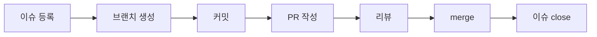

# 기여 규칙

팀 협업은 정기 온라인 회의 대신 GitHub 이슈와 PR 중심의 비동기 방식으로 진행한다. 커밋 로그와 기여자 식별이 평가 요소이므로 모든 작업은 아래 흐름을 따른다.

## 작업 흐름

- 작업을 시작하기 전에 이슈를 먼저 등록한다. 지금 무엇을 하고 있는지 이슈로 보이게 한다.
- `master`에 직접 push하지 않는다. 모든 변경은 PR로 올린다.
- PR 본문에 `Closes #<이슈 번호>`를 적어 merge 시 이슈가 자동으로 닫히게 한다.

## 이슈

포함 항목 (`Document/cyber_boardgame_documentation_spec.md` 26장):

- Title
- Owner (assignee)
- Backup
- Deadline
- Dependency
- Module
- Requirement
- Acceptance Criteria
- Status

- 다른 팀원이 해야 할 작업을 발견하면 그 팀원을 assignee로 지정해 이슈를 만들어 넘긴다.
- 막힌 점, 필요한 것도 이슈로 올린다.

## 마일스톤

- 마일스톤마다 기간(due date)과 완료 기준을 적는다.
- 이슈는 해당 마일스톤에 연결한다.
- 주차별 일정은 `Document/roadmap.md`를 따른다.

## 레이블

- GitHub 기본 레이블(`bug`, `documentation` 등)을 사용한다.

## PR

포함 항목 (문서화 명세서 26장):

- Related Issue
- Implementation Summary: 무엇을 개발했는지 알 수 있게 적는다
- Affected Requirements
- Affected Contracts
- Test Result
- Documentation Change
- Reviewer

- 리뷰어는 작성자 외 1명이다. 인증·스키마·공통 계약 변경은 B를 리뷰어로 추가한다 (`Document/roadmap.md` 2장).
- Schema, Contract, Auth, Game State가 바뀌면 관련 문서도 같은 PR에서 수정한다.
- 실제 테스트 실행 결과는 PR의 `Test Result`에 실행 명령·검증한 커밋·환경·통과/실패 결과와 함께 기록한다. 미실행 항목은 별도로 표시한다.

## API 상태 코드

- 모든 API endpoint는 발생할 수 있는 모든 상황(성공, 검증 실패, 인증, 권한, 없음, 충돌, rate limit, 서버/DB 장애 등)에 맞는 HTTP 상태 코드를 반환한다.
- 가능한 모든 상태 코드를 route의 `schema.response`에 선언해 Swagger(`/docs`)에 보이게 한다.
- endpoint별 상태 코드를 `Document/contracts.md`에도 기록한다.

## GitHub Projects

- 이슈를 등록하면 Projects에 자동으로 올라간다. Projects를 따로 관리하지 않는다.

## 문서

작성 규칙은 문서화 명세서(`Document/cyber_boardgame_documentation_spec.md`) 5장을 따른다.

1. 담당자 한 명이 초안을 작성하고 `documentation` 레이블을 단 이슈로 공유한다.
2. 팀원이 이슈에서 피드백한다.
3. 반영이 끝나면 PR로 merge하고 이슈를 close한다.
4. merge된 문서는 Notion에도 올린다. 공유는 GitHub, 열람은 Notion에서 한다 (문서화 명세서 5장).
