# SDS v0.1 (초안)

사이버 보드게임 카페의 Software Design Specification. SRS가 정한 요구사항을 **어떻게 구현하는가**를 기술한다. 구성은 IEEE 1016-2009와 문서화 명세 10장을 따른다.

## 0. Frontmatter

| 항목 | 내용 |
|---|---|
| 작성일 | 2026-10-13 |
| 상태 | 초안. B 담당 영역은 구현 기준으로 작성했고, 나머지는 담당자가 채운다. 팀 승인 전이다. |
| 범위 | 오목·오델로 2인 1:1 웹 플랫폼 (SRS v0.3.1의 16점 후보) |
| 작성 | B (yunhpark) |
| 기술 검토 | C, D, E (문서화 명세 32장) |
| 참조 | [SRS v0.3.1 (Draft PR #4)](https://github.com/EscapeFromGyeongsan/ft_transcendence/pull/4), [GAME_RULES.md](GAME_RULES.md), [공통 게임 계약 (Draft PR #6)](https://github.com/EscapeFromGyeongsan/ft_transcendence/pull/6), [오목 엔진 (Draft PR #9)](https://github.com/EscapeFromGyeongsan/ft_transcendence/pull/9), [전체 앱 컨테이너 (PR #10)](https://github.com/EscapeFromGyeongsan/ft_transcendence/pull/10) |
| 구현 기준 브랜치 | `feat/server-auth-persistence` ([PR #11](https://github.com/EscapeFromGyeongsan/ft_transcendence/pull/11)). migration `0000`~`0003` |
| 기준 커밋 | SRS: `codex/srs-draft` `349e9e4` (v0.3.1) / 공통 계약: PR #6 `1a33f3c` / 구현: PR #11 `b30b7f2` |

### 상태 표시

| 표시 | 의미 |
|---|---|
| `구현됨` | 코드와 테스트가 있고 실제 PostgreSQL에서 통과 (문서화 명세 34장의 "구현됨"과 달리 비작성자 재현·통합 전) |
| `계획` | 설계만 있고 코드 없음 |
| `미정` | 팀 결정 필요 |

### 용어

| 용어 | 뜻 |
|---|---|
| match / 경기 | 한 판. DB `games` 한 행. 외부 계약 이름은 `matchId` |
| command | 경기 상태를 바꾸려는 클라이언트 요청 (착수, 기권 등). `commandId`로 식별 |
| stateVersion | 서버가 확정한 경기 상태 번호. 명령이 적용될 때마다 +1 |
| session | 로그인 1회로 생기는 서버 세션. 폐기하면 그 세션의 토큰이 모두 무효 |
| challenge | 2FA 계정 로그인의 두 번째 단계를 위한 1회용 토큰 |

### 변경 이력

| 버전 | 날짜 | 내용 |
|---|---|---|
| 0.1 | 2026-10-13 | 초안. B 구현(인증·2FA·OAuth·프로필·경기 저장·통계) 반영, 전체 다이어그램 작성. 기능별 모든 분기 흐름(2.10) 추가. Codex 코드 리뷰 15건 수정분과 SDS 누락 분석 반영: B 계획 기능(아바타·전적 공개·탈퇴·시스템 종료) 설계, 테스트 대응표, 담당자별 작성 필요 항목 |

---

## 1. Design stakeholders and concerns

| 이해관계자 | 주요 관심사 | 관련 절 |
|---|---|---|
| A (UI/UX, 문서 취합) | 화면 흐름, API 요청·응답 형식, 오류 표시 | 2.2, 2.5 |
| B (Tech Lead) | 인증·세션, 스키마·트랜잭션, 중복 명령·버전 충돌, 결과 1회 확정, 통계 | 2.4, 2.6, 2.8 |
| C (게임) | 게임 규칙과 플랫폼의 경계, 규칙 확장(CON-04) | 2.2, 2.7 |
| D (플랫폼) | 매칭·방, WebSocket, 명령 순서, commit 후 broadcast, 재접속 | 2.5, 2.6, 2.7 |
| E (실행 환경·소셜) | 컨테이너·HTTPS·환경 변수, 친구 | 2.9 |
| 평가자 | 필수 요구(HTTPS, 비밀번호 해시, 입력 검증), 모듈별 증거 | 1.1, 4 |

### 1.1 Security design (명세 15번)

보안은 독립 view가 아니라 관심사로 두고, 관련 view에서 다룬다.

| 위협·요구 | 설계 | 상태 | 관련 요구 |
|---|---|---|---|
| 비밀번호 유출 | Argon2id (19 MiB, 2회, 병렬도 1). 해시만 저장. 모르는 email도 같은 검증 시간을 거쳐 가입 여부가 드러나지 않음 | `구현됨` | NFR-SEC-02 |
| 토큰 위조 | JWT HS256, 헤더를 고정값으로만 허용 (`alg: none`·알고리즘 바꿔치기 거절) | `구현됨` | FR-AUTH-03 |
| 로그아웃 후 토큰 재사용 | 모든 보호 요청에서 서버 세션의 소유자·만료·폐기를 DB로 확인 | `구현됨` | FR-AUTH-03, 07 |
| refresh token 탈취 | 해시만 저장, 사용할 때마다 교체. 이미 교체된 token이 다시 오면 세션 전체 폐기 | `구현됨` | FR-AUTH-07 |
| 무차별 대입 | 가입·로그인·갱신·2FA·OAuth callback에 IP당 분당 10회 제한(429). 2FA challenge는 5회 실패 시 폐기. 프록시 뒤에서는 `TRUST_PROXY`로 지정한 프록시의 `X-Forwarded-For`만 믿어 실제 클라이언트 IP로 집계 | `구현됨` | NFR-SEC-05 |
| 2FA 비밀값 유출 | TOTP secret을 AES-256-GCM으로 암호화 저장. 키는 `TWO_FACTOR_KEY`에서 HKDF로 파생 | `구현됨` | DATA-05 |
| OAuth 응답 위조·재사용·login CSRF | `state`를 해시로 저장, 10분·1회용. 시작 응답의 `flowToken`(브라우저 sessionStorage 보관)이 callback에서 일치해야 함(RFC 9700 4.7.1). 연결(link)은 시작한 세션이 callback 시점에도 살아 있어야 함. 같은 email이라는 이유로 기존 계정을 자동 연결하지 않음 | `구현됨` | FR-AUTH-05 |
| 타인 권한 행사 | 사용자는 항상 토큰으로 식별. 경기 명령은 참가자 확인 후 처리 | `구현됨` | FR-AUTH-04 |
| 개인정보 노출 | 공개 프로필에 email 제외. 오류 응답에 SQL·연결 문자열·스택 미포함 | `구현됨` | DATA-05 |
| 입력 검증 | 모든 route에 JSON Schema. 실패 시 422, 잘못된 JSON 400, 1 MiB 초과 413, JSON 아닌 본문 415. 숫자 ID는 `Number.MAX_SAFE_INTEGER` 이하만 허용 | `구현됨` | NFR-SEC-03 |
| 로그 개인정보 | Fastify logger는 기본 꺼짐(`index.ts`에서 logger 미설정). 켤 경우 기본 serializer는 method·url·host·원격 주소만 기록하고 header·body는 기록하지 않는다. 오류 처리기는 DB 장애·42 장애를 고정 문구로만 기록한다. logger를 켤 때 `authorization`, `refreshToken`, `password`, `code`, `challengeToken`, `flowToken`을 redact 대상으로 지정한다 | logger 꺼짐 `구현됨`, redact `계획` | DATA-05 |
| CSRF | access token을 cookie가 아닌 `Authorization` 헤더로 전달하므로 cookie 기반 CSRF 대상 아님. refresh token을 cookie로 바꾸면 재검토 | `미정` (A와 전달 방식 합의) | NFR-SEC-05 |
| 전송 구간 | Nginx에서 HTTPS 종료, HTTP는 308로 HTTPS 이동 | `계획` (PR #10) | NFR-SEC-01 |
| DB 노출 | DB는 내부 네트워크(`data`, internal)에만 연결. 호스트 포트 미공개 | `계획` (PR #10) | NFR-SEC-04 |

---

## 2. Design views

### 2.1 Context viewpoint

#### 1. System architecture

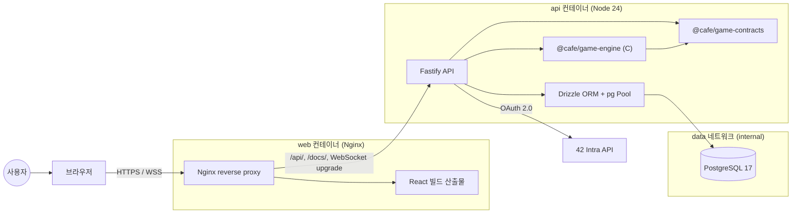

- 게임 상태의 기준은 서버다(server-authoritative). 클라이언트는 명령만 보내고, 서버가 검증·저장한 상태를 받는다.
- 게임 엔진은 별도 서비스가 아니라 API 프로세스 안의 라이브러리다(SRS: 마이크로서비스 불필요).
- 컨테이너 구성은 PR #10 기준이며 병합 전이다.

#### Use case diagram

Mermaid에 use case 전용 문법이 없어 flowchart로 표현한다. SRS v0.3.1 범위 기준이며 채팅은 후속 범위라 제외했다.

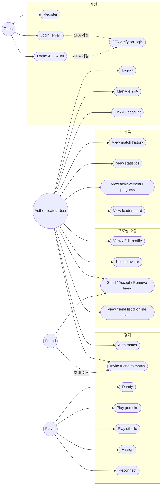

| Use case | 담당 | 상태 |
|---|---|---|
| Register, Login(email), Logout, 2FA, 42 OAuth, Link 42 | B | `구현됨` (API) |
| View/Edit profile | B (API), A (UI) | `구현됨` (닉네임 변경·공개 프로필 API) |
| Upload avatar | B (API), A (UI) | `계획` (10/24) |
| Friend, online status | E (+ D 연결 상태) | `계획` |
| Auto match, Invite, Ready, Reconnect | D | `계획` |
| Play gomoku / othello, Resign | C (규칙), D (실행), B (저장) | 저장 `구현됨`, 규칙 일부(PR #9), 실행 `계획` |
| History, statistics, achievement, leaderboard | B (API), A (UI) | `구현됨` (API) |

---

### 2.2 Composition viewpoint

#### 2. Frontend architecture (A)

`계획`. 현재 `apps/web`은 React + Vite 골격(`App.tsx`, `main.tsx`)만 있다. 아래는 API 계약에 맞춘 최소 구조 제안이며 A가 확정한다.

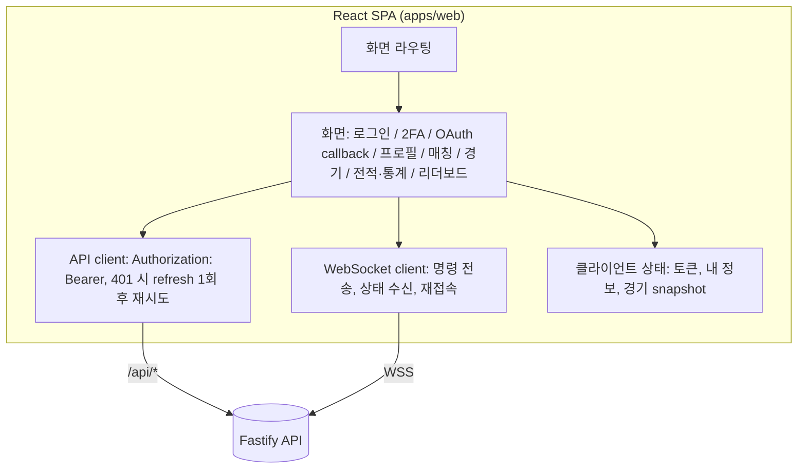

- OAuth: 시작 응답의 `flowToken`을 sessionStorage에 보관한다. 42가 redirect하는 web 페이지(`FT_OAUTH_REDIRECT_URI`)가 `code`, `state`를 받아 보관한 `flowToken`과 함께 `POST /api/auth/oauth/42/callback`으로 보낸다. 다른 탭·브라우저로 열린 callback은 실패한다.
- 2FA: 로그인 응답에 `twoFactorRequired`가 있으면 코드 입력 화면으로 보내고 `POST /api/auth/2fa/verify`를 호출한다.
- 승률은 `played`가 0이면 `-`로 표시한다(DEC-08).

#### 3. Backend architecture (B)

`구현됨`. 디렉터리와 책임은 다음과 같다.

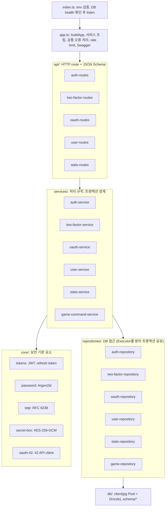

규칙:

- route는 검증·응답 형식만 담당하고, 처리 규칙은 service, SQL은 repository에 둔다.
- 하나의 처리에 참여하는 repository 호출은 같은 `Executor`(트랜잭션)를 받는다. 일부만 저장되는 일이 없다.
- 서비스는 `buildApp`에서 한 번 만든다. DB나 설정이 없으면 해당 route는 503을 반환한다(`ServiceUnavailableError`).
- 공통 오류 처리: 검증 422, JSON 오류 400, Content-Type 415, rate limit 429, 42 장애 502, DB 연결 장애 503, 그 외 500. 응답 형식은 `{ "error": { "code", "message", "details?" } }`.

#### 4. Domain boundary (플랫폼 경계, 명세 12장)

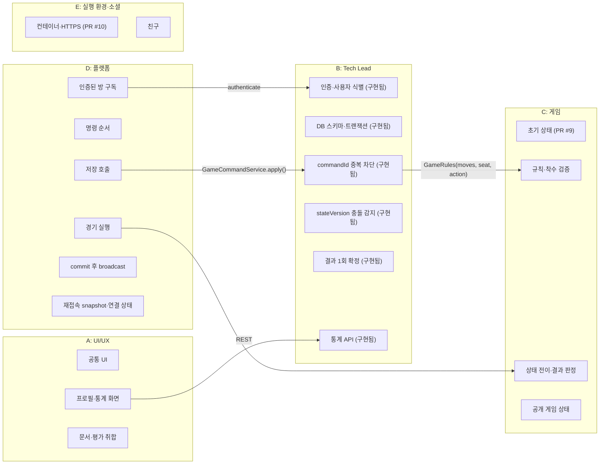

경계 규칙 (CON-04):

- 게임 규칙(C)은 `GameRules` 함수 하나와 규칙 버전(`{ version, rules }`)으로 플랫폼에 연결한다. 입력은 지금까지의 착수 목록·두는 사람·행동, 출력은 거절 코드 또는 다음 차례·종료 결과다.
- 잠금·버전·중복·저장(B)과 전송(D)은 게임 종류와 무관하다. 금수 같은 규칙을 추가해도 인증·방·전송·저장 코드는 바뀌지 않는다.
- 게임 추가 시 `gameType` 값, `GameRules` 구현, 계약 타입(PR #6 절차)만 추가한다. DB의 `games_game_type_check`에 값을 더하는 migration이 함께 필요하다.

---

### 2.3 Logical viewpoint

#### 6. Class design

TypeScript 모듈을 클래스처럼 표시했다. 핵심 관계만 넣고 DTO·유틸리티는 뺐다. `<<planned>>`는 아직 코드가 없는 D 모듈, `<<engine>>`은 C의 게임 엔진(PR #9)이다.

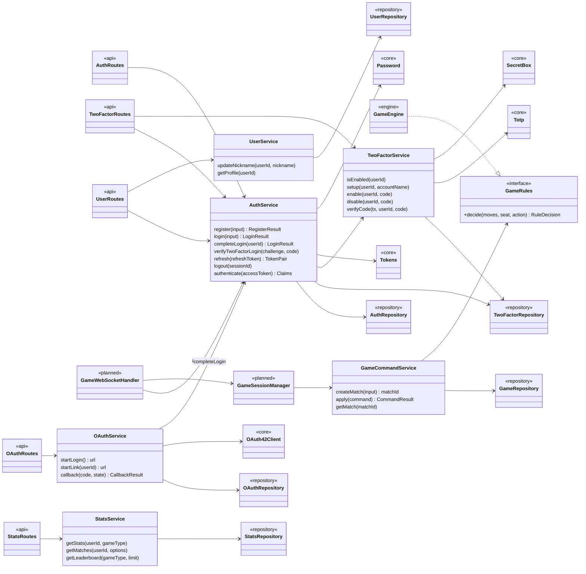

---

### 2.4 Information viewpoint

#### 5. Database design

`구현됨` (migration `0000_connection_probe`, `0001_auth_and_games`, `0002_oauth_and_two_factor`, `0003_tighten_results_and_oauth_state`). Drizzle 스키마는 `apps/server/src/db/schema/`.

```mermaid
erDiagram
    users ||--o{ sessions : "logs in"
    sessions ||--o{ refresh_tokens : "rotates"
    users ||--o{ oauth_accounts : "links"
    users |o--o{ oauth_states : "starts link"
    sessions |o--o{ oauth_states : "link started by"
    users ||--o| two_factor_secrets : "has"
    users ||--o{ two_factor_recovery_codes : "has"
    users ||--o{ two_factor_challenges : "pending login"
    users ||--o{ game_players : "plays"
    games ||--|{ game_players : "has 2"
    games ||--o{ moves : "history"
    users ||--o{ moves : "places"
    games ||--o{ game_commands : "receives"
    users ||--o{ game_commands : "issues"
    users |o--o{ games : "wins"

    users {
        bigint id PK "identity"
        varchar_254 email UK "NOT NULL, 소문자 저장"
        text password_hash "NULL = OAuth 전용 계정"
        varchar_32 nickname UK "NOT NULL"
        text avatar_url "NULL"
        timestamptz created_at "NOT NULL"
        timestamptz updated_at "NOT NULL"
    }
    sessions {
        uuid id PK "gen_random_uuid()"
        bigint user_id FK "NOT NULL, cascade"
        timestamptz created_at "NOT NULL"
        timestamptz expires_at "NOT NULL, 로그인 후 7일"
        timestamptz revoked_at "NULL"
    }
    refresh_tokens {
        bigint id PK
        uuid session_id FK "NOT NULL, cascade"
        text token_hash UK "SHA-256"
        timestamptz expires_at "NOT NULL"
        timestamptz used_at "NULL = 아직 교체 전"
        timestamptz created_at "NOT NULL"
    }
    oauth_accounts {
        bigint id PK
        bigint user_id FK "NOT NULL, cascade"
        text provider "NOT NULL, 42"
        text provider_user_id "NOT NULL"
        timestamptz created_at "NOT NULL"
    }
    oauth_states {
        text state_hash PK "SHA-256"
        text provider "NOT NULL"
        text mode "login | link"
        bigint user_id FK "NULL, link일 때만"
        uuid session_id FK "NULL, link일 때만, cascade"
        text browser_hash "NOT NULL, flowToken의 SHA-256"
        timestamptz expires_at "NOT NULL, 10분"
        timestamptz used_at "NULL"
        timestamptz created_at "NOT NULL"
    }
    two_factor_secrets {
        bigint user_id PK,FK "cascade"
        text secret_encrypted "AES-256-GCM"
        timestamptz enabled_at "NULL = 설정 중"
        integer last_used_step "NULL, 재사용 차단"
        timestamptz created_at "NOT NULL"
    }
    two_factor_recovery_codes {
        bigint id PK
        bigint user_id FK "NOT NULL, cascade"
        text code_hash UK "SHA-256"
        timestamptz used_at "NULL"
    }
    two_factor_challenges {
        uuid id PK
        bigint user_id FK "NOT NULL, cascade"
        text token_hash UK "SHA-256"
        timestamptz expires_at "NOT NULL, 5분"
        timestamptz used_at "NULL"
        integer failed_attempts "NOT NULL DEFAULT 0"
        timestamptz created_at "NOT NULL"
    }
    games {
        bigint id PK "외부 matchId"
        text game_type "gomoku | othello"
        text rules_version "NOT NULL"
        text status "waiting | playing | paused | finished"
        integer state_version "NOT NULL DEFAULT 0"
        text current_turn "NULL | black | white"
        text outcome "NULL | win | draw | void"
        text result_reason "NULL"
        bigint winner_user_id FK "NULL"
        timestamptz created_at "NOT NULL"
        timestamptz started_at "NULL"
        timestamptz finished_at "NULL"
        timestamptz updated_at "NOT NULL"
    }
    game_players {
        bigint id PK
        bigint game_id FK "NOT NULL, cascade"
        bigint user_id FK "NOT NULL"
        text seat "black | white"
        text result "NULL | win | loss | draw | void"
        timestamptz joined_at "NOT NULL"
        timestamptz disconnected_at "NULL"
    }
    moves {
        bigint id PK
        bigint game_id FK "NOT NULL, cascade"
        bigint user_id FK "NOT NULL"
        integer turn_number "NOT NULL, >= 1"
        smallint row_idx "0..14"
        smallint col_idx "0..14"
        text stone "black | white"
        timestamptz created_at "NOT NULL"
    }
    game_commands {
        bigint id PK
        bigint game_id FK "NOT NULL, cascade"
        bigint user_id FK "NOT NULL"
        uuid command_id "NOT NULL"
        text command_type "place | resign"
        integer expected_version "NOT NULL"
        integer applied_version "applied일 때만"
        text status "applied | rejected"
        text reject_code "rejected일 때만"
        timestamptz created_at "NOT NULL"
    }
```

제약조건:

| 테이블 | 제약 | 목적 |
|---|---|---|
| users | `UNIQUE(email)`, `UNIQUE(nickname)` | 동시 가입·닉네임 변경 경합에서도 중복 방지 (FR-AUTH-01, FR-PRO-01) |
| refresh_tokens | `UNIQUE(token_hash)` | token 조회·중복 방지 |
| oauth_accounts | `UNIQUE(provider, provider_user_id)`, `UNIQUE(user_id, provider)` | 42 계정 하나는 한 사용자에만, 사용자당 42 연결 하나 |
| oauth_states | `CHECK(mode='login' AND user_id, session_id 모두 NULL OR mode='link' AND 둘 다 NOT NULL)` | link는 시작한 사용자와 세션을 반드시 기록 |
| games | `CHECK` game_type, status, current_turn, outcome 값 | 계약 값만 저장 |
| games | `CHECK(status='finished' AND outcome, result_reason, finished_at 모두 NOT NULL OR status<>'finished' AND outcome, result_reason, finished_at, winner_user_id 모두 NULL)` | 종료와 결과가 함께만 존재. 진행 중 경기에 부분 결과 불가 |
| games | `CHECK(outcome='win' AND winner NOT NULL OR outcome IS DISTINCT FROM 'win' AND winner NULL)` | 승리일 때만 승자 (outcome NULL이어도 판정) |
| game_players | `UNIQUE(game_id, user_id)`, `UNIQUE(game_id, seat)` | 한 경기에 같은 사람·같은 좌석 중복 금지 |
| moves | `UNIQUE(game_id, turn_number)`, `UNIQUE(game_id, row_idx, col_idx)`, 좌표 `CHECK 0..14` | 같은 수·같은 칸 중복 착수를 DB에서도 차단 |
| game_commands | `UNIQUE(game_id, command_id)` | 같은 명령 두 번 적용 차단 |
| game_commands | `CHECK(applied ⇔ applied_version NOT NULL, rejected ⇔ reject_code NOT NULL)` | 처리 결과 형식 고정 |

Index: `sessions(user_id)`, `refresh_tokens(session_id)`, `game_players(user_id, result)`(통계), `two_factor_recovery_codes(user_id)`, `two_factor_challenges(user_id)`.

설계 결정:

- **enum 대신 text + CHECK**: 값 추가가 단순한 migration으로 끝난다. 값은 `@cafe/game-contracts`와 같다.
- **board를 저장하지 않음**: `moves`가 기준 기록이고 board는 엔진으로 재생해 만든다. 오목 최대 225수라 재생 비용이 작다.
- **통계 테이블 없음**: 승·패·승률·진행도·순위는 `game_players` + `games`로 계산한다(2.4의 14번). 업적(첫 승, 10경기 진행도, DEC-08)도 계산하고 테이블은 두지 않는다.
- **세션과 refresh token 분리**: 세션 ID는 로그인 동안 고정되고 token만 교체된다.
- **소셜 테이블**: `friendships`(E)는 `계획`. 채팅 테이블은 후속 범위라 만들지 않는다.
- migration은 Drizzle Kit으로 생성하고 SQL을 검토한 뒤 적용한다. 공유된 migration은 수정하지 않고 수정 migration을 추가한다.

#### 계획 스키마 (구현 전)

아래는 SRS가 요구하지만 아직 migration이 없는 부분이다. B 계획 기능(2.10.25~28)과 E의 친구 기능에 필요하다.

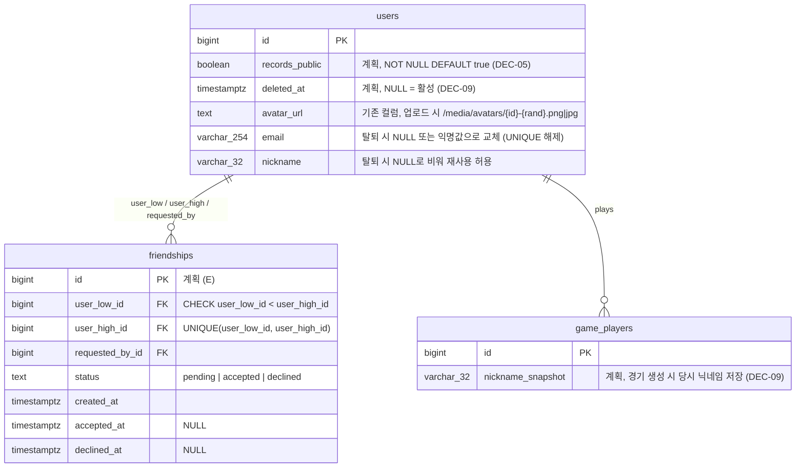

| 계획 변경 | 이유 | 담당 | 상태 |
|---|---|---|---|
| `users.records_public` | 전적 공개 설정 (FR-PRO-04) | B | `계획` |
| `users.deleted_at`, email·nickname nullable 전환 | 탈퇴 후 닉네임 재사용과 경기 기록 보존 (DATA-01~05, DEC-09) | B | `계획` (DEC-09 확정 후) |
| `game_players.nickname_snapshot` | 경기 당시 닉네임 표시. 전적 조회는 이 값을 우선 사용 | B | `계획` |
| `friendships` | 친구 요청·수락 (FR-SOC-01~03). 제안 규칙: 거절 시 행을 지우지 않고 `declined`로 남김, 거절당한 요청자의 재요청은 차단, 거절한 쪽의 요청은 허용, 친구 삭제는 행 삭제 후 재요청 허용 | E (스키마 리뷰 B) | `계획` |

#### 14. Statistics design

`구현됨`. 게임별로 독립 집계한다(DEC-08).

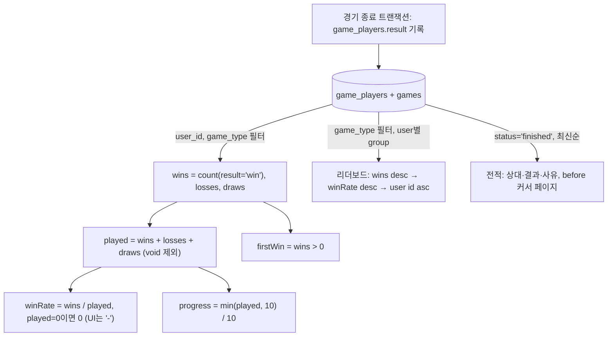

- 진행 중 경기는 `result`가 NULL이라 자동 제외된다.
- 리더보드는 무효를 제외한 완료 경기가 1경기 이상인 사용자만 포함한다. 순위는 `row_number()`로 동률 없이 매긴다.
- 미정: 전적 비공개(DEC-05), 탈퇴 사용자 표시(DEC-09). 경기 당시 닉네임 스냅샷 컬럼은 DEC-09 확정 후 추가한다.

---

### 2.5 Interface viewpoint

#### 8. API contract

상세 요청·응답·상태 코드는 이 문서 2.10(기능별 처리 흐름)과 Swagger(`/docs`)가 기준이다. 모든 route는 가능한 상태 코드를 `schema.response`에 선언했다. 게임 명령·snapshot·결과 타입은 [공통 게임 계약 (PR #6)](https://github.com/EscapeFromGyeongsan/ft_transcendence/pull/6)의 contracts.md를 따른다.

| 영역 | Endpoint | 담당 | 상태 |
|---|---|---|---|
| Health | `GET /api/health`, `GET /api/health/db` | B | `구현됨` |
| Auth | `POST /api/auth/register`, `login`, `refresh`, `logout` | B | `구현됨` |
| 2FA | `GET /api/auth/2fa`, `POST /api/auth/2fa/setup`, `enable`, `disable`, `verify` | B | `구현됨` |
| OAuth | `POST /api/auth/oauth/42/login`, `link`, `callback` | B | `구현됨` |
| Users | `GET /api/users/me`, `PATCH /api/users/me`, `GET /api/users/{userId}` | B | `구현됨` |
| Avatar | `PUT /api/users/me/avatar`, `DELETE /api/users/me/avatar` (2.10.25) | B | `계획` |
| 전적 공개 설정 | `PATCH /api/users/me`의 `recordsPublic`, stats·matches의 403 (2.10.26) | B | `계획` |
| 탈퇴 | `DELETE /api/users/me` (2.10.27) | B | `계획` |
| Statistics | `GET /api/users/{userId}/stats`, `GET /api/users/{userId}/matches`, `GET /api/leaderboard` | B | `구현됨` |
| 매칭·초대·방 | 미정 | D | `계획` |
| 친구 | 미정 | E | `계획` |

#### 9. WebSocket contract (D)

`계획`. 이벤트 목록은 문서화 명세 19장을 따른다. 아래는 B 구현과 연결되는 부분이다.

| 방향 | 이벤트 | 서버 처리 | B 연결 지점 |
|---|---|---|---|
| C→S | 연결 | JWT 검증 + 서버 세션 확인 후 `userId` 바인딩 | `AuthService.authenticate()` |
| C→S | `SUBSCRIBE_ROOM` | 참가자인지 확인 | `GameCommandService.getMatch()` |
| C→S | `PLACE_STONE`, `RESIGN` | 명령 처리 | `GameCommandService.apply()` |
| C→S | `RECONNECT` | snapshot 재전송 | `getMatch()` + 엔진 재생 |
| S→C | `STONE_PLACED`, `GAME_FINISHED` | **commit 후** broadcast | `apply()` 결과 |
| S→C | `ERROR` | 거절 코드 전달 | `CommandResult.code` |

미정: 토큰 전달 방식(첫 메시지 AUTH 권장, query string은 로그에 남음), 세션 폐기 시 기존 연결 처리, heartbeat·감지 지연.

---

### 2.6 Interaction viewpoint

#### 11. Authentication design

`구현됨`. 공통 원칙:

- access token: JWT HS256, 30분, claim `sub`(userId), `sid`(sessionId).
- refresh token: 32바이트 난수 opaque, 해시만 저장, 세션 만료(로그인 후 7일)까지. 갱신해도 세션 만료는 늘지 않는다.
- 보호 요청: JWT 검증 + `sessions`에서 소유자·만료·폐기 확인. 인증 확인은 `onRequest`라 본문 검증보다 먼저다.
- 2FA 계정은 비밀번호·42 로그인 모두 `completeLogin()`을 거쳐 challenge를 받는다.

로그인 (2FA 없음 / 있음):

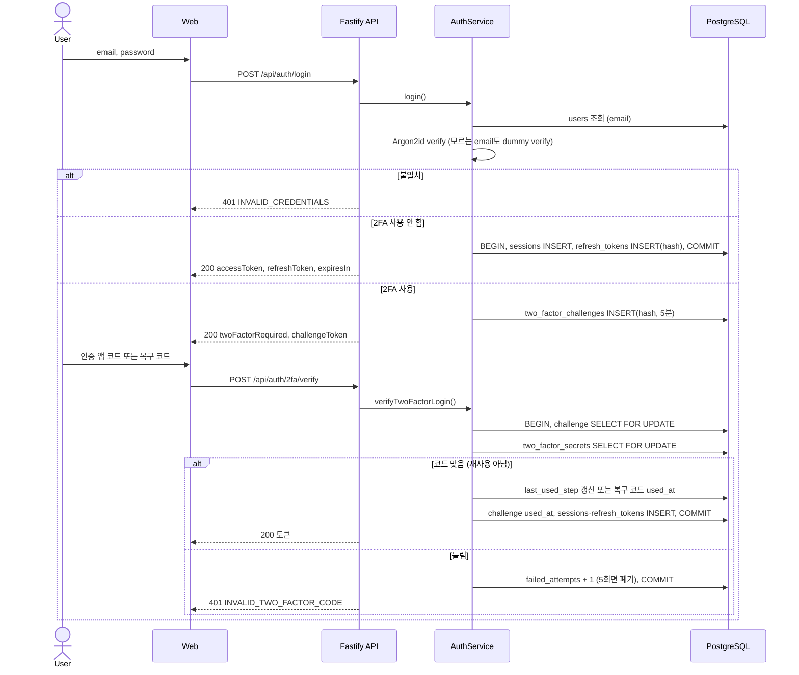

refresh token 교체와 재사용 탐지:

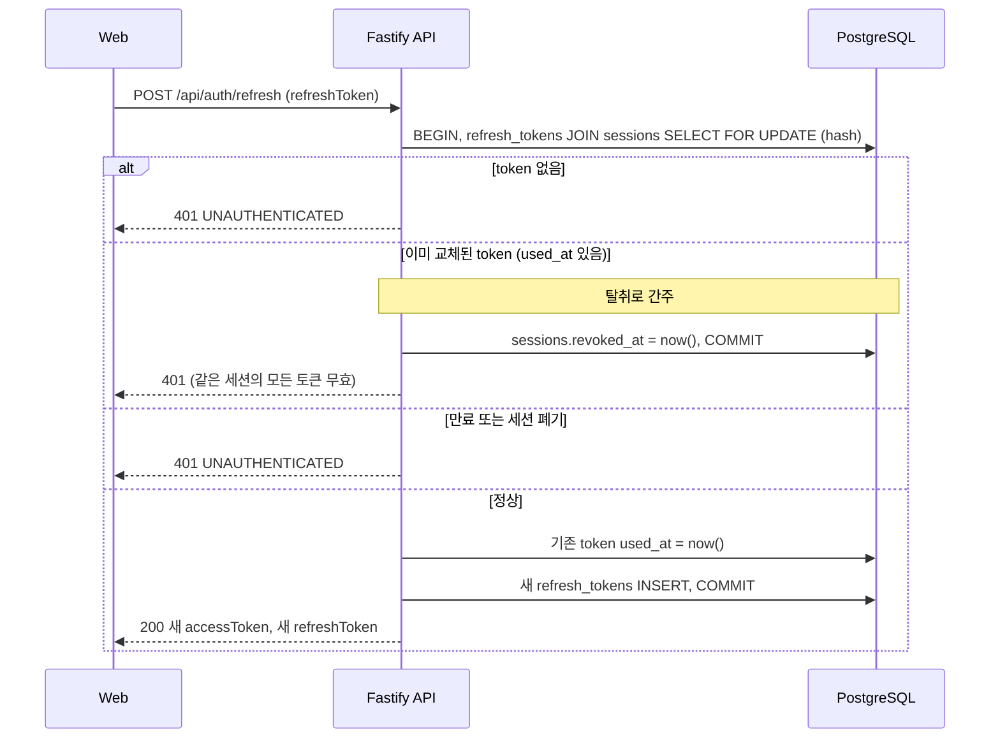

로그아웃과 보호 요청:

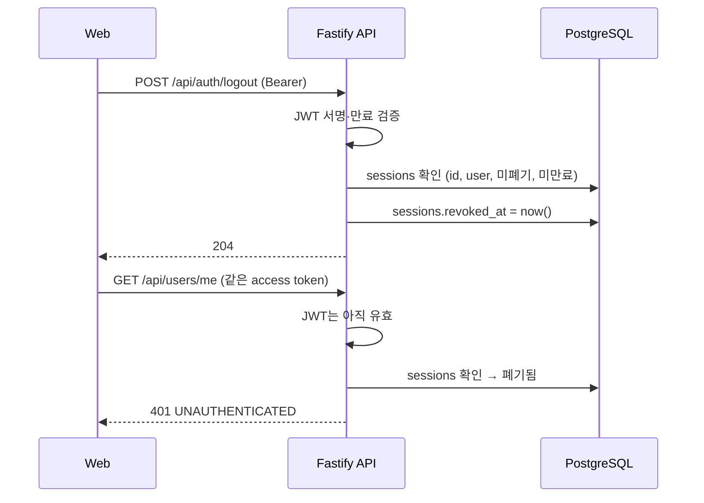

2FA 설정:

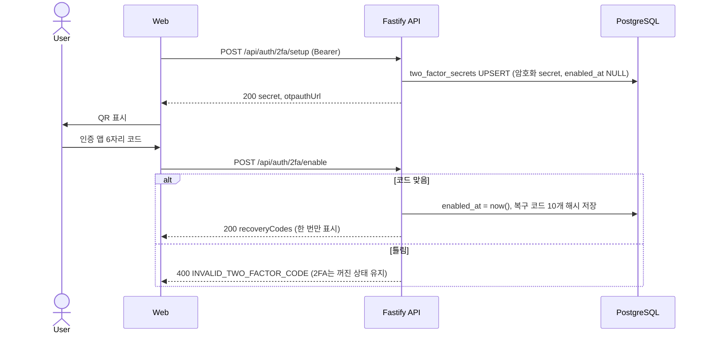

42 OAuth (로그인 / 연결):

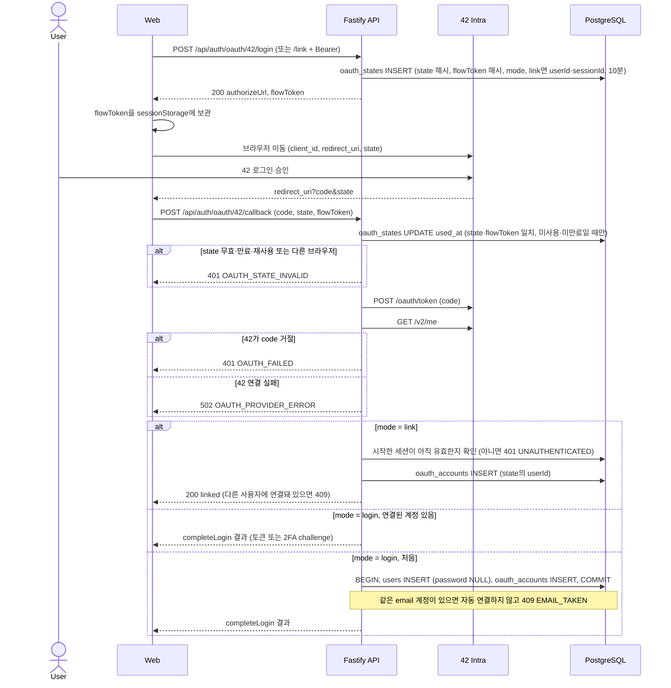

#### 정상 착수 (move sequence)

API 내부(`GameCommandService.apply`)는 `구현됨`, WebSocket 처리(D)와 엔진 연결(C)은 `계획`.

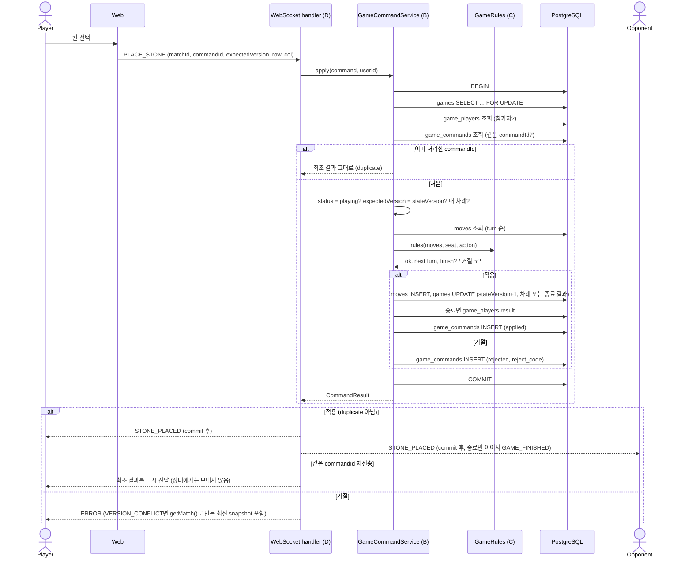

전송 순서(D 구현 시 지킬 것): 같은 경기의 broadcast는 commit 순서(= stateVersion 순서)로 보낸다. 종료 착수는 `STONE_PLACED` 다음 `GAME_FINISHED`. 재접속 snapshot의 `stateVersion`보다 작거나 같은 이벤트는 클라이언트가 버린다.

처리 원칙:

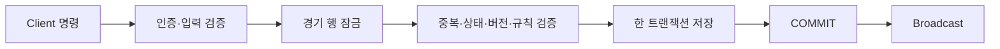

#### 13. Reconnection design (D)

`계획`. DEC-03(사용자별 경기 내 누적 이탈 60초)과 DEC-07(재시작 시 미완료 경기 무효)을 따른다.

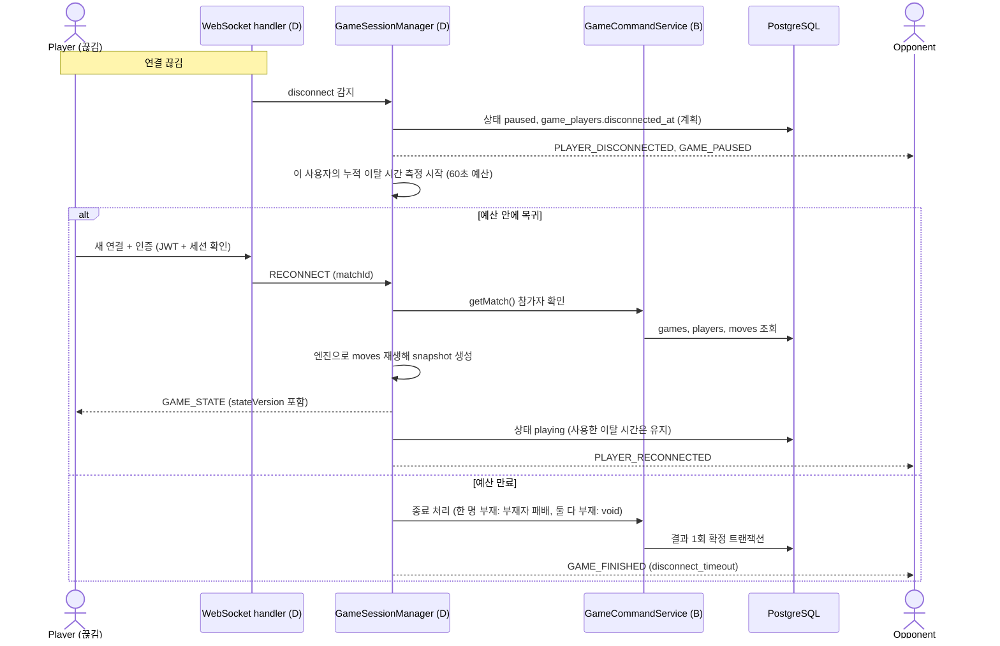

- 종료 경로도 착수와 같은 경기 행 잠금을 쓴다. 이탈 만료와 마지막 착수가 겹쳐도 결과는 하나만 확정된다.
- 미정: 감지 방식·최대 지연, 누적 시간을 DB에 둘지 메모리에 둘지(서버 재시작 시 어차피 무효), 기기 전환 처리.

---

### 2.7 State dynamics viewpoint

#### 7. Game FSM

DB와 계약의 상태 값은 `waiting`, `playing`, `paused`, `finished`다. 명세 16장의 `READY`는 별도 상태가 아니라 `waiting` 안의 준비 조건으로 다룬다(PR #6 `GameStatus`). 무효(`void`)는 `finished`의 결과 값이다.

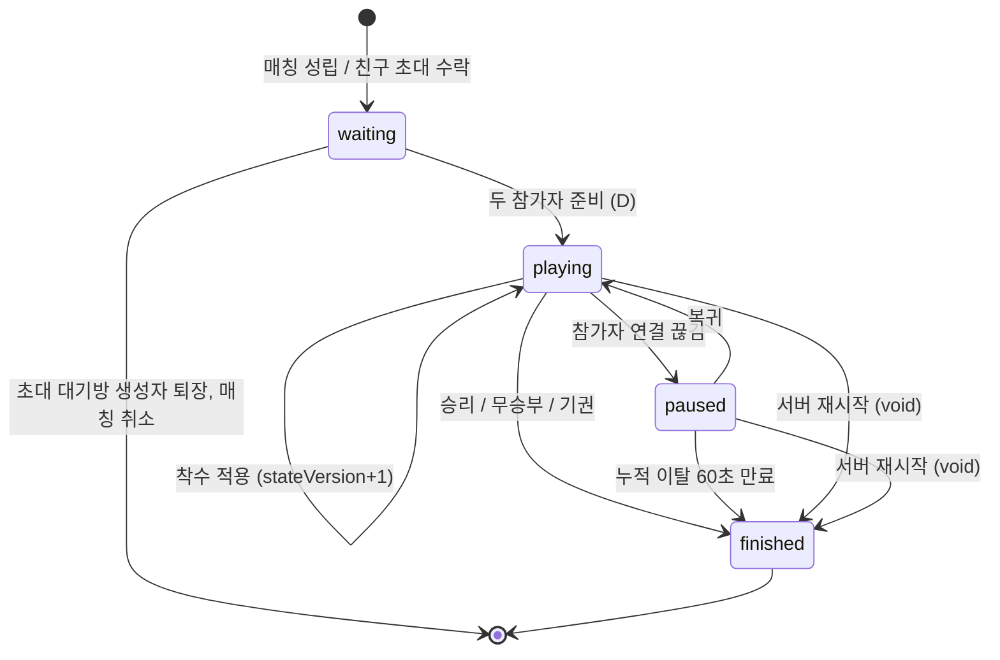

| 현재 | 이벤트 | 조건 | 다음 | 서버 동작 | 저장 | Broadcast | 상태 |
|---|---|---|---|---|---|---|---|
| (없음) | 매칭 성립 | 두 사용자 모두 활성 참가 위치 없음 | waiting 또는 playing | 경기 생성, 좌석 배정 | games, game_players INSERT | GAME_STARTED / ROOM_STATE | `구현됨`: `createMatch()`는 바로 playing (준비 단계는 D) |
| waiting | 준비 완료 | 두 명 모두 준비 | playing | 흑 차례로 시작 | status, started_at | GAME_STARTED | `계획` (D) |
| waiting | 초대 대기방 생성자 퇴장, 매칭 취소 | 아직 시작 전 | (종료, 경기 아님) | 참가 위치 해제, 초대 무효화 | 대기 경기 행 삭제 또는 취소 표시 (D와 결정) | ROOM_STATE (남은 사람), 초대 취소 알림 | `계획` (D) |
| playing | PLACE_STONE | 참가자, 내 차례, 버전 일치, 규칙 통과 | playing | 착수 반영, 차례 전환 | moves, games, game_commands | STONE_PLACED | `구현됨` (전송은 D) |
| playing | PLACE_STONE | 위 조건 + 규칙상 종료 | finished | 결과 확정 | + outcome, reason, winner, finished_at, game_players.result | STONE_PLACED, GAME_FINISHED | `구현됨` |
| playing | 거절되는 명령 | 버전 불일치, 차례 아님, 규칙 위반 | playing | 거절 코드 반환 | game_commands (rejected) | ERROR (요청자만) | `구현됨` |
| playing | RESIGN | 참가자, 버전 일치 | finished | 상대 승리 (`resign`) | 결과 확정 | GAME_FINISHED | `구현됨` |
| playing | 연결 끊김 | 참가자 연결 0개 | paused | 이탈 시간 측정 | status, disconnected_at | PLAYER_DISCONNECTED, GAME_PAUSED | `계획` (D) |
| paused | 복귀 | 예산 남음, 인증·참가자 확인 | playing | snapshot 재전송 | status | PLAYER_RECONNECTED, GAME_STATE | `계획` (D) |
| paused | 예산 만료 | 누적 60초 | finished | 한 명 부재: 상대 승리 / 둘 다: void | 결과 확정 | GAME_FINISHED | `계획` (D), 저장 경로 B |
| playing, paused | 서버 재시작 | 미완료 경기 | finished | void (`server_restart`) | 결과 확정 | 없음 (재접속 시 표시) | `구현됨`: `voidUnfinishedGames()` |
| finished | 새 명령 | - | finished | `GAME_FINISHED`로 거절 | game_commands (rejected) | ERROR | `구현됨` |
| finished | 이미 처리한 commandId 재전송 | 같은 사용자 | finished | 최초 결과 반환 (2.8 순서상 상태 확인보다 중복 확인이 먼저) | 없음 | 요청자에게만 | `구현됨` |

---

### 2.8 Algorithm viewpoint

#### 10. Command / version model

`구현됨`.

- 클라이언트는 명령마다 새 `commandId`(UUID)를 만들고, 재전송할 때는 같은 값을 쓴다.
- `expectedVersion`은 클라이언트가 보고 있던 `stateVersion`이다. 새 경기는 0에서 시작하고 적용될 때마다 +1.
- 같은 `(matchId, commandId)`가 다시 오면 다시 처리하지 않고 처음 결과(적용/거절)를 그대로 돌려준다.
- 같은 `commandId`를 다른 사용자가 쓰면 `COMMAND_ID_CONFLICT`로 거절하고 기록하지 않는다.
- 현재 한계: 저장하는 것은 적용 버전 또는 거절 코드뿐이다. 같은 사용자가 같은 `commandId`에 **다른 payload**를 보내도 최초 결과를 돌려주며 payload를 비교하지 않는다. 최초 이벤트의 전체 payload나 오류 `details`도 복원하지 않는다(D는 `getMatch()`로 현재 상태를 다시 만들어 보낸다). payload 해시 저장 여부는 C·D와 결정(5장).
- `VERSION_CONFLICT`의 최신 상태: 서비스는 코드만 반환하고, D가 `getMatch()` + 엔진 재생으로 snapshot을 만들어 `ERROR.details`에 담는다.
- 거절 코드: `NOT_FOUND`, `NOT_PARTICIPANT`, `COMMAND_ID_CONFLICT`(기록 안 함), `GAME_FINISHED`, `GAME_NOT_ACTIVE`, `VERSION_CONFLICT`, `NOT_YOUR_TURN`, 엔진 코드(예: `CELL_OCCUPIED`)(기록함).

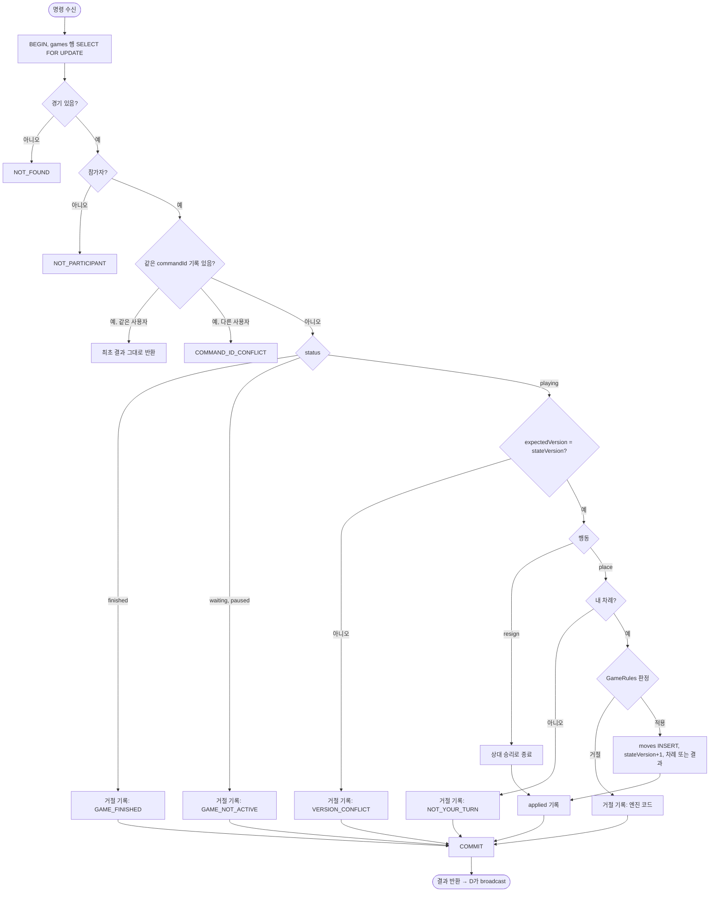

#### 12. Concurrency design

`구현됨`. 두 장치를 목적에 따라 나눠 쓴다.

| 장치 | 막는 것 |
|---|---|
| 경기 행 잠금 (`SELECT ... FOR UPDATE`) | 같은 경기의 동시 변경. 경기별로만 잠가 다른 경기는 병렬 처리 |
| `stateVersion` 비교 | 오래된 화면에서 보낸 명령 |
| `UNIQUE(game_id, command_id)` | 같은 명령의 두 번 적용 (잠금이 1차, UNIQUE가 최종 방어) |
| `moves` UNIQUE + CHECK | 엔진 버그가 있어도 같은 칸·같은 수 중복 저장 불가 |
| 단일 트랜잭션 | 저장 실패 시 착수·버전·명령 기록·결과 모두 rollback |

잠금은 중복 확인보다 먼저 잡는다. 그래야 같은 `commandId`가 동시에 와도 두 번째 요청이 첫 번째의 commit된 기록을 본다.

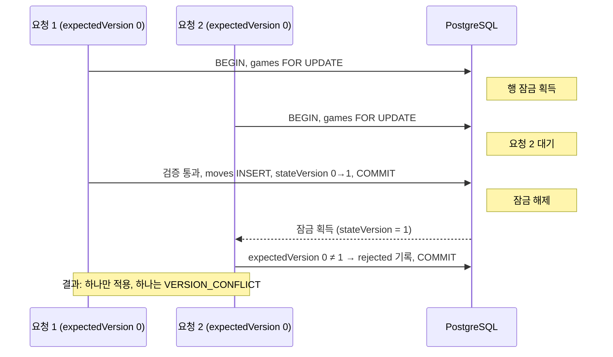

테스트로 확인한 경우: 같은 버전의 동시 명령 2개 → 1개만 적용 / 같은 `commandId` 동시 재전송 → 1번만 적용 / 저장 실패 → 전부 rollback / 종료 후 명령 → `GAME_FINISHED`.

#### Result finalization

- 종료는 착수·기권과 같은 트랜잭션 안에서 `games`(status, outcome, reason, winner, finished_at)와 `game_players.result`를 함께 기록한다.
- `games_result_check`가 "종료 ⇔ 결과 있음"을 DB에서 강제한다.
- 종료된 경기는 잠금 후 `GAME_FINISHED`로 거절되므로 결과가 다시 쓰이지 않는다.
- broadcast는 commit 이후에만 한다(D). 트랜잭션 안에서 네트워크 전송을 하지 않는다.

---

### 2.9 Resource viewpoint

#### 16. Deployment design (E)

PR #10(`infra/compose.full.yaml`) 기준. 병합 전이다.

```mermaid
flowchart TD
    Client[브라우저] -->|"HTTPS :8443 (HTTP :8080 → 308)"| Web

    subgraph host["호스트 (기본 바인딩 127.0.0.1)"]
        subgraph edge["edge 네트워크"]
            Web["web: Nginx 1.28 + React 빌드<br/>80, 443"]
            Api["api: Node 24 Fastify<br/>3001"]
        end
        subgraph data["data 네트워크 (internal)"]
            ApiData["api"]
            Migrate["migrate: Drizzle migration (1회 실행)"]
            Db[("db: PostgreSQL 17<br/>5432")]
        end
        Vol[(postgres_data volume)]
        Certs[[TLS 인증서 bind mount, 읽기 전용]]
        Secret[[postgres_password secret]]
    end

    Web -->|"/api/, /docs/, WS upgrade"| Api
    Api -.- ApiData
    ApiData --> Db
    Migrate --> Db
    Db --- Vol
    Web --- Certs
    Db --- Secret
    Api --- Secret
    Migrate --- Secret
    Api -->|OAuth| Intra[42 Intra API]
```

| 컨테이너 | 역할 | 내부 포트 | 공개 포트 | 네트워크 | Volume | 주요 환경 변수 | Health check | 시작 조건 |
|---|---|---|---|---|---|---|---|---|
| web | 정적 파일, reverse proxy, HTTPS 종료 | 80, 443 | `127.0.0.1:8080`, `127.0.0.1:8443` | edge | 인증서 (읽기 전용) | `PUBLIC_HTTPS_PORT` | `https://127.0.0.1/api/health/db` | api healthy |
| api | REST, (계획) WebSocket | 3001 | 없음 | edge, data | - | `POSTGRES_*`, `API_HOST`, `PORT`, **`JWT_SECRET`, `TWO_FACTOR_KEY`, `FT_OAUTH_*`, `TRUST_PROXY=uniquelocal` (추가 필요)** | `/api/health/db` | migrate 성공 |
| migrate | migration 적용 후 종료 | - | 없음 | data | - | `POSTGRES_*` | - | db healthy |
| db | PostgreSQL | 5432 | 없음 | data (internal) | postgres_data | `POSTGRES_USER`, `POSTGRES_DB`, `POSTGRES_PASSWORD_FILE` | `pg_isready` | - |

- DB 포트는 외부에 공개하지 않는다. 호스트에서 포트를 여는 컨테이너는 web 하나다.
- DB 연결 자원(`db/client.ts`, `구현됨`): API 인스턴스당 pg Pool 하나, 최대 연결 5, 연결 대기 3초, idle 10초, statement timeout 3초. 연결을 3초 안에 못 얻거나 쿼리가 3초를 넘으면 오류가 나고 공통 처리기가 503(연결 계열) 또는 500으로 응답한다. 서버 종료 시 `onClose`에서 Pool을 닫는다. 성능 측정(NFR-PERF-01) 후 값 조정.
- **PR #10 병합 시 합칠 것**: 현재 `index.ts`는 `127.0.0.1`에 고정 listen한다. PR #10은 `API_HOST`로 listen 주소를 받는다. 병합할 때 `API_HOST`와 위 인증·프록시 환경 변수를 함께 반영한다.
- 비밀번호는 Compose secret 파일로 전달한다. B 구현으로 추가된 `JWT_SECRET`, `TWO_FACTOR_KEY`, `FT_OAUTH_*`도 secret 또는 env 파일로 전달해야 한다(PR #10 병합 후 반영 필요).
- 개발 환경은 `infra/compose.yaml`(DB만)과 `npm run dev`를 쓴다. 통합 테스트는 별도 `TEST_DATABASE_URL` DB를 쓴다.

### 2.10 기능별 처리 흐름 (모든 분기)

기능마다 코드에 있는 분기를 모두 그렸다. 끝 상자는 응답 상태 코드와 오류 코드다. 공통 단계(2.10.0)의 분기는 각 기능 그림에서 반복하지 않는다.

#### 2.10.0 공통 요청 단계

Fastify lifecycle 순서다. 인증이 필요한 route는 route의 `onRequest`(인증)가 rate limit보다 먼저 실행된다.

```mermaid
flowchart TD
    Req([HTTP 요청]) --> NeedAuth{인증 필요 route?}
    NeedAuth -->|예| Auth["requireAuth (2.10.4)"]
    Auth -->|실패| E401[401 UNAUTHENTICATED]
    Auth -->|성공| RL
    NeedAuth -->|아니오| RL{rate limit 적용 route?}
    RL -->|"예, IP당 분당 10회 초과"| E429[429 RATE_LIMITED]
    RL -->|통과 또는 미적용| Body{"POST·PATCH 본문 해석"}
    Body -->|Content-Type이 JSON 아님| E415[415 UNSUPPORTED_MEDIA_TYPE]
    Body -->|JSON 해석 불가| E400[400 BAD_REQUEST]
    Body -->|1 MiB 초과| E413[413 PAYLOAD_TOO_LARGE]
    Body -->|정상 또는 본문 없음| Schema{JSON Schema 검증}
    Schema -->|"실패 (body, params, query)"| E422["422 VALIDATION_ERROR (details.issues)"]
    Schema -->|통과| Svc{서비스 준비됨?}
    Svc -->|"DB 또는 필요한 설정 없음"| E503a[503 SERVICE_UNAVAILABLE]
    Svc -->|예| Handler[기능별 handler]
    Handler -->|DB 연결 장애| E503b[503 SERVICE_UNAVAILABLE]
    Handler -->|42 API 장애| E502[502 OAUTH_PROVIDER_ERROR]
    Handler -->|예상하지 못한 오류| E500[500 INTERNAL_ERROR]
    Handler -->|기능별 결과| Res([2.10.1~ 각 기능])
```

POST·PATCH는 본문을 받지 않는 route라도 본문이 오면 해석하므로 400·413·415가 날 수 있다. 이 코드들도 해당 route에 모두 선언했다.

| route 묶음 | 인증 | rate limit | JSON 본문 | 서비스가 없을 때 503 조건 |
|---|---|---|---|---|
| register, login, refresh | 없음 | 있음 | 있음 | DB 또는 `JWT_SECRET` 없음 |
| 2fa/verify | 없음 | 있음 | 있음 | 위 + `TWO_FACTOR_KEY` 없음 |
| 2fa/enable, 2fa/disable | 있음 | 있음 | 있음 | 위와 같음 |
| 2fa (GET), 2fa/setup | 있음 | 없음 | 없음 | 위와 같음 |
| oauth/42/login, callback | 없음 | 있음 | callback만 | DB, `JWT_SECRET`, `FT_OAUTH_*` 중 하나라도 없음 |
| oauth/42/link | 있음 | 없음 | 없음 | 위와 같음 |
| logout, users/*, stats, leaderboard | 있음 | 없음 | PATCH만 | DB 또는 `JWT_SECRET` 없음 |

#### 2.10.1 회원가입 `POST /api/auth/register`

```mermaid
flowchart TD
    S([검증 통과: email, password 8~128자, nickname 2~32자]) --> Hash[Argon2id 해시]
    Hash --> Ins["users INSERT (email은 소문자)"]
    Ins -->|성공| R201[201 사용자 정보, 비밀번호 미포함]
    Ins -->|users_email_unique 위반| R409a[409 EMAIL_TAKEN]
    Ins -->|users_nickname_unique 위반| R409b[409 NICKNAME_TAKEN]
    Ins -->|그 외 DB 오류| R5xx[500 / 503]
```

동시 가입 경합은 UNIQUE 제약이 판정한다. 먼저 commit한 요청만 201이다.

#### 2.10.2 로그인 `POST /api/auth/login`

```mermaid
flowchart TD
    S([검증 통과]) --> Find["users 조회 (email 소문자)"]
    Find --> HasPw{계정 있음 + password_hash 있음?}
    HasPw -->|"아니오 (없는 email, OAuth 전용 계정)"| Dummy[dummy 해시로 같은 시간 verify]
    Dummy --> R401[401 INVALID_CREDENTIALS]
    HasPw -->|예| Verify{Argon2id verify}
    Verify -->|불일치| R401
    Verify -->|일치| TwoFA{2FA 활성?}
    TwoFA -->|예| Ch["two_factor_challenges INSERT (해시, 5분)"]
    Ch --> R200c[200 twoFactorRequired, challengeToken, expiresIn=300]
    TwoFA -->|아니오| Tx["BEGIN, sessions INSERT (7일), refresh_tokens INSERT, COMMIT"]
    Tx --> R200t[200 accessToken, tokenType, expiresIn=1800, refreshToken]
```

#### 2.10.3 2FA 로그인 두 번째 단계 `POST /api/auth/2fa/verify`

```mermaid
flowchart TD
    S([검증 통과: challengeToken, code 6~16자]) --> Tx[BEGIN]
    Tx --> Lock["challenge SELECT FOR UPDATE (해시)"]
    Lock --> Valid{있음, 미사용, 미만료?}
    Valid -->|아니오| R401a["401 UNAUTHENTICATED (다시 로그인)"]
    Valid -->|예| Sec["two_factor_secrets SELECT FOR UPDATE"]
    Sec --> Enabled{2FA 활성?}
    Enabled -->|"아니오 (그 사이 비활성화됨)"| Wrong
    Enabled -->|예| Kind{code 형식}
    Kind -->|6자리 숫자| Totp{"TOTP 일치? (±1 step, last_used_step 이후만)"}
    Totp -->|예| Step[last_used_step 갱신]
    Totp -->|아니오| Wrong
    Kind -->|그 외| Rec{"미사용 복구 코드 일치? (대소문자·하이픈 무시)"}
    Rec -->|예| Use[복구 코드 used_at]
    Rec -->|아니오| Wrong[failed_attempts + 1]
    Wrong --> Max{5회 도달?}
    Max -->|예| Burn[challenge used_at = 폐기]
    Max -->|아니오| Keep[challenge 유지]
    Burn --> R401b[401 INVALID_TWO_FACTOR_CODE]
    Keep --> R401b
    Step --> Ok[challenge used_at, sessions·refresh_tokens INSERT]
    Use --> Ok
    Ok --> C[COMMIT] --> R200[200 토큰]
```

#### 2.10.4 보호 요청 인증 (`requireAuth`, 모든 인증 route 공통)

```mermaid
flowchart TD
    S([요청]) --> H{"Authorization: Bearer 토큰?"}
    H -->|없음 또는 형식 다름| R401[401 UNAUTHENTICATED]
    H -->|있음| P{세 부분으로 나뉨 + 헤더가 고정값 HS256?}
    P -->|아니오| R401
    P -->|예| Sig{서명 일치? timingSafeEqual}
    Sig -->|아니오| R401
    Sig -->|예| Claims{"payload JSON 정상, sub 정수, sid UUID, exp 미래?"}
    Claims -->|아니오| R401
    Claims -->|예| Sess{"sessions: id=sid, user=sub, 미폐기, 미만료?"}
    Sess -->|아니오| R401
    Sess -->|예| OK["request.auth = userId, sessionId → 다음 단계"]
```

#### 2.10.5 refresh `POST /api/auth/refresh`

```mermaid
flowchart TD
    S([검증 통과: refreshToken]) --> Tx[BEGIN]
    Tx --> Lock["refresh_tokens JOIN sessions SELECT FOR UPDATE (해시)"]
    Lock --> Found{있음?}
    Found -->|아니오| R401[401 UNAUTHENTICATED]
    Found -->|예| Used{used_at 있음?}
    Used -->|"예 (이미 교체된 token 재사용)"| Revoke["sessions.revoked_at = now(), COMMIT"]
    Revoke --> R401
    Used -->|아니오| Live{"세션 미폐기 + token 미만료 + 세션 미만료?"}
    Live -->|아니오| R401
    Live -->|예| Rot["used_at = now(), 새 refresh_tokens INSERT (만료 = 세션 만료)"]
    Rot --> C[COMMIT] --> R200[200 새 access + 새 refresh]
```

#### 2.10.6 로그아웃 `POST /api/auth/logout`

```mermaid
flowchart TD
    S([requireAuth 통과]) --> Rev["sessions.revoked_at = now() (미폐기일 때만)"]
    Rev --> R204[204]
    R204 --> After["이후 같은 세션의 access token: 401, refresh token: 401, 다른 기기 세션: 유지"]
```

#### 2.10.7 내 정보 `GET /api/users/me`

```mermaid
flowchart TD
    S([requireAuth 통과]) --> Find[users 조회 userId]
    Find -->|있음| R200[200 id, email, nickname, avatarUrl, createdAt]
    Find -->|"없음 (세션은 살아 있는데 계정 행 없음)"| R401[401 UNAUTHENTICATED]
```

#### 2.10.8 닉네임 변경 `PATCH /api/users/me`

```mermaid
flowchart TD
    S([requireAuth 통과, nickname 검증 통과]) --> Up["users UPDATE nickname, updated_at"]
    Up -->|행 갱신됨| R200[200 갱신된 내 정보]
    Up -->|갱신된 행 없음| R401[401 UNAUTHENTICATED]
    Up -->|users_nickname_unique 위반| R409[409 NICKNAME_TAKEN]
```

#### 2.10.9 공개 프로필 `GET /api/users/{userId}`

```mermaid
flowchart TD
    S([requireAuth 통과]) --> P{"userId 정수, 1 이상 MAX_SAFE_INTEGER 이하?"}
    P -->|아니오| R422[422 VALIDATION_ERROR]
    P -->|예| Find[users 조회]
    Find -->|있음| R200["200 id, nickname, avatarUrl (email 제외)"]
    Find -->|없음| R404[404 NOT_FOUND]
```

#### 2.10.10 2FA 사용 여부 `GET /api/auth/2fa`

```mermaid
flowchart TD
    S([requireAuth 통과]) --> Cfg{TWO_FACTOR_KEY 설정됨?}
    Cfg -->|아니오| R503[503 SERVICE_UNAVAILABLE]
    Cfg -->|예| Q[two_factor_secrets 조회]
    Q --> R200["200 enabled = enabled_at 있음"]
```

#### 2.10.11 2FA 설정 시작 `POST /api/auth/2fa/setup`

```mermaid
flowchart TD
    S([requireAuth 통과]) --> U[users 조회]
    U -->|없음| R401[401 UNAUTHENTICATED]
    U -->|있음| Cfg{TWO_FACTOR_KEY 설정됨?}
    Cfg -->|아니오| R503[503 SERVICE_UNAVAILABLE]
    Cfg -->|예| Tx["BEGIN, two_factor_secrets SELECT FOR UPDATE"]
    Tx --> En{이미 활성?}
    En -->|예| R409[409 TWO_FACTOR_ALREADY_ENABLED]
    En -->|"아니오 (없음 또는 설정 중)"| Gen["새 secret 생성, 암호화, UPSERT (기존 행은 enabled_at IS NULL일 때만 덮어씀)"]
    Gen -->|"덮어쓴 행 없음 (그 사이 다른 요청이 활성화)"| R409
    Gen -->|저장됨| C2[COMMIT] --> R200[200 secret, otpauthUrl]
```

다시 호출하면 설정 중인 secret이 새 값으로 바뀐다. 활성화 전이라 로그인에는 영향이 없다.

#### 2.10.12 2FA 활성화 `POST /api/auth/2fa/enable`

```mermaid
flowchart TD
    S([requireAuth 통과, code 6자리 숫자]) --> Tx["BEGIN, two_factor_secrets SELECT FOR UPDATE"]
    Tx --> Has{행 있음?}
    Has -->|아니오| R409a[409 TWO_FACTOR_NOT_SET_UP]
    Has -->|예| En{이미 활성?}
    En -->|예| R409b[409 TWO_FACTOR_ALREADY_ENABLED]
    En -->|아니오| V{"TOTP 일치? (±1 step)"}
    V -->|아니오| R400["400 INVALID_TWO_FACTOR_CODE (꺼진 상태 유지)"]
    V -->|예| On["enabled_at = now(), last_used_step 기록"]
    On --> Codes["복구 코드 10개 생성, 기존 코드 삭제 후 해시 저장, COMMIT"]
    Codes --> R200["200 recoveryCodes (평문은 이때만)"]
```

#### 2.10.13 2FA 비활성화 `POST /api/auth/2fa/disable`

```mermaid
flowchart TD
    S([requireAuth 통과, code 6~16자]) --> Tx[BEGIN]
    Tx --> En{2FA 활성?}
    En -->|아니오| R409[409 TWO_FACTOR_NOT_ENABLED]
    En -->|예| V{"코드 확인 (2.10.3과 같은 verifyCode: TOTP 또는 복구 코드)"}
    V -->|실패| R400[400 INVALID_TWO_FACTOR_CODE]
    V -->|성공| Del["two_factor_secrets, 복구 코드 삭제, COMMIT"]
    Del --> R204[204]
```

기존 세션은 유지된다(5장 미결정).

#### 2.10.14 42 로그인 시작 `POST /api/auth/oauth/42/login`, 연결 시작 `POST /api/auth/oauth/42/link`

```mermaid
flowchart TD
    S([요청]) --> Which{route}
    Which -->|login| Cfg
    Which -->|link| A{requireAuth}
    A -->|실패| R401[401 UNAUTHENTICATED]
    A -->|성공| Cfg{FT_OAUTH_* 설정됨?}
    Cfg -->|아니오| R503[503 SERVICE_UNAVAILABLE]
    Cfg -->|예| St["state, flowToken = 각 32바이트 난수, oauth_states INSERT (두 해시, mode, link면 userId·sessionId, 10분)"]
    St --> R200["200 authorizeUrl (client_id, redirect_uri, scope=public, state), flowToken"]
```

#### 2.10.15 42 인증 결과 `POST /api/auth/oauth/42/callback`

```mermaid
flowchart TD
    S([검증 통과: code, state, flowToken]) --> Consume["oauth_states UPDATE used_at (state·flowToken 해시 일치, provider=42, 미사용, 미만료)"]
    Consume -->|갱신된 행 없음| R401a[401 OAUTH_STATE_INVALID]
    Consume -->|성공| Tok["42 POST /oauth/token"]
    Tok -->|네트워크 오류| R502[502 OAUTH_PROVIDER_ERROR]
    Tok -->|400 / 401| R401b[401 OAUTH_FAILED]
    Tok -->|"그 외 실패, JSON 아님, access_token 없음"| R502
    Tok -->|성공| Me["42 GET /v2/me"]
    Me -->|"실패, JSON 아님, id·login 없음"| R502
    Me -->|성공| Mode{state의 mode}

    Mode -->|link| LS{"시작한 세션이 아직 유효?"}
    LS -->|아니오| R401c[401 UNAUTHENTICATED]
    LS -->|예| L1{이 42 계정이 이미 연결됨?}
    L1 -->|같은 사용자에 연결| R200l[200 linked]
    L1 -->|다른 사용자에 연결| R409a[409 OAUTH_ACCOUNT_LINKED]
    L1 -->|아니오| L2[oauth_accounts INSERT]
    L2 -->|성공| R200l
    L2 -->|"oauth_accounts_user_provider_unique 위반 (이미 다른 42 연결)"| R409b[409 OAUTH_ALREADY_LINKED]
    L2 -->|"oauth_accounts_provider_user_unique 위반 (동시 연결)"| L3{연결 주인 재조회}
    L3 -->|나| R200l
    L3 -->|다른 사용자| R409a

    Mode -->|login| G1{이 42 계정이 연결됨?}
    G1 -->|예| Done
    G1 -->|아니오| G2{42가 email 제공?}
    G2 -->|아니오| R422[422 OAUTH_EMAIL_MISSING]
    G2 -->|예| N["닉네임 후보: 42 login → login-xxxx → login-xxxx"]
    N --> Create["BEGIN, users INSERT (password NULL), oauth_accounts INSERT, COMMIT"]
    Create -->|성공| Done
    Create -->|"users_email_unique 또는 oauth_accounts_provider_user_unique 위반"| Re{이 42 계정의 연결 재조회}
    Re -->|"있음 (동시 첫 로그인이 먼저 만듦)"| Win[먼저 만든 계정 사용] --> Done
    Re -->|"없음 + email 위반"| R409c["409 EMAIL_TAKEN (기존 계정 자동 연결 안 함)"]
    Create -->|users_nickname_unique 위반| Next{후보 남음?}
    Next -->|예| Create
    Next -->|아니오| R500[500 INTERNAL_ERROR]
    Done["completeLogin (2.10.2의 2FA 분기와 같음)"] --> R200g["200 토큰 또는 twoFactorRequired"]
```

`state`는 첫 단계에서 바로 소비되므로, 이후 42 실패·409가 나도 같은 `state`로 재시도할 수 없다. 처음부터 다시 시작한다.

#### 2.10.16 게임별 통계 `GET /api/users/{userId}/stats?gameType=`

```mermaid
flowchart TD
    S([requireAuth 통과]) --> V{"userId 정수 1~MAX_SAFE_INTEGER, gameType이 gomoku 또는 othello?"}
    V -->|아니오 또는 gameType 없음| R422[422 VALIDATION_ERROR]
    V -->|예| U{사용자 있음?}
    U -->|아니오| R404[404 NOT_FOUND]
    U -->|예| C["game_players JOIN games (user, game_type): win·loss·draw 개수"]
    C --> P{"played = 승+패+무 > 0?"}
    P -->|예| R1["winRate = wins / played"]
    P -->|아니오| R0["winRate = 0"]
    R1 --> Out["200 + firstWin = wins > 0, progress = min(played, 10)/10"]
    R0 --> Out
```

#### 2.10.17 전적 `GET /api/users/{userId}/matches`

```mermaid
flowchart TD
    S([requireAuth 통과]) --> V{"userId, gameType(선택), before(선택, 1 이상), limit 1~50 (기본 20)"}
    V -->|위반| R422[422 VALIDATION_ERROR]
    V -->|통과| U{사용자 있음?}
    U -->|아니오| R404[404 NOT_FOUND]
    U -->|예| Q["status=finished 경기, 상대 JOIN, gameType 있으면 필터, before 있으면 id < before, id 내림차순, limit + 1개 조회"]
    Q --> Full{"limit보다 많이 나옴?"}
    Full -->|예| N1["200 앞의 limit개, nextBefore = 그중 마지막 matchId"]
    Full -->|아니오| N0["200 전부, nextBefore = null"]
```

#### 2.10.18 리더보드 `GET /api/leaderboard?gameType=&limit=`

```mermaid
flowchart TD
    S([requireAuth 통과]) --> V{"gameType 필수, limit 1~100 (기본 10)"}
    V -->|위반| R422[422 VALIDATION_ERROR]
    V -->|통과| Q["game_type 필터, 사용자별 wins·played 집계"]
    Q --> H{"played > 0?"}
    H -->|아니오| Skip[목록에서 제외]
    H -->|예| Ord["정렬: wins desc → winRate desc → userId asc, rank = row_number"]
    Ord --> R200["200 rank, userId, nickname, wins, played, winRate (빈 배열 가능)"]
```

#### 2.10.19 경기 생성 `GameCommandService.createMatch()` (D가 호출)

```mermaid
flowchart TD
    S([gameType, blackUserId, whiteUserId]) --> Reg{gameType에 등록된 엔진?}
    Reg -->|아니오| Err[예외]
    Reg -->|예| Tx["BEGIN, games INSERT (status=playing, current_turn=black, started_at)"]
    Tx --> P1[game_players INSERT black]
    P1 --> P2[game_players INSERT white]
    P2 -->|성공| C["COMMIT → matchId 반환"]
    P2 -->|"같은 사용자 두 좌석 (game_players_game_user_unique)"| RB[ROLLBACK, 예외]
    Tx -->|"gameType이 gomoku·othello 아님 (CHECK)"| RB
```

매칭·준비 단계는 D 범위라, 지금은 두 참가자가 정해지면 바로 `playing`으로 만든다.

`rulesVersion`은 호출자가 넘기지 않는다. 서버가 등록된 엔진의 버전(`{ version, rules }`)으로 채워, 지원하지 않는 버전이 저장되지 않는다. `apply()`는 저장된 버전과 등록된 버전이 다르면 규칙을 적용하지 않고 예외로 끝낸다(트랜잭션 롤백). 재시작 때 미완료 경기가 모두 무효가 되므로 정상 운영에서는 일어나지 않는다.

#### 2.10.20 경기 명령 `GameCommandService.apply()` (D가 호출)

모든 분기는 2.8의 10번 흐름도와 같다. 결과 형식:

| 결과 | 기록 | 반환 |
|---|---|---|
| 적용 | moves, games, game_players(종료 시), game_commands(applied) | `{ status: "applied", stateVersion, duplicate: false }` |
| 같은 commandId 재전송 | 없음 | 최초 결과 + `duplicate: true` (payload는 비교하지 않음, 2.8 참고) |
| 경기 없음, 비참가자, 다른 사용자의 commandId | 없음 | `{ status: "rejected", code, duplicate: false }` |
| 종료됨, 진행 중 아님, 버전 불일치, 차례 아님, 엔진 거절 | game_commands(rejected) | `{ status: "rejected", code, duplicate: false }` |
| DB 제약 위반·저장 실패 | 전부 rollback | 예외 (호출자가 처리) |
| 등록되지 않은 gameType의 규칙 | rollback | 예외 |

#### 2.10.21 경기 조회 `GameCommandService.getMatch()`

```mermaid
flowchart TD
    S([matchId]) --> T["BEGIN REPEATABLE READ, READ ONLY"] --> G[games 조회]
    G -->|없음| U[undefined]
    G -->|있음| P["같은 스냅샷에서 game_players, moves(turn 순) 조회"]
    P --> R["game, players, moves 반환 (stateVersion과 moves가 항상 같은 시점) → D가 엔진으로 재생해 snapshot 생성"]
```

#### 2.10.22 Health `GET /api/health`, `GET /api/health/db`

```mermaid
flowchart TD
    S([요청]) --> W{route}
    W -->|/api/health| R200a["200 status=ok (DB와 무관)"]
    W -->|/api/health/db| D{DB 설정됨?}
    D -->|아니오| R503[503 SERVICE_UNAVAILABLE]
    D -->|예| Q[connection_probe 조회]
    Q -->|성공| R200b[200 status=ok, database=ok]
    Q -->|"연결 실패, migration 전"| R503
```

#### 2.10.23 서버 시작 `index.ts`

```mermaid
flowchart TD
    S([npm run dev:server]) --> Env[.env 있으면 로드]
    Env --> Db{DATABASE_URL?}
    Db -->|없음| X1[시작 중단]
    Db -->|있음| Jwt{"JWT_SECRET 32자 이상?"}
    Jwt -->|아니오| X1
    Jwt -->|예| Tfa{"TWO_FACTOR_KEY 없음 또는 32자 이상?"}
    Tfa -->|"있는데 32자 미만"| X1
    Tfa -->|통과| OA{"FT_OAUTH_* 셋 다 있음 또는 셋 다 없음?"}
    OA -->|일부만| X1
    OA -->|통과| Port{"PORT 1~65535 정수?"}
    Port -->|아니오| X1
    Port -->|예| Build["buildApp (trustProxy = TRUST_PROXY, 기본 loopback)"]
    Build --> H{"/api/health/db = 200?"}
    H -->|아니오| X2["앱 종료, 'npm run db:up, db:migrate 먼저' 안내"]
    H -->|예| L["127.0.0.1:PORT listen, SIGINT/SIGTERM에 정상 종료"]
```

`TWO_FACTOR_KEY`가 없으면 2FA route만 503이고, `FT_OAUTH_*`가 없으면 OAuth route만 503이다. 나머지 기능은 동작한다.

#### 2.10.24 QA 계정 준비 `npm run qa:accounts`

```mermaid
flowchart TD
    S([실행]) --> Pw{"QA_PASSWORD 8자 이상?"}
    Pw -->|아니오| X[오류 종료]
    Pw -->|예| Loop["qa-p1, qa-p2, qa-p3, qa-p4, qa-outsider 순서로 POST /api/auth/register"]
    Loop --> R{응답}
    R -->|201| Created[created 출력] --> Loop
    R -->|409 EMAIL_TAKEN| Exists[exists 출력] --> Loop
    R -->|"그 외 (409 NICKNAME_TAKEN, 429 포함)"| X
```

가입 API의 rate limit(분당 10회)을 거치므로 1분 안에 세 번 이상 실행하면 429로 멈출 수 있다.

#### 2.10.25 아바타 업로드·삭제 `PUT /api/users/me/avatar`, `DELETE /api/users/me/avatar` (B, `계획`, 10/24)

DEC-05 제안(PNG/JPEG, 2 MiB 이하, 실제 형식 검사, 기본 이미지)을 따른다. `@fastify/multipart`로 받는다.

```mermaid
flowchart TD
    S([requireAuth 통과]) --> M{multipart/form-data?}
    M -->|아니오| R415[415 UNSUPPORTED_MEDIA_TYPE]
    M -->|예| F{file 필드 1개?}
    F -->|아니오| R422[422 VALIDATION_ERROR]
    F -->|예| Size{2 MiB 이하?}
    Size -->|아니오| R413[413 PAYLOAD_TOO_LARGE]
    Size -->|예| Magic{"파일 앞부분 바이트가 PNG 또는 JPEG 서명? (확장자·Content-Type은 믿지 않음)"}
    Magic -->|아니오| R415
    Magic -->|예| Dim{"이미지 치수 상한 이내? (DEC-05 미정, 제안 1024×1024)"}
    Dim -->|아니오| R422
    Dim -->|예| Write["새 이름(/media/avatars/{userId}-{난수}.{png,jpg})으로 임시 파일 저장 후 rename"]
    Write --> Up["users.avatar_url UPDATE"]
    Up -->|성공| Old[이전 파일 삭제] --> R200[200 갱신된 내 정보]
    Up -->|실패| Clean[새 파일 삭제, 이전 avatar_url 유지] --> R5xx[500 / 503]
    S2([DELETE, requireAuth 통과]) --> Null["avatar_url = NULL (UI는 기본 이미지)"] --> Del[이전 파일 삭제] --> R204[204]
```

- 저장 위치: api 컨테이너의 volume(`avatar_data`)을 Nginx가 `/media/`로 읽기 전용 제공(E와 PR #10 후속 협의). DB에는 경로만 저장한다.
- 교체 실패 시 기존 파일과 URL을 유지한다. 탈퇴 시 파일을 삭제한다(2.10.27).

#### 2.10.26 전적 공개 설정 (B, `계획`)

FR-PRO-04, DEC-05: 기본 공개. 비공개면 **본인 외에는** 프로필의 전적·경기 기록을 볼 수 없다. 리더보드와 상대방 본인의 경기 기록에는 계속 표시된다.

```mermaid
flowchart TD
    Set(["PATCH /api/users/me { recordsPublic }"]) --> Save[users.records_public UPDATE] --> R200a[200 내 정보]

    Q([GET /api/users/:id/stats 또는 /matches]) --> Own{조회자 = 대상?}
    Own -->|예| Show[그대로 반환]
    Own -->|아니오| Pub{대상 records_public?}
    Pub -->|예| Show
    Pub -->|아니오| R403["403 RECORDS_PRIVATE"]

    LB([GET /api/leaderboard]) --> LBshow["비공개 사용자도 포함 (FR-REC-04)"]
    Mine([내 /matches의 상대 정보]) --> Opp["상대가 비공개여도 내 기록의 상대 닉네임은 표시"]
```

- 구현 시 `StatsService.getStats/getMatches`에 조회자 `viewerId`를 추가로 넘긴다(현재는 대상만 받음).
- 상태 코드 추가: stats·matches에 403 `RECORDS_PRIVATE`.

#### 2.10.27 회원 탈퇴 `DELETE /api/users/me` (B, `계획`, DEC-09 확정 후)

```mermaid
flowchart TD
    S([requireAuth 통과]) --> Re{"본인 재확인: 비밀번호, 또는 OAuth 전용이면 2FA 코드/최근 로그인"}
    Re -->|실패| R401[401]
    Re -->|성공| Act{진행 중 경기·대기 참가 있음?}
    Act -->|예| Leave["D: 대기 참가 해제, 진행 중 경기는 기권 처리 (DEC-09 미정)"]
    Act -->|아니오| Tx
    Leave --> Tx["BEGIN"]
    Tx --> Rev[모든 sessions 폐기]
    Rev --> Wipe["삭제: refresh_tokens, oauth_accounts, two_factor_*, friendships (E), 아바타 파일"]
    Wipe --> Anon["users: email·nickname·password_hash·avatar_url 비움, deleted_at = now()"]
    Anon --> Keep["유지: games, game_players(nickname_snapshot 포함), moves"]
    Keep --> C[COMMIT] --> R204[204]
```

- 전적 표시: `nickname_snapshot` + "(탈퇴한 사용자)". 현재 프로필 링크는 만들지 않는다. 같은 닉네임을 새 계정이 써도 과거 기록과 연결되지 않는다(불변 user id 기준).
- 보존 기간·백업 반영·탈퇴자 리더보드 처리는 DEC-09 결정 전이라 미정(5장).

#### 2.10.28 시스템 종료: 이탈 만료·서버 재시작 무효 (B 저장 + D 호출, 이탈 만료 저장 `구현됨`·시계 `계획`(D), 서버 재시작 `구현됨`)

현재 `apply()`는 사용자 명령(`place`, `resign`)만 받는다. 이탈 만료와 재시작 무효는 사용자가 아닌 서버가 일으키므로 별도 진입점을 둔다.

```mermaid
flowchart TD
    subgraph timeout["이탈 만료 (D가 시계 만료 시 호출)"]
        T0(["finishBySystem(matchId, reason='disconnect_timeout', absentUserIds, expectedVersion)"]) --> T1[BEGIN, games FOR UPDATE]
        T1 --> T2{status가 playing 또는 paused?}
        T2 -->|아니오 이미 종료| T9["아무것도 안 함 (중복 종료 방지)"]
        T2 -->|예| T3{"stateVersion = expectedVersion? (그 사이 착수·기권 없음)"}
        T3 -->|아니오| T9
        T3 -->|예| T4{부재자 수}
        T4 -->|1명| T5["outcome=win, winner=상대, reason=disconnect_timeout"]
        T4 -->|2명| T6["outcome=void, reason=disconnect_timeout"]
        T5 --> T7["결과 확정 (2.8 Result finalization과 같은 저장), stateVersion+1, COMMIT"]
        T6 --> T7
    end
    subgraph restart["서버 재시작 (index.ts, listen 전)"]
        R0([기동]) --> R1["UPDATE games SET status=finished, outcome=void, reason=server_restart, finished_at=now(), stateVersion+1 WHERE status IN (playing, paused)"]
        R1 --> R2["game_players.result = void (R1과 같은 트랜잭션)"]
        R2 --> R3["대기 상태(waiting) 정리 (D)"]
        R3 --> R4[listen]
    end
```

- 서버 재시작 무효는 `index.ts`가 DB 확인 뒤 listen 전에 `voidUnfinishedGames()`로 처리한다. 진행 중 경기의 시계·연결은 재시작 후 남지 않기 때문이다. API 인스턴스가 하나라는 전제다. 여러 개를 띄우면 다른 인스턴스의 진행 중 경기까지 무효가 된다. 대기 상태 정리(D)는 `계획`이다.
- 착수·기권과 만료가 겹치면 경기 행 잠금이 순서를 정한다. 먼저 commit한 쪽이 이기고, 나중 쪽은 버전 불일치나 종료 상태로 아무것도 하지 않는다.
- 일시정지·복귀는 `stateVersion`을 올리지 않는다(#34 합의). 그래서 복귀만으로 이탈 종료 요청이 무시되지 않는다. 만료 전에 복귀하면 D가 이탈 타이머를 취소하고, 만료된 뒤에는 그 순간의 부재자로 결과를 확정한다(DEC-03). 만료 후 복귀는 종료를 취소하지 않는다.
- `Finish` 타입에 `void`를 추가했다. 결과 사유 `disconnect_timeout`, `server_restart`는 계약 PR #6의 `TwoPlayerResult`와 같다.
- `finishBySystem()`은 `{ status: "finished", stateVersion }` 또는 `{ status: "skipped" }`를 돌려준다. `finished`일 때만 D가 `GAME_FINISHED`를 보낸다. 없는 경기, 이미 종료, 버전 불일치는 `skipped`다.
- `absentUserIds`가 비었거나 참가자가 아닌 사용자가 있으면 예외를 던진다. D의 호출 오류이므로 사용자에게 보낼 오류 코드가 아니다.

---

## 3. Design rationale

### 17. Technical decisions

| 결정 | 선택 | 이유 | 상태 |
|---|---|---|---|
| Backend framework | Fastify 5 | JSON Schema 검증과 Swagger 생성이 내장돼 상태 코드 선언 규칙을 지키기 쉬움 | `구현됨` |
| Frontend framework | React + Vite | 팀 합의 | 골격만 |
| Database | PostgreSQL 17 | 행 잠금, UNIQUE·CHECK 제약, 트랜잭션 | `구현됨` |
| ORM / migration | Drizzle ORM + Drizzle Kit + pg | TypeScript 스키마와 검토 가능한 SQL migration | `구현됨` |
| ID | BIGINT identity (세션·challenge는 UUID) | 단순·순서 보장. 외부 JSON의 matchId도 number (`Number.MAX_SAFE_INTEGER` 이하) | `구현됨` |
| 상태 값 저장 | text + CHECK | enum보다 값 추가가 쉬움, 계약과 같은 소문자 값 | `구현됨` |
| WebSocket | 미정 (D) | Fastify 플러그인 등 D가 선택 | `미정` |
| Authentication | JWT access 30분 + opaque refresh 7일 + 서버 세션 | 로그아웃 즉시 효력(FR-AUTH-03)을 JWT 만료에 기대지 않음 | `구현됨` |
| Refresh token | 매번 교체, 재사용 시 세션 폐기 | 탈취된 token 사용을 감지 | `구현됨` |
| Password hashing | Argon2id (m=19 MiB, t=2, p=1) | OWASP Password Storage Cheat Sheet의 Argon2id 최소 권장값. salt 내장으로 같은 비밀번호도 계정마다 다른 해시(NFR-SEC-02). 실행 환경 비용 측정 후 조정 | `구현됨` |
| 2FA | TOTP (RFC 6238, HMAC-SHA1, 6자리, 30초 주기, ±1 step) + 복구 코드 10개 | 메일 인프라 불필요, 기기 분실 복구 경로 (DEC-04 제안). SHA1·30초·6자리는 Google Authenticator 등 주요 앱의 기본값이라 호환됨. RFC 6238 테스트 벡터로 검증 | `구현됨` |
| OAuth | 42 Intra, 첫 로그인 신규 계정, 연결은 로그인 후에만 | 평가 환경 전원 42 계정 보유, FR-AUTH-05 | `구현됨` |
| Rate limit | `@fastify/rate-limit`, 인증 경로 IP당 분당 10회 | NFR-SEC-05 | `구현됨` |
| Server-authoritative game state | 서버가 규칙 판정·저장 후 전송 | 클라이언트 조작 방지 | 저장 `구현됨` |
| commandId | UUID, (match, commandId) UNIQUE, 최초 결과 재전송 | 네트워크 재전송에도 1회 적용 | `구현됨` |
| stateVersion | 낙관적 버전 비교 + 경기 행 잠금 | 오래된 상태 감지와 동시 변경 직렬화를 분리 | `구현됨` |
| Board 저장 | moves만 저장, 재생 | 기록이 기준, 재생 비용 작음 | `구현됨` |
| 통계 | 저장하지 않고 계산 | 중복 집계·불일치 방지 | `구현됨` |
| Reconnect policy | 사용자별 경기 내 누적 60초 | DEC-03 | `계획` (D) |
| Result finalization | 단일 트랜잭션 + DB CHECK | 결과 1회 확정 | `구현됨` |

---

## 4. SRS 추적 (SRS 10.1 대응)

| SRS 설계 항목 | 이 문서 | 상태 |
|---|---|---|
| 시스템 구성·실행/배포 | 2.1의 1번, 2.9 | `계획` (PR #10) |
| 인증·권한·프로필 | 1.1, 2.6의 11번, 2.5의 8번 | `구현됨` (아바타·전적 비공개·탈퇴 제외) |
| 친구·온라인 상태 | 2.1 use case | `계획` (E, D) |
| 방·매칭 상태 전이 | 2.7 | `계획` (D) |
| 공통 경기와 규칙 경계 | 2.2의 4번, 2.3 | 경계 `구현됨`, 엔진 연결 `계획` |
| 실시간 계약·복구 | 2.5의 9번, 2.6의 13번 | `계획` (D) |
| 논리/물리 데이터 모델 | 2.4의 5번 | `구현됨` |
| API·오류 계약 | 2.5의 8번, 2.10 | `구현됨` (B 범위) |
| 화면·접근성 | 2.2의 2번 | `계획` (A) |
| 테스트·성능·운영 관측 | 4.1, TEST_PLAN.md | B 범위 테스트 대응 `구현됨`, 성능·AT 연결은 5.1 |

### 4.1 B 범위 테스트 대응 (`구현됨`)

`npm test`(Vitest). DB 통합 테스트는 `TEST_DATABASE_URL`이 있을 때만 실행하고, 없으면 건너뛴다. 테스트 DB는 실제 연결된 DB 이름이 `_test`로 끝나야 하며 매 테스트마다 전체 TRUNCATE한다.

| 테스트 파일 | 검증 내용 | SRS 근거 | 대체물 (실제가 아닌 것) |
|---|---|---|---|
| `core/tokens.test.ts` | JWT 서명·만료·위조·`alg: none` 거절 | FR-AUTH-03 | 없음 |
| `core/totp.test.ts` | RFC 6238 벡터, ±1 step, 재사용 거절, AES-GCM 키·변조 검사 | FR-AUTH-06, DATA-05 | 없음 |
| `api/auth-routes.test.ts` | 가입·중복(대소문자)·검증 400/413/415/422, 로그인, refresh 교체·재사용 폐기, 로그아웃 후 거절·다른 기기 유지, rate limit 429, Swagger 상태 코드 | AT-02, FR-AUTH-01~03·07, NFR-SEC-03·05 | 없음 |
| `api/user-routes.test.ts` | 닉네임 변경·중복, 인증이 검증보다 먼저, 공개 프로필 email 제외, ID 범위 | FR-PRO-01, FR-AUTH-04 | 없음 |
| `api/two-factor-routes.test.ts` | 설정·활성화 전 미적용, 2단계 로그인, 재사용·5회 실패 폐기, 복구 코드 1회, 비활성화, setup 경합, 키 없을 때 503 | AT-16, FR-AUTH-06 | 없음 |
| `api/oauth-routes.test.ts` | 42 시작 URL, 첫 로그인 계정 생성·재사용, state 1회·위조·다른 브라우저 거절, email 중복 거절, 닉네임 접미사, 연결·연결 충돌·로그아웃 후 연결 거절, 2FA 적용, 42 장애·잘못된 JSON 502, 동시 첫 로그인 | AT-15, FR-AUTH-05 | **42 API는 `fake42`** (실제 42 검증은 앱 등록 후 별도) |
| `api/stats-routes.test.ts` | 게임별 집계·진행 중 제외·첫 승·진행도, 전적 순서·페이지, 리더보드 정렬, 부분 결과 CHECK 거절 | AT-08, FR-REC-01~04, DEC-08 | **게임 규칙은 stub** |
| `services/game-command-service.test.ts` | 착수·버전·차례, 재전송 1회 적용, 거절 기록, 비참가자·없는 경기·남의 commandId, 동시 명령 1개만 적용, 동시 재전송, 종료·기권 결과, 저장 실패 rollback | AT-05·09(저장 부분), FR-GAME-03, NFR-CONC-01 | **게임 규칙은 `stubRules`** (실제 엔진 연결은 C 엔진 병합 후) |
| `app.test.ts` | health, DB 미설정·연결 실패 503과 비밀값 비노출 | NFR-OPS-01 | 없음 |

실행하지 않은 것: 실제 42 OAuth, 실제 엔진 연결, WebSocket·재접속(D), 성능 측정(NFR-PERF-01, DEC-10), 비작성자 재현(문서화 명세 34장 "평가 가능" 조건).

## 5. 미결정 항목

| 항목 | 결정 필요 | 관련 |
|---|---|---|
| 2FA 켜기·끄기 시 기존 세션 처리 | 현재 유지. 팀 의견 | DEC-04 |
| refresh token 전달 방식 | 현재 body. HttpOnly cookie로 바꿀지 (바꾸면 CSRF 대책 추가) | DEC-04, A |
| 메일 소유 확인·비밀번호 복구·이메일 변경 | 학교 요건 확인 후 결정 | DEC-04, DEC-11 |
| GameError 코드 목록 | 세분화 제안 | PR #6 |
| WebSocket 라이브러리·토큰 전달·heartbeat | D | 문서화 명세 19장 |
| 준비·시작 절차, 색상 배정, 초대 유효기간 | D, A | DEC-06 |
| 이탈 시간 저장 위치·감지 지연 | D | DEC-03, DEC-07 |
| 아바타 저장 위치 | B (PNG/JPEG 2MiB 이하 제안) | DEC-05 |
| 전적 비공개, 탈퇴 표시·닉네임 스냅샷 | B, A | DEC-05, DEC-09 |
| 같은 commandId·다른 payload | payload 해시 저장 후 불일치 거절할지 | B, C, D |

### 5.1 담당자별 작성 필요 항목

SDS v0.1은 B 범위를 구현 기준으로 채웠다. 아래는 SRS가 SDS에서 답하라고 한 질문 중 다른 담당자의 결정이 필요한 것이다. 담당자가 해당 절을 채운다.

| 담당 | 채울 내용 | SRS 근거 | SDS 위치 |
|---|---|---|---|
| A | 화면 전이, 게임 목록·플레이 가능 상태, 규칙 안내(내용은 C), 경기 입력·기권 확인, 로딩·빈·오류·재접속 표시, 키보드·포커스, 반응형 게임판, CSS 도구와 공통 스타일 위치, 토큰 보관 방식 | §10.1 화면·접근성, FR-CAT-01~02, FR-GAME-04, NFR-UX-02~04 | 2.2의 2번 |
| C | 규칙 버전(`rulesVersion`)으로 엔진을 고르는 방법, 오델로 초기 배치·`0..7` 좌표·뒤집기·자동 패스·돌 수 판정과 snapshot·result 표현, 수순 재생 복원, 금수·장목 확장 모듈과 테스트 지점, 엔진 거절 코드 목록 | FR-G2-01~05, FR-CAT-02, CON-04 | 2.2의 4번, 2.7 |
| D | 방·대기열·초대 상태와 불변조건(사용자당 활성 참가 위치 하나의 저장·잠금 방식), 매칭 확정·취소·초대 수락 경합, 준비·시작 주체, 색상 배정, WebSocket 라이브러리·이벤트별 payload·검증·오류, 세션 폐기 후 연결 처리, 경기 제어 연결 선택(다중 탭·기기), 이탈 감지 방식·최대 지연·누적 시계 저장 위치, 양쪽 부재·복귀/만료 경합, 재시작 시 대기 정리 | FR-ROOM-01~04, FR-MATCH-01~02, FR-RT-01~05, DEC-03·06·07 | 2.5의 9번, 2.6의 13번, 2.7 |
| E | 친구 요청·수락·거절·삭제 API와 경합, 사용자 검색 범위, 다중 접속 온라인 집계(D와), 설정 우선순위(셸·`.env`·기본값), 개발·preview 프록시의 PORT 일치, 개발 프로세스 정리, PR #10에 인증 환경 변수 반영 | FR-SOC-01~03, CON-03·05·06, NFR-OPS-02 | 2.9, 계획 스키마 |
| A, B | 요구사항 ID별 추적 레코드(SRS 10.2 형식), TEST_PLAN의 T 시나리오와 AT-01~17 연결, 성능 측정 지점·증빙 위치 | SRS §10.2, NFR-PERF-01 | 4장 |

### 5.2 다른 문서와의 불일치 (정리 필요)

| 문서 위치 | 남아 있는 내용 | 맞출 기준 | 담당 |
|---|---|---|---|
| `contracts.md` | B의 REST API·오류 형식·endpoint별 상태 코드가 없음 | PR #6 merge 후 장을 추가해 기록 | B |
| `GAME_RULES.md` 3~4장 | 단순 60초 복귀, 동률 순위 `nickname → userId` | 누적 60초(DEC-03), `wins → winRate → userId`(DEC-08) | C |
