# SDS v0.5 (초안)

사이버 보드게임 카페의 Software Design Specification. SRS가 정한 요구사항을 **어떻게 구현하는가**를 기술한다. 구성은 IEEE 1016-2009와 문서화 명세 10장을 따른다.

## 0. Frontmatter

| 항목 | 내용 |
|---|---|
| 작성일 | 2026-10-13 |
| 최종 동기화 | 2026-11-12 (KST). `master` `6965b9c`와 PR #59 리뷰, B SDS `1ef0d80`의 계약 정정, 미병합 구현 브랜치를 대조했다. 문서 브랜치에 최신 master를 반영했으며 아래 상태표에서 현재 체크아웃과 미병합 기능을 구분한다. |
| 상태 | 초안. B 담당 영역은 구현 기준으로 작성했다. 다른 담당 영역(A·C·D·E)은 B가 SRS·계약·이슈 기준으로 초안을 채웠고 `B 초안`으로 표시했다. A 담당 영역(2.2 화면 목록·전이·표시 규칙·토큰 보관·키보드·접근성·반응형, 4장 요구사항 ID별 추적 레코드·성능 측정 연결)은 A가 확인·보완했다. 팀 승인 전이다. |
| 범위 | 오목·오델로 2인 1:1 웹 플랫폼 (SRS v0.3.1의 16점 후보) |
| 작성 | B (yunhpark), A (jaeyoo: 2.2·4장 검토·보완) |
| 기술 검토 | C, D, E (문서화 명세 32장) |
| 참조 | [SRS v0.3.1 (Draft PR #4)](https://github.com/EscapeFromGyeongsan/ft_transcendence/pull/4), [GAME_RULES.md](GAME_RULES.md), [공통 게임 계약 (병합된 PR #6)](https://github.com/EscapeFromGyeongsan/ft_transcendence/pull/6), [오목 규칙 (PR #12)](https://github.com/EscapeFromGyeongsan/ft_transcendence/pull/12), [오목 보드 연결 (PR #45)](https://github.com/EscapeFromGyeongsan/ft_transcendence/pull/45), [전체 앱 컨테이너 (PR #10)](https://github.com/EscapeFromGyeongsan/ft_transcendence/pull/10), [아바타 업로드·제공 (PR #15)](https://github.com/EscapeFromGyeongsan/ft_transcendence/pull/15) |
| 구현 기준 브랜치 | `feat/server-auth-persistence` ([PR #11](https://github.com/EscapeFromGyeongsan/ft_transcendence/pull/11)), `feat/avatar-upload` ([PR #15](https://github.com/EscapeFromGyeongsan/ft_transcendence/pull/15)). migration `0000`~`0003` |
| 기준 커밋 | SRS: `codex/srs-draft` `349e9e4` (v0.3.1) / 공통 계약: PR #6 `1a33f3c` / 서버 구현: PR #11 `b30b7f2` (`29d5a3e`), PR #15 `26c253d` |

### 상태 표시

| 표시 | 의미 |
|---|---|
| `구현됨` | 명시한 커밋·브랜치에 코드와 해당 범위 테스트가 있다. `master 병합`과 `병합 전 구현`을 따로 표시한다. DB·브라우저 검증 결과는 해당 PR의 실행 기록을 따른다. 전체 E2E 통과·비작성자 재현을 뜻하지 않는다. |
| `계획` | 설계만 있고 코드 없음 |
| `미정` | 팀 결정 필요 |
| `B 초안` | 다른 담당 영역을 B가 먼저 설계한 것. 담당자 확인 전 |

2026-11-12 기준 문서 체크아웃은 `master` `6965b9c`를 반영한다. 문서 변경은 SDS·TEST_PLAN·README 3개이며, 아래 미병합 기능의 코드는 포함하지 않는다. PR #9는 닫혔고 현재 오목 엔진 근거는 병합된 #12·#45다.

| 범위 | 확인한 PR / 커밋 | 상태 |
|---|---|---|
| 인증·프로필·경기 저장, 오목·오델로 엔진 | #11·#15·#12·#45·#58 | master 병합 |
| 시스템 종료 저장·시작 시 무효화, REST 계약, WS 인증, 상태 전환·세션 폐기 callback | #32·#33·#41·#51 | master 병합. #41의 `auth.ok`는 `{ userId }`이며 활성 경기·구독·매칭은 후속 스택 |
| 전체 앱 컨테이너·HTTPS·API_HOST·아바타 volume | #10 (`7788e5e`, #40 포함) | master 병합. 과거 WSS 증거의 통합 SHA·한계는 [실행 기록](runtime-wss-validation.md) 참조 |
| 구독·명령·매칭·재접속 서버 | #42 `b843f5c`, #43 `8c3d167`, #49 `55afc38`, #50 `80715d9` | 병합 전 구현. `queue.*`는 #49, heartbeat·이탈 시계·`player.*`·paused는 #50 |
| 인증·대국·프로필·매칭·약관 UI | #55 `b431f05` → #56 `a61fba6` → #57 `0a4ebb3` → #63 `c25f624` → #71 `011b5a8` | master 병합 전 구현. IF-02 access token 메모리 전용 수정과 후속 스택 전파를 원격에 반영함 |
| OAuth/2FA·오델로 UI | #72 `e28c223`, #73 `3d06126` | master 병합 전 구현. 이 브랜치들에는 최신 #55 인증 수정 전파가 남아 있음 |
| 오델로 서버 등록 및 약관·프로필·오델로 E2E | #77 `05eaede` | 병합 전 구현, #27 통합 브랜치 기반 |
| 전적 공개 설정 | #79 `8b93fb5` | API·DB·UI·E2E 병합 전 구현 |
| 탈퇴 | #89 `fec1686` | API·DB 병합 전 구현, 화면 #85 및 실시간·친구 정리 후속 필요 |
| 친구와 온라인 | UI #90 `d589b93`, REST #95 `758459e`, presence #98 `07a4989` | 병합 전 구현. #95·#98 상호 주입 및 실제 두 사용자 통합은 남아 있음 |
| 약관 리뷰 후속 | snapshot 보호 #99 `7c491c5`, 탈퇴 정책 #100 `29a7549` | 두 PR 모두 #71 `011b5a8`에 병합됨. master에는 미포함. #100은 #89·#85가 포함될 배포본에서 동작 대조 필요 |

초대·알림 화면은 계획이다. #79·#89·#95가 각각 migration `0004`를 추가하므로 #96의 병합 순서에 맞춰 뒤에 통합하는 미병합 migration을 새 기준에서 재생성한다. 이미 공유·적용된 migration은 다시 쓰지 않는다.

### 용어

| 용어 | 뜻 |
|---|---|
| match / 경기 | 한 판. DB `games` 한 행. 외부 계약 이름은 `matchId` |
| command | 경기 상태를 바꾸려는 클라이언트 요청 (착수, 기권 등). `commandId`로 식별 |
| stateVersion | 서버가 확정한 경기 상태 번호. 명령이 적용될 때마다 +1 |
| session | 로그인 1회로 생기는 서버 세션. 폐기하면 그 세션의 토큰이 모두 무효 |
| challenge | 2FA 계정 로그인의 두 번째 단계를 위한 1회용 토큰 |

### 변경 이력

| 버전 | 날짜 | 내용 |
|---|---|---|
| 0.1 | 2026-10-13 | 초안. B 구현(인증·2FA·OAuth·프로필·경기 저장·통계) 반영, 전체 다이어그램 작성. 기능별 모든 분기 흐름(2.10) 추가. Codex 코드 리뷰 15건 수정분과 SDS 누락 분석 반영: B 계획 기능(아바타·전적 공개·탈퇴·시스템 종료) 설계, 테스트 대응표, 담당자별 작성 필요 항목 |
| 0.2 | 2026-10-29 | 다른 담당 영역 B 초안: 화면 구성·전이(A), WebSocket 이벤트(D, #16~#20 이름 기준), 참가 위치 FSM(D), 재접속 감지·기기 전환(D), 친구 API(E), 오델로 엔진 연결(C), 배포의 아바타 volume·WSS(E, #28). 경기 기록 영구 보존 제안, 5.2 해결 항목 정리 |
| 0.3 | 2026-11-06 | A 담당 영역 확인·보완: Stitch 22개 화면 및 PR #11·#15·#41~#43 계약 기준 2.2 화면 목록·화면 전이·표시 규칙 확정, 토큰 보관 방식(access token 메모리, refresh token `localStorage`) 및 `auth.ok.activeMatchId` 대국 복귀 전이 확정(D 합의), 키보드 상세 동작·접근성·반응형·공통 CSS 위치 작성, 4장 요구사항 ID별 추적 레코드(SRS 10.2)·AT/T·성능 측정 지점 작성 |
| 0.4 | 2026-11-09 | B/E 최신 SDS의 배포·친구 API 검토안을 A 설계와 통합. 이슈 #23·#64~#66 및 PR #58·#63·#71~#73 구현 근거 갱신. TEST_PLAN 좌표·DEC-03·DEC-08·AT/T 대응과 영문 README 초안 동기화. 브랜치 구현·통합·평가 증거를 구분 |
| 0.5 | 2026-11-12 | 최신 master(#10·#32·#33·#41·#51) 반영, #59 리뷰의 파일·커밋·WS 계약·상태 정정. #55 인증 수정·#71 리뷰 대응의 원격 반영 상태, #77·#79·#89·#90·#95·#98~#100의 master 미병합 범위 및 migration 충돌 명시 |

2026-11-09 [#78](https://github.com/EscapeFromGyeongsan/ft_transcendence/issues/78) 보완: `feat/profile-records-privacy`에서 migration `0004`, 전적 공개 API·권한 검사·프로필 UI와 테스트를 추가했다. 아래 관련 절의 `구현됨`은 이 브랜치 기준이며 B의 검토·통합 승인을 뜻하지 않는다. 기존 구현 기준 커밋과 다른 영역의 상태는 별도다.

---

## 1. Design stakeholders and concerns

| 이해관계자 | 주요 관심사 | 관련 절 |
|---|---|---|
| A (UI/UX, 문서 취합) | 화면 흐름, API 요청·응답 형식, 오류 표시, 키보드·접근성, 요구사항 추적 | 2.2, 2.5, 4 |
| B (Tech Lead) | 인증·세션, 스키마·트랜잭션, 중복 명령·버전 충돌, 결과 1회 확정, 통계 | 2.4, 2.6, 2.8 |
| C (게임) | 게임 규칙과 플랫폼의 경계, 규칙 확장(CON-04) | 2.2, 2.7 |
| D (플랫폼) | 매칭·방, WebSocket, 명령 순서, commit 후 broadcast, 재접속 | 2.5, 2.6, 2.7 |
| E (실행 환경·소셜) | 컨테이너·HTTPS·환경 변수, 친구 | 2.9 |
| 평가자 | 필수 요구(HTTPS, 비밀번호 해시, 입력 검증), 모듈별 증거 | 1.1, 4 |

### 1.1 Security design (명세 15번)

보안은 독립 view가 아니라 관심사로 두고, 관련 view에서 다룬다.

| 위협·요구 | 설계 | 상태 | 관련 요구 |
|---|---|---|---|
| 비밀번호 유출 | Argon2id (19 MiB, 2회, 병렬도 1). 해시만 저장. 모르는 email도 같은 검증 시간을 거쳐 가입 여부가 드러나지 않음 | `구현됨` | NFR-SEC-02 |
| 토큰 위조 | JWT HS256, 헤더를 고정값으로만 허용 (`alg: none`·알고리즘 바꿔치기 거절) | `구현됨` | FR-AUTH-03 |
| 로그아웃 후 토큰 재사용 | 모든 보호 요청에서 서버 세션의 소유자·만료·폐기를 DB로 확인 | `구현됨` | FR-AUTH-03, 07 |
| refresh token 탈취 | 해시만 저장, 사용할 때마다 교체. 이미 교체된 token이 다시 오면 세션 전체 폐기 | `구현됨` | FR-AUTH-07 |
| 무차별 대입 | 가입·로그인·2FA·OAuth callback·아바타 업로드에 IP당 분당 10회 제한(429). 토큰 갱신은 화면을 열 때마다 호출되므로 IP당 분당 60회(#149). 2FA challenge는 5회 실패 시 폐기. 프록시 뒤에서는 `TRUST_PROXY`로 지정한 프록시의 `X-Forwarded-For`만 믿어 실제 클라이언트 IP로 집계 | `구현됨` | NFR-SEC-05 |
| 2FA 비밀값 유출 | TOTP secret을 AES-256-GCM으로 암호화 저장. 키는 `TWO_FACTOR_KEY`에서 HKDF로 파생 | `구현됨` | DATA-05 |
| OAuth 응답 위조·재사용·login CSRF | `state`를 해시로 저장, 10분·1회용. 시작 응답의 `flowToken`(브라우저 sessionStorage 보관)이 callback에서 일치해야 함(RFC 9700 4.7.1). 연결(link)은 시작한 세션이 callback 시점에도 살아 있어야 함. 같은 email이라는 이유로 기존 계정을 자동 연결하지 않음 | `구현됨` | FR-AUTH-05 |
| 타인 권한 행사 | 사용자는 항상 토큰으로 식별. 경기 명령은 참가자 확인 후 처리 | `구현됨` | FR-AUTH-04 |
| 개인정보 노출 | 공개 프로필에 email 제외. 오류 응답에 SQL·연결 문자열·스택 미포함 | `구현됨` | DATA-05 |
| 입력 검증 | 모든 route에 JSON Schema. 실패 시 422, 잘못된 JSON 400, 1 MiB 초과 413(아바타는 2 MiB 초과 시 413), JSON 아닌 본문 415. 숫자 ID는 `Number.MAX_SAFE_INTEGER` 이하만 허용 | `구현됨` | NFR-SEC-03 |
| 로그 개인정보 | Fastify logger는 기본 꺼짐(`index.ts`에서 logger 미설정). 켤 경우 기본 serializer는 method·url·host·원격 주소만 기록하고 header·body는 기록하지 않는다. 알려진 DB·42 장애는 고정 문구로 기록하지만, 처리되지 않은 500은 `{ err: error }`로 원본 오류를 기록한다. logger를 켤 때 `authorization`, `refreshToken`, `password`, `code`, `challengeToken`, `flowToken` 및 `err`의 민감한 중첩 값·연결 문자열도 redact 대상으로 지정하고 실제 로그를 확인한다 | logger 꺼짐 `구현됨`, redact `계획` | DATA-05 |
| CSRF | access token은 `Authorization: Bearer` 헤더(메모리 보관), refresh token은 JSON body(`localStorage`/`sessionStorage` 보관)로 전달하며 쿠키 자동 전송을 쓰지 않으므로 cookie 기반 CSRF 대상 아님 (A·B 합의 확정) | 전달 계약 확정, #55 `b431f05`에 저장 방식 수정 게시; #71까지 전파, 나머지 웹 브랜치 통합 별도 | NFR-SEC-05 |
| 전송 구간 | Nginx에서 HTTPS 종료, HTTP는 308로 HTTPS 이동 | `master 병합` (PR #10), 통합 WSS 인수 별도 | NFR-SEC-01 |
| DB 노출 | DB는 내부 네트워크(`data`, internal)에만 연결. 호스트 포트 미공개 | `master 병합` (PR #10) | NFR-SEC-04 |

---

## 2. Design views

### 2.1 Context viewpoint

#### 1. System architecture

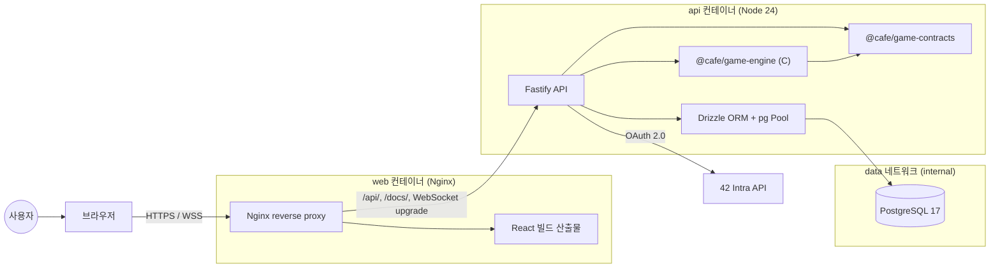

- 게임 상태의 기준은 서버다(server-authoritative). 클라이언트는 명령만 보내고, 서버가 검증·저장한 상태를 받는다.
- 게임 엔진은 별도 서비스가 아니라 API 프로세스 안의 라이브러리다(SRS: 마이크로서비스 불필요).
- 컨테이너 구성은 병합된 PR #10 기준이다. 실시간 기능은 별도 미병합 스택이며 이 그림은 통합 목표 구조를 보여 준다.

#### Use case diagram

Mermaid에 use case 전용 문법이 없어 flowchart로 표현한다. SRS v0.3.1 범위 기준이며 채팅은 후속 범위라 제외했다.


| Use case | 담당 | 상태 |
|---|---|---|
| Register, Login(email), Logout, 2FA, 42 OAuth, Link 42 | B (API), A (UI) | API `구현됨` (#11), UI `구현됨` (#21, #65) |
| View/Edit profile | B (API), A (UI) | `구현됨` (#11, #24, 전적 공개 #78) |
| Upload avatar | B (API), A (UI) | `구현됨` (#15, #24) |
| Friend, online status | E (+ D 연결 상태), A (UI) | `구현됨` (#95 REST, #98·#82 presence, #90 UI) |
| Auto match, Invite, Ready, Reconnect | D (실행), A (UI) | WS 인증·구독·명령·매칭·재접속 `구현됨` (#41~#43, #49, #50, #23), 초대 `계획` |
| Play gomoku / othello, Resign | C (규칙), D (실행), B (저장), A (UI) | `구현됨` (저장 #11, 오목 #12·#45·#22, 오델로 #58·#66) |
| History, statistics, achievement, leaderboard | B (API), A (UI) | `구현됨` (#11, #24) |

---

### 2.2 Composition viewpoint

#### 2. Frontend architecture (A)

아래 다이어그램은 화면 구성이다. #147 통합 후보(#96)에 인증·프로필·친구·매칭·오목·오델로·약관·탈퇴 UI와 Tailwind CSS가 포함된다. 친구 초대는 계획이다. 최종 제출 인수는 별도다.

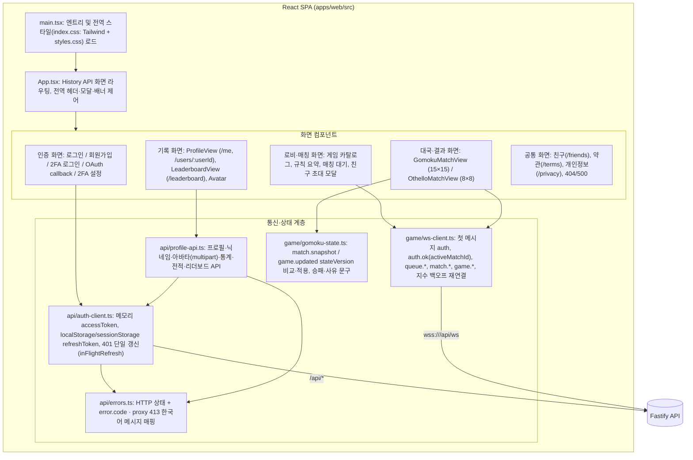

##### 모듈 책임 및 CSS·공통 스타일 위치 (NFR-UX-04)

- **라우팅 및 세션 부트스트랩 (`apps/web/src/App.tsx`)**: 브라우저 History API(`window.history.pushState`, `popstate`) 기반으로 화면을 전환한다. 최초 진입 시 저장된 `refreshToken`이 있으면 `POST /api/auth/refresh`로 세션을 복원하고 `GET /api/users/me`로 내 정보를 가져온다.
- **인증·HTTP 클라이언트 (`apps/web/src/api/auth-client.ts`, `errors.ts`, `profile-api.ts`)**:
  - `Authorization: Bearer <accessToken>` 헤더를 자동 첨부한다.
  - 보호 API가 `401`을 반환하면 진행 중인 갱신 Promise(`inFlightRefresh`)를 공유해 `POST /api/auth/refresh`를 **단 1회** 호출한 뒤 원래 요청을 1회 재시도한다. 갱신마저 실패하면 토큰을 비우고 `/login`으로 이동한다.
  - OAuth 시작 응답(`POST /api/auth/oauth/42/login` 또는 `link`)의 `flowToken`을 `sessionStorage`(`cyber_board_cafe.oauth42.flow_token`)에 저장하고 `authorizeUrl`로 이동한다. 42가 redirect한 `/oauth/42/callback?code=...&state=...`에서 보관된 `flowToken`을 JSON body에 넣어 `POST /api/auth/oauth/42/callback`을 호출한다. 성공 응답의 토큰 쌍·2FA challenge·`{ linked: true }`로 분기한다. 다른 탭·브라우저에서 열려 `flowToken`이 없거나 불일치하면 거절된다. 현재 서버는 `GET /start`나 callback 헤더 방식이 아니다.
- **실시간 WebSocket 클라이언트 (`apps/web/src/game/ws-client.ts`, `gomoku-state.ts`)**:
  - 연결 직후 첫 메시지로 `auth` (`{ accessToken }`)를 보내고 `auth.ok` (`{ userId, activeMatchId }`)를 받은 뒤에만 대기열·구독·게임 명령을 전송한다.
  - 비정상 종료 시 지수 백오프(`500ms × 2^attempt`, 최대 `8,000ms`)로 자동 재연결하며, close code `4401`(토큰 만료·무효)일 때는 `refreshAccessToken()`으로 새 `accessToken`을 발급받아 재연결한다.
- **CSS 도구와 공통 스타일 위치 (`apps/web/src/index.css`, `styles.css`, #119)**:
  - 스타일링 도구는 Tailwind CSS v4(`tailwindcss`, `@tailwindcss/vite` `4.3.3`)다. `vite.config.ts`의 `tailwindcss()` plugin이 빌드에 연결하고, `main.tsx`가 진입점 `index.css`를 로드한다.
  - `index.css`는 cascade layer 순서를 Tailwind theme → `styles.css`(components) → Tailwind utilities로 둔다. Tailwind preflight(전역 reset)는 `styles.css`의 base 규칙과 겹쳐 넣지 않는다.
  - 공통 폼(`flex flex-col gap-5` 등), 라벨, 부제, 프로필 레이아웃(`lg:grid-cols-[340px_1fr]`)은 컴포넌트의 Tailwind utility class로 쓴다(#119).
  - 여러 화면이 공유하는 버튼·입력·카드·모달·앱 레이아웃 19개 규칙은 `styles.css`의 `.cbc-*` 클래스 안에서 `@apply`로 Tailwind utility를 쓴다(#124, 예: `.cbc-input { @apply w-full rounded-lg py-3 pr-11 pl-4; … }`). components layer 안에서 펼쳐지므로 `cbc-btn-primary cbc-btn-compact`처럼 겹쳐 쓰는 클래스의 우선순위가 그대로다. 색상·테두리·상태 효과와 게임판 좌표·돌 같은 화면 고유 규칙은 CSS로 유지한다.
  - 평가 시연 위치와 순서는 [mandatory-checklist.md](evaluation/mandatory-checklist.md)의 "스타일링 솔루션 시연", 검증 기록은 [styling-validation.md](styling-validation.md)(#124)에 둔다.
  - 디자인 토큰은 `styles.css` `:root`의 CSS 변수이고, `index.css`의 `@theme inline`이 Tailwind 색·글꼴 이름(`text-on-surface-variant`, `font-display` 등)으로 연결한다. 주요 값: 배경 `--surface` `#fcf9f2`, 본문 `--on-surface` `#1c1c18`, 보조 문구 `--on-surface-variant` `#41493a`, 주 강조 `--primary` `#2f6c00`·`--primary-container` `#70b644`, 오류 `--error` `#ba1a1a`, 제목 글꼴 `Epilogue`, 본문 글꼴 `Plus Jakarta Sans`(`Pretendard`·`Apple SD Gothic Neo` 폴백).
- **게임 목록·플레이 가능 상태 및 사전 규칙 안내 (`FR-CAT-01`, `FR-CAT-02`)**:
  - `game/matchmaking-state.ts`의 `GAME_CATALOG`를 로비·매칭 화면이 공유한다. #66 브랜치에서는 두 종목 모두 `playable: true`이며 실행 서버 등록 여부는 통합 검증에서 따로 확인한다.
  - 홈·로비(`/`)의 게임 카탈로그에 **오목(Gomoku)**과 **오델로(Othello)** 두 게임을 표시하고, 각 카드에 현재 플레이 가능 상태 배지(예: `플레이 가능`, 엔진 미연결 시 `준비 중` 및 매칭 버튼 비활성)를 명시한다.
  - 대국 시작 전 로비 카드와 규칙 안내 패널에서 [GAME_RULES.md](GAME_RULES.md) 기준의 **판 크기·선공·승리 조건·특수 규칙 요약**(오목: 15×15, 흑 선공, 가로·세로·대각선 5목 이상 승리, 금수 없음 `gomoku-freestyle-v1` / 오델로: 8×8, 중앙 4칸 교차 배치·흑 선공, 8방향 끼우기 뒤집기, 합법 수 없을 때 자동 패스, 종료 시 돌 수 비교 `othello-standard-v1`)을 제공한다.

##### 화면 목록 (A 확인)

Stitch 시안(데스크톱, 2026-10-28 export, `cyber_board_cafe_stitch_2026-10-28/` 22개 화면 `01_login`~`22_error_500`)과 PR #11·#15 REST API 및 D의 WebSocket 이벤트 기준이다. 표시 언어는 한국어다(NFR-UX-01, README는 영어).

| Stitch 시안 번호·폴더 | 화면 | 경로 | 인증 | 사용하는 REST API (`#11`, `#15`, E) 및 WebSocket 이벤트 (D) |
|---|---|---|---|---|
| `01_login` | 로그인 | `/login` | 비로그인 | `POST /api/auth/login`, `POST /api/auth/oauth/42/login` |
| `02_signup` | 회원가입 | `/signup` | 비로그인 | `POST /api/auth/register` (성공 후 `POST /api/auth/login` 자동 로그인 시도) |
| `03_2fa` | 2FA 로그인 확인 | `/login/2fa` | `challengeToken` 보유 | `POST /api/auth/2fa/verify` (6자리 TOTP 또는 `XXXX-XXXX` 복구 코드) |
| `04_oauth_42_callback` | 42 OAuth callback | `/oauth/42/callback` | 비로그인 또는 로그인(`link`) | `POST /api/auth/oauth/42/callback` (`code`, `state`, `sessionStorage`의 `flowToken`) |
| `05_home_lobby` | 홈·로비 (게임 선택·규칙 안내·매칭 시작) | `/` | 필요 | `GET /api/users/me`, `GET /api/users/{userId}/stats`, `GET /api/leaderboard`, WS `auth` → `auth.ok`, `queue.join` |
| `06_matchmaking_waiting` | 매칭 대기 | `/matching` (또는 로비 대기 패널) | 필요 | WS `queue.joined`, `queue.leave` → `queue.left`, `queue.matched` |
| `07_gomoku_match`, `08_othello_match` | 오목·오델로 대국 | `/match/:matchId` (`status: playing \| paused`) | 참가자 | WS `match.subscribe`, `match.snapshot`, `game.command`(`place`), `game.ack`, `game.updated`, `game.error`, `error` |
| `09_resign_confirm_modal` | 기권 확인 모달 | `/match/:matchId` 위 모달 | 참가자 | 확인 시 WS `game.command` (`action: { type: "resign" }`) |
| `10_opponent_disconnected_banner` | 연결 끊김·유예 시간 배너 | `/match/:matchId` 상단 배너 | 참가자 | WS `player.disconnected`(`remainingMs`), `player.reconnected`, `session.replaced`, 내 WS close/reconnect 상태 |
| `11_gomoku_result`, `12_othello_result` | 오목·오델로 대국 결과 | `/match/:matchId` (`status: finished` 결과 패널/오버레이) | 참가자 | WS `game.updated` / `match.snapshot`의 `result`(`winnerId`, `outcome`, `reason`), 로비 복귀 시 `match.unsubscribe` → `match.unsubscribed` |
| `13_leaderboard` | 리더보드 | `/leaderboard` | 필요 | `GET /api/leaderboard?gameType=gomoku\|othello&limit=20` |
| `14_my_profile` | 내 프로필·통계·전적·아바타 | `/me` | 필요 | `GET /api/users/me`, `PATCH /api/users/me`, `PUT /api/users/me/avatar`, `DELETE /api/users/me/avatar`, `GET /api/media/avatars/{name}`, `GET /api/users/{userId}/stats`, `GET /api/users/{userId}/matches`, `GET /api/auth/2fa`, `POST /api/auth/oauth/42/link` |
| `15_other_user_profile` | 다른 사용자 프로필 | `/users/:userId` | 필요 | `GET /api/users/{userId}`, `GET /api/users/{userId}/stats`, `GET /api/users/{userId}/matches` (`403 RECORDS_PRIVATE` 시 비공개 안내) |
| `16_friends_chat` | 친구 목록·요청 관리 (채팅 제외) | `/friends` | 필요 | `GET /api/friends`, `GET /api/users?nickname=`, `POST /api/friends/requests`, `POST /api/friends/requests/{id}/accept`, `.../decline`, `DELETE /api/friends/{userId}`, WS `presence` |
| `17_settings_2fa` | 2FA 설정·복구 코드·해제 | 현재 `/me` 보안 섹션 (`/settings/2fa`는 시안 경로) | 필요 | `GET /api/auth/2fa`, `POST /api/auth/2fa/setup`, `POST /api/auth/2fa/enable`, `POST /api/auth/2fa/disable` |
| `18_account_menu_logout_modal` | 계정 메뉴·로그아웃 확인 모달 | 전역 헤더 위 모달 | 필요 | `POST /api/auth/logout` (`Authorization: Bearer <accessToken>`, 본문 없음), WS 연결 종료 |
| `19_notifications_toast_center` | 전역 알림·토스트·초대 수신 | 전역 오버레이 | 필요 | WS `invite.send`, `invite.received`, `invite.accept`, `invite.decline`, `invite.cancel`, `invite.updated`, `invite.error` |
| `20_terms_privacy` | 이용약관·개인정보처리방침 | `/terms`, `/privacy` | 없음 (비로그인 접근 가능) | 정적 문서 (`NFR-PRIV-01`, 로그인·회원가입·하단 푸터에서 상시 접근) |
| `21_error_404`, `22_error_500` | 404 찾을 수 없음 / 500 서버 오류 | `*` (미정의 경로), 전역 오류 경계 | 없음 | 없음 (`홈으로 이동` / `다시 시도` 액션 제공) |

- Stitch의 `16_friends_chat` 시안은 우측 채팅 영역을 포함하지만, 채팅은 SRS v0.3.1 후속 범위이므로 구현 화면에서는 제외하고 친구 검색·요청·목록·온라인 상태·대국 초대에 집중한다.
- Stitch의 `07_gomoku_match`, `08_othello_match` 시안 우측 하단 채팅 입력창도 같은 이유로 제외하고 대국 정보·수순/돌 수·기권·연결 상태 영역으로 구성한다.

##### 화면 전이 (A 확인)

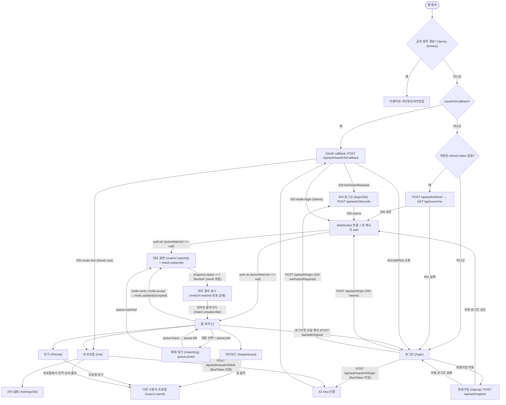

세부 전이 규칙:

1. **초기 접속 및 세션 복원**:
   - `/terms`, `/privacy`는 인증 여부와 무관하게 즉시 표시한다(`NFR-PRIV-01`).
   - 그 외 경로에서 `localStorage`(또는 `sessionStorage`)에 `refreshToken`이 있으면 `POST /api/auth/refresh`로 새 `accessToken`·`refreshToken`을 발급받고 `GET /api/users/me`를 호출한다. 실패(401)하면 저장된 토큰을 삭제하고 `/login`으로 이동한다.
2. **회원가입 후 전이 (`/signup`)**:
   - `POST /api/auth/register`(`201`) 성공 시 같은 이메일·비밀번호로 `POST /api/auth/login`을 이어서 호출해 즉시 로비(`/`)로 진입한다. 만약 후속 자동 로그인만 일시 오류로 실패하면 안내 배너와 함께 `/login`으로 보낸다.
3. **로그인·2FA·42 OAuth 전이**:
   - `POST /api/auth/login` 또는 `POST /api/auth/oauth/42/callback`(`mode: "login"`) 응답이 `{ twoFactorRequired: true, challengeToken, expiresAt }`이면 `challengeToken`을 메모리에 보관하고 `/login/2fa`로 이동한다.
   - `/login/2fa`에서 6자리 TOTP 코드 또는 10자리 복구 코드(`XXXX-XXXX` 또는 8자리 영숫자)로 `POST /api/auth/2fa/verify`에 성공하면 토큰을 저장하고 WebSocket 인증 단계로 진입한다. `401 CHALLENGE_EXPIRED`(만료 또는 5회 실패 폐기)가 오면 `challengeToken`을 비우고 `/login`으로 되돌린다.
   - 내 프로필(`/me`)에서 `42 계정 연결`(`POST /api/auth/oauth/42/link`)을 시작한 경우 `sessionStorage`에 `flowToken`을 저장한다. callback 응답이 `{ linked: true }`이면 토큰을 교체하지 않고 `/me`로 복귀해 연결 완료 안내를 띄운다. 위 다이어그램의 `/settings/2fa`는 시안 경로이며, #65의 설정 UI는 현재 `/me` 보안 섹션에 구현돼 있다.
4. **진행 중 경기 자동 복귀 (`auth.ok`의 `activeMatchId`, A·D 합의 확정)**:
   - 로그인 성공 직후 또는 새로고침으로 세션 복원 직후 WebSocket `/api/ws`를 연결해 첫 메시지 `auth`를 보낸다.
   - 서버가 보낸 `auth.ok` payload(`{ userId, activeMatchId }`)에 **`activeMatchId`가 `null`이 아니면**, 사용자가 `/`이나 `/login`에 있었더라도 로비에 머물지 않고 즉시 `/match/:matchId`로 경로를 전환한 뒤 `match.subscribe` (`{ matchId: activeMatchId }`)를 전송해 진행 중 대국(`match.snapshot`)을 복원한다(2.5의 9번, 2.6의 13번).
   - 사용자가 브라우저 주소창으로 `/match/:matchId`에 직접 진입한 경우에도 `auth.ok` 수신 즉시 해당 `matchId`로 `match.subscribe`를 보낸다.
5. **매칭 대기·친구 초대·대국·결과 전이**:
   - 로비에서 게임을 고르고 매칭 시작을 누르면 `queue.join` (`{ gameType }`)을 보내고 `queue.joined` 수신 시 매칭 대기 화면(`/matching`)을 표시한다.
   - 대기 중 취소 버튼을 누르면 `queue.leave`를 보내고 `queue.left` 수신 시 로비(`/`)로 돌아온다.
   - `queue.matched` (`{ matchId, gameType }`) 또는 친구 초대 수락 알림(`invite.updated` `status: "accepted"`)을 받으면 즉시 `/match/:matchId`로 이동하고 `match.subscribe` (`{ matchId }`)를 전송한다.
   - 대국 중 `match.snapshot` 또는 `game.updated`의 `status === "finished"`가 도착하면 별도 페이지 새로고침 없이 같은 `/match/:matchId` 화면 위에 결과 오버레이·패널(`11_gomoku_result`, `12_othello_result`)을 표시한다.
   - 결과 화면에서 `로비로 돌아가기`를 누르면 `match.unsubscribe` (`{ matchId }`)를 보내고 `/`로 이동한다.

##### 표시 규칙 (A 확인)

| 구분 | 상황 | 표시 및 동작 규칙 |
|---|---|---|
| **로딩** | 초기 세션 복원 / 프로필·통계·리더보드 조회 | 데이터 영역에 Stitch 톤(`#221e19`~`#2c2720`) skeleton 카드와 `role="status"` `aria-live="polite"` 안내 문구를 표시한다 |
| **로딩** | 폼 제출(로그인·가입·2FA·닉네임·아바타) | 요청 진행 중 제출 버튼을 `disabled`로 잠그고 진행 문구(`로그인 중...`, `업로드 중...`)로 바꿔 중복 제출을 막는다 |
| **로딩** | 대국 착수·기권 명령 전송 (`pendingCommand`) | `game.command` 전송 시점부터 해당 `commandId`의 `game.ack` / `game.updated` / `game.error` 수신(또는 WS 연결 종료) 전까지 보드 칸과 기권 버튼을 잠가 중복 클릭을 방지한다 |
| **빈 데이터** | 완료 경기 0건 (`played === 0`) | 승률은 `0%`가 아니라 **`-`**로 표시한다(`DEC-08`). 진행도는 `0% (0 / 10판)`, 첫 승리 배지는 `미달성`으로 표시한다 |
| **빈 데이터** | 전적·리더보드·친구 목록 0건 | 빈 표 대신 중앙 안내 문구(`아직 완료된 대국 기록이 없습니다.`, `아직 집계된 완료 대국이 없습니다.`, `등록된 친구가 없습니다.`)를 표시한다 |
| **빈 데이터** | 아바타 미설정 (`avatarUrl === null`) 또는 이미지 로드 실패 | 깨진 이미지 아이콘을 노출하지 않고 닉네임 첫 글자(대문자)와 고정 배색을 조합한 기본 이니셜 아바타 SVG를 표시한다(`DEC-05`) |
| **오래된 갱신** | WebSocket 이벤트 순서 역전 | `game.updated`의 `stateVersion`이 현재 클라이언트의 `stateVersion` 이하이면 무시한다. `match.snapshot`은 `stateVersion`이 현재 이상이면 상태를 통째로 교체하고(같은 버전의 `playing` ↔ `paused` 전환 반영), 현재보다 작으면 무시한다(2.6의 13번) |
| **연결 끊김 (본인)** | 브라우저 네트워크 단절 / WS close | 대국 화면 상단에 `실시간 서버와 연결이 끊어졌습니다. 자동 재연결 중...` 경고 배너를 띄우고 보드 입력을 비활성화한다. 재연결 후 `auth.ok` → `match.subscribe` → `match.snapshot` 수신 시 배너를 닫고 입력을 복구한다 |
| **연결 끊김 (상대)** | `player.disconnected` 수신 | 상단 배너(`10_opponent_disconnected_banner`)에 `상대방 연결이 끊어졌습니다. 남은 복귀 유예 시간: {초}초`를 표시하고 `remainingMs` 기준으로 1초 단위 로컬 카운트다운을 보여준다. **단, 로컬 카운트다운이 0초가 되어도 클라이언트가 임의로 승패를 판정하지 않고** 서버의 `game.updated`(`reason: "disconnect_timeout"`) 또는 `player.reconnected`를 기다린다(`FR-RT-01`) |
| **다중 탭·기기 전환** | `session.replaced` 수신 | 상단에 `다른 탭 또는 기기에서 대국 제어권을 가져왔습니다. 이 화면은 관전(읽기 전용) 상태입니다.` 배너를 표시하고 이 탭의 착수·기권 입력을 비활성화한다(`FR-MATCH-02`) |
| **위험 동작** | 기권·로그아웃·2FA 해제·회원 탈퇴 | 즉시 실행하지 않고 확인 모달(`role="dialog"`, `aria-modal="true"`)을 띄운다. 진입 버튼은 outline 스타일로 두고, 모달 안의 최종 확인 버튼만 강조색(`#ff7a00` 또는 위험 `#ffb4ab`/`#93000a`)을 쓴다. 2FA 해제는 현재 TOTP 코드 또는 복구 코드 입력을 함께 요구한다 |

###### REST 오류 코드별 표시 규칙 (`apps/web/src/api/errors.ts`, PR #11·#15 기준)

3 MiB를 넘는 업로드 요청은 Fastify에 도달하기 전에 Nginx(`client_max_body_size 3m`)가 HTML `413`으로 차단할 수 있다. 따라서 클라이언트는 JSON 응답의 `error.code`뿐 아니라 **`error.code`가 없는 HTTP `413` 응답도 동일하게 파일 크기 초과 오류로 처리**한다.

| HTTP 상태 | `error.code` | 발생 경로 | 화면 표시 및 클라이언트 동작 |
|---|---|---|---|
| `400` | `BAD_REQUEST` | 잘못된 JSON 본문, 잘못된 multipart 형식 | 입력·요청 형식을 확인해 달라는 인라인 오류 배너 표시 |
| `401` | `UNAUTHORIZED` | 보호 API 토큰 누락·만료, 세션 폐기 | `refreshToken`이 있으면 `POST /api/auth/refresh` 1회 시도 후 원 요청 재시도. 갱신도 `401`이면 토큰 삭제 후 `/login`으로 이동 |
| `401` | `INVALID_CREDENTIALS` | `POST /api/auth/login` | 로그인 폼 하단에 `이메일 또는 비밀번호가 올바르지 않습니다.` 표시 |
| `401` | `CHALLENGE_EXPIRED` | `POST /api/auth/2fa/verify` | `2단계 인증 시간이 만료되었거나 허용 횟수(5회)를 초과했습니다. 다시 로그인해 주세요.` 표시 후 `/login`으로 이동 |
| `401` | `INVALID_TWO_FACTOR_CODE` | `POST /api/auth/2fa/verify`, `enable`, `disable` | 코드 입력란 하단에 `인증 코드가 올바르지 않습니다. 6자리 TOTP 코드 또는 복구 코드를 확인해 주세요.` 표시 |
| `401` | `OAUTH_STATE_INVALID` | `POST /api/auth/oauth/42/callback` | `42 OAuth 인증 상태가 만료되었거나 다른 브라우저에서 시작된 요청입니다.` 표시 및 `/login` 이동 버튼 제공 |
| `403` | `RECORDS_PRIVATE` | `GET /api/users/{userId}/stats`, `matches` (2.10.26) | 프로필 상단 기본 정보는 유지하고, 통계·전적 영역에 `이 사용자의 전적은 비공개입니다.` 안내 카드 표시 |
| `404` | `NOT_FOUND` / `USER_NOT_FOUND` | 없는 사용자·아바타·리소스 조회 | 프로필 조회 시 `찾을 수 없는 사용자입니다.` 안내 및 로비 복귀 버튼 표시, 미정의 경로는 `21_error_404` 표시 |
| `409` | `EMAIL_TAKEN` | `POST /api/auth/register` | 이메일 입력란에 `이미 가입된 이메일입니다.` 표시 |
| `409` | `NICKNAME_TAKEN` | `POST /api/auth/register`, `PATCH /api/users/me` | 닉네임 입력란에 `이미 사용 중인 닉네임입니다.` 표시 |
| `409` | `OAUTH_EMAIL_CONFLICT` | `POST /api/auth/oauth/42/callback` | `동일한 이메일의 일반 계정이 이미 존재합니다. 기존 계정으로 로그인한 뒤 프로필에서 42 계정을 연결해 주세요.` 안내 |
| `409` | `OAUTH_ALREADY_LINKED` | `POST /api/auth/oauth/42/callback` | `이미 다른 계정에 연결된 42 계정입니다.` 안내 |
| `409` | `TWO_FACTOR_ALREADY_ENABLED` / `TWO_FACTOR_NOT_SETUP` / `TWO_FACTOR_NOT_ENABLED` | `/api/auth/2fa/*` | 2FA 상태를 다시 조회(`GET /api/auth/2fa`)해 화면 단계를 동기화하고 안내 문구 표시 |
| `409` | `ALREADY_FRIENDS` / `REQUEST_PENDING` / `REQUEST_DECLINED` | `/api/friends/*` (2.10.29) | 각각 `이미 친구 상태입니다.`, `이미 친구 요청을 보냈습니다.`, `상대방이 거절한 요청입니다.` 토스트 표시 |
| `413` | `PAYLOAD_TOO_LARGE` 또는 `error.code` 없음(Nginx HTML 413) | `PUT /api/users/me/avatar` 등 | `업로드할 파일이 너무 큽니다. 2 MiB 이하의 PNG 또는 JPEG 이미지를 선택해 주세요.` 표시 (클라이언트에서도 `file.size > 2 * 1024 * 1024` 사전 검사 수행) |
| `415` | `UNSUPPORTED_MEDIA_TYPE` | 잘못된 Content-Type 또는 PNG/JPEG 서명 불일치 | 아바타 업로드 시 `PNG 또는 JPEG 이미지 파일만 업로드할 수 있습니다.` 표시 |
| `422` | `IMAGE_TOO_BIG` | `PUT /api/users/me/avatar` (가로·세로 1024px 초과) | `이미지 해상도가 너무 큽니다. 가로·세로 1024px 이하 이미지를 업로드해 주세요.` 표시 |
| `422` | `VALIDATION_ERROR` | JSON Schema 검증 실패 | `error.details.issues`의 `instancePath`별 필드 오류 문구(이메일 형식, 비밀번호 8~72자, 닉네임 2~32자 등)를 해당 입력란 아래에 표시 |
| `429` | `RATE_LIMITED` | 인증·OAuth·아바타 분당 10회 초과 | `요청이 너무 많습니다. 잠시 후 다시 시도해 주세요.` 배너/토스트 표시 |
| `502` | `OAUTH_UPSTREAM_ERROR` | 42 Intra API 통신 실패 | `42 인증 서버와 통신할 수 없습니다. 잠시 후 다시 시도해 주세요.` 표시 |
| `500`, `503` | `INTERNAL_ERROR`, `SERVICE_UNAVAILABLE` | 서버 내부 오류, DB/2FA/OAuth 미설정 | 기능 화면 안에서는 재시도 가능한 오류 배너/토스트를 띄우고, 전체 화면 치명 오류 시 `22_error_500` 화면을 표시 |

###### WebSocket 및 게임 명령 오류 표시 규칙 (`game.error`, `error`)

| 메시지 `type` | `code` | 클라이언트 처리 및 표시 |
|---|---|---|
| `game.error` | `VERSION_CONFLICT` | 다른 착수나 상태 변경이 먼저 반영된 것이므로 토스트로 방해하지 않고 뒤이어 도착하는 최신 `match.snapshot`(또는 재구독 snapshot)으로 보드를 즉시 다시 그린다 |
| `game.error` | `NOT_YOUR_TURN` | `현재 내 차례가 아닙니다.` 배너/토스트 표시 및 `pendingCommand` 해제 |
| `game.error` | `INVALID_ACTION` | `놓을 수 없는 위치입니다.` (오목: 이미 돌이 있는 칸·범위 밖 / 오델로: 상대 돌을 끼우지 못하는 칸) 안내 및 `pendingCommand` 해제 |
| `game.error` | `GAME_NOT_ACTIVE` | 일시정지(`paused`) 또는 시작 전 상태 안내(`대국이 일시정지 상태입니다.`) 표시 |
| `game.error` | `GAME_FINISHED` | `이미 종료된 대국입니다.` 표시 |
| `game.error` | `NOT_SUBSCRIBED` | 대국 구독이 풀린 상태이므로 즉시 `match.subscribe` (`{ matchId }`)를 자동 재전송해 최신 `match.snapshot`을 복구한다 |
| `error` | `NOT_FOUND` / `NOT_PARTICIPANT` | 존재하지 않거나 참가자가 아닌 대국이므로 안내 문구와 함께 `로비로 돌아가기` 버튼을 표시한다 |
| `error` | `ALREADY_IN_QUEUE` / `ALREADY_IN_MATCH` / `ALREADY_ACTIVE` | 이미 대기열 또는 진행 중 경기에 참가 중인 상태 안내를 띄우고, 활성 경기 ID가 있으면 해당 대국 화면으로 이동한다 |
| `invite.error` | `NOT_FRIEND` / `TARGET_BUSY` / `INVITE_EXPIRED` / `INVITE_CANCELLED` | 전역 토스트(`19_notifications_toast_center`)에 사유(`친구가 현재 다른 대국 또는 매칭 중입니다.`, `초대 유효시간(60초)이 만료되었습니다.`)를 표시하고 초대 모달 상태를 정리한다 |

##### 토큰 보관 방식 (A·B 합의 확정)

아래 IF-02 계약은 #55 `b431f05`에서 구현·검증 후 게시했고 #56 → #57 → #63 → #71 `011b5a8`까지 전파했다. access token은 메모리 전용이며 refresh만 저장한다. 이전 token pair 저장 형식은 refresh-only로 이전하고, Web Locks로 같은 origin의 공유 refresh 회전을 직렬화한다. Web Locks 미지원 환경과 복제된 sessionStorage 탭의 동기화는 보장하지 않는다. #72·#73 등 나머지 웹 브랜치에는 이 수정 전파가 남아 있다. 실행 범위는 [인증 검증 기록](https://github.com/EscapeFromGyeongsan/ft_transcendence/blob/b431f05fa9a19055b5a82e8da0e2e6b345f2e4ad/Document/auth-web-validation.md)을 따른다.

5장 미결정 항목이었던 토큰 보관·전달 방식을 다음과 같이 확정한다(1.1 Security design과 일치):

- **`accessToken` (JWT, 30분)**: 브라우저 스토리지(`localStorage`, `sessionStorage`, `IndexedDB`, 쿠키)에 저장하지 않고 **메모리 변수(`auth-client.ts`)에만 보관**한다. HTTP 요청에는 `Authorization: Bearer <accessToken>` 헤더로, WebSocket 연결에는 첫 메시지 `auth` (`{ accessToken }`)로만 전달한다. URL query string에는 절대 넣지 않는다.
- **`refreshToken` (opaque, 7일)**: 로그인 화면의 `로그인 상태 유지` 체크 시 **`localStorage`(`cbc.auth.refreshToken`)**, 해제 시 **`sessionStorage`**에 보관하고, `POST /api/auth/refresh`의 JSON body(`{ refreshToken }`)로 전달한다. 로그아웃은 access token의 Bearer 헤더로 현재 세션을 식별하며 본문을 보내지 않는다.
- **보안 대책 및 폐기**: 쿠키 자동 전송을 쓰지 않으므로 cookie 기반 CSRF 공격 대상이 아니다. XSS를 통한 토큰 접근을 막기 위해 React 기본 텍스트 이스케이프를 유지하고(`dangerouslySetInnerHTML` 미사용), 사용자 입력(닉네임 등)을 DOM에 직접 삽입하지 않으며, 서버의 refresh token 1회용 회전·재사용 감지 시 세션 전체 폐기(1.1)와 결합한다. 현재 세션의 로그아웃 또는 refresh `401` 실패 시 해당 세션의 저장 토큰과 메모리 토큰을 삭제한다. 이전 세션의 늦은 refresh 응답은 새 로그인 세션을 덮어쓰거나 삭제하지 않는다.

##### 키보드 상세 동작 및 접근성·반응형 설계 (A, NFR-UX-02~04)

###### 1. 전역 및 대국판 키보드 상세 동작 (`NFR-UX-02`)

마우스 없이 키보드만으로도 로그인 → 매칭 시작 → 대국 착수·기권 → 결과 확인 → 프로필·리더보드 탐색 전 과정을 수행할 수 있도록 다음 키 매핑을 적용한다.

| 영역 | 키 입력 | 상세 동작 |
|---|---|---|
| 전역 탐색 | `Tab` / `Shift + Tab` | 상단 내비게이션(로비, 리더보드, 내 프로필, 로그아웃) → 본문 주요 액션 → 대국판/표 순서로 논리적 포커스 이동 |
| 버튼·링크·탭 | `Enter` / `Space` | 포커스된 버튼, 게임 선택 카드, 리더보드/프로필 게임 탭(`오목` / `오델로`), 모달 액션 실행 |
| 대국판 진입 | `Tab` | 보드 격자(`role="grid"`) 내 현재 활성 칸(초기 중앙 칸: 오목 `(7, 7)`, 오델로 `(3, 3)` 또는 마지막 포커스 칸)으로 진입 |
| 대국판 칸 이동 | `ArrowUp` / `ArrowDown` / `ArrowLeft` / `ArrowRight` | 현재 칸 `(row, col)`에서 상하좌우 인접 칸(`row ± 1`, `col ± 1`)으로 포커스 이동. 보드 경계(`0..size-1`) 밖으로는 넘어가지 않음 |
| 대국판 행 양끝 이동 | `Home` / `End` | 현재 행의 첫 열 `(row, 0)` / 마지막 열 `(row, size - 1)`로 포커스 이동 |
| 대국판 전체 양끝 이동 | `Ctrl + Home` / `Ctrl + End` | 보드 첫 칸 `(0, 0)` / 마지막 칸 `(size - 1, size - 1)`로 포커스 이동 |
| 대국판 착수 | `Enter` / `Space` | 포커스된 칸이 비어 있고(오델로는 합법 수이고) 내 차례(`playing`)이며 `pendingCommand`가 없을 때 `game.command` (`place`) 전송 |
| 확인 모달 (기권·로그아웃·2FA 해제) | `Escape` | 열린 확인 모달을 즉시 닫고(취소 처리), 모달을 열었던 원래 버튼(예: `기권`, `로그아웃`)으로 포커스를 되돌림 |

###### 2. 포커스 표시·비색상 시각 단서·ARIA 규칙 (`NFR-UX-02`)

- **키보드 포커스 링**: 모든 대화형 요소(`button`, `input`, `a`, 보드 교차점 버튼 `.cbc-board-cell`)에 `:focus-visible` 스타일(`outline: 2px solid #ff7a00; outline-offset: 2px`)을 적용해 현재 포커스 위치를 명확히 드러낸다.
- **보드 칸 접근성 레이블**: 현재 구현의 보드 칸 `<button>`은 `aria-label="{row}, {col} {상태}"` 형태로 0-based 좌표와 상태를 제공한다(예: `"7, 7 빈 칸"`, `"7, 7 흑돌"`). TEST_PLAN과 전송 좌표도 같은 기준을 쓴다. 착수 불가능 상태(이미 놓인 칸, 상대 차례, 경기 일시정지·종료, `pendingCommand`, `sessionReplaced`)에서는 `disabled` 속성을 부여한다.
- **색상에만 의존하지 않는 상태 구분**:
  - 흑/백 돌 구분: 색상 대비(흑돌 `#141210` 하이라이트 vs 백돌 `#f5eee6` 테두리)와 함께 플레이어 카드에 **`흑 (선공)` / `백 (후공)` 텍스트 배지**와 아이콘을 병기한다.
  - 차례 및 상태 구분: 색상 점 외에도 **`내 차례` / `상대 차례` / `일시정지(연결 끊김)` / `대국 종료` 텍스트 배지**와 상단 요약 문구를 함께 표시한다.
  - 마지막 착수 및 합법 수 표시: 마지막에 놓인 돌 위에는 호박색 원형 링 마커(`.cbc-stone-last`)를 겹쳐 표시하고 우측 상태 패널에 `마지막 수: 흑 (8, 8)` 텍스트를 함께 적는다. 오델로의 합법 착수 칸에는 중앙 보조 점 마커와 함께 합법 수 개수를 텍스트로 표시한다.
- **실시간 상태 알림 영역**: 매칭 대기 상태, 대국 차례·오류 배너, 연결 끊김 배너는 `role="status"` 또는 `role="alert"`(`aria-live="polite"`)로 마크업해 화면 낭독기가 상태 변화를 읽을 수 있게 한다.

###### 3. 반응형 게임판 및 뷰포트 레이아웃 (`NFR-UX-03`)

SRS `NFR-UX-03`의 세 기준 해상도(`1440×900` 데스크톱, `768×1024` 태블릿, `360×800` 모바일)에서 가로 스크롤 없이 모든 조작 요소와 대국판이 화면 안에 들어오도록 CSS Grid와 가변 정사각형 보드(`aspect-ratio: 1 / 1`)를 사용한다.

| 기준 뷰포트 | 레이아웃 구조 | 대국판 및 조작부 배치 규칙 |
|---|---|---|
| 데스크톱 (`1440×900`, `> 1100px`) | 3열 그리드 (`260px minmax(320px, 720px) 300px`) | 좌측: 흑/백 플레이어 카드·착수 수/돌 수·기권 버튼 / 중앙: 정사각형 대국판(`max-width: 720px`) / 우측: 대국 상태·마지막 수·규칙 요약 패널 |
| 태블릿 (`768×1024`, `768px ~ 1100px`) | 상하 결합 2열 그리드 | 상단에 좌·우 플레이어 카드를 나란히 배치하고, 중앙에 대국판(`width: min(100%, 640px); aspect-ratio: 1 / 1`), 하단에 상태·기권·규칙 패널을 배치 |
| 모바일 (`360×800`, `<= 767px`) | 1열 수직 스택 (`padding: 0.75rem`) | 상단 내비게이션 줄바꿈 허용, 플레이어 요약 바 → 정사각형 대국판(`width: 100%; aspect-ratio: 1 / 1; padding: 0.45rem`) → 하단 기권·상태 패널 순으로 배치. 15×15 오목 칸도 `minmax(0, 1fr)` 균등 분할로 `360px` 폭 안에서 잘리지 않고 터치·키보드 포커스가 동작함 |

##### 스타일링 솔루션 (`NFR-UX-04`, #116)

B의 [#118](https://github.com/EscapeFromGyeongsan/ft_transcendence/pull/118) 문서 커밋 `a727ade`·`69a2e29`의 스타일링 설명과 시연 절차를 이 통합 후보의 문서 구조에 맞춰 반영했다.

- Tailwind CSS와 `@tailwindcss/vite`는 **4.3.3**이다. `apps/web/vite.config.ts`의 `tailwindcss()`가 production build에 연결되고 `main.tsx`는 `index.css`를 로드한다.
- `index.css`는 `theme → styles.css(components) → utilities` 순서로 cascade layer를 구성한다. 기존 전역 규칙을 보존하기 위해 Preflight는 제외한다.
- 로그인 폼의 `flex flex-col gap-5`, 친구 검색 필드의 `flex min-w-48 flex-1 flex-col gap-1.5`, 프로필의 `lg:grid-cols-[340px_1fr]`처럼 JSX에서 유틸리티를 직접 사용한다(#119).
- 공통 버튼·입력·카드·모달·앱 레이아웃 19개 규칙은 `.cbc-*` 클래스 안에서 `@apply`를 사용한다(#124). 예: `.cbc-input { @apply w-full rounded-lg py-3 pr-11 pl-4; … }`. 게임판 좌표·돌과 상태별 색상·테두리는 화면 고유 CSS를 함께 사용한다.
- `@theme inline`은 기존 CSS 변수를 Tailwind 색상·글꼴에 연결한다. 배경 `--surface: #fcf9f2`, 본문 `--on-surface: #1c1c18`, 주 강조 `--primary: #2f6c00`, 제목 `Epilogue`, 본문 `Plus Jakarta Sans`다.
- 사용 코드와 렌더링은 [평가 체크리스트](evaluation/mandatory-checklist.md#스타일링-솔루션-시연-116)의 순서로 두 화면 이상에서 시연한다. [#124 검증 기록](styling-validation.md)과 최종 제출 SHA의 HTTPS/WSS·작성자 외 재현을 구분한다.
- 최신 master와 #119를 합친 후보의 빌드·실제 API/DB·Chrome 결과와 남은 조건은 [#116 통합 검증](styling-116-integration-validation.md)에 기록한다.

##### 평가 시나리오 결함 대응 (#136)

#143 위에 B의 #142·#126과 A의 후속 수정을 통합했다. OAuth·수동 갱신 안내는 화면 공통 영역에서 표시하고 본인 계정의 42 연결 상태는 `GET /api/users/me.oauth42Linked`로 확인한다. 종료된 대기열과 거절된 경기 재개 경로는 정리하며, 제어권 상실 후에는 재인증·재구독 스냅샷을 받은 뒤에만 착수·기권을 허용한다. 모달 포커스·계정 메뉴 키보드·화면 제목 포커스·턴 live 안내·타이머 알림·reduced motion과 항목별 검증은 [#136 수정 기록](evaluation-136-validation.md)을 따른다. 본인 계정 필드의 공개 범위는 [계약 문서](contracts.md#본인-계정의-인증-수단-표시-136)에 명시한다.

##### 친구 REST 화면 후속 구현 (#80·#90, 2026-11-12)

`feat/web-friends`는 `/friends` 프런트를 추가하며 #95 `758459e`와 #98 `07a4989`의 소스·리뷰에 맞춰 계약을 대조했다. 두 서버 PR은 미병합이다. 별도 후보의 실제 두 계정 검증은 서버 PR의 병합·출시 조건 해결을 뜻하지 않는다.

- 로그인한 사용자만 `/friends`에 진입한다. 로비·계정 메뉴에서 이동하며, 상대 프로필의 친구 검색·요청 버튼은 해당 닉네임으로 검색한다. 직접 접근·새로고침·방문 기록 이동을 기존 라우팅에 연결한다.
- `api/friends-api.ts`가 REST 응답을 검증한다. 목록·요청은 `{ userId, nickname, avatarUrl }` 공통형과 `online` 또는 `requestId/createdAt`을 사용한다. #95 검색의 `{ id, nickname, avatarUrl }[]`를 `userId`로 변환한다. 부적합한 응답은 오류로 표시한다.
- `friends/friends-state.ts`는 조회를 직렬화하고 여러 갱신 요청을 모은다. 오래된 검색·이전 화면 수명의 응답을 폐기하며, 계정별로 화면을 다시 만들어 사용자 데이터가 남지 않게 한다.
- 변경 요청은 서버 응답 이후 확정하고 목록 전체를 재조회한다. 변경 성공과 재조회 실패는 별도로 표시하며, 오래된 목록에서는 추가 변경을 막는다. 수락·거절은 최신 요청 ID를 확인하고 충돌 시 변경 요청을 재전송하지 않는다.
- 각 친구 요청은 15초 제한과 AbortSignal을 사용한다. 공유 refresh는 유지하되 timeout된 변경 요청은 지연 refresh 이후에도 새로 전송하지 않는다. 결과 미확정 안내와 목록 재조회로 복구한다.
- 거절 확인은 재요청 차단과 본인이 먼저 요청할 수 있는 동선을 안내한다. 대화상자는 기본 취소 포커스·키보드 이동·Escape 취소·버튼 또는 제목으로의 포커스 복귀를 지원한다. 친구 삭제는 별도 확인 동작이다.
- 초기 조회 실패를 빈 목록으로, 미확인 온라인 상태를 false로 바꾸지 않는다. 마지막 조회 시점 기준임을 안내하며 명시적 null은 확인 불가로 보존한다. 현재 #95는 온라인 집계 미연결 시 503을 반환한다. WS 연결이 끊기면 온라인 상태를 확인 불가로 표시하고, 인증 연결 복구 후 목록을 다시 읽는다.
- 인증 후 `presence { userId, online }`와 `friends.changed {}`를 받으면 목록을 다시 읽는다. 알림 값으로 직접 덮지 않는다. 서버의 온라인 registry·변경 알림 연결과 #98의 삭제 후 수신자 경합 해결은 통합 조건이다. 초대·재대국·채팅은 이 변경의 범위가 아니다.

검증 범위·결과·응답 대체와 실제 서버의 구분은 [친구 화면 검증 기록](friends-web-validation.md)을 따른다.

#### 3. Backend architecture (B)

`구현됨`. 디렉터리와 책임은 다음과 같다.

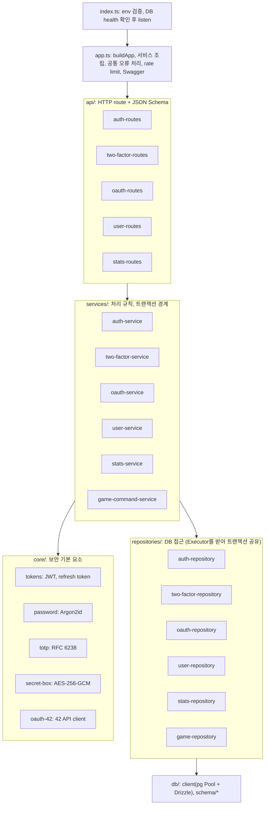

규칙:

- route는 검증·응답 형식만 담당하고, 처리 규칙은 service, SQL은 repository에 둔다.
- 하나의 처리에 참여하는 repository 호출은 같은 `Executor`(트랜잭션)를 받는다. 일부만 저장되는 일이 없다.
- 서비스는 `buildApp`에서 한 번 만든다. DB나 설정이 없으면 해당 route는 503을 반환한다(`ServiceUnavailableError`).
- 공통 오류 처리: 검증 422, JSON 오류 400, Content-Type 415, rate limit 429, 42 장애 502, DB 연결 장애·statement timeout 503, 그 외 500. 응답 형식은 `{ "error": { "code", "message", "details?" } }`.

#### 4. Domain boundary (플랫폼 경계, 명세 12장)

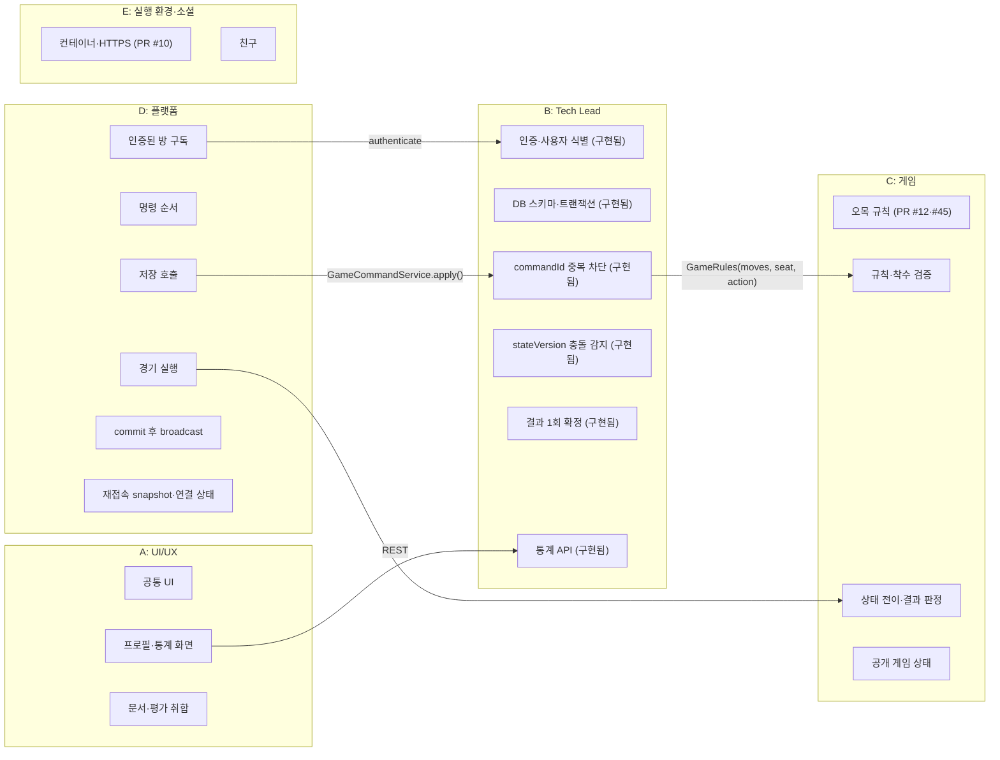

경계 규칙 (CON-04):

- 게임 규칙(C)은 규칙 버전, `GameRules` 함수, 보드 복원 함수(`{ version, rules, board }`)로 플랫폼에 연결한다. `rules`의 입력은 지금까지의 착수 목록·두는 사람·행동, 출력은 거절 코드(`INVALID_ACTION`, `GAME_FINISHED`) 또는 다음 차례·종료 결과다. `board`는 저장된 착수 목록으로 현재 보드를 만든다(오델로의 뒤집기는 규칙이 필요하므로 엔진이 맡는다).
- 잠금·버전·중복·저장(B)과 전송(D)은 게임 종류와 무관하다. 금수 같은 규칙을 추가해도 인증·방·전송·저장 코드는 바뀌지 않는다.
- 게임 추가 시 `gameType` 값, `GameRules` 구현, 계약 타입(PR #6 절차)만 추가한다. DB의 `games_game_type_check`에 값을 더하는 migration이 함께 필요하다.

##### 게임 엔진 연결 (설계 및 PR #45·#58 엔진 구현 기준, 실행 서버 등록 별도)

| 항목 | 오목 (`gomoku-freestyle-v1`) | 오델로 (`othello-standard-v1`, PR #58 구현) |
|---|---|---|
| 판 | 15×15, `row/col` 0..14 | 8×8, `row/col` 0..7 |
| 시작 | 빈 판, 흑 먼저 | 가운데 4칸: (3,3)·(4,4) 백, (3,4)·(4,3) 흑. 흑 먼저 |
| 합법 착수 | 빈 교차점 | 빈 칸이고 8방향 중 하나 이상에서 상대 돌을 끼움 |
| `board(moves)` | 착수 순서대로 돌을 놓음 | 착수마다 뒤집기를 적용해 재생 (엔진만 가능) |
| 다음 차례 (`nextTurn`) | 항상 상대 | 상대에게 합법 수가 없으면 같은 사람(자동 패스). 패스는 착수 기록을 만들지 않는다 |
| 종료 | 5목 이상 → `five_in_row` 승. 판이 차면 `draw` | 양쪽 모두 둘 곳이 없거나 판이 차면 돌 수 비교 → `disc_count` 승 또는 `draw` |
| 거절 | `INVALID_ACTION` (범위 밖, 이미 돌 있음), `GAME_FINISHED` | 같음 (끼우지 못하는 칸도 `INVALID_ACTION`) |
| 등록 | `{ version, rules, board }` | 같음 |

- 자동 패스는 엔진이 `nextTurn`으로만 표현한다. 서버는 `currentTurn`을 그 값으로 저장하므로 별도 패스 명령이 없다. 클라이언트는 같은 사람의 차례가 이어지는 것을 보고 "상대 패스"를 표시한다.
- 오델로는 `seat`에 해당하는 돌 색을 엔진이 판 재생으로 판단한다. 저장 `moves.stone`은 착수한 사람의 색이다.
- 규칙 버전은 서버 시작 시 등록된 한 개만 쓴다. 금수·장목 같은 변형은 새 버전 이름으로 등록한다(CON-04).

---

### 2.3 Logical viewpoint

#### 6. Class design

TypeScript 모듈을 클래스처럼 표시했다. 핵심 관계만 넣고 DTO·유틸리티는 뺐다. `<<planned>>`는 B 초안의 개념상 경계를 나타내며 구현 클래스 이름이 아니다. D·E의 실제 함수형 모듈과 병합 상태는 0장·4장을 따른다. `<<engine>>`은 C의 게임 엔진(PR #12·#45·#58)이다.

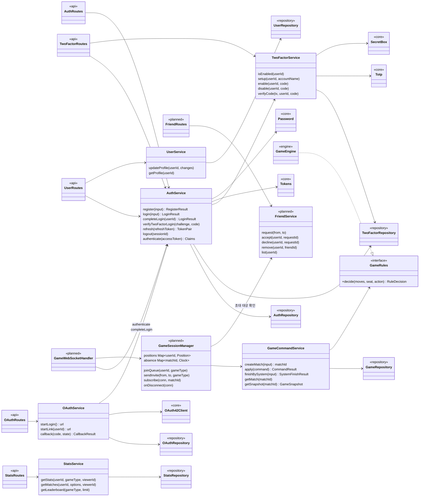

---

### 2.4 Information viewpoint

#### 5. Database design

`구현됨` (migration `0000_connection_probe`, `0001_auth_and_games`, `0002_oauth_and_two_factor`, `0003_tighten_results_and_oauth_state`). Drizzle 스키마는 `apps/server/src/db/schema/`.

```mermaid
erDiagram
    users ||--o{ sessions : "logs in"
    sessions ||--o{ refresh_tokens : "rotates"
    users ||--o{ oauth_accounts : "links"
    users |o--o{ oauth_states : "starts link"
    sessions |o--o{ oauth_states : "link started by"
    users ||--o| two_factor_secrets : "has"
    users ||--o{ two_factor_recovery_codes : "has"
    users ||--o{ two_factor_challenges : "pending login"
    users ||--o{ game_players : "plays"
    games ||--|{ game_players : "has 2"
    games ||--o{ moves : "history"
    users ||--o{ moves : "places"
    games ||--o{ game_commands : "receives"
    users ||--o{ game_commands : "issues"
    users |o--o{ games : "wins"

    users {
        bigint id PK "identity"
        varchar_254 email UK "NOT NULL, 소문자 저장"
        text password_hash "NULL = OAuth 전용 계정"
        varchar_32 nickname UK "NOT NULL"
        text avatar_url "NULL"
        boolean records_public "NOT NULL DEFAULT true, migration 0004"
        timestamptz created_at "NOT NULL"
        timestamptz updated_at "NOT NULL"
    }
    sessions {
        uuid id PK "gen_random_uuid()"
        bigint user_id FK "NOT NULL, cascade"
        timestamptz created_at "NOT NULL"
        timestamptz expires_at "NOT NULL, 로그인 후 7일"
        timestamptz revoked_at "NULL"
    }
    refresh_tokens {
        bigint id PK
        uuid session_id FK "NOT NULL, cascade"
        text token_hash UK "SHA-256"
        timestamptz expires_at "NOT NULL"
        timestamptz used_at "NULL = 아직 교체 전"
        timestamptz created_at "NOT NULL"
    }
    oauth_accounts {
        bigint id PK
        bigint user_id FK "NOT NULL, cascade"
        text provider "NOT NULL, 42"
        text provider_user_id "NOT NULL"
        timestamptz created_at "NOT NULL"
    }
    oauth_states {
        text state_hash PK "SHA-256"
        text provider "NOT NULL"
        text mode "login | link"
        bigint user_id FK "NULL, link일 때만"
        uuid session_id FK "NULL, link일 때만, cascade"
        text browser_hash "NOT NULL, flowToken의 SHA-256"
        timestamptz expires_at "NOT NULL, 10분"
        timestamptz used_at "NULL"
        timestamptz created_at "NOT NULL"
    }
    two_factor_secrets {
        bigint user_id PK,FK "cascade"
        text secret_encrypted "AES-256-GCM"
        timestamptz enabled_at "NULL = 설정 중"
        integer last_used_step "NULL, 재사용 차단"
        timestamptz created_at "NOT NULL"
    }
    two_factor_recovery_codes {
        bigint id PK
        bigint user_id FK "NOT NULL, cascade"
        text code_hash UK "SHA-256"
        timestamptz used_at "NULL"
    }
    two_factor_challenges {
        uuid id PK
        bigint user_id FK "NOT NULL, cascade"
        text token_hash UK "SHA-256"
        timestamptz expires_at "NOT NULL, 5분"
        timestamptz used_at "NULL"
        integer failed_attempts "NOT NULL DEFAULT 0"
        timestamptz created_at "NOT NULL"
    }
    games {
        bigint id PK "외부 matchId"
        text game_type "gomoku | othello"
        text rules_version "NOT NULL"
        text status "waiting | playing | paused | finished"
        integer state_version "NOT NULL DEFAULT 0"
        text current_turn "NULL | black | white"
        text outcome "NULL | win | draw | void"
        text result_reason "NULL"
        bigint winner_user_id FK "NULL"
        timestamptz created_at "NOT NULL"
        timestamptz started_at "NULL"
        timestamptz finished_at "NULL"
        timestamptz updated_at "NOT NULL"
    }
    game_players {
        bigint id PK
        bigint game_id FK "NOT NULL, cascade"
        bigint user_id FK "NOT NULL"
        text seat "black | white"
        text result "NULL | win | loss | draw | void"
        timestamptz joined_at "NOT NULL"
        timestamptz disconnected_at "NULL"
    }
    moves {
        bigint id PK
        bigint game_id FK "NOT NULL, cascade"
        bigint user_id FK "NOT NULL"
        integer turn_number "NOT NULL, >= 1"
        smallint row_idx "0..14"
        smallint col_idx "0..14"
        text stone "black | white"
        timestamptz created_at "NOT NULL"
    }
    game_commands {
        bigint id PK
        bigint game_id FK "NOT NULL, cascade"
        bigint user_id FK "NOT NULL"
        uuid command_id "NOT NULL"
        text command_type "place | resign"
        integer expected_version "NOT NULL"
        integer applied_version "applied일 때만"
        text status "applied | rejected"
        text reject_code "rejected일 때만"
        timestamptz created_at "NOT NULL"
    }
```

제약조건:

| 테이블 | 제약 | 목적 |
|---|---|---|
| users | `UNIQUE(email)`, `UNIQUE(lower(normalize(nickname, NFC)))` | 동시 가입·닉네임 변경 경합에서도 대소문자·Unicode 조합 형태에 따른 중복 방지 (FR-AUTH-01, FR-PRO-01). #133의 `0007` 다음 후속 `0008` 적용 기준 |
| refresh_tokens | `UNIQUE(token_hash)` | token 조회·중복 방지 |
| oauth_accounts | `UNIQUE(provider, provider_user_id)`, `UNIQUE(user_id, provider)` | 42 계정 하나는 한 사용자에만, 사용자당 42 연결 하나 |
| oauth_states | `CHECK(mode='login' AND user_id, session_id 모두 NULL OR mode='link' AND 둘 다 NOT NULL)` | link는 시작한 사용자와 세션을 반드시 기록 |
| games | `CHECK` game_type, status, current_turn, outcome 값 | 계약 값만 저장 |
| games | `CHECK(status='finished' AND outcome, result_reason, finished_at 모두 NOT NULL OR status<>'finished' AND outcome, result_reason, finished_at, winner_user_id 모두 NULL)` | 종료와 결과가 함께만 존재. 진행 중 경기에 부분 결과 불가 |
| games | `CHECK(outcome='win' AND winner NOT NULL OR outcome IS DISTINCT FROM 'win' AND winner NULL)` | 승리일 때만 승자 (outcome NULL이어도 판정) |
| game_players | `UNIQUE(game_id, user_id)`, `UNIQUE(game_id, seat)` | 한 경기에 같은 사람·같은 좌석 중복 금지 |
| moves | `UNIQUE(game_id, turn_number)`, `UNIQUE(game_id, row_idx, col_idx)`, 좌표 `CHECK 0..14` | 같은 수·같은 칸 중복 착수를 DB에서도 차단 |
| game_commands | `UNIQUE(game_id, command_id)` | 같은 명령 두 번 적용 차단 |
| game_commands | `CHECK(applied ⇔ applied_version NOT NULL, rejected ⇔ reject_code NOT NULL)` | 처리 결과 형식 고정 |

Index: `sessions(user_id)`, `refresh_tokens(session_id)`, `game_players(user_id, result)`(통계), `two_factor_recovery_codes(user_id)`, `two_factor_challenges(user_id)`.

닉네임 신규 입력은 가입·수정·42 가입 경로에서 NFC로 정규화한다. 기존 분해형(NFD) 값도 DB UNIQUE index에서 NFC로 비교하되 저장된 닉네임과 경기 당시 스냅샷은 이 migration으로 바꾸지 않는다. 이미 대소문자 또는 NFC 비교 키가 충돌하는 계정이 있으면 index 생성이 실패하고 migration 트랜잭션이 롤백된다. 배포 전 충돌 조회·수동 해결이 필요하며 계정을 자동 삭제하거나 임의 개명하지 않는다. 닉네임 index의 case 변환은 PostgreSQL `lower`와 해당 DB locale을 따른다.

설계 결정:

- **enum 대신 text + CHECK**: 값 추가가 단순한 migration으로 끝난다. 값은 `@cafe/game-contracts`와 같다.
- **board를 저장하지 않음**: `moves`가 기준 기록이고 board는 엔진으로 재생해 만든다. 오목 최대 225수라 재생 비용이 작다.
- **통계 테이블 없음**: 승·패·승률·진행도·순위는 `game_players` + `games`로 계산한다(2.4의 14번). 업적(첫 승, 10경기 진행도, DEC-08)도 계산하고 테이블은 두지 않는다.
- **세션과 refresh token 분리**: 세션 ID는 로그인 동안 고정되고 token만 교체된다.
- **소셜 테이블**: `friendships`(E)는 #95에 병합 전 구현됐다. 채팅 테이블은 후속 범위라 만들지 않는다.
- migration은 Drizzle Kit으로 생성하고 SQL을 검토한 뒤 적용한다. 공유된 migration은 수정하지 않고 수정 migration을 추가한다.

#### 병합 전 스키마 (#79·#89·#95)

현재 master에는 없는 확장이다. #79의 `0004_records_public`, #89의 `0004_account_deletion`, #95의 `0004_friendships`가 각각 구현하며, 통합 시 migration 번호·snapshot·journal을 조정한다(#96).

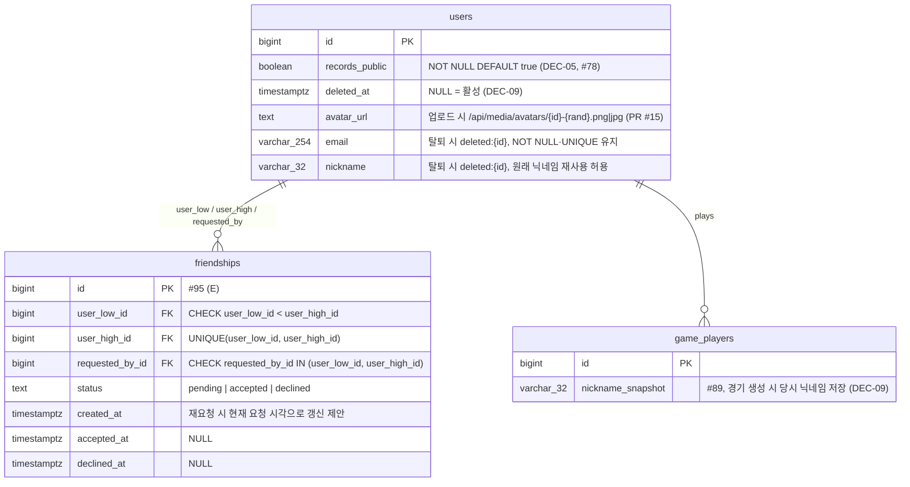

| 계획 변경 | 이유 | 담당 | 상태 |
|---|---|---|---|
| `users.records_public` | 전적 공개 설정 (FR-PRO-04), migration `0004` | A (B 리뷰) | `구현됨` |
| `users.deleted_at`, email·nickname 익명값 전환 | NOT NULL·UNIQUE 유지, 원래 닉네임 재사용과 경기 기록 보존 (DATA-01~05, DEC-09), migration `0005` | B | `구현됨` |
| `game_players.nickname_snapshot` | 경기 당시 닉네임 표시. 기존 행은 migration 당시 닉네임으로 채움 | B | `구현됨` |
| `friendships` | 친구 요청·수락 (FR-SOC-01~03). 거절 시 행을 지우지 않고 `declined`로 남김, 거절당한 요청자의 재요청은 차단, 거절한 쪽의 요청은 허용, 친구 삭제는 행 삭제 후 재요청 허용, migration `0006` | E (스키마 리뷰 B) | `구현됨` |

#### 14. Statistics design

`구현됨`. 게임별로 독립 집계한다(DEC-08).

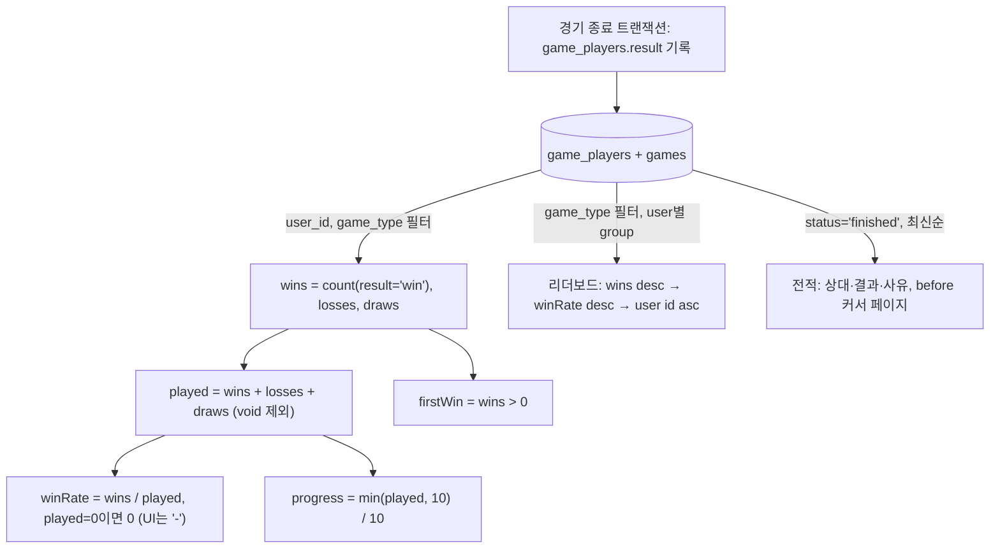

- 진행 중 경기는 `result`가 NULL이라 자동 제외된다.
- 리더보드는 무효를 제외한 완료 경기가 1경기 이상인 사용자만 포함한다. 순위는 `row_number()`로 동률 없이 매긴다.
- 전적 비공개(#78)와 탈퇴 표시·경기 당시 닉네임 스냅샷은 #147 통합 후보에 구현됐다.

---

### 2.5 Interface viewpoint

#### 8. API contract

상세 요청·응답·상태 코드는 [contracts.md 11장](contracts.md)(#33, master 병합), 이 문서 2.10(기능별 처리 흐름)과 Swagger(`/docs`)를 대조한다. 미병합 기능은 해당 PR의 계약 문서를 따른다. 모든 route는 가능한 상태 코드를 `schema.response`에 선언했다. 게임 명령·snapshot·결과 타입은 [공통 게임 계약 (PR #6)](https://github.com/EscapeFromGyeongsan/ft_transcendence/pull/6)의 contracts.md를 따른다.

| 영역 | Endpoint | 담당 | 상태 |
|---|---|---|---|
| Health | `GET /api/health`, `GET /api/health/db` | B | `구현됨` |
| Auth | `POST /api/auth/register`, `login`, `refresh`, `logout` | B | `구현됨` |
| 2FA | `GET /api/auth/2fa`, `POST /api/auth/2fa/setup`, `enable`, `disable`, `verify` | B | `구현됨` |
| OAuth | `POST /api/auth/oauth/42/login`, `link`, `callback` | B | `구현됨` |
| Users | `GET /api/users/me`, `PATCH /api/users/me`, `GET /api/users/{userId}` | B | `구현됨` |
| Avatar | `PUT /api/users/me/avatar`, `DELETE /api/users/me/avatar`, `GET /api/media/avatars/{name}` (2.10.25) | B | `구현됨` (#15) |
| 전적 공개 설정 | `PATCH /api/users/me`의 `recordsPublic`, stats·matches의 403 (2.10.26) | A (B 리뷰) | `구현됨` |
| 탈퇴 | `DELETE /api/users/me` (2.10.27) | B | `구현됨` |
| Statistics | `GET /api/users/{userId}/stats`, `GET /api/users/{userId}/matches`, `GET /api/leaderboard` | B | `구현됨` |
| 매칭·초대 | REST 없음. WebSocket `queue.*`, `invite.*` (9번) | D | `queue.*` #49 병합 전 구현, `invite.*` 계획 |
| 친구 | `GET /api/friends`, `POST /api/friends/requests`, `POST /api/friends/requests/{id}/accept`, `.../decline`, `DELETE /api/friends/{userId}`, `GET /api/users?nickname=` (2.10.29) | E | #95 `병합 전 구현` |

#### 9. WebSocket contract (D)

`master`에는 #41의 인증·앱 ping만 있다. 아래 통합 계약의 구독은 #42, 명령은 #43, 매칭은 #49, heartbeat·재접속은 #50에 병합 전 구현됐다. presence는 #98의 병합 전 구현이며 초대는 B 초안이다. 이벤트 이름은 이슈 #16~#20을 따른다. 문서화 명세 19장의 대문자 이름(`PLACE_STONE` 등)은 쓰지 않는다. payload 타입은 [contracts.md](contracts.md)(PR #6)를 그대로 쓴다.

Endpoint: `wss://<host>/api/ws` (Nginx가 upgrade 전달, #28).

모든 메시지는 같은 envelope를 쓴다.

```ts
type Envelope<T> = {
  type: string;        // 아래 이벤트 이름
  requestId?: string;  // 클라이언트 요청에만. 서버 응답·오류가 같은 값을 돌려줌
  payload: T;
};
```

| 방향 | 이벤트 | payload | 서버 처리 | B 연결 지점 |
|---|---|---|---|---|
| C→S | `auth` | `{ accessToken }` | 연결 후 5초 안에 첫 메시지로 받음. 없거나 실패면 close 4401. URL query에 토큰을 넣지 않음(로그 노출) | `AuthService.authenticate()` |
| S→C | `auth.ok` | `{ userId, activeMatchId: number \| null }` | 진행 중 경기가 있으면 화면이 대국으로 이동. 클라이언트는 `auth.ok`를 받은 뒤에 다음 메시지를 보낸다. 인증 처리 중 다른 메시지가 오면 4401 | 참가 위치 (아래 FSM). `activeMatchId`는 #42 이후 구독 스택에서 채움 |
| S→C | WebSocket ping frame | - | 서버가 10초마다 보낸다. 브라우저가 자동으로 pong을 보내므로 A 코드는 필요 없음. 마지막 pong·메시지 후 20초 동안 응답이 없으면 끊는다 | - |
| C→S | `ping` / S→C `pong` | `{}` | 클라이언트가 서버 끊김을 감지하는 용도. 서버의 끊김 판정에는 쓰지 않아도 됨(ping frame이 담당) | - |
| C→S | `queue.join` / `queue.leave` | `{ gameType }` / `{}` | 참가 위치가 없을 때만 대기열 등록 | - |
| S→C | `queue.joined` / `queue.left` | `{ gameType }` / `{}` | 대기열 등록·취소 성공 응답 (#49) | - |
| S→C | `queue.matched` | `{ matchId, gameType }` | 두 명 성립 시 양쪽에 전송 | `createMatch()` |
| C→S | `invite.send` | `{ friendUserId, gameType }` | 수락된 친구, 둘 다 참가 위치 없음 | 친구 확인(E) |
| S→C | `invite.received` | `{ inviteId, fromUserId, gameType, expiresAt }` | 받는 사람의 모든 연결에 전송 | - |
| C→S | `invite.accept` / `invite.decline` / `invite.cancel` | `{ inviteId }` | 수락 시 경기 생성. 만료·취소·이미 참가 중이면 `invite.error` | `createMatch()` |
| S→C | `invite.updated` | `{ inviteId, status }` | 보낸 사람·받은 사람 모두 | - |
| C→S | `match.subscribe` / `match.unsubscribe` | `{ matchId }` | 참가자만 구독. 구독 즉시 snapshot 전송. 실패는 `error` (`NOT_FOUND`, `NOT_PARTICIPANT`) | `getMatch()`, `getSnapshot()` |
| S→C | `match.unsubscribed` | `{ matchId }` | `match.unsubscribe` 응답. 요청의 `requestId`를 돌려줌 | - |
| S→C | `match.snapshot` | `GomokuSnapshot \| OthelloSnapshot` | 구독·재접속·`VERSION_CONFLICT` 때 | `getSnapshot()` |
| C→S | `game.command` | `GomokuCommand \| OthelloCommand` (`userId` 없음) | 런타임 검증 후 인증된 `userId`를 붙여 호출 | `apply()` |
| S→C | `game.ack` | `{ matchId, commandId, stateVersion, duplicate }` | 요청자에게만. 결과가 `applied`일 때 보내고 요청의 `requestId`를 돌려줌. 중복 재전송이면 `duplicate: true` | `apply()` 결과 |
| S→C | `game.updated` | 최신 snapshot | **commit 후**, 결과가 `applied`이면 최신 snapshot을 구독자 전체에. 중복 재전송도 같은 경로를 사용하되 이미 보낸 `stateVersion` 이하이면 생략 | `apply()` 결과, `getSnapshot()` |
| S→C | `game.error` | `GameError` + `{ matchId, commandId, duplicate }` | 결과가 `rejected`일 때 요청자에게만. 구독·제어권 실패는 `NOT_SUBSCRIBED`·`SESSION_REPLACED`. 중복 재전송의 최초 거절도 요청자에게만 | `CommandResult.code` |
| S→C | `error` | `{ code, message, matchId? }` | `game.command` 결과 외의 모든 오류. 요청의 `requestId`를 돌려줌. 코드: `UNSUPPORTED_MESSAGE`(모르는 `type`), `INVALID_MESSAGE`(payload 검증 실패·경기 gameType 불일치), `ALREADY_ACTIVE`(중복 참가), `ALREADY_MATCHED`(매칭 확정 중 취소), `NOT_FOUND`·`NOT_PARTICIPANT`(`match.subscribe` 실패, `GameError` 코드 그대로), `INTERNAL_ERROR`(처리 중 예외) | - |
| S→C | `player.disconnected` / `player.reconnected` | `{ matchId, userId, remainingMs }` | 상대에게 | - |
| S→C | `presence` | `{ userId, online }` | 수락된 친구에게 (인증 완료 연결 수 0 ↔ 1 이상 변화 때, 전송 시점의 상태) | #98, #95와 연결 대기 |
| S→C | `friends.changed` | `{}` | 관계 DB commit 후 두 사용자의 모든 인증 완료 연결에 목록 갱신 신호 | #98 전송기, #95와 연결 대기 |
| S→C | `session.replaced` | `{ matchId }` | 같은 사용자의 새 연결이 경기 제어를 가져가면 이전 연결에 전송 | - |

Close code:

| code | 상황 |
|---|---|
| 4401 | 5초 안에 인증 없음, 토큰 무효·만료, 첫 메시지가 `auth`가 아님, 인증 처리 중 다른 메시지, 세션 폐기 |
| 4400 | JSON이 아님, envelope 형식 오류, binary 메시지 |
| 1009 | 16 KiB 초과 메시지 (`ws`의 `maxPayload`) |
| 1011 | 서버 내부 오류 (인증 확인 중 DB 장애 등) |

- 세션 폐기 시 해당 세션으로 인증된 연결을 close 4401 `Session ended.`로 닫는다. 연결마다 `sessionId`를 들고 있다.
  - 로그아웃: 로그아웃 처리 후 연결 관리(D)가 닫는다(#41, master 병합).
  - refresh token 재사용 감지: `refresh()` 트랜잭션 안에서 일어나므로 `createAuthService`의 `onSessionRevoked(sessionId)` 콜백(#51)으로 commit 후에 알리고, `buildApp()`이 이를 연결 목록의 `closeSession()`에 연결해 그 세션의 연결을 4401로 닫는다(#86, master 병합).
- access token(30분)은 연결할 때만 확인한다. 경기 중에 만료돼도 연결은 유지한다. access token 만료 자체는 연결을 종료하지 않으며 세션 폐기·전송 오류·heartbeat 등은 별도 종료 사유다.
- 같은 경기의 명령은 행 잠금으로 순서가 정해지지만 `apply()` 결과가 돌아오는 순서는 보장되지 않는다. 서버는 경기마다 마지막으로 보낸 `stateVersion`을 기억하고, 같은 경기에서 이미 보낸 `stateVersion` 이하의 갱신은 보내지 않는다(#43).
- 같은 사용자의 연결이 여러 개(탭·기기)여도 경기 명령을 보낼 수 있는 연결은 하나다(FR-MATCH-02). 마지막으로 `match.subscribe`한 연결이 제어권을 가진다. 이전 연결은 `session.replaced`를 받고 입력을 비활성화한다. 이 연결이 보낸 `game.command`는 거절한다. 두 연결 모두 같은 사용자이므로 이탈 시간은 연결이 하나라도 있으면 흐르지 않는다.
- 이벤트 단위 재전송은 하지 않는다. 누락은 snapshot으로 복구한다(#19).

---

### 2.6 Interaction viewpoint

#### 11. Authentication design

`구현됨`. 공통 원칙:

- access token: JWT HS256, 30분, claim `sub`(userId), `sid`(sessionId).
- refresh token: 32바이트 난수 opaque, 해시만 저장, 세션 만료(로그인 후 7일)까지. 갱신해도 세션 만료는 늘지 않는다.
- 보호 요청: JWT 검증 + `sessions`에서 소유자·만료·폐기 확인. 인증 확인은 `onRequest`라 본문 검증보다 먼저다.
- 2FA 계정은 비밀번호·42 로그인 모두 `completeLogin()`을 거쳐 challenge를 받는다.

로그인 (2FA 없음 / 있음):

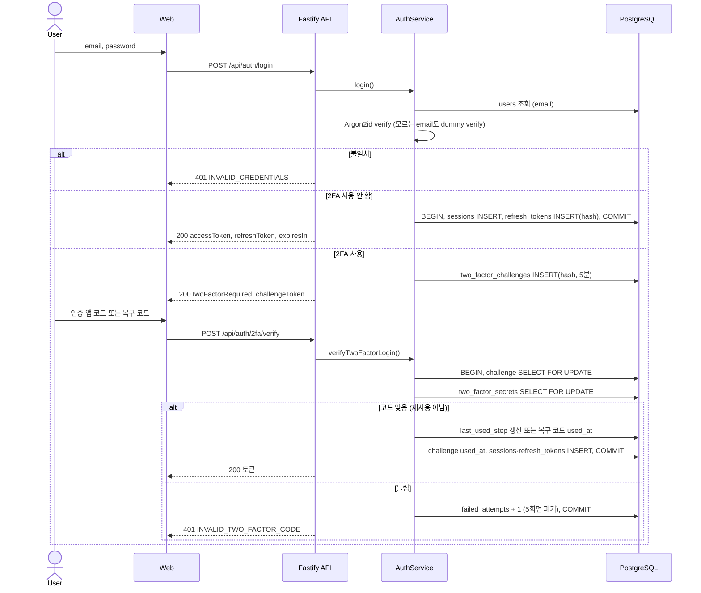

refresh token 교체와 재사용 탐지:

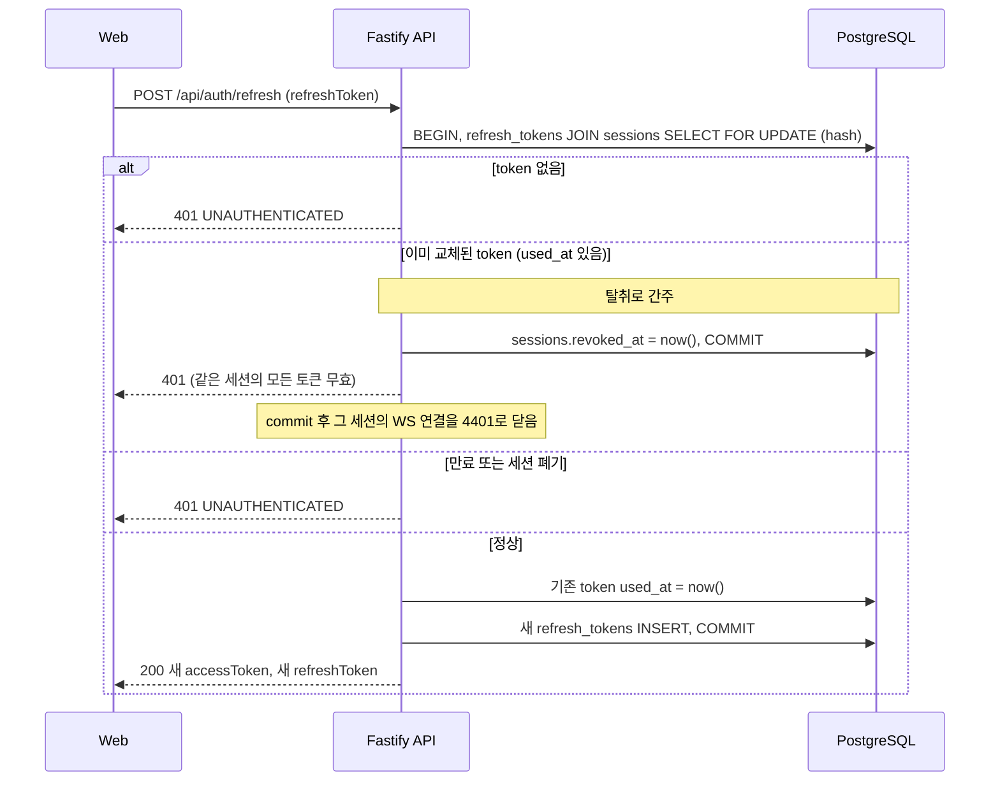

로그아웃과 보호 요청:

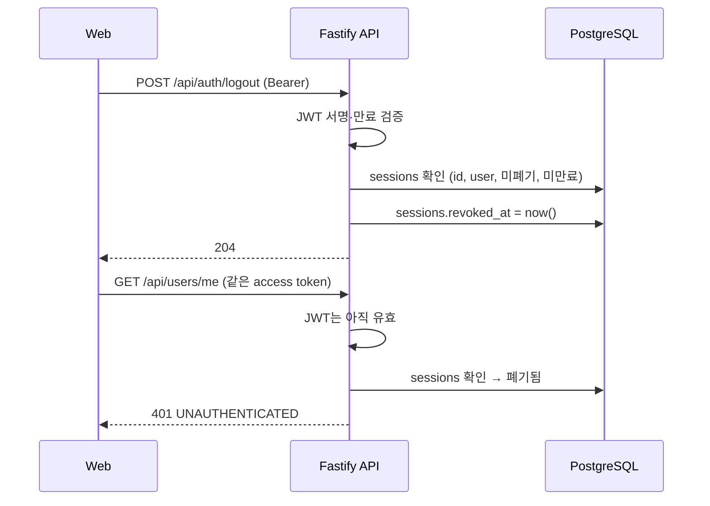

2FA 설정:

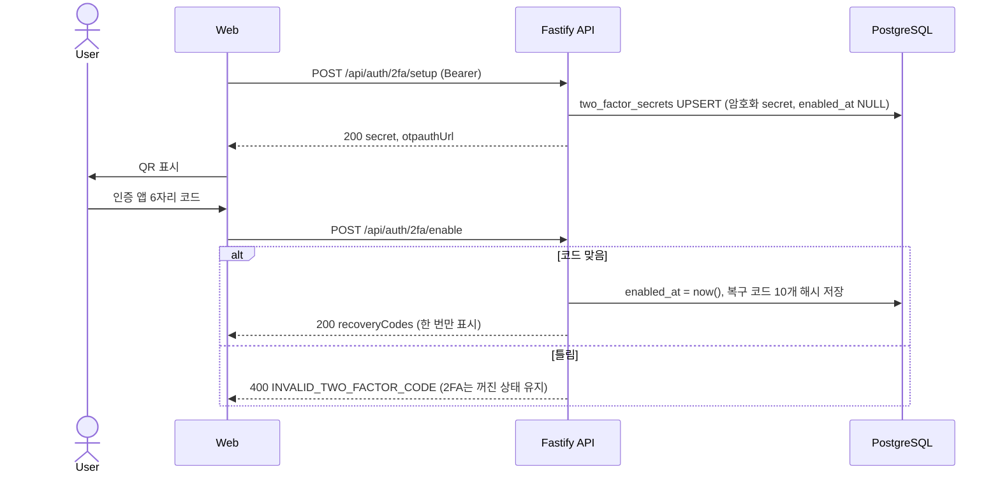

42 OAuth (로그인 / 연결):

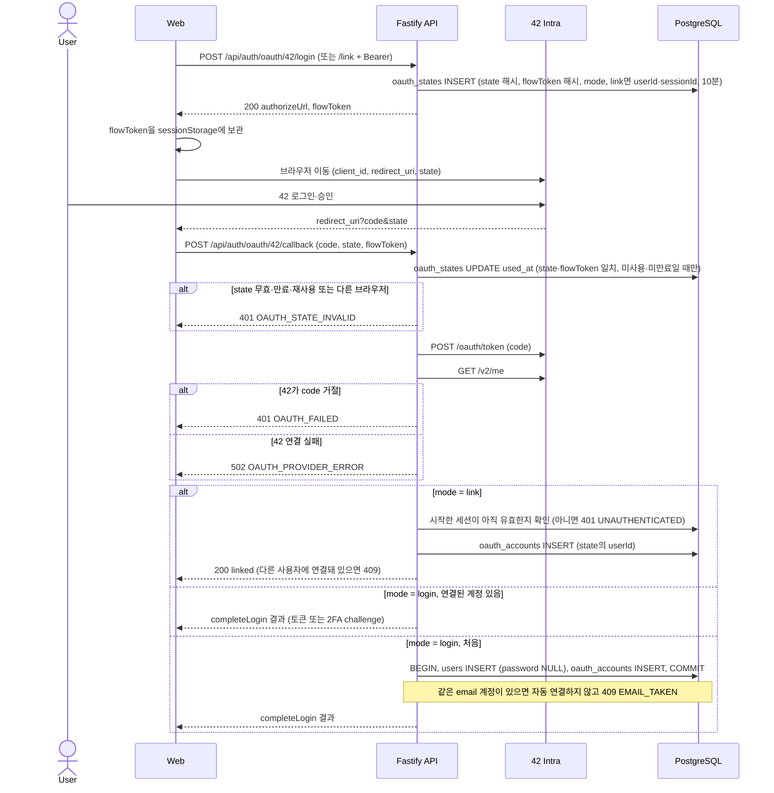

#### 정상 착수 (move sequence)

API 내부(`GameCommandService.apply`)는 master 병합, WebSocket 명령은 #43 병합 전 구현이다. 엔진 등록·웹 실행 통합은 #27·#77의 별도 브랜치를 따른다.

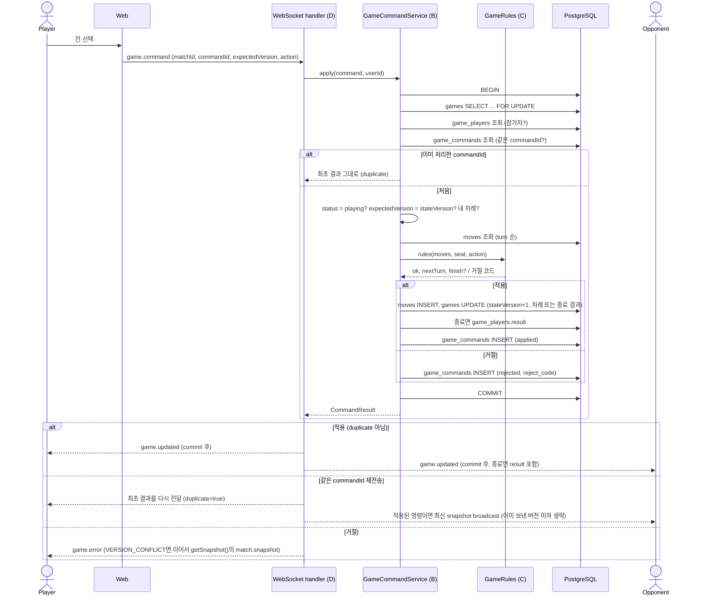

전송 순서(D 구현 시 지킬 것): 같은 경기의 broadcast는 commit 순서(= stateVersion 순서)로 보낸다. 종료 착수는 `result`가 채워진 `game.updated` 하나로 보낸다. 클라이언트는 현재 snapshot보다 `stateVersion`이 작거나 같은 `game.updated`를 버리고, `match.snapshot`은 더 작은 버전만 버린다. 같은 버전의 `match.snapshot`은 일시정지·복귀 상태 반영을 위해 수용한다.

처리 원칙:

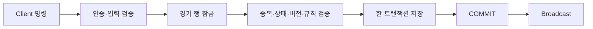

#### 13. Reconnection design (D)

#50 (`80715d9`)의 병합 전 구현. DEC-03(사용자별 경기 내 누적 이탈 60초)과 DEC-07(재시작 시 미완료 경기 무효)을 따른다. `finishBySystem()`·시작 시 무효화는 #32, `setStatus()`는 #51로 master에 병합됐다(2.10.28).

| 항목 | 설계 |
|---|---|
| 끊김 감지 | WebSocket close 이벤트는 즉시. close 없이 끊긴 경우는 서버 ping frame(10초 주기)에 대한 pong·메시지가 마지막 응답 후 20초 동안 없으면 끊김으로 본다. 20초는 무응답 기준이며 10초 검사 주기에 따른 추가 지연 가능 |
| 이탈 판정 단위 | 사용자. 그 경기에 대한 사용자의 연결이 0개가 되는 순간 이탈 시작, 1개 이상이 되는 순간 이탈 끝 |
| 누적 시계 저장 | 메모리 (`services/absence-tracker.ts`, 경기별 사용자 시계). 재시작하면 경기가 void가 되므로 DB에 둘 필요 없음 |
| 이탈 시작 시각 (`since`) | close 없이 끊긴 경우 "마지막으로 응답한 시각". 감지까지 걸린 시간도 예산에서 빠지므로 실제 허용 시간이 60초를 넘지 않는다 |
| 만료 시각 | `since + (60000 - usedMs)`에 타이머. 복귀하면 타이머 취소, `usedMs`에 더함 |
| 상태 전환 | 한 명이라도 이탈 중이면 `paused`, 모두 복귀하면 `playing`. 전환은 `stateVersion`을 올리지 않는다. 그래서 같은 버전의 snapshot이 `playing`·`paused` 두 상태로 나올 수 있다. `match.snapshot`은 `stateVersion`이 현재 이상이면 클라이언트 상태를 통째로 교체하고(같은 버전이면 `status`만 다를 수 있음), 현재보다 작으면 무시한다. 구독 직후 `getSnapshot()` 사이에 commit된 `game.updated`가 snapshot보다 먼저 도착할 수 있기 때문이다. 일시정지·복귀 시 상대에게 `player.disconnected`·`player.reconnected`, 구독자 전체에 같은 버전의 `match.snapshot`을 보낸다 |
| 양쪽 부재 | 각자 시계가 따로 흐른다. 먼저 만료된 시점에 아직 상대도 부재면 `absentUserIds`에 둘 다 넣어 void |
| 만료와 착수·복귀 경합 | 착수·기권은 행 잠금·버전 비교로 순서를 정한다. 복귀는 버전을 올리지 않는다. 만료 전에만 타이머를 취소하며, 만료 순간의 부재자로 종료를 확정한다 |
| 기기 전환 | 새 연결이 `match.subscribe`하면 그 연결이 제어권을 받는다(9번). 이전 연결이 살아 있어도 이탈은 없음 |

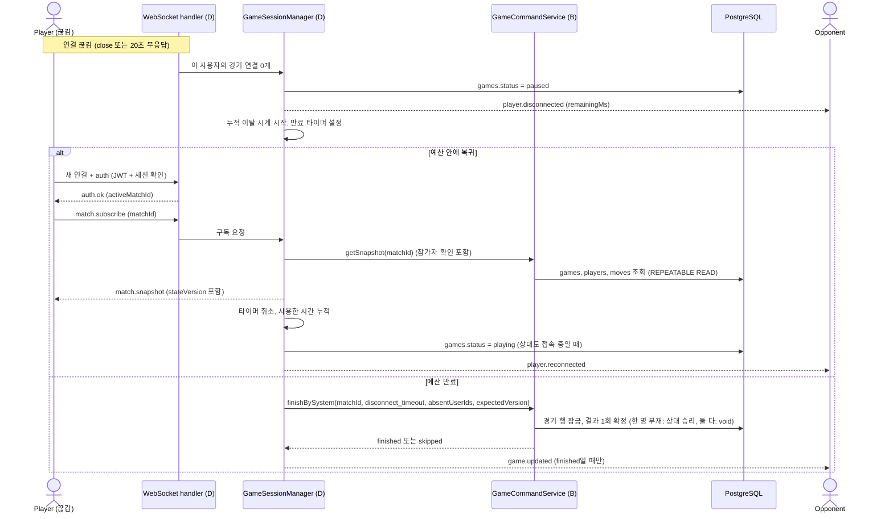

- 과거 고정 SHA의 [WSS 검증](runtime-wss-validation.md)에서는 감지가 약 30초여서 20초 목표 차이를 보고했다. 최신 통합에서 다시 측정하기 전에는 목표 달성으로 기록하지 않는다.
- 종료 경로도 착수와 같은 경기 행 잠금을 쓴다. 이탈 만료와 마지막 착수가 겹쳐도 결과는 하나만 확정된다.
- `paused` 전환을 `games.status`에 저장하는 이유: 그 사이 들어온 착수를 `apply()`가 `GAME_NOT_ACTIVE`로 거절하게 하기 위해서다. 이 갱신은 `GameCommandService.setStatus(matchId, from, to)`(B)를 쓴다. 현재 상태가 `from`일 때만 바꾸고 바꿨는지를 돌려준다. 그래서 경기 종료 직후 들어온 이탈 처리가 `finished`를 덮어쓰지 않는다.

---

### 2.7 State dynamics viewpoint

#### 7. Game FSM

DB와 계약의 상태 값은 `waiting`, `playing`, `paused`, `finished`다. 명세 16장의 `READY`는 별도 상태가 아니라 `waiting` 안의 준비 조건으로 다룬다(PR #6 `GameStatus`). 무효(`void`)는 `finished`의 결과 값이다.

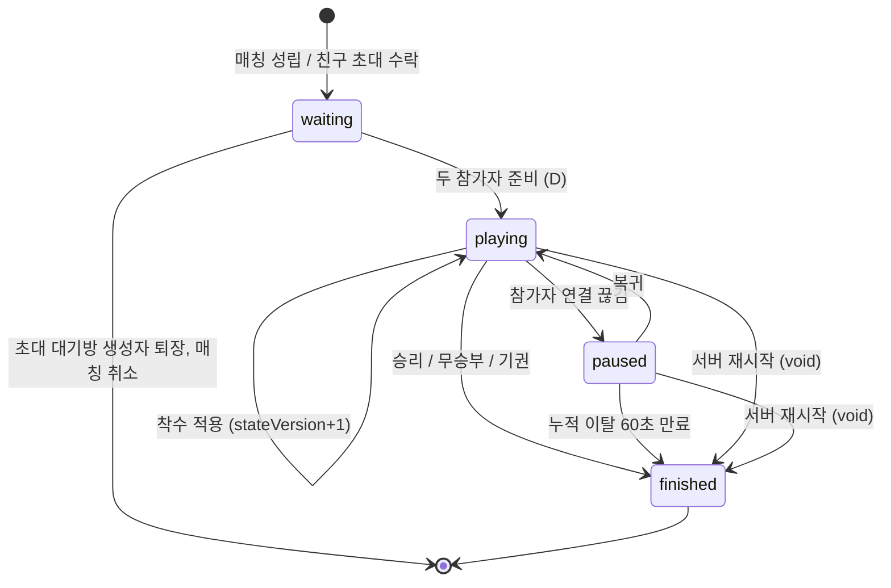

| 현재 | 이벤트 | 조건 | 다음 | 서버 동작 | 저장 | Broadcast | 상태 |
|---|---|---|---|---|---|---|---|
| (없음) | 매칭 성립 | 두 사용자 모두 활성 참가 위치 없음 | waiting 또는 playing | 경기 생성, 좌석 배정 | games, game_players INSERT | `queue.matched` 또는 `invite.updated` | `구현됨`: `createMatch()`는 바로 playing (준비 단계는 D) |
| waiting | 준비 완료 | 두 명 모두 준비 | playing | 흑 차례로 시작 | status, started_at | GAME_STARTED | `계획` (D) |
| waiting | 초대 대기방 생성자 퇴장, 매칭 취소 | 아직 시작 전 | (종료, 경기 아님) | 참가 위치 해제, 초대 무효화 | 대기 경기 행 삭제 또는 취소 표시 (D와 결정) | `invite.updated` (cancelled) | `계획` (D) |
| playing | `game.command` place | 참가자, 내 차례, 버전 일치, 규칙 통과 | playing | 착수 반영, 차례 전환 | moves, games, game_commands | `game.updated` | `구현됨` (전송은 D) |
| playing | `game.command` place | 위 조건 + 규칙상 종료 | finished | 결과 확정 | + outcome, reason, winner, finished_at, game_players.result | `game.updated` (result 포함) | `구현됨` |
| playing | 거절되는 명령 | 버전 불일치, 차례 아님, 규칙 위반 | playing | 거절 코드 반환 | game_commands (rejected) | `game.error` (요청자만) | `구현됨` |
| playing | `game.command` resign | 참가자, 버전 일치 | finished | 상대 승리 (`resign`) | 결과 확정 | `game.updated` (result 포함) | `구현됨` |
| playing | 연결 끊김 | 참가자 연결 0개 | paused | 이탈 시간 측정 | status | `player.disconnected` | #50 `병합 전 구현` |
| paused | 복귀 | 예산 남음, 인증·참가자 확인 | playing | snapshot 재전송 | status | `player.reconnected`, `match.snapshot` | #50 `병합 전 구현` |
| paused | 예산 만료 | 누적 60초 | finished | 한 명 부재: 상대 승리 / 둘 다: void | 결과 확정 (`finishBySystem`) | `game.updated` (result 포함) | 시계 #50 `병합 전 구현`, 저장 #32 `master 병합` |
| playing, paused | 서버 재시작 | 미완료 경기 | finished | void (`server_restart`) | 결과 확정 | 없음 (재접속 시 표시) | `구현됨`: `voidUnfinishedGames()` |
| finished | 새 명령 | - | finished | `GAME_FINISHED`로 거절 | game_commands (rejected) | `game.error` | `구현됨` |
| finished | 이미 처리한 commandId 재전송 | 같은 사용자 | finished | 최초 결과 반환 (2.8 순서상 상태 확인보다 중복 확인이 먼저) | 없음 | 요청자에게 최초 결과, 적용된 명령이면 최신 snapshot도 버전 증가 시 broadcast | `구현됨` (#43 전송은 병합 전) |

- 현재 `createMatch()`는 `waiting`을 건너뛰고 바로 `playing`으로 만든다. 준비 단계를 두지 않는 것을 제안한다(B 초안): 매칭 성립·초대 수락이 곧 시작이다. 그러면 위 `waiting` 두 줄은 쓰지 않는다. D가 준비 단계를 두기로 하면 `createMatch()`에 시작 상태 인자를 추가한다.
- 색상 배정(제안): 자동 매칭은 무작위, 친구 초대는 초대한 사람이 흑. 두 게임 모두 같다(DEC-06).

#### 7.1 사용자 참가 위치 FSM (`B 초안`, D 확인)

FR-MATCH-02: 한 사용자의 활성 참가 위치는 매칭 대기·초대 대기·진행 경기 중 하나다. 공개방은 없다. 자동 매칭과 친구 초대 두 경로만 있다.

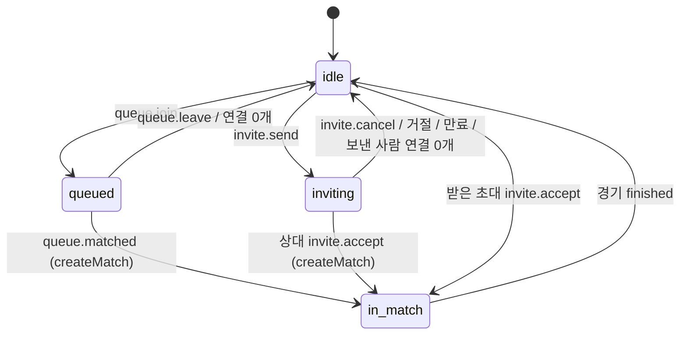

| 현재 | 이벤트 | 조건 | 다음 | 거절 시 |
|---|---|---|---|---|
| idle | `queue.join` | - | queued | - |
| queued | 상대 성립 | 같은 `gameType` 대기열 앞 두 명 | in_match (둘 다) | - |
| queued | `queue.leave`, 연결 0개 | - | idle | - |
| idle | `invite.send` | 수락된 친구, 친구가 idle | inviting | `invite.error` (`NOT_FRIEND`, `TARGET_BUSY`) |
| idle (받는 사람) | `invite.accept` | 초대가 pending, 보낸 사람이 아직 inviting | in_match (둘 다) | `invite.error` (`INVITE_EXPIRED`, `INVITE_CANCELLED`) |
| inviting | 취소·거절·만료(60초)·연결 0개 | - | idle | - |
| in_match | 경기 finished | - | idle | - |
| queued·inviting·in_match | 다른 참가 요청 | - | 그대로 | `ALREADY_ACTIVE` |

- 저장: 메모리(`GameSessionManager`의 `Map<userId, Position>`), API 인스턴스 1개 전제(2.10.28과 같음). 재시작하면 대기열·초대가 사라지고 진행 경기는 void가 되므로 유령 참가가 남지 않는다(FR-RT-05).
- 경합: 참가 위치 변경은 사용자 ID 순서로 두 사용자의 위치를 함께 바꾼다. 단일 Node 프로세스라 같은 tick 안의 동기 코드로 처리하면 별도 잠금이 필요 없다. `createMatch()` 실패 시 두 사람을 idle로 되돌린다.
- `in_match`는 진행 중 경기 행(`games.status in (playing, paused)`)과 같은 뜻이다. 재시작 후에는 `voidUnfinishedGames()`가 모두 끝내므로 메모리와 DB가 어긋나지 않는다.
- 초대 유효기간 60초는 제안값이다(DEC-06).

---

### 2.8 Algorithm viewpoint

#### 10. Command / version model

`구현됨`.

- 클라이언트는 명령마다 새 `commandId`(UUID)를 만들고, 재전송할 때는 같은 값을 쓴다.
- `expectedVersion`은 클라이언트가 보고 있던 `stateVersion`이다. 새 경기는 0에서 시작하고 적용될 때마다 +1.
- 같은 `(matchId, commandId)`가 다시 오면 다시 처리하지 않고 처음 결과(적용/거절)를 그대로 돌려준다.
- 같은 `commandId`를 다른 사용자가 쓰면 `COMMAND_ID_CONFLICT`로 거절하고 기록하지 않는다.
- 현재 한계: 저장하는 것은 적용 버전 또는 거절 코드뿐이다. 같은 사용자가 같은 `commandId`에 **다른 payload**를 보내도 최초 결과를 돌려주며 payload를 비교하지 않는다. 최초 이벤트의 전체 payload나 오류 `details`도 복원하지 않는다(D는 `getMatch()`로 현재 상태를 다시 만들어 보낸다). payload 해시 저장 여부는 C·D와 결정(5장).
- `VERSION_CONFLICT`의 최신 상태: 서비스는 코드만 반환하고, D가 `getMatch()` + 엔진 재생으로 snapshot을 만들어 `ERROR.details`에 담는다.
- 거절 코드: `NOT_FOUND`, `NOT_PARTICIPANT`, `COMMAND_ID_CONFLICT`(기록 안 함), `GAME_FINISHED`, `GAME_NOT_ACTIVE`, `VERSION_CONFLICT`, `NOT_YOUR_TURN`, 엔진 코드 `INVALID_ACTION`(기록함). 세부 사유는 엔진의 `message`에만 둔다(IF-01).

```mermaid
flowchart TD
    Start([명령 수신]) --> Lock[BEGIN, games 행 SELECT FOR UPDATE]
    Lock --> Found{경기 있음?}
    Found -->|아니오| NF[NOT_FOUND]
    Found -->|예| Part{참가자?}
    Part -->|아니오| NP[NOT_PARTICIPANT]
    Part -->|예| Dup{같은 commandId 기록 있음?}
    Dup -->|예, 같은 사용자| Replay[최초 결과 그대로 반환]
    Dup -->|예, 다른 사용자| Conflict[COMMAND_ID_CONFLICT]
    Dup -->|아니오| Status{status}
    Status -->|finished| GF[거절 기록: GAME_FINISHED]
    Status -->|waiting, paused| GNA[거절 기록: GAME_NOT_ACTIVE]
    Status -->|playing| Ver{expectedVersion = stateVersion?}
    Ver -->|아니오| VC[거절 기록: VERSION_CONFLICT]
    Ver -->|예| Kind{행동}
    Kind -->|resign| Resign[상대 승리로 종료]
    Kind -->|place| Turn{내 차례?}
    Turn -->|아니오| NYT[거절 기록: NOT_YOUR_TURN]
    Turn -->|예| Rules{GameRules 판정}
    Rules -->|거절| RC[거절 기록: 엔진 코드]
    Rules -->|적용| Save[moves INSERT, stateVersion+1, 차례 또는 결과]
    Resign --> Applied[applied 기록]
    Save --> Applied
    Applied --> Commit[COMMIT]
    GF --> Commit
    GNA --> Commit
    VC --> Commit
    NYT --> Commit
    RC --> Commit
    Commit --> Done([결과 반환 → D가 broadcast])
```

#### 12. Concurrency design

`구현됨`. 두 장치를 목적에 따라 나눠 쓴다.

| 장치 | 막는 것 |
|---|---|
| 경기 행 잠금 (`SELECT ... FOR UPDATE`) | 같은 경기의 동시 변경. 경기별로만 잠가 다른 경기는 병렬 처리 |
| `stateVersion` 비교 | 오래된 화면에서 보낸 명령 |
| `UNIQUE(game_id, command_id)` | 같은 명령의 두 번 적용 (잠금이 1차, UNIQUE가 최종 방어) |
| `moves` UNIQUE + CHECK | 엔진 버그가 있어도 같은 칸·같은 수 중복 저장 불가 |
| 단일 트랜잭션 | 저장 실패 시 착수·버전·명령 기록·결과 모두 rollback |

잠금은 중복 확인보다 먼저 잡는다. 그래야 같은 `commandId`가 동시에 와도 두 번째 요청이 첫 번째의 commit된 기록을 본다.

```mermaid
sequenceDiagram
    participant R1 as 요청 1 (expectedVersion 0)
    participant R2 as 요청 2 (expectedVersion 0)
    participant DB as PostgreSQL

    R1->>DB: BEGIN, games FOR UPDATE
    Note right of DB: 행 잠금 획득
    R2->>DB: BEGIN, games FOR UPDATE
    Note right of DB: 요청 2 대기
    R1->>DB: 검증 통과, moves INSERT, stateVersion 0→1, COMMIT
    Note right of DB: 잠금 해제
    DB-->>R2: 잠금 획득 (stateVersion = 1)
    R2->>DB: expectedVersion 0 ≠ 1 → rejected 기록, COMMIT
    Note over R1,R2: 결과: 하나만 적용, 하나는 VERSION_CONFLICT
```

테스트로 확인한 경우: 같은 버전의 동시 명령 2개 → 1개만 적용 / 같은 `commandId` 동시 재전송 → 1번만 적용 / 저장 실패 → 전부 rollback / 종료 후 명령 → `GAME_FINISHED`.

#### Result finalization

- 종료는 착수·기권과 같은 트랜잭션 안에서 `games`(status, outcome, reason, winner, finished_at)와 `game_players.result`를 함께 기록한다.
- `games_result_check`가 "종료 ⇔ 결과 있음"을 DB에서 강제한다.
- 종료된 경기는 잠금 후 `GAME_FINISHED`로 거절되므로 결과가 다시 쓰이지 않는다.
- broadcast는 commit 이후에만 한다(D). 트랜잭션 안에서 네트워크 전송을 하지 않는다.

---

### 2.9 Resource viewpoint

#### 16. Deployment design (E)

PR #10(`infra/compose.full.yaml`)은 master `6965b9c`에 병합됐다. 실행·검증 범위는 [runtime.md](runtime.md)와 [runtime-wss-validation.md](runtime-wss-validation.md)를 따른다.

```mermaid
flowchart TD
    Client[브라우저] -->|"HTTPS :8443 (HTTP :8080 → 308)"| Web

    subgraph host["호스트 (기본 바인딩 127.0.0.1)"]
        subgraph edge["edge 네트워크"]
            Web["web: Nginx 1.28 + React 빌드<br/>80, 443"]
            Api["api: Node 24 Fastify<br/>3001"]
        end
        subgraph data["data 네트워크 (internal)"]
            ApiData["api"]
            Migrate["migrate: Drizzle migration (1회 실행)"]
            Db[("db: PostgreSQL 17<br/>5432")]
        end
        Vol[(postgres_data volume)]
        Certs[[TLS 인증서 bind mount, 읽기 전용]]
        Secret[[postgres_password secret]]
    end

    Web -->|"/api/, /docs/, WS upgrade"| Api
    Api -.- ApiData
    ApiData --> Db
    Migrate --> Db
    Db --- Vol
    Web --- Certs
    Db --- Secret
    Api --- Secret
    Migrate --- Secret
    Api -->|OAuth| Intra[42 Intra API]
```

| 컨테이너 | 역할 | 내부 포트 | 공개 포트 | 네트워크 | Volume | 주요 환경 변수 | Health check | 시작 조건 |
|---|---|---|---|---|---|---|---|---|
| web | 정적 파일, reverse proxy, HTTPS 종료 | 80, 443 | `127.0.0.1:8080`, `127.0.0.1:8443` | edge | 인증서 (읽기 전용) | `PUBLIC_HTTPS_PORT` | `https://127.0.0.1/api/health/db` | api healthy |
| api | REST, WebSocket (통합 PR) | 3001 | 없음 | edge, data | avatars | `POSTGRES_*`, `API_HOST`, `PORT`, `JWT_SECRET`, `TWO_FACTOR_KEY`, `FT_OAUTH_*`, `TRUST_PROXY`, `AVATAR_DIR` | `/api/health/db` | migrate 성공 |
| migrate | migration 적용 후 종료 | - | 없음 | data | - | `POSTGRES_*` | - | db healthy |
| db | PostgreSQL | 5432 | 없음 | data (internal) | postgres_data | `POSTGRES_USER`, `POSTGRES_DB`, `POSTGRES_PASSWORD_FILE` | `pg_isready` | - |

- DB 포트는 외부에 공개하지 않는다. 호스트에서 포트를 여는 컨테이너는 web 하나다.
- DB 연결 자원(`db/client.ts`, `구현됨`): API 인스턴스당 pg Pool 하나, 최대 연결 5, 연결 대기 3초, idle 10초, statement timeout 3초. 연결을 3초 안에 못 얻거나 쿼리가 3초를 넘으면(잠금 대기 포함) 공통 처리기가 503으로 응답한다(#93, master 병합). 서버 종료 시 `onClose`에서 Pool을 닫는다. 성능 측정(NFR-PERF-01) 후 값 조정.
- master의 `index.ts`는 `API_HOST`와 `PORT`를 읽는다. 로컬 기본값은 `127.0.0.1:3001`이고 Compose는 컨테이너 간 접근을 위해 `0.0.0.0:3001`을 지정한다. 실시간 서버를 통합할 때 시작 코드에서 이 설정과 게임 엔진 등록을 함께 유지한다(#27).
- PostgreSQL 비밀번호는 Compose secret 파일로 전달한다. API의 `JWT_SECRET`, `TWO_FACTOR_KEY`, `FT_OAUTH_*`는 Compose의 `environment`로 전달한다.
- 개발 환경은 `infra/compose.yaml`(DB만)과 `npm run dev`를 쓴다. 통합 테스트는 별도 `TEST_DATABASE_URL` DB를 쓴다.

##### 배포 브랜치의 인증·아바타·WSS 설정 (E 확인, #28·#40)

PR #40을 포함한 PR #10이 master `6965b9c`에 병합됐다. 아래는 현재 체크아웃의 구성이다. 실시간 서버와의 통합 상태는 #27·#28에서 추적한다.

| 대상 | 추가 내용 | 이유 |
|---|---|---|
| api 컨테이너 | named volume `avatars`를 `AVATAR_DIR`(예: `/data/avatars`)와 같은 경로에 연결하고 실행 사용자 `node`의 쓰기 권한을 준비 | PR #15는 아바타 파일을 `AVATAR_DIR`에 저장한다. 컨테이너 재생성 후 파일 보존과 첫 업로드 성공을 함께 확인한다(NFR-OPS-01) |
| Nginx | 기존 `location /api/`와 공통 `api-proxy.conf`의 HTTP/1.1, `Upgrade`, `Connection`, read/send timeout 75초를 `/api/ws`에도 재사용 | PR #10에 이미 포함된 설정이다. 별도 location·60초 timeout 추가를 필수로 두지 않고, 실제 WSS 검증 결과와 미해결 항목은 #28·#40에서 추적한다 |
| Nginx | `/api/media/avatars/`는 api로 전달 (정적 서빙 안 함) | 파일 이름 검증을 API가 한다 |
| Nginx | `client_max_body_size 3m` | 아바타 2 MiB + multipart 여유. API 제한(413)보다 먼저 막지 않게 |
| 환경 변수 예시·전달 | 개발용 `.env.example`과 전체 실행용 `.env.full.example`에 `AVATAR_DIR`, `JWT_SECRET`, `TWO_FACTOR_KEY`, `FT_OAUTH_*`, `TRUST_PROXY`를 설명하고, `infra/compose.full.yaml`의 api 환경에 실제 연결 | Compose의 `--env-file`은 설정 치환에 쓰인다. 예시에 값을 추가하는 것만으로 api 컨테이너 환경에 전달되지는 않는다 |

- 인증 설정은 api의 `environment` 또는 명시적 `env_file`로 전달한다. secret 파일 방식을 쓰면 애플리케이션 환경에 값을 연결하는 읽기 처리도 필요하다. PR #10의 `container-start.mjs`가 현재 읽는 secret은 PostgreSQL 비밀번호뿐이다.
- PR #11의 API 직접 기동은 `JWT_SECRET`이 없거나 32자 미만이면 중단한다. `TWO_FACTOR_KEY`는 미설정이면 2FA만 비활성화하지만 빈 문자열이면 기동 검사에서 실패한다. PR #40의 `container-start.mjs`는 API 실행 전에 Compose의 빈 `TWO_FACTOR_KEY`를 미설정으로 정규화한다. `FT_OAUTH_*` 세 값은 모두 설정하거나 모두 미설정으로 둔다.
- 위 항목의 실제 Compose·volume·권한·업로드·WSS 구현과 검증 상태는 #28·#40에서 확인한다. 이 문서 보완만으로 전체 통합 완료를 뜻하지 않는다.

```mermaid
flowchart LR
    B[브라우저] -->|"wss://host/api/ws"| N[Nginx web]
    N -->|"Upgrade: websocket"| A["api: /api/ws (D)"]
    B -->|"https://host/api/media/avatars/x.png"| N
    N --> A
    A --- V[(avatars volume)]
```

### 2.10 기능별 처리 흐름 (모든 분기)

기능마다 코드에 있는 분기를 모두 그렸다. 끝 상자는 응답 상태 코드와 오류 코드다. 공통 단계(2.10.0)의 분기는 각 기능 그림에서 반복하지 않는다.

#### 2.10.0 공통 요청 단계

Fastify lifecycle 순서다. 인증이 필요한 route는 route의 `onRequest`(인증)가 rate limit보다 먼저 실행된다.

```mermaid
flowchart TD
    Req([HTTP 요청]) --> NeedAuth{인증 필요 route?}
    NeedAuth -->|예| Auth["requireAuth (2.10.4)"]
    Auth -->|실패| E401[401 UNAUTHENTICATED]
    Auth -->|성공| RL
    NeedAuth -->|아니오| RL{rate limit 적용 route?}
    RL -->|"예, IP당 분당 10회 초과"| E429[429 RATE_LIMITED]
    RL -->|통과 또는 미적용| Body{"POST·PATCH 본문 해석"}
    Body -->|Content-Type이 JSON 아님| E415[415 UNSUPPORTED_MEDIA_TYPE]
    Body -->|JSON 해석 불가| E400[400 BAD_REQUEST]
    Body -->|1 MiB 초과| E413[413 PAYLOAD_TOO_LARGE]
    Body -->|정상 또는 본문 없음| Schema{JSON Schema 검증}
    Schema -->|"실패 (body, params, query)"| E422["422 VALIDATION_ERROR (details.issues)"]
    Schema -->|통과| Svc{서비스 준비됨?}
    Svc -->|"DB 또는 필요한 설정 없음"| E503a[503 SERVICE_UNAVAILABLE]
    Svc -->|예| Handler[기능별 handler]
    Handler -->|DB 연결 장애| E503b[503 SERVICE_UNAVAILABLE]
    Handler -->|42 API 장애| E502[502 OAUTH_PROVIDER_ERROR]
    Handler -->|예상하지 못한 오류| E500[500 INTERNAL_ERROR]
    Handler -->|기능별 결과| Res([2.10.1~ 각 기능])
```

POST·PATCH는 본문을 받지 않는 route라도 본문이 오면 해석하므로 400·413·415가 날 수 있다. 이 코드들도 해당 route에 모두 선언했다.

| route 묶음 | 인증 | rate limit | JSON 본문 | 서비스가 없을 때 503 조건 |
|---|---|---|---|---|
| register, login, refresh | 없음 | 있음 | 있음 | DB 또는 `JWT_SECRET` 없음 |
| 2fa/verify | 없음 | 있음 | 있음 | 위 + `TWO_FACTOR_KEY` 없음 |
| 2fa/enable, 2fa/disable | 있음 | 있음 | 있음 | 위와 같음 |
| 2fa (GET), 2fa/setup | 있음 | 없음 | 없음 | 위와 같음 |
| oauth/42/login, callback | 없음 | 있음 | callback만 | DB, `JWT_SECRET`, `FT_OAUTH_*` 중 하나라도 없음 |
| oauth/42/link | 있음 | 없음 | 없음 | 위와 같음 |
| logout, users/*, stats, leaderboard | 있음 | 없음 | PATCH만 | DB 또는 `JWT_SECRET` 없음 |

#### 2.10.1 회원가입 `POST /api/auth/register`

```mermaid
flowchart TD
    S([검증 통과: email, password 8~128자, nickname 2~32자]) --> Hash[Argon2id 해시]
    Hash --> Ins["users INSERT (email은 소문자)"]
    Ins -->|성공| R201[201 사용자 정보, 비밀번호 미포함]
    Ins -->|users_email_unique 위반| R409a[409 EMAIL_TAKEN]
    Ins -->|users_nickname_unique 위반| R409b[409 NICKNAME_TAKEN]
    Ins -->|그 외 DB 오류| R5xx[500 / 503]
```

동시 가입 경합은 UNIQUE 제약이 판정한다. 먼저 commit한 요청만 201이다.

#### 2.10.2 로그인 `POST /api/auth/login`

```mermaid
flowchart TD
    S([검증 통과]) --> Find["users 조회 (email 소문자)"]
    Find --> HasPw{계정 있음 + password_hash 있음?}
    HasPw -->|"아니오 (없는 email, OAuth 전용 계정)"| Dummy[dummy 해시로 같은 시간 verify]
    Dummy --> R401[401 INVALID_CREDENTIALS]
    HasPw -->|예| Verify{Argon2id verify}
    Verify -->|불일치| R401
    Verify -->|일치| TwoFA{2FA 활성?}
    TwoFA -->|예| Ch["two_factor_challenges INSERT (해시, 5분)"]
    Ch --> R200c[200 twoFactorRequired, challengeToken, expiresIn=300]
    TwoFA -->|아니오| Tx["BEGIN, sessions INSERT (7일), refresh_tokens INSERT, COMMIT"]
    Tx --> R200t[200 accessToken, tokenType, expiresIn=1800, refreshToken]
```

#### 2.10.3 2FA 로그인 두 번째 단계 `POST /api/auth/2fa/verify`

```mermaid
flowchart TD
    S([검증 통과: challengeToken, code 6~16자]) --> Tx[BEGIN]
    Tx --> Lock["challenge SELECT FOR UPDATE (해시)"]
    Lock --> Valid{있음, 미사용, 미만료?}
    Valid -->|아니오| R401a["401 UNAUTHENTICATED (다시 로그인)"]
    Valid -->|예| Sec["two_factor_secrets SELECT FOR UPDATE"]
    Sec --> Enabled{2FA 활성?}
    Enabled -->|"아니오 (그 사이 비활성화됨)"| Wrong
    Enabled -->|예| Kind{code 형식}
    Kind -->|6자리 숫자| Totp{"TOTP 일치? (±1 step, last_used_step 이후만)"}
    Totp -->|예| Step[last_used_step 갱신]
    Totp -->|아니오| Wrong
    Kind -->|그 외| Rec{"미사용 복구 코드 일치? (대소문자·하이픈 무시)"}
    Rec -->|예| Use[복구 코드 used_at]
    Rec -->|아니오| Wrong[failed_attempts + 1]
    Wrong --> Max{5회 도달?}
    Max -->|예| Burn[challenge used_at = 폐기]
    Max -->|아니오| Keep[challenge 유지]
    Burn --> R401b[401 INVALID_TWO_FACTOR_CODE]
    Keep --> R401b
    Step --> Ok[challenge used_at, sessions·refresh_tokens INSERT]
    Use --> Ok
    Ok --> C[COMMIT] --> R200[200 토큰]
```

#### 2.10.4 보호 요청 인증 (`requireAuth`, 모든 인증 route 공통)

```mermaid
flowchart TD
    S([요청]) --> H{"Authorization: Bearer 토큰?"}
    H -->|없음 또는 형식 다름| R401[401 UNAUTHENTICATED]
    H -->|있음| P{세 부분으로 나뉨 + 헤더가 고정값 HS256?}
    P -->|아니오| R401
    P -->|예| Sig{서명 일치? timingSafeEqual}
    Sig -->|아니오| R401
    Sig -->|예| Claims{"payload JSON 정상, sub 정수, sid UUID, exp 미래?"}
    Claims -->|아니오| R401
    Claims -->|예| Sess{"sessions: id=sid, user=sub, 미폐기, 미만료?"}
    Sess -->|아니오| R401
    Sess -->|예| OK["request.auth = userId, sessionId → 다음 단계"]
```

#### 2.10.5 refresh `POST /api/auth/refresh`

```mermaid
flowchart TD
    S([검증 통과: refreshToken]) --> Tx[BEGIN]
    Tx --> Lock["refresh_tokens JOIN sessions SELECT FOR UPDATE (해시)"]
    Lock --> Found{있음?}
    Found -->|아니오| R401[401 UNAUTHENTICATED]
    Found -->|예| Used{used_at 있음?}
    Used -->|"예 (이미 교체된 token 재사용)"| Revoke["sessions.revoked_at = now(), COMMIT"]
    Revoke --> R401
    Used -->|아니오| Live{"세션 미폐기 + token 미만료 + 세션 미만료?"}
    Live -->|아니오| R401
    Live -->|예| Rot["used_at = now(), 새 refresh_tokens INSERT (만료 = 세션 만료)"]
    Rot --> C[COMMIT] --> R200[200 새 access + 새 refresh]
```

#### 2.10.6 로그아웃 `POST /api/auth/logout`

```mermaid
flowchart TD
    S([requireAuth 통과]) --> Rev["sessions.revoked_at = now() (미폐기일 때만)"]
    Rev --> R204[204]
    R204 --> After["이후 같은 세션의 access token: 401, refresh token: 401, 다른 기기 세션: 유지"]
```

#### 2.10.7 내 정보 `GET /api/users/me`

```mermaid
flowchart TD
    S([requireAuth 통과]) --> Find[users 조회 userId]
    Find -->|있음| R200[200 id, email, nickname, avatarUrl, recordsPublic, createdAt]
    Find -->|"없음 (세션은 살아 있는데 계정 행 없음)"| R401[401 UNAUTHENTICATED]
```

#### 2.10.8 닉네임·전적 공개 설정 변경 `PATCH /api/users/me`

```mermaid
flowchart TD
    S([requireAuth 통과]) --> V{"nickname / recordsPublic 중 하나 이상, 필드 검증 통과?"}
    V -->|아니오| R422[422 VALIDATION_ERROR]
    V -->|예| Up["users UPDATE 전달된 필드와 updated_at (단일 UPDATE)"]
    Up -->|행 갱신됨| R200[200 갱신된 내 정보]
    Up -->|갱신된 행 없음| R401[401 UNAUTHENTICATED]
    Up -->|users_nickname_unique 위반| R409[409 NICKNAME_TAKEN]
```

`recordsPublic`의 기본값·권한·UI 동작은 2.10.26을 따른다. 두 필드 동시 변경 시 닉네임 충돌이 나면 어느 필드도 변경하지 않는다.

#### 2.10.9 공개 프로필 `GET /api/users/{userId}`

```mermaid
flowchart TD
    S([requireAuth 통과]) --> P{"userId 정수, 1 이상 MAX_SAFE_INTEGER 이하?"}
    P -->|아니오| R422[422 VALIDATION_ERROR]
    P -->|예| Find[users 조회]
    Find -->|있음| R200["200 id, nickname, avatarUrl (email 제외)"]
    Find -->|없음| R404[404 NOT_FOUND]
```

#### 2.10.10 2FA 사용 여부 `GET /api/auth/2fa`

```mermaid
flowchart TD
    S([requireAuth 통과]) --> Cfg{TWO_FACTOR_KEY 설정됨?}
    Cfg -->|아니오| R503[503 SERVICE_UNAVAILABLE]
    Cfg -->|예| Q[two_factor_secrets 조회]
    Q --> R200["200 enabled = enabled_at 있음"]
```

#### 2.10.11 2FA 설정 시작 `POST /api/auth/2fa/setup`

```mermaid
flowchart TD
    S([requireAuth 통과]) --> U[users 조회]
    U -->|없음| R401[401 UNAUTHENTICATED]
    U -->|있음| Cfg{TWO_FACTOR_KEY 설정됨?}
    Cfg -->|아니오| R503[503 SERVICE_UNAVAILABLE]
    Cfg -->|예| Tx["BEGIN, two_factor_secrets SELECT FOR UPDATE"]
    Tx --> En{이미 활성?}
    En -->|예| R409[409 TWO_FACTOR_ALREADY_ENABLED]
    En -->|"아니오 (없음 또는 설정 중)"| Gen["새 secret 생성, 암호화, UPSERT (기존 행은 enabled_at IS NULL일 때만 덮어씀)"]
    Gen -->|"덮어쓴 행 없음 (그 사이 다른 요청이 활성화)"| R409
    Gen -->|저장됨| C2[COMMIT] --> R200[200 secret, otpauthUrl]
```

다시 호출하면 설정 중인 secret이 새 값으로 바뀐다. 활성화 전이라 로그인에는 영향이 없다.

#### 2.10.12 2FA 활성화 `POST /api/auth/2fa/enable`

```mermaid
flowchart TD
    S([requireAuth 통과, code 6자리 숫자]) --> Tx["BEGIN, two_factor_secrets SELECT FOR UPDATE"]
    Tx --> Has{행 있음?}
    Has -->|아니오| R409a[409 TWO_FACTOR_NOT_SET_UP]
    Has -->|예| En{이미 활성?}
    En -->|예| R409b[409 TWO_FACTOR_ALREADY_ENABLED]
    En -->|아니오| V{"TOTP 일치? (±1 step)"}
    V -->|아니오| R400["400 INVALID_TWO_FACTOR_CODE (꺼진 상태 유지)"]
    V -->|예| On["enabled_at = now(), last_used_step 기록"]
    On --> Codes["복구 코드 10개 생성, 기존 코드 삭제 후 해시 저장, COMMIT"]
    Codes --> R200["200 recoveryCodes (평문은 이때만)"]
```

#### 2.10.13 2FA 비활성화 `POST /api/auth/2fa/disable`

```mermaid
flowchart TD
    S([requireAuth 통과, code 6~16자]) --> Tx[BEGIN]
    Tx --> En{2FA 활성?}
    En -->|아니오| R409[409 TWO_FACTOR_NOT_ENABLED]
    En -->|예| V{"코드 확인 (2.10.3과 같은 verifyCode: TOTP 또는 복구 코드)"}
    V -->|실패| R400[400 INVALID_TWO_FACTOR_CODE]
    V -->|성공| Del["two_factor_secrets, 복구 코드 삭제, COMMIT"]
    Del --> R204[204]
```

기존 세션은 유지된다(5장 미결정).

#### 2.10.14 42 로그인 시작 `POST /api/auth/oauth/42/login`, 연결 시작 `POST /api/auth/oauth/42/link`

```mermaid
flowchart TD
    S([요청]) --> Which{route}
    Which -->|login| Cfg
    Which -->|link| A{requireAuth}
    A -->|실패| R401[401 UNAUTHENTICATED]
    A -->|성공| Cfg{FT_OAUTH_* 설정됨?}
    Cfg -->|아니오| R503[503 SERVICE_UNAVAILABLE]
    Cfg -->|예| St["state, flowToken = 각 32바이트 난수, oauth_states INSERT (두 해시, mode, link면 userId·sessionId, 10분)"]
    St --> R200["200 authorizeUrl (client_id, redirect_uri, scope=public, state), flowToken"]
```

#### 2.10.15 42 인증 결과 `POST /api/auth/oauth/42/callback`

```mermaid
flowchart TD
    S([검증 통과: code, state, flowToken]) --> Consume["oauth_states UPDATE used_at (state·flowToken 해시 일치, provider=42, 미사용, 미만료)"]
    Consume -->|갱신된 행 없음| R401a[401 OAUTH_STATE_INVALID]
    Consume -->|성공| Tok["42 POST /oauth/token"]
    Tok -->|네트워크 오류| R502[502 OAUTH_PROVIDER_ERROR]
    Tok -->|400 / 401| R401b[401 OAUTH_FAILED]
    Tok -->|"그 외 실패, JSON 아님, access_token 없음"| R502
    Tok -->|성공| Me["42 GET /v2/me"]
    Me -->|"실패, JSON 아님, id·login 없음"| R502
    Me -->|성공| Mode{state의 mode}

    Mode -->|link| LS{"시작한 세션이 아직 유효?"}
    LS -->|아니오| R401c[401 UNAUTHENTICATED]
    LS -->|예| L1{이 42 계정이 이미 연결됨?}
    L1 -->|같은 사용자에 연결| R200l[200 linked]
    L1 -->|다른 사용자에 연결| R409a[409 OAUTH_ACCOUNT_LINKED]
    L1 -->|아니오| L2[oauth_accounts INSERT]
    L2 -->|성공| R200l
    L2 -->|"oauth_accounts_user_provider_unique 위반 (이미 다른 42 연결)"| R409b[409 OAUTH_ALREADY_LINKED]
    L2 -->|"oauth_accounts_provider_user_unique 위반 (동시 연결)"| L3{연결 주인 재조회}
    L3 -->|나| R200l
    L3 -->|다른 사용자| R409a

    Mode -->|login| G1{이 42 계정이 연결됨?}
    G1 -->|예| Done
    G1 -->|아니오| G2{42가 email 제공?}
    G2 -->|아니오| R422[422 OAUTH_EMAIL_MISSING]
    G2 -->|예| N["닉네임 후보: 42 login → login-xxxx → login-xxxx"]
    N --> Create["BEGIN, users INSERT (password NULL), oauth_accounts INSERT, COMMIT"]
    Create -->|성공| Done
    Create -->|"users_email_unique 또는 oauth_accounts_provider_user_unique 위반"| Re{이 42 계정의 연결 재조회}
    Re -->|"있음 (동시 첫 로그인이 먼저 만듦)"| Win[먼저 만든 계정 사용] --> Done
    Re -->|"없음 + email 위반"| R409c["409 EMAIL_TAKEN (기존 계정 자동 연결 안 함)"]
    Create -->|users_nickname_unique 위반| Next{후보 남음?}
    Next -->|예| Create
    Next -->|아니오| R500[500 INTERNAL_ERROR]
    Done["completeLogin (2.10.2의 2FA 분기와 같음)"] --> R200g["200 토큰 또는 twoFactorRequired"]
```

`state`는 첫 단계에서 바로 소비되므로, 이후 42 실패·409가 나도 같은 `state`로 재시도할 수 없다. 처음부터 다시 시작한다.

#### 2.10.16 게임별 통계 `GET /api/users/{userId}/stats?gameType=`

```mermaid
flowchart TD
    S([requireAuth 통과]) --> V{"userId 정수 1~MAX_SAFE_INTEGER, gameType이 gomoku 또는 othello?"}
    V -->|아니오 또는 gameType 없음| R422[422 VALIDATION_ERROR]
    V -->|예| U{사용자 있음?}
    U -->|아니오| R404[404 NOT_FOUND]
    U -->|예| A{"본인 또는 records_public = true? (행 공유 잠금)"}
    A -->|아니오| R403[403 RECORDS_PRIVATE]
    A -->|예| C["game_players JOIN games (user, game_type): win·loss·draw 개수"]
    C --> P{"played = 승+패+무 > 0?"}
    P -->|예| R1["winRate = wins / played"]
    P -->|아니오| R0["winRate = 0"]
    R1 --> Out["200 + firstWin = wins > 0, progress = min(played, 10)/10"]
    R0 --> Out
```

#### 2.10.17 전적 `GET /api/users/{userId}/matches`

```mermaid
flowchart TD
    S([requireAuth 통과]) --> V{"userId, gameType(선택), before(선택, 1 이상), limit 1~50 (기본 20)"}
    V -->|위반| R422[422 VALIDATION_ERROR]
    V -->|통과| U{사용자 있음?}
    U -->|아니오| R404[404 NOT_FOUND]
    U -->|예| A{"본인 또는 records_public = true? (행 공유 잠금)"}
    A -->|아니오| R403[403 RECORDS_PRIVATE]
    A -->|예| Q["status=finished 경기, 상대 JOIN, gameType 있으면 필터, before 있으면 id < before, id 내림차순, limit + 1개 조회"]
    Q --> Full{"limit보다 많이 나옴?"}
    Full -->|예| N1["200 앞의 limit개, nextBefore = 그중 마지막 matchId"]
    Full -->|아니오| N0["200 전부, nextBefore = null"]
```

#### 2.10.18 리더보드 `GET /api/leaderboard?gameType=&limit=`

```mermaid
flowchart TD
    S([requireAuth 통과]) --> V{"gameType 필수, limit 1~100 (기본 10)"}
    V -->|위반| R422[422 VALIDATION_ERROR]
    V -->|통과| Q["game_type 필터, 사용자별 wins·played 집계"]
    Q --> H{"played > 0?"}
    H -->|아니오| Skip[목록에서 제외]
    H -->|예| Ord["정렬: wins desc → winRate desc → userId asc, rank = row_number"]
    Ord --> R200["200 rank, userId, nickname, wins, played, winRate (빈 배열 가능)"]
```

#### 2.10.19 경기 생성 `GameCommandService.createMatch()` (D가 호출)

```mermaid
flowchart TD
    S([gameType, blackUserId, whiteUserId]) --> Reg{gameType에 등록된 엔진?}
    Reg -->|아니오| Err[예외]
    Reg -->|예| Tx["BEGIN, games INSERT (status=playing, current_turn=black, started_at)"]
    Tx --> P1[game_players INSERT black]
    P1 --> P2[game_players INSERT white]
    P2 -->|성공| C["COMMIT → matchId 반환"]
    P2 -->|"같은 사용자 두 좌석 (game_players_game_user_unique)"| RB[ROLLBACK, 예외]
    Tx -->|"gameType이 gomoku·othello 아님 (CHECK)"| RB
```

매칭·준비 단계는 D 범위라, 지금은 두 참가자가 정해지면 바로 `playing`으로 만든다.

`rulesVersion`은 호출자가 넘기지 않는다. 서버가 등록된 엔진의 버전(`{ version, rules, board }`의 `version`)으로 채워, 지원하지 않는 버전이 저장되지 않는다. `apply()`는 저장된 버전과 등록된 버전이 다르면 규칙을 적용하지 않고 예외로 끝낸다(트랜잭션 롤백). 재시작 때 미완료 경기가 모두 무효가 되므로 정상 운영에서는 일어나지 않는다.

#### 2.10.20 경기 명령 `GameCommandService.apply()` (D가 호출)

모든 분기는 2.8의 10번 흐름도와 같다. 결과 형식:

| 결과 | 기록 | 반환 |
|---|---|---|
| 적용 | moves, games, game_players(종료 시), game_commands(applied) | `{ status: "applied", stateVersion, duplicate: false }` |
| 같은 commandId 재전송 | 없음 | 최초 결과 + `duplicate: true` (payload는 비교하지 않음, 2.8 참고) |
| 경기 없음, 비참가자, 다른 사용자의 commandId | 없음 | `{ status: "rejected", code, duplicate: false }` |
| 종료됨, 진행 중 아님, 버전 불일치, 차례 아님, 엔진 거절 | game_commands(rejected) | `{ status: "rejected", code, duplicate: false }` |
| DB 제약 위반·저장 실패 | 전부 rollback | 예외 (호출자가 처리) |
| 등록되지 않은 gameType의 규칙 | rollback | 예외 |

#### 2.10.21 경기 조회 `GameCommandService.getMatch()`

```mermaid
flowchart TD
    S([matchId]) --> T["BEGIN REPEATABLE READ, READ ONLY"] --> G[games 조회]
    G -->|없음| U[undefined]
    G -->|있음| P["같은 스냅샷에서 game_players, moves(turn 순) 조회"]
    P --> R["game, players, moves 반환 (stateVersion과 moves가 항상 같은 시점)"]
```

`getSnapshot(matchId)`는 같은 조회 결과를 계약의 `GameSnapshot`으로 바꿔 돌려준다(`구현됨`). 보드는 등록된 엔진의 `board(moves)`로 만들고, `players`는 좌석별 사용자 ID, `currentPlayerId`는 `currentTurn` 좌석의 사용자, `result`는 저장된 `outcome`·`resultReason`·`winnerUserId`다. 종료 결과를 엔진이 다시 계산하지 않는다. D는 `match.snapshot`, 재접속, `VERSION_CONFLICT` 상세에 이것을 쓴다. 없는 경기는 `undefined`.

#### 2.10.22 Health `GET /api/health`, `GET /api/health/db`

```mermaid
flowchart TD
    S([요청]) --> W{route}
    W -->|/api/health| R200a["200 status=ok (DB와 무관)"]
    W -->|/api/health/db| D{DB 설정됨?}
    D -->|아니오| R503[503 SERVICE_UNAVAILABLE]
    D -->|예| Q[connection_probe 조회]
    Q -->|성공| R200b[200 status=ok, database=ok]
    Q -->|"연결 실패, migration 전"| R503
```

#### 2.10.23 서버 시작 `index.ts`

```mermaid
flowchart TD
    S([npm run dev:server]) --> Env[.env 있으면 로드]
    Env --> Db{DATABASE_URL?}
    Db -->|없음| X1[시작 중단]
    Db -->|있음| Jwt{"JWT_SECRET 32자 이상?"}
    Jwt -->|아니오| X1
    Jwt -->|예| Tfa{"TWO_FACTOR_KEY 없음 또는 32자 이상?"}
    Tfa -->|"있는데 32자 미만"| X1
    Tfa -->|통과| OA{"FT_OAUTH_* 셋 다 있음 또는 셋 다 없음?"}
    OA -->|일부만| X1
    OA -->|통과| Port{"PORT 1~65535 정수?"}
    Port -->|아니오| X1
    Port -->|예| Build["buildApp (trustProxy = TRUST_PROXY, 기본 loopback)"]
    Build --> H{"/api/health/db = 200?"}
    H -->|아니오| X2["앱 종료, 'npm run db:up, db:migrate 먼저' 안내"]
    H -->|예| L["127.0.0.1:PORT listen, SIGINT/SIGTERM에 정상 종료"]
```

`TWO_FACTOR_KEY`가 없으면 2FA route만 503(`Two-factor is not configured.`)이고, `FT_OAUTH_*`가 없으면 OAuth route만 503(`42 login is not configured.`)이다. 나머지 기능은 동작한다.

#### 2.10.24 QA 계정 준비 `npm run qa:accounts`

```mermaid
flowchart TD
    S([실행]) --> Pw{"QA_PASSWORD 8자 이상?"}
    Pw -->|아니오| X[오류 종료]
    Pw -->|예| Loop["qa-p1, qa-p2, qa-p3, qa-p4, qa-outsider 순서로 POST /api/auth/register"]
    Loop --> R{응답}
    R -->|201| Created[created 출력] --> Loop
    R -->|409 EMAIL_TAKEN| Exists[exists 출력] --> Loop
    R -->|"그 외 (409 NICKNAME_TAKEN, 429 포함)"| X
```

가입 API의 rate limit(분당 10회)을 거치므로 1분 안에 세 번 이상 실행하면 429로 멈출 수 있다.

#### 2.10.25 아바타 업로드·삭제 `PUT /api/users/me/avatar`, `DELETE /api/users/me/avatar` (B, `구현됨`, PR #15, 10/30)

PR #15는 2026-10-30에 병합됐다. PNG/JPEG, 2 MiB 이하, 실제 형식 검사, 가로·세로 각각 1024px 이하를 구현하며 `@fastify/multipart`로 받는다. 파일 검사는 파일 내용으로 수행하고, 아바타가 없으면 UI에서 기본 이미지를 표시한다. 아래 경로·저장 설명은 #15 구현 기준이며 전체 실행 환경 연결은 2.9의 #28·#40에서 추적한다.

```mermaid
flowchart TD
    S([requireAuth 통과, 분당 10회]) --> M{multipart/form-data?}
    M -->|아니오| R415[415 UNSUPPORTED_MEDIA_TYPE]
    M -->|예| F{file 필드 1개?}
    F -->|아니오| R422[422 VALIDATION_ERROR]
    M -.->|multipart 해석 실패| R400[400 BAD_REQUEST]
    F -->|예| Size{2 MiB 이하?}
    Size -->|아니오| R413[413 PAYLOAD_TOO_LARGE]
    Size -->|예| Magic{"파일 앞부분 바이트가 PNG 또는 JPEG 서명? (확장자·Content-Type은 믿지 않음)"}
    Magic -->|아니오| R415
    Magic -->|예| Dim{"가로·세로 각각 1~1024px 이내? (PR #15 구현)"}
    Dim -->|아니오| R422Image[422 IMAGE_TOO_BIG]
    Dim -->|예| Write["새 이름({userId}-{난수}.{png,jpg})으로 임시 파일 저장 후 rename"]
    Write --> Up["users 행 FOR UPDATE로 이전 URL 읽고 avatar_url UPDATE (한 트랜잭션)"]
    Up -->|성공| Old[이전 파일 삭제 시도] --> R200[200 갱신된 내 정보]
    Up -->|실패| Clean[새 파일 삭제 시도, 이전 avatar_url 유지] --> R5xx[500 / 503]
    Up -->|사용자 행 없음| R401[401]
    S2([DELETE, requireAuth 통과]) --> Null["avatar_url = NULL (UI는 기본 이미지)"] --> Del[이전 파일 삭제 시도] --> R204["204 (아바타가 없어도)"]
```

- 저장 위치: `AVATAR_DIR`(PR #15 기본값 `data/avatars`). 컨테이너에서는 api에 named volume `avatars`를 연결하고, `AVATAR_DIR`을 같은 마운트 경로로 설정한다(2.9, #28). DB에는 `/api/media/avatars/{name}` URL만 저장한다.
- 제공: PR #15의 API가 `GET /api/media/avatars/{name}`으로 직접 제공한다. Nginx는 기존 `/api/` 프록시로 전달하며 아바타 volume을 직접 읽거나 공유하지 않는다. 인증 없이 ``로 읽고, 이름이 매번 새로 만들어지므로 1년 immutable 캐시와 `nosniff`를 붙인다.
- 서비스가 만든 이름(`{userId}-{16진수 16자}.{png,jpg}`)만 읽고 지운다. 요청 경로나 DB 값으로 디렉터리 밖을 가리킬 수 없다.
- 교체 실패 시 기존 파일과 URL을 유지한다. 탈퇴 시 파일을 삭제한다(2.10.27).

#### 2.10.26 전적 공개 설정 (A 구현·B 리뷰, `구현됨`)

FR-PRO-04, DEC-05: 기본 공개. 비공개면 **본인 외에는** 프로필의 전적·경기 기록을 볼 수 없다. 리더보드와 상대방 본인의 경기 기록에는 계속 표시된다.

```mermaid
flowchart TD
    Set(["PATCH /api/users/me { recordsPublic }"]) --> Save[users.records_public UPDATE] --> R200a[200 내 정보]

    Q([GET /api/users/:id/stats 또는 /matches]) --> Own{조회자 = 대상?}
    Own -->|예| Show[그대로 반환]
    Own -->|아니오| Pub{대상 records_public?}
    Pub -->|예| Show
    Pub -->|아니오| R403["403 RECORDS_PRIVATE"]

    LB([GET /api/leaderboard]) --> LBshow["비공개 사용자도 포함 (FR-REC-04)"]
    Mine([내 /matches의 상대 정보]) --> Opp["상대가 비공개여도 내 기록의 상대 닉네임은 표시"]
```

- migration `0004_records_public.sql`이 `users.records_public boolean NOT NULL DEFAULT true`를 추가하며 기존 사용자도 공개 상태로 유지한다. 공유된 `0000`~`0003` migration은 수정하지 않는다.
- `PATCH /api/users/me`는 `nickname` 또는 `recordsPublic`을 받는다(둘 다 허용). boolean 이외의 설정, 빈 객체, 미등록 필드는 422다. 닉네임 충돌 시 단일 UPDATE 전체가 실패한다. 본인 계정 DTO에는 필수 boolean `recordsPublic`을 포함해 가입·내 정보·닉네임·아바타 응답에서도 설정을 유지한다.
- `StatsService.getStats/getMatches`에 인증된 조회자의 `viewerId`를 필수로 넘긴다. 한 트랜잭션에서 대상 사용자 행을 `FOR SHARE`로 읽고 권한을 검사한 뒤 전적을 읽어, 설정 변경과 조회의 순서를 DB에서 정한다. 없는 대상은 404, 타인의 비공개 전적은 데이터 없이 403 `RECORDS_PRIVATE`다. 두 API 응답은 `Cache-Control: no-store`다.
- 기본 프로필의 닉네임·아바타, 리더보드, 상대방 본인의 전적은 유지한다. 이메일·공개 설정은 타인의 기본 프로필에 추가 노출하지 않는다.
- 내 프로필 토글은 처리 중 비활성화하고 서버 응답 이후 반영한다. 실패하면 저장된 값을 유지하고 오류를 표시한다. 다른 사용자의 비공개 안내는 기본 프로필과 함께 표시하며 통계·업적·최근 대국 및 이전 조회 데이터는 숨긴다.
- 상세 요청·응답·상태 코드는 [contracts 11.4](contracts.md#114-전적-공개-설정과-조회-권한-fr-pro-04-dec-05), 실제 DB·브라우저 증거는 [검증 기록](profile-records-privacy-validation.md)을 따른다.

#### 2.10.27 회원 탈퇴 `DELETE /api/users/me` (B, #89 `병합 전 구현`, #84)

```mermaid
flowchart TD
    S([requireAuth 통과]) --> Lock["BEGIN, 사용자 행 잠금 (탈퇴하지 않은 계정)"]
    Lock -->|없음| R401[401]
    Lock --> Act{"끝나지 않은 경기 (waiting·playing·paused)?"}
    Act -->|예| R409["409 ACTIVE_MATCH"]
    Act -->|아니오| Re{본인 확인}
    Re -->|"비밀번호 계정: password 불일치"| R400P["400 INVALID_CREDENTIALS"]
    Re -->|"OAuth 전용 + 2FA: code 불일치"| R400C["400 INVALID_TWO_FACTOR_CODE"]
    Re -->|"OAuth 전용, 2FA 없음: 로그인 10분 초과"| R403["403 RECENT_LOGIN_REQUIRED"]
    Re -->|성공| Rev["모든 sessions 폐기, refresh_tokens 삭제"]
    Rev --> Wipe["삭제: oauth_accounts, oauth_states, two_factor_*"]
    Wipe --> Anon["users: email·nickname = deleted:{id}, password_hash·avatar_url = NULL, deleted_at = now()"]
    Anon --> Keep["유지: games, game_players(nickname_snapshot), moves"]
    Keep --> C[COMMIT] --> File[아바타 파일 삭제] --> R204[204]
```

- 본문: `{ password?, code? }`. 본문 없이 보내도 된다(최근 로그인 OAuth 계정).
- 끝나지 않은 경기 검사를 본인 확인보다 먼저 한다. 거절될 요청이 복구 코드나 TOTP 단계를 쓰지 않게 하기 위해서다.
- 진행 중 경기는 기권 처리하지 않고 거절한다(409). 경기를 끝낸 뒤 탈퇴한다. 자동 매칭 대기열(메모리, D)에 있는 상태는 서버가 확인하지 않는다.
- 아바타 파일 삭제는 commit 뒤에 시도한다. 파일 삭제 실패가 이미 확정된 탈퇴를 되돌리지는 않으므로 즉시 물리 삭제를 보장하지 않는다.
- 전적 표시: 경기 기록 응답의 `opponent.nickname`은 `nickname_snapshot`, `opponent.deleted`가 `true`면 화면이 "(탈퇴한 사용자)"를 붙이고 프로필 링크를 만들지 않는다. 같은 닉네임을 새 계정이 써도 과거 기록과 연결되지 않는다(불변 user id 기준).
- 탈퇴한 사용자는 리더보드에서 빠지고, 프로필·통계·경기 기록 조회는 404다.
- 경기 기록 보존 기간(B 제안): **영구 보존**. DB의 email·nickname은 익명값으로 바꾸고 비밀번호 해시·OAuth·2FA 비밀·아바타 URL을 제거한다. 아바타 파일은 commit 뒤 삭제를 시도한다. 개인정보처리방침에 같은 내용을 적는다(NFR-PRIV-01, A #85).
- 후속: 친구 관계(`friendships`, #69) 삭제와 열린 WebSocket 연결 종료(#86)는 해당 기능이 merge된 뒤 연결한다.

#### 2.10.28 시스템 종료: 이탈 만료·서버 재시작 무효 (B 저장 + D 호출, 저장·서버 재시작 #32 및 상태 전환 #51 `master 병합`, 시계·호출 #50 `병합 전 구현`)

현재 `apply()`는 사용자 명령(`place`, `resign`)만 받는다. 이탈 만료와 재시작 무효는 사용자가 아닌 서버가 일으키므로 별도 진입점을 둔다.

```mermaid
flowchart TD
    subgraph timeout["이탈 만료 (D가 시계 만료 시 호출)"]
        T0(["finishBySystem(matchId, reason='disconnect_timeout', absentUserIds, expectedVersion)"]) --> T1[BEGIN, games FOR UPDATE]
        T1 --> T2{status가 playing 또는 paused?}
        T2 -->|아니오 이미 종료| T9["아무것도 안 함 (중복 종료 방지)"]
        T2 -->|예| T3{"stateVersion = expectedVersion? (그 사이 착수·기권 없음)"}
        T3 -->|아니오| T9
        T3 -->|예| T4{부재자 수}
        T4 -->|1명| T5["outcome=win, winner=상대, reason=disconnect_timeout"]
        T4 -->|2명| T6["outcome=void, reason=disconnect_timeout"]
        T5 --> T7["결과 확정 (2.8 Result finalization과 같은 저장), stateVersion+1, COMMIT"]
        T6 --> T7
    end
    subgraph restart["서버 재시작 (index.ts, listen 전)"]
        R0([기동]) --> R1["UPDATE games SET status=finished, outcome=void, reason=server_restart, finished_at=now(), stateVersion+1 WHERE status IN (playing, paused)"]
        R1 --> R2["game_players.result = void (R1과 같은 트랜잭션)"]
        R2 --> R3["대기 상태(waiting) 정리 (D)"]
        R3 --> R4[listen]
    end
```

- 서버 재시작 무효는 `index.ts`가 DB 확인 뒤 listen 전에 `voidUnfinishedGames()`로 처리한다. 진행 중 경기의 시계·연결은 재시작 후 남지 않기 때문이다. API 인스턴스가 하나라는 전제다. 여러 개를 띄우면 다른 인스턴스의 진행 중 경기까지 무효가 된다. #49의 대기열은 메모리이므로 재시작 시 사라진다.
- 착수·기권과 만료가 겹치면 경기 행 잠금이 순서를 정한다. 먼저 commit한 쪽이 이기고, 나중 쪽은 버전 불일치나 종료 상태로 아무것도 하지 않는다.
- 일시정지·복귀는 `stateVersion`을 올리지 않는다(#34 합의). 그래서 복귀만으로 이탈 종료 요청이 무시되지 않는다. 만료 전에 복귀하면 D가 이탈 타이머를 취소하고, 만료된 뒤에는 그 순간의 부재자로 결과를 확정한다(DEC-03). 만료 후 복귀는 종료를 취소하지 않는다.
- `Finish` 타입에 `void`를 추가했다. 결과 사유 `disconnect_timeout`, `server_restart`는 계약 PR #6의 `TwoPlayerResult`와 같다.
- `finishBySystem()`은 `{ status: "finished", stateVersion }` 또는 `{ status: "skipped" }`를 돌려준다. `finished`일 때만 D가 종료 snapshot(`result` 포함)을 `game.updated`로 보낸다. `GAME_FINISHED`는 이벤트가 아니라 `game.error` 거절 코드다. 없는 경기, 이미 종료, 버전 불일치는 `skipped`다.
- `absentUserIds`가 비었거나 참가자가 아닌 사용자가 있으면 예외를 던진다. D의 호출 오류이므로 사용자에게 보낼 오류 코드가 아니다.

---

#### 2.10.29 친구 (#95 REST·#90 UI·#98 presence 병합 전 구현, FR-SOC-01~03)

스키마는 2.4의 병합 전 스키마를 사용한다. 정렬한 사용자 쌍을 UNIQUE로 유지하고 요청자는 반드시 쌍에 속한다. 아래는 #95 `758459e`의 REST 계약이며 [#38의 B·E 검토](https://github.com/EscapeFromGyeongsan/ft_transcendence/issues/38)와 연결한다. #98 `07a4989`는 presence·관계 변경 알림의 전송기를 구현했지만 #95와의 실제 연결은 남았다. #90 UI의 기존 임시 검색 형식 `{ id, nickname, avatarUrl }[]`는 #95 검색 응답과 같으며 실제 서버 UI 인수는 별도다.

| Endpoint | 성공 | 오류 |
|---|---|---|
| `GET /api/users?nickname=` | 200 `{ id, nickname, avatarUrl }[]`, 닉네임 접두사 일치 최대 20명 (email 미포함, 탈퇴 필터는 #89 통합 필요) | 401, 422, 429 |
| `GET /api/friends` | 200 `{ friends: [{ userId, nickname, avatarUrl, online }], incoming: [...], outgoing: [...] }` | 401, 500, 503 (수락된 친구가 있는데 온라인 registry 미연동 포함) |
| `POST /api/friends/requests` `{ userId }` | 201 (pending 생성), 200 (상대가 보낸 pending 요청에 맞요청하여 수락) | 401, 404 `USER_NOT_FOUND`, 409 `ALREADY_FRIENDS` / `REQUEST_PENDING` / `REQUEST_DECLINED` / `FRIEND_REQUEST_CONFLICT`, 422 (자기 자신), 429 |
| `POST /api/friends/requests/{id}/accept` | 200 | 401, 403 (발신자), 404 (제3자·없는 요청), 409 (pending 아님), 422, 429 |
| `POST /api/friends/requests/{id}/decline` | 204 | 401, 403 (발신자), 404 (제3자·없는 요청), 409, 422, 429 |
| `DELETE /api/friends/{userId}` | 204 (호출자와 대상의 accepted 관계 삭제) | 401, 404 (accepted 관계 없음), 422, 429 |

```mermaid
flowchart TD
    S(["POST /api/friends/requests { userId }"]) --> Self{자기 자신?}
    Self -->|예| R422[422]
    Self -->|아니오| Exists{대상 활성 사용자?}
    Exists -->|아니오| R404[404 USER_NOT_FOUND]
    Exists -->|예| Row{"(low, high) 행 있음? (FOR UPDATE)"}
    Row -->|없음| Ins["INSERT pending, requested_by = 나"] --> R201[201]
    Row -->|accepted| R409a[409 ALREADY_FRIENDS]
    Row -->|"pending, 내가 보냄"| R409b[409 REQUEST_PENDING]
    Row -->|"pending, 상대가 보냄"| Acc["accepted로 변경 (맞요청은 수락으로 처리)"] --> R200[200]
    Row -->|"declined, 내가 보냈다가 거절당함"| R409c[409 REQUEST_DECLINED]
    Row -->|"declined, 내가 거절했었음"| Re["declined 행 삭제 후 새 ID로 pending 생성, requested_by = 나"] --> R201
    Ins -.->|"ON CONFLICT: 삽입 결과 0행"| Retry{"재조회 결과?"}
    Retry -->|"행이 있으면 잠근 뒤 상태 판정"| Row
    Retry -->|"수락·삭제가 겹쳐 0행"| Recheck["상한 내 조회·삽입 재시도"]
    Recheck --> Row
```

- `GET /api/friends`의 공통 사용자 정보는 `{ userId, nickname, avatarUrl }`이다. `friends`에는 `online`을, `incoming`과 `outgoing`에는 `requestId`와 `createdAt`을 붙인다. `declined` 행은 목록에 포함하지 않는다.
- 신규 요청 201, 맞요청 수락 200, 명시적 수락 200은 공통 사용자 정보에 `requestId`와 `status`를 붙인다. `requestId`는 `friendships.id`이며 `status`는 `pending` 또는 `accepted`다. 거절 204에는 응답 본문이 없다.
- 요청은 정렬한 사용자 쌍을 `SELECT ... FOR UPDATE`로 조회한 뒤, 행이 없으면 `INSERT ... ON CONFLICT DO NOTHING RETURNING id`를 시도한다. 삽입이 0행이면 새 쿼리로 다시 조회한다. 그 사이 수락과 삭제가 일어나면 재조회도 0행일 수 있다. 최대 3회 삽입을 시도하고 계속 충돌하면 409 `FRIEND_REQUEST_CONFLICT`를 반환한다. 마지막 삽입 충돌 뒤에도 잠금 재조회를 수행한다.
- 수락과 거절은 관계 행을 잠근 뒤 수신자 권한과 `pending` 상태를 확인한다. 수락 후 도착한 거절은 409다. 친구 삭제는 호출자와 대상의 `accepted` 행에만 적용한다. `declined` 행을 유지해야 재요청 차단이 유지된다.
- 거절한 사용자는 검색이나 상대 프로필에서 먼저 요청할 수 있다. 화면에는 거절 전에 상대의 재요청이 차단된다는 점을 표시한다. 기존 `declined` 행을 지우고 새 ID를 발급하므로 오래된 요청 ID가 새 요청을 수락·거절할 수 없다. 수락·거절은 최신 목록의 `requestId`를 사용한다.
- 온라인 상태는 DB에 저장하지 않는다. #98은 인증 완료 연결 수가 0 ↔ 1 이상으로 바뀔 때 친구 조회 후 전송 시점의 상태로 `presence`를 보낸다. `friends.changed`도 목록 갱신 신호다. #95에 같은 registry의 `isUserOnline`과 commit 후 알림을 연결해야 한다. 미연동인 #95 단독 실행에서 수락된 친구가 있으면 목록은 503이며 false를 채우지 않는다. #90은 수락 뒤·화면 진입·WS 재인증 뒤 목록을 다시 조회하나 presence·friends.changed 수신 연결과 실제 통합 검증은 남았다.
- 탈퇴 시 친구 관계 삭제는 #89·#95 통합 후 연결해야 한다(2.10.27). 두 브랜치 단독 실행에서 완료된 동작으로 보지 않는다.
- #95의 `schema.response`와 해당 브랜치 `contracts.md` 11·13장을 따른다. 모든 route는 공통 500·503 및 해당 입력 검증 오류를 선언한다.

## 3. Design rationale

### 17. Technical decisions

| 결정 | 선택 | 이유 | 상태 |
|---|---|---|---|
| Backend framework | Fastify 5 | JSON Schema 검증과 Swagger 생성이 내장돼 상태 코드 선언 규칙을 지키기 쉬움 | `구현됨` |
| Frontend framework | React + Vite + Tailwind CSS | 팀 합의, SPA 라우팅과 Tailwind CSS(`apps/web/src/index.css`; 컴포넌트 utility #119, 공통 규칙 `@apply` #124) 및 화면 고유 CSS(`apps/web/src/styles.css`) 조합 | `구현됨` (#21, #22, #24) |
| Database | PostgreSQL 17 | 행 잠금, UNIQUE·CHECK 제약, 트랜잭션 | `구현됨` |
| ORM / migration | Drizzle ORM + Drizzle Kit + pg | TypeScript 스키마와 검토 가능한 SQL migration | `구현됨` |
| ID | BIGINT identity (세션·challenge는 UUID) | 단순·순서 보장. 외부 JSON의 matchId도 number (`Number.MAX_SAFE_INTEGER` 이하) | `구현됨` |
| 상태 값 저장 | text + CHECK | enum보다 값 추가가 쉬움, 계약과 같은 소문자 값 | `구현됨` |
| WebSocket | `@fastify/websocket` | Fastify 네이티브 통합, 첫 메시지 `auth` 인증 및 envelope 규격 | #41 master 병합, 구독·명령 #42·#43 병합 전 |
| Authentication | JWT access 30분(메모리) + opaque refresh 7일(`localStorage`/`sessionStorage`) + 서버 세션 | 로그아웃 즉시 효력(FR-AUTH-03)을 JWT 만료에 기대지 않음, 쿠키 CSRF 비대상(A·B 합의) | 서버 구현, 웹 #55 `b431f05` 수정 게시·#71까지 전파; master 통합 별도 |
| Refresh token | 매번 교체, 재사용 시 세션 폐기 | 탈취된 token 사용을 감지 | `구현됨` |
| Password hashing | Argon2id (m=19 MiB, t=2, p=1) | OWASP Password Storage Cheat Sheet의 Argon2id 최소 권장값. salt 내장으로 같은 비밀번호도 계정마다 다른 해시(NFR-SEC-02). 실행 환경 비용 측정 후 조정 | `구현됨` |
| 2FA | TOTP (RFC 6238, HMAC-SHA1, 6자리, 30초 주기, ±1 step) + 복구 코드 10개 | 메일 인프라 불필요, 기기 분실 복구 경로 (DEC-04 제안). SHA1·30초·6자리는 Google Authenticator 등 주요 앱의 기본값이라 호환됨. RFC 6238 테스트 벡터로 검증 | `구현됨` |
| OAuth | 42 Intra, 첫 로그인 신규 계정, 연결은 로그인 후에만 | 평가 환경 전원 42 계정 보유, FR-AUTH-05 | `구현됨` |
| Rate limit | `@fastify/rate-limit`, 인증·아바타 경로 IP당 분당 10회 | NFR-SEC-05 | `구현됨` |
| Server-authoritative game state | 서버가 규칙 판정·저장 후 전송 | 클라이언트 조작 방지 | 저장 `구현됨` |
| commandId | UUID, (match, commandId) UNIQUE, 최초 결과 재전송 | 네트워크 재전송에도 1회 적용 | `구현됨` |
| stateVersion | 낙관적 버전 비교 + 경기 행 잠금 | 오래된 상태 감지와 동시 변경 직렬화를 분리 | `구현됨` |
| Board 저장 | moves만 저장, 재생 | 기록이 기준, 재생 비용 작음 | `구현됨` |
| 통계 | 저장하지 않고 계산 | 중복 집계·불일치 방지 | `구현됨` |
| Reconnect policy | 사용자별 경기 내 누적 60초 | DEC-03 | 저장 #32 `master 병합`, 실시간 #50 `병합 전 구현` |
| Result finalization | 단일 트랜잭션 + DB CHECK | 결과 1회 확정 | `구현됨` |

---

## 4. SRS 추적 (SRS 10.1·10.2 대응)

| SRS 설계 항목 (SRS 10.1) | 이 문서 | 상태 |
|---|---|---|
| 시스템 구성·실행/배포 | 2.1의 1번, 2.9 | `구현됨` (PR #10, #40, `make` 실행) |
| 인증·권한·프로필 | 1.1, 2.6의 11번, 2.5의 8번, 2.10.25 | `구현됨` (전적 공개·탈퇴 포함) |
| 친구·온라인 상태 | 2.1 use case, 2.10.29, 2.5의 9번 `presence` | `구현됨` (#95 REST, #90 UI, #98·#82 presence) |
| 방·매칭 상태 전이 | 2.7의 7번, 7.1 | 대기열 `구현됨` (#49), 초대 `계획` |
| 공통 경기와 규칙 경계 | 2.2의 4번, 2.3 | `구현됨` (오목·오델로 엔진 #45, #58과 실행 서버 등록) |
| 실시간 계약·복구 | 2.5의 9번, 2.6의 13번 | `구현됨` (WS 인증 #41, 저장 #32, 상태 #51, 구독 #42, 명령 #43, 매칭 #49, 복구 #50) |
| 논리/물리 데이터 모델 | 2.4의 5번 | `구현됨` |
| API·오류 계약 | 2.5의 8번, 2.10 | `구현됨` (B 범위: PR #11, PR #15) |
| 화면·접근성 | 2.2의 2번 | A 확인 완료 (#21~#24·#64~#66 및 친구 #90·전적 공개 #79는 master 병합 전 구현, 초대·탈퇴 UI #85는 계획) |
| 테스트·성능·운영 관측 | 4.1, 4.2, 4.3, [TEST_PLAN.md](TEST_PLAN.md) | 요구사항 추적·AT/T 매핑·성능 측정 지점 작성 완료 |

### 4.1 B·C·D·A 자동 테스트 대응 (`구현됨`)

`npm test`(Vitest) 및 `npm run test:e2e`(Playwright). DB 통합 테스트는 `TEST_DATABASE_URL`이 있을 때만 실행하고, 없으면 건너뛴다. 테스트 DB는 실제 연결된 DB 이름이 `_test`로 끝나야 하며 매 테스트마다 전체 TRUNCATE한다.

| 테스트 파일 | 검증 내용 | SRS 근거 | 대체물 (실제가 아닌 것) |
|---|---|---|---|
| `apps/server/src/core/tokens.test.ts` | JWT 서명·만료·위조·`alg: none` 거절 | FR-AUTH-03 | 없음 |
| `apps/server/src/core/totp.test.ts` | RFC 6238 벡터, ±1 step, 재사용 거절, AES-GCM 키·변조 검사 | FR-AUTH-06, DATA-05 | 없음 |
| `apps/server/src/core/image.test.ts` | PNG/JPEG 매직 바이트 판별, 손상 파일·크기 초과·해상도(1024px) 검사 | FR-PRO-02, NFR-SEC-03 | 없음 |
| `apps/server/src/api/auth-routes.test.ts` | 가입·중복(대소문자)·검증 400/413/415/422, 로그인, refresh 교체·재사용 폐기, 로그아웃 후 거절·다른 기기 유지, rate limit 429, Swagger 상태 코드 | AT-02, FR-AUTH-01~03·07, NFR-SEC-03·05 | 없음 |
| `apps/server/src/api/user-routes.test.ts` | 닉네임 변경·중복, 인증이 검증보다 먼저, 공개 프로필 email 제외, ID 범위 | FR-PRO-01, FR-AUTH-04 | 없음 |
| `apps/server/src/api/avatar-routes.test.ts` | 아바타 업로드·교체·삭제, PNG/JPEG 외 415, 2 MiB 초과 413, 1024px 초과 422 `IMAGE_TOO_BIG`, 경로 안전성, rate limit 429 | FR-PRO-02, NFR-SEC-03 | 없음 |
| `apps/server/src/api/two-factor-routes.test.ts` | 설정·활성화 전 미적용, 2단계 로그인, 재사용·5회 실패 폐기, 복구 코드 1회, 비활성화, setup 경합, 키 없을 때 503 | AT-16, FR-AUTH-06 | 없음 |
| `apps/server/src/api/oauth-routes.test.ts` | 42 시작 URL, 첫 로그인 계정 생성·재사용, state 1회·위조·다른 브라우저 거절, email 중복 거절, 닉네임 접미사, 연결·연결 충돌·로그아웃 후 연결 거절, 2FA 적용, 42 장애·잘못된 JSON 502, 동시 첫 로그인 | AT-15, FR-AUTH-05 | **42 API는 `fake42`** (실제 42 검증은 앱 등록 후 별도) |
| `apps/server/src/api/stats-routes.test.ts` | 게임별 집계·진행 중 제외·첫 승·진행도, 전적 순서·페이지, 리더보드 정렬, 부분 결과 CHECK 거절 | AT-08, FR-REC-01~04, DEC-08 | **게임 규칙은 stub** |
| `apps/server/src/services/game-command-service.test.ts` | 착수·버전·차례, 재전송 1회 적용, 거절 기록, 비참가자·없는 경기·남의 commandId, 동시 명령 1개만 적용, 동시 재전송, 종료·기권 결과, 시스템 종료(`finishBySystem`), 저장 실패 rollback | AT-05·06·09(저장 부분), FR-GAME-03~05, NFR-CONC-01 | **오델로 규칙은 stub** (오목 엔진은 `#45` 연결) |
| `apps/server/src/app.test.ts` | health, DB 미설정·연결 실패 503과 비밀값 비노출 | NFR-OPS-01 | 없음 |
| `packages/game-engine/src/gomoku/*.test.ts` | 오목 15×15 초기 상태, 좌표 범위·중복 착수 거절, 가로·세로·대각선 5목/장목 판정, 무승부·기권 처리 | AT-05, FR-OMK-01~05 | 없음 |
| `packages/game-engine/src/othello/*.test.ts` (PR #58) | 8×8 초기 배치·8방향 뒤집기·자동 패스·돌 수 종료·이력 복원 | AT-07, FR-G2-01~05 | WS·DB 통합과 별도 |
| `apps/web/src/game/matchmaking.test.ts`, `legal/legal-routing.test.ts`, `api/auth-client.test.ts`, `game/othello-state.test.ts` | 매칭 전이·약관/404 경로·OAuth/2FA 요청 계약·오델로 합법 수/상태 전이 | #23, #64~#66 | HTTP/WS 클라이언트 대체물·정적 렌더링 포함. 브라우저 E2E와 별도 |
| `tests/app.spec.ts` | Playwright 브라우저 스모크 및 UI 렌더링 검증 | AT-01 일부 | 개발 서버 기준. full-app·독립 설치 인수는 별도 |
| `tests/gomoku.spec.ts` (#27 브랜치 `b24ea10`에만 있음) | 실제 두 브라우저 세션 매칭·착수·복귀·승패·전적 UI | T03, T04 일부, AT-04·05·06·08 | 현재 브랜치 미포함. 별도 통합 체크아웃에서 실행 결과 기록 필요 |
| `tests/auth.spec.ts` (#55 `b431f05`) | refresh-only 저장·복구·로그아웃, 같은 origin의 다중 탭 갱신·이전 저장 형식 이전 | AT-02, FR-AUTH-02~03, NFR-SEC-05, NFR-REC-01 | 실제 API·DB, desktop/mobile 8개 통과 기록. 현재 문서 브랜치 미포함 |
| `tests/legal-routing-regression.spec.ts` (#71 `011b5a8`) | 활성 대국의 문서 유지·history·다른 대국 복원·360px 푸터 | AT-11, NFR-PRIV-01, NFR-UX-02~03 | HTTP·WS 응답 대체, desktop/mobile 10개 통과 기록. 실제 대국 서버 인수와 별도 |

이번 문서 동기화에서 실행하지 않은 것: 실제 42 OAuth 앱 연동, 오델로 WS·DB 통합 E2E, 약관·프로필 브라우저 E2E, 친구·초대 API 및 UI 통합(E·D·A), 성능 수치 수집(NFR-PERF-01, DEC-10), 비작성자 재현. 코드 존재·다른 작성자의 실행 보고를 이번 실행 결과로 기록하지 않는다. 명령·전제·범위는 TEST_PLAN 3.2와 README를 따른다.

### 4.2 요구사항 ID별 추적 레코드 (A·B 작성)

기준은 SRS v0.3.1 `349e9e4`다. 아래 76개 요구사항의 ID와 요구사항 문구는 그 커밋의 원문을 그대로 옮겼다. 구현이 원문과 다르면 ID를 다른 의미로 바꾸지 않고 검증 상태에 차이를 기록한다. SRS §5.7의 `FR-CHAT-01`~`03`은 후속 예약 ID이며 이번 인수 범위의 요구사항 행에 포함하지 않는다.

각 행은 **요구사항 → 설계 절 → 구현 위치 → 구현 근거 → 인수/시스템 테스트 → 남은 검증**을 연결한다. 파일·PR 표시는 코드 존재 근거이며 전체 요구사항의 충족·실행 통과를 뜻하지 않는다. 현재 문서 체크아웃과 미병합 구현의 구분은 0장의 상태표를 따른다. `T00`~`T10`은 TEST_PLAN의 기존 시스템 테스트 ID이며 아래 확장 절차도 해당 ID 안에서 수행한다.

#### 1. 기능 요구사항 (`FR-*`) 추적

| 요구사항 ID | 요구사항 (SRS 원문) | SDS 설계 절 | 구현 모듈·파일 | 이슈 / PR / 커밋 | 검증 시나리오·테스트 | 검증 상태 |
|---|---|---|---|---|---|---|
| `FR-AUTH-01` | 방문자는 이메일·비밀번호로 가입할 수 있어야 한다. | 2.2.2, 2.6.11, 2.10.1 | `apps/server/src/api/auth-routes.ts`, `services/auth-service.ts`, `apps/web/src/App.tsx`, `api/auth-client.ts` | PR #11 (`29d5a3e`), 이슈 #21 (`b431f05`) | `AT-02`, `auth-routes.test.ts`, `T01`, `B-IT-01`, `B-IT-02`, `B-IT-04` | 서버 `구현됨`, 웹 `#21 구현됨`(병합 전) |
| `FR-AUTH-02` | 사용자는 올바른 자격 증명으로 로그인할 수 있어야 한다. | 2.2.2, 2.6.11, 2.10.2 | `apps/server/src/api/auth-routes.ts`, `services/auth-service.ts`, `apps/web/src/App.tsx`, `api/auth-client.ts` | PR #11 (`29d5a3e`), 이슈 #21 (`b431f05`) | `AT-02`, `AT-16`, `auth-routes.test.ts`, `T01`, `B-IT-04` | 서버 `구현됨`, 웹 `#21 구현됨`(병합 전) |
| `FR-AUTH-03` | 사용자는 현재 로그인 상태를 종료할 수 있어야 하며, 만료·종료된 인증으로 보호 기능을 사용할 수 없어야 한다. | 1.1, 2.2.2, 2.5.9, 2.6.11, 2.10.4~6 | `apps/server/src/services/auth-service.ts`, `api/ws-routes.ts`, `apps/web/src/api/auth-client.ts` | PR #11 (`29d5a3e`), PR #41 (`a3f6b8e`, master 병합), #51 callback 제공·실제 연결 확인 필요, 이슈 #21 (`b431f05`) | `AT-02`, `AT-15`, `AT-16`, `auth-routes.test.ts`, `tokens.test.ts`, `T01`, `B-IT-05` | HTTP 세션 폐기 구현; WS 종료 연결·만료 및 실제 다중 기기 인수는 통합 검증 필요 |
| `FR-AUTH-04` | 다른 계정의 식별자를 입력해도 그 계정의 권한을 얻을 수 없어야 한다. | 1.1, 2.5.8, 2.5.9, 2.8 (명령·동시성), 2.10.0 | `apps/server/src/api/auth-routes.ts`(`requireAuth`), `services/game-command-service.ts` | PR #11 (`29d5a3e`), PR #43 (`8c3d167`, 병합 전) | `AT-02`, `AT-15`, `user-routes.test.ts`, `game-command-service.test.ts`, `T01`, `B-IT-05` | `구현됨` |
| `FR-AUTH-05` | 사용자는 승인된 외부 제공자의 OAuth 인증으로 공통 플랫폼 계정에 로그인할 수 있어야 한다. | 2.2.2, 2.6.11, 2.10.14~15 | `apps/server/src/api/oauth-routes.ts`, `services/oauth-service.ts`, `core/oauth-42.ts`, `apps/web/src/api/auth-client.ts`, `App.tsx` | PR #11 (`29d5a3e`), 이슈 #65 / PR #72 (`e28c223`) | `AT-15`, `oauth-routes.test.ts`, `T01` | API master 병합, 웹 #72 병합 전; 실 42·취소·실패·2FA 조합 인수 별도 |
| `FR-AUTH-06` | 사용자는 2FA를 활성화·비활성화할 수 있고, 활성 계정은 추가 인증을 통과해야 로그인 상태를 얻어야 한다. | 2.2.2, 2.6.11, 2.10.2~3, 2.10.10~13 | `apps/server/src/api/two-factor-routes.ts`, `services/two-factor-service.ts`, `core/totp.ts`, `apps/web/src/profile/ProfileView.tsx`, `api/auth-client.ts` | PR #11 (`29d5a3e`), 이슈 #65 / PR #72 (`e28c223`) | `AT-16`, `two-factor-routes.test.ts`, `totp.test.ts`, `T01` | 서버·웹 `구현됨`, PR #72 병합 전, 브라우저 E2E 별도 |
| `FR-AUTH-07` | 다중 기기 로그인을 허용하되 로그인 수명과 로그아웃 범위를 일관되게 적용해야 한다. | 1.1, 2.5.9, 2.6.11, 2.10.5~6 | `apps/server/src/services/auth-service.ts`, `repositories/auth-repository.ts`, `core/tokens.ts` | PR #11 (`29d5a3e`), PR #51 (`fbe3c29`, master 병합) | `AT-02`, `AT-15`, `AT-16`, `auth-routes.test.ts`, `T01`, `B-IT-05` | `구현됨` |
| `FR-PRO-01` | 로그인 사용자는 자기 프로필을 조회·수정할 수 있어야 한다. | 2.2.2, 2.10.7~8 | `apps/server/src/api/user-routes.ts`, `services/user-service.ts`, `apps/web/src/profile/ProfileView.tsx` | PR #11 (`29d5a3e`), 이슈 #24 (`bb3bcdf`) | `AT-02`, `AT-03`, `AT-17`, `user-routes.test.ts`, `T02` | 서버 `구현됨`, 웹 `#24 구현됨`(병합 전) |
| `FR-PRO-02` | 사용자는 아바타를 업로드할 수 있어야 하며 미등록 사용자에게 기본 아바타를 표시해야 한다. | 2.2.2, 2.9, 2.10.25 | `apps/server/src/api/avatar-routes.ts`, `services/avatar-service.ts`, `core/image.ts`, `apps/web/src/profile/Avatar.tsx`, `ProfileView.tsx` | PR #15 (`26c253d`), 이슈 #24 (`bb3bcdf`) | `AT-03`, `AT-17`, `avatar-routes.test.ts`, `image.test.ts`, `T02` | 서버 `구현됨` (#15), 웹 `#24 구현됨`(병합 전) |
| `FR-PRO-03` | 로그인 사용자는 다른 사용자의 공개 프로필을 조회할 수 있어야 한다. | 2.2.2, 2.10.9, 2.10.16~17 | `apps/server/src/api/user-routes.ts`, `stats-routes.ts`, `apps/web/src/profile/ProfileView.tsx` | PR #11 (`29d5a3e`), 이슈 #24 (`bb3bcdf`) | `AT-03`, `AT-17`, `user-routes.test.ts`, `stats-routes.test.ts`, `T02` | 서버 `구현됨`, 웹 `#24 구현됨`(병합 전) |
| `FR-PRO-04` | 사용자는 자기 프로필의 전적·경기 기록 공개 여부를 설정할 수 있어야 한다. | 2.2.2, 2.4.5, 2.10.26 | `apps/server/src/services/user-service.ts`, `stats-service.ts`, `apps/web/src/profile/ProfileView.tsx` | PR #79 (`8b93fb5`, A 구현·B 리뷰) | `AT-03`, `AT-17`, `T02`, #79 프로필 E2E | API·DB·UI `병합 전 구현` |
| `FR-SOC-01` | 사용자는 다른 사용자를 찾아 친구 관계를 생성·삭제하고 목록을 조회할 수 있어야 한다. | 2.1, 2.4.5, 2.10.29 | `apps/server/src/api/friend-routes.ts`, `services/friend-service.ts`, `apps/web/src/friends/FriendsView.tsx` | PR #95 (`758459e`), #90 (`d589b93`) | `AT-03`, `T06`, `friend-routes.test.ts`, `friends-api.test.ts` | 요청·수락·거절·삭제·검색 REST #95 및 UI #90 병합 전; 실제 연동·경합 인수 별도 |
| `FR-SOC-02` | 친구 목록은 친구의 온라인 상태를 반영해야 한다. | 2.5.9, 2.10.29 | `apps/server/src/services/connection-registry.ts`, `services/presence.ts`, `services/friend-service.ts`, `apps/web/src/friends/FriendsView.tsx` | PR #98 (`07a4989`), #95 (`758459e`), #90 (`d589b93`) | `AT-03`, `T06`, #98 registry·WS 테스트 | presence #98·REST #95·UI #90 개별 병합 전 구현; 연결 집계 주입·UI 이벤트·다중 세션 인수 별도 |
| `FR-SOC-03` | 사용자는 수락된 친구에게 게임을 지정해 경기 초대를 보내고 수락·거절·취소 결과를 확인할 수 있어야 한다. | 2.2.2, 2.5.9, 2.7.7.1, 2.10.29 | 초대 서비스·화면(계획) | 초대 #81·#82, 화면 #83; PR #34 설계 | `AT-04`, `T06` 초대 변형, `T05` 초대·매칭 경합(구현 후) | 초대 계획; 친구 REST·presence 구현을 초대 완료로 보지 않음 |
| `FR-CAT-01` | 사용자는 제출 범위의 게임 목록과 각 게임의 플레이 가능 여부를 확인할 수 있어야 한다. | 2.2.2 | `apps/web/src/game/matchmaking-state.ts`, `App.tsx` | 이슈 #23 / PR #63 (`5b10db3`), #66 / PR #73 (`3d06126`) | `AT-04`, `T03`, `T09` | 두 게임 카탈로그·매칭 활성화 `구현됨` (서버 등록 별도) |
| `FR-CAT-02` | 각 게임은 인원·규칙·승패/무승부 조건·중도 종료 정책을 시작 전에 제공해야 한다. | 2.2.2, 2.2.4, [GAME_RULES.md](GAME_RULES.md) | `apps/web/src/game/matchmaking-state.ts`, `game/MatchmakingView.tsx`, `App.tsx` | 이슈 #23 / PR #63 (`5b10db3`), #66 / PR #73 (`3d06126`) | `AT-04`, `AT-12`, `T03`, `T09` | 오목·오델로 규칙 요약 `구현됨` (브랜치) |
| `FR-ROOM-01` | 자동 매칭이 확정되거나 친구 초대가 수락되면 선택한 게임의 2인 대기방에 참가할 수 있어야 한다. | 2.5.9, 2.7.7, 2.7.7.1 | `apps/server/src/services/matchmaking.ts`(#49), 초대·대기방 구현은 계획 | PR #49 (`55afc38`, 병합 전), 초대 #81·#82·#83, PR #34 설계 | `AT-04`, `T03`, `T06` 초대 변형, `T05` 참가 경합 | 자동 매칭은 즉시 경기 시작; SRS의 2인 대기방·준비 표시와 SDS 즉시 시작 설계의 차이는 요구사항 변경 정합 필요. 초대 계획 |
| `FR-ROOM-02` | 경기는 게임별 필요 인원이 모두 준비된 경우에만 시작할 수 있어야 한다. | 2.5.9, 2.7.7, 2.7.7.1 | 준비 상태·시작 승인 처리 구현 없음; 즉시 시작은 `services/matchmaking.ts`(#49) | PR #34의 즉시 시작 설계, PR #49 (`55afc38`, 병합 전) | `AT-04`, `T03`·`T06`에서 미준비·부족 인원·중복 시작 거절(요구사항 정합 후) | SRS의 명시적 준비 조건 미충족. SDS의 준비 없는 즉시 시작 합의가 SRS에 반영됐다고 간주하지 않음 |
| `FR-ROOM-03` | 방의 참가·퇴장·준비·시작 상태가 관련 사용자에게 갱신되어야 한다. | 2.5.9, 2.7.7, 2.7.7.1 | `apps/server/src/api/ws-routes.ts`, `services/matchmaking.ts`, `apps/web/src/game/ws-client.ts` | PR #11 (`29d5a3e`), 이슈 #19 / PR #49 (`55afc38`, 병합 전) | `AT-04`, `AT-09`, `T03`, `T05`, `T06` 초대 변형 | queue·경기 구독 이벤트 병합 전 구현; 대기방 준비·초대 전이는 계획이며 관련 사용자 격리 인수 별도 |
| `FR-ROOM-04` | 대기방 퇴장·폐쇄와 경기 중 이탈을 구별해야 한다. | 2.5.9, 2.7.7, 2.7.7.1 | `apps/server/src/services/matchmaking.ts`(#49), 초대 서비스·화면(계획) | 이슈 #19 / PR #49 (`55afc38`, 병합 전), 초대 부분 `계획` (D) | `AT-04`, `T05` 취소·성립 경합, `T06` 초대 취소·퇴장, `T07` 경기 이탈 | 대기열 취소 #49와 경기 이탈 #50 병합 전 구현; SRS의 대기방 퇴장·폐쇄·초대 무효화는 계획 |
| `FR-MATCH-01` | 사용자는 게임을 선택해 상대 매칭을 요청·취소할 수 있어야 한다. | 2.2.2, 2.5.9, 2.7.7.1 | `apps/server/src/services/matchmaking.ts` (D 브랜치), `apps/web/src/game/matchmaking-state.ts`, `game/MatchmakingView.tsx`, `game/ws-client.ts`, `App.tsx` | 이슈 #19 / PR #49 (`55afc38`, 병합 전), #23 / PR #63 (`5b10db3`), 통합 #27 (`b24ea10`) | `AT-04`, `T03`, `T04`, `T05` | 서버·웹 브랜치 `구현됨`, #27 오목 E2E와 전체 경합 인수 별도 |
| `FR-MATCH-02` | 동일 사용자의 활성 참가 위치는 매칭 대기·대기방·진행 경기 중 하나여야 한다. | 2.2.2, 2.5.9, 2.7.7.1 | `apps/server/src/api/ws-routes.ts`, `services/connection-registry.ts`, `services/matchmaking.ts`, `apps/web/src/game/GomokuMatchView.tsx` | PR #42 (`b843f5c`)·#49 (`55afc38`)·#50 (`80715d9`, 병합 전), 이슈 #22 (`98218d9`) | `AT-04`, `T03`, `T04` 다중 기기 변형, `T05`, `T06` 초대 경합 | 대기열·경기 제어권 구현은 병합 전; 초대까지 포함한 활성 참가 위치 불변조건 인수는 미완료 |
| `FR-GAME-01` | 각 게임은 유효한 초기 상태·참가 순서·행동 가능 조건을 결정하여 참가자에게 제공해야 한다. | 2.2.2, 2.4.5, 2.7.7, 2.10.21 | `packages/game-contracts/src/types.ts`, `apps/server/src/services/game-command-service.ts`, `apps/web/src/game/GomokuMatchView.tsx` | PR #6 (`7064845`), PR #11 (`29d5a3e`), 이슈 #22 (`98218d9`) | `AT-05`, `AT-07`, `game-command-service.test.ts`, `T03`, `T05`, `T07` | `구현됨` |
| `FR-GAME-02` | 경기 행동은 서버가 참가 권한·현재 상태·게임 규칙을 검증한 후 확정해야 한다. | 2.1.1, 2.2.4, 2.6 (정상 착수), 2.8 (명령·동시성) | `apps/server/src/services/game-command-service.ts`, `packages/game-engine/src/gomoku/apply-move.ts`, `packages/game-engine/src/othello/apply-move.ts` | PR #12 (`992707a`), PR #11 (`29d5a3e`), PR #45 (`d56ffbe`), PR #58 (`c202cb8`) | `AT-05`, `AT-07`, `AT-09`, `game-command-service.test.ts`, `T03`, `T05`, `T07` | 두 게임 엔진 `구현됨`, 실행 서버의 오델로 등록·실제 통합 검증 별도 |
| `FR-GAME-03` | 동일 행동의 재전송 또는 같은 상태에서의 동시 행동으로 상태가 중복 변경되지 않아야 한다. | 2.6 (정상 착수), 2.8 (명령·동시성), 2.10.20 | `apps/server/src/services/game-command-service.ts`, `repositories/game-repository.ts`, `apps/web/src/game/GomokuMatchView.tsx` | PR #11 (`29d5a3e`), PR #43 (`8c3d167`, 병합 전), 이슈 #22 (`98218d9`) | `AT-05`, `AT-06`, `AT-09`, `game-command-service.test.ts`, `T04`, `T05`, `B-IT-06`, `B-IT-07` | 행 잠금·commandId 멱등·버전 충돌 구현. 같은 사용자 재전송은 최초 결과 반환이며 중복이라는 이유만으로 거절하지 않음 |
| `FR-GAME-04` | 정상 종료·기권·연결 유예 만료·운영 중단을 구분하여 결과와 이유를 알려야 한다. | 2.4.5, 2.8 (결과 확정), 2.10.20, 2.10.28 | `packages/game-contracts/src/shared/two-player-result.ts`, `apps/server/src/services/game-command-service.ts`, `db/schema/games.ts` | PR #6 (`7064845`), PR #11 (`29d5a3e`), PR #32 (`faf7c82`, master 병합) | `AT-05`, `AT-06`, `AT-07`, `T03`, `T07`, `game-command-service.test.ts`, `B-IT-08` | 결과 저장·시스템 종료 #32 master 병합; 이탈 시계 #50·웹 표시 병합 전, 두 게임 실제 인수 별도 |
| `FR-GAME-05` | 종료된 경기는 이후 행동으로 결과나 상태를 변경할 수 없어야 한다. | 2.7.7, 2.8 (명령·동시성·결과 확정), 2.10.20, 2.10.28 | `apps/server/src/services/game-command-service.ts`, `repositories/game-repository.ts`, `db/schema/games.ts` | PR #11 (`29d5a3e`), PR #32 (`faf7c82`, master 병합), #43 전송은 병합 전 | `AT-05`, `AT-06`, `AT-07`, `T05`, `T07`, `game-command-service.test.ts`, `B-IT-08` | 종료 후 새 명령 GAME_FINISHED 거절·최초 commandId 결과 재전달 구현; 결과·상태 중복 변경 없음 확인 |
| `FR-RT-01` | 서로 다른 컴퓨터의 사용자가 같은 경기를 실시간으로 진행할 수 있어야 한다. | 2.2.2, 2.5.9, 2.6 (정상 착수), 2.6.13 | `apps/server/src/api/ws-routes.ts`, `apps/web/src/game/ws-client.ts`, `GomokuMatchView.tsx` | PR #41 (`a3f6b8e`, 병합), #42 (`b843f5c`)·#43 (`8c3d167`, 병합 전), 이슈 #20 / PR #50 (`80715d9`, 병합 전), 이슈 #22 (`98218d9`) | `AT-05`, `AT-07`, `T03` 실제 두 PC, `T03` 오델로 변형, `T04` | WS 게임 스택·웹은 병합 전 구현; 두 PC 오목·오델로 원격 완주 인수 별도 |
| `FR-RT-02` | 경기 접속 해제를 감지하고 사용자별 누적 부재 시간·남은 유예·경기 진행 가능 상태를 알려야 한다. | 2.5.9, 2.6.13, 2.7.7 | `apps/server/src/api/ws-routes.ts`, `services/absence-tracker.ts`, `services/game-command-service.ts`(`setStatus`) | PR #32·#51 master 병합, PR #50 (`80715d9`) 병합 전 | `AT-06`, `AT-07`, `T04`, `T07` 반복 단절·누적 60초 경계·양쪽 부재 | 이탈 시계 #50 병합 전; 20초 무응답 기준과 검사 주기의 실제 감지 지연 및 두 게임 인수 별도 |
| `FR-RT-03` | 재접속한 참가자는 서버의 최신 경기 상태를 복원받아야 한다. | 2.2.2, 2.5.9, 2.6.13 | `apps/server/src/api/ws-routes.ts`, `services/game-command-service.ts`(`getSnapshot`), `apps/web/src/game/ws-client.ts` | PR #42 (`b843f5c`, 병합 전), 이슈 #20 / PR #50 (`80715d9`, 병합 전), 이슈 #22 (`98218d9`) | `AT-06`, `AT-07`, `T04`, `T07` | `구현됨` (#20, #22, 병합 전) |
| `FR-RT-04` | 지연·응답 유실 시 사용자는 처리 중·실패·확정 상태를 구별할 수 있어야 한다. | 2.2.2, 2.5.9, 2.6 (정상 착수·재접속), 2.8 (명령·동시성) | `apps/web/src/game/gomoku-state.ts`, `game/GomokuMatchView.tsx`, `game/ws-client.ts`, `apps/server/src/services/game-command-service.ts` | PR #11, #43, 웹 #56; 오델로 #73 | `AT-06`, `AT-07`, `T04`, `T05`, `gomoku-state.test.ts`, `game-command-service.test.ts` | pendingCommand·ack/error·재접속 상태 표시 브랜치 구현; 응답 유실·재전송 및 오델로 UI 실제 인수 별도 |
| `FR-RT-05` | 서버 재시작으로 중단된 미완료 경기는 무효 처리하고 완료 결과는 보존해야 한다. | 2.7.7, 2.10.28 | `apps/server/src/index.ts`, `services/game-command-service.ts`(`voidUnfinishedGames`) | PR #11 (`29d5a3e`), PR #32 (`faf7c82`, master 병합) | `AT-06`, `T07`, `T08`, `game-command-service.test.ts` | 시작 시 미완료 경기 무효화 #32 master 병합; 완료 데이터 보존·메모리 대기열 정리 통합 재현 별도 |
| `FR-REC-01` | 확정된 경기 결과를 게임 종류·규칙 버전·참가자·결과·종료 사유·종료 시각과 함께 보존해야 한다. | 2.4.5, 2.8 (결과 확정), 2.10.20 | `apps/server/src/db/schema/games.ts`, `repositories/game-repository.ts`, `services/game-command-service.ts` | PR #11 (`29d5a3e`) | `AT-07`, `AT-08`, `stats-routes.test.ts`, `T08`, `B-IT-08` | `구현됨` |
| `FR-REC-02` | 사용자는 게임별 전적 목록(상대·종료 시각·결과)과 자신의 승·패·무승부·경기 수·승률을 조회할 수 있어야 한다. | 2.2.2, 2.4.14, 2.10.16~17 | `apps/server/src/api/stats-routes.ts`, `services/stats-service.ts`, `repositories/stats-repository.ts`, `apps/web/src/profile/ProfileView.tsx` | PR #11 (`29d5a3e`), 이슈 #24 (`bb3bcdf`) | `AT-07`, `AT-08`, `stats-routes.test.ts`, `T08` | 서버 `구현됨`, 웹 `#24 구현됨`(병합 전) |
| `FR-REC-03` | 게임별 업적과 달성 진행도를 영속적으로 관리·표시해야 한다. | 2.2.2, 2.4.14, 2.10.16 | `apps/server/src/services/stats-service.ts`, `apps/web/src/profile/ProfileView.tsx` | PR #11 (`29d5a3e`), 이슈 #24 (`bb3bcdf`) | `AT-07`, `AT-08`, `stats-routes.test.ts`, `T08` | 서버 `구현됨`, 웹 `#24 구현됨`(병합 전) |
| `FR-REC-04` | 게임별 리더보드가 통계와 연결되어야 한다. | 2.2.2, 2.4.14, 2.10.18 | `apps/server/src/api/stats-routes.ts`, `repositories/stats-repository.ts`, `apps/web/src/profile/LeaderboardView.tsx` | PR #11 (`29d5a3e`), 이슈 #24 (`bb3bcdf`) | `AT-07`, `AT-08`, `stats-routes.test.ts`, `T08` | 서버 `구현됨`, 웹 `#24 구현됨`(병합 전) |
| `FR-OMK-01` | 15×15 교차점 보드에서 서로 다른 두 사용자가 흑·백을 맡고 흑이 먼저 시작한다. | 2.2.4, [GAME_RULES.md](GAME_RULES.md) | `packages/game-engine/src/gomoku/initial-state.ts`, `apps/web/src/game/GomokuMatchView.tsx` | PR #12 (`992707a`), PR #45 (`d56ffbe`), 이슈 #22 (`98218d9`) | `AT-05`, `initial-state.test.ts`, `T03`, `T07` | `구현됨` |
| `FR-OMK-02` | 자기 차례에 보드 안의 빈 교차점 한 곳에만 착수할 수 있다. | 2.2.4, 2.8 (명령·동시성) | `packages/game-engine/src/gomoku/rules.ts`, `apps/server/src/services/game-command-service.ts` | PR #12 (`992707a`), PR #12 (`5e064f3`), PR #11 (`29d5a3e`) | `AT-05`, `T03`, `T05`, `rules.test.ts`, `game-command-service.test.ts` | `구현됨` |
| `FR-OMK-03` | 가로·세로·두 대각선 중 같은 색 돌이 연속 5개 이상이면 승리한다. 금수는 적용하지 않는다. | 2.2.4, [GAME_RULES.md](GAME_RULES.md) | `packages/game-engine/src/gomoku/rules.ts`, `apply-move.ts` | PR #12 (`992707a`), PR #12 (`5e064f3`), PR #45 (`d56ffbe`) | `AT-05`, `T03` 승리 방향·장목 변형, `rules.test.ts`, `finish.test.ts` | `구현됨` |
| `FR-OMK-04` | 승자가 없고 빈 칸이 없으면 무승부로 종료한다. | 2.2.4, [GAME_RULES.md](GAME_RULES.md) | `packages/game-engine/src/gomoku/rules.ts`, `apply-move.ts` | PR #12 (`992707a`), PR #12 (`5e064f3`) | `AT-05`, `T07` 합법 전체 착수 재생, `finish.test.ts` | `구현됨` |
| `FR-OMK-05` | 명시적인 기권은 기권자 패배·상대 승리로 종료한다. | 2.2.2, 2.7.7, 2.8 (결과 확정), 2.10.20 | `packages/game-engine/src/gomoku/`, `apps/server/src/services/game-command-service.ts`, `apps/web/src/game/GomokuMatchView.tsx` | PR #6 (`7064845`), PR #11 (`29d5a3e`), 이슈 #22 (`98218d9`) | `AT-05`, `T07`, `game-command-service.test.ts`, 오목 엔진 테스트 | 엔진·저장 master 병합, 기권 UI #56 병합 전; 실제 두 PC 결과 인수 별도 |
| `FR-G2-01` | 8×8 보드에서 두 사용자가 흑·백을 맡고 흑이 선공한다. 팀전은 없다. | 2.2.4, [GAME_RULES.md](GAME_RULES.md) | `packages/game-engine/src/othello/`, `apps/web/src/game/othello-state.ts`, `game/OthelloMatchView.tsx` | 엔진 PR #58 (`c202cb8`, master `5db96b1`), 이슈 #66 / PR #73 (`3d06126`) | `AT-07`, `T03`, `T07` | 엔진·UI `구현됨`, UI PR #73 병합 전, 서버 등록·실제 2세션 E2E 별도 |
| `FR-G2-02` | 자기 차례에 상대 돌을 한 방향 이상 끼울 수 있는 빈칸에만 놓고, 모든 해당 방향의 끼운 돌을 뒤집는다. | 2.2.4, 2.7, 2.8 (명령·동시성) | `packages/game-engine/src/othello/`, `apps/web/src/game/othello-state.ts`, `game/OthelloMatchView.tsx` | 엔진 PR #58 (`c202cb8`, master `5db96b1`), 이슈 #66 / PR #73 (`3d06126`) | `AT-07`, `T03` 오델로 변형, `T05`, `othello/*.test.ts`, `othello-state.test.ts` | 8방향 합법 수·뒤집기 엔진 #58 master 병합, UI #73·실제 서버 등록 #77 병합 전 |
| `FR-G2-03` | 둘 수 있는 칸이 없는 사용자는 자동 패스하고 양쪽 모두 합법 행동이 없으면 종료한다. | 2.2.4, 2.7, 2.8 (결과 확정) | `packages/game-engine/src/othello/`, `apps/web/src/game/othello-state.ts`, `game/OthelloMatchView.tsx` | 엔진 PR #58 (`c202cb8`, master `5db96b1`), 이슈 #66 / PR #73 (`3d06126`) | `AT-07`, `T03` 오델로 패스 변형, `T07`, `othello/*.test.ts` | 자동 패스·양쪽 합법 수 부재 종료 엔진 #58 master 병합; 실제 경기 전파·결과 저장 인수 별도 |
| `FR-G2-04` | 오델로도 자동 매칭·친구 초대·준비·원격 완주 및 게임별 전적·통계·업적·순위를 제공한다. | 2.2.2, 2.5.9, 2.7.7.1, 2.10.16~18 | `apps/server/src/services/matchmaking.ts`(#49), `services/stats-service.ts`, `apps/web/src/game/OthelloMatchView.tsx`, `profile/` | PR #11, #49, #58, #73, #77 (`05eaede`), 초대 #81·#82·#83 | `AT-04`, `AT-07`, `AT-08`, `T03` 오델로 변형, `T06` 초대 변형, `T08`, #77 `tests/othello.spec.ts` | 오델로 UI·서버 등록·E2E 병합 전; 친구 초대·준비는 미구현/요구사항 정합 필요. 원격 완주·게임별 통계 인수 별도 |
| `FR-G2-05` | 기권·일시 단절·복귀·유예 만료·서버 재시작은 두 게임의 공통 정책을 적용한다. | 2.6.13, 2.7.7, 2.8 (결과 확정), 2.10.28 | `apps/server/src/services/game-command-service.ts`, `services/absence-tracker.ts`(#50), `apps/web/src/game/OthelloMatchView.tsx` | PR #32·#51·#58 master 병합, #50·#73·#77 병합 전 | `AT-06`, `AT-07`, `T04` 오델로 복구 변형, `T07` 오델로 기권·이탈·재시작 변형 | 공통 저장·오델로 엔진 구현; 두 게임에 동일 정책이 적용되는 실제 서버·브라우저 인수 별도 |

#### 2. 데이터 요구사항 (`DATA-*`) 추적

| 요구사항 ID | 요구사항 (SRS 원문) | SDS 설계 절 | 구현 모듈·파일 | 이슈 / PR / 커밋 | 검증 시나리오·테스트 | 검증 상태 |
|---|---|---|---|---|---|---|
| `DATA-01` | 사용자·프로필·친구 관계의 식별과 관계를 일관되게 보존한다. | 2.4.5, 2.10.7~9, 2.10.27, 2.10.29 | `apps/server/src/db/schema/users.ts`, `apps/server/src/db/schema/`의 친구 스키마(#95) | PR #11·#15 master 병합, #89·#95 병합 전 | `AT-03`, `AT-15`, `AT-17`, `T01`, `T02`, `T06`, `B-IT-01` | 사용자·프로필 식별 구현; 친구 관계 #95·탈퇴 관계 정리 #89 통합 인수 별도 |
| `DATA-02` | 게임 종류·규칙 버전·경기·참가자·확정 결과를 연결한다. | 2.4.5, 2.8 (명령·동시성·결과 확정), 2.10.19~21, 2.10.27 | `apps/server/src/db/schema/games.ts`, `repositories/game-repository.ts`, `services/game-command-service.ts` | PR #11·#32 master 병합, 탈퇴 기록 #89 병합 전 | `AT-06`, `AT-08`, `AT-17`, `T03`, `T07`, `T08`, `B-IT-08` | 게임·규칙 버전·참가자·결과 연결 구현; 탈퇴 후 당시 닉네임 보존·재사용 인수 별도 |
| `DATA-03` | 최종 결과와 그에 따른 전적·통계·업적 변화는 모순 없이 반영된다. | 2.4.5, 2.8 (결과 확정), 2.10.20 | `apps/server/src/db/schema/games.ts`, `services/game-command-service.ts`, `apps/server/drizzle/0001_*.sql`, `0003_*.sql` | PR #11 (`29d5a3e`) | `AT-06`, `AT-08`, `AT-17`, `T05`, `T07`, `T08`, `stats-routes.test.ts`, `game-command-service.test.ts`, `B-IT-08` | `구현됨` |
| `DATA-04` | 영속 데이터와 임시 접속·대기 상태의 수명 및 복구 정책을 구분한다. | 2.4.5, 2.6.13, 2.9, 2.10.27~29 | `apps/server/src/index.ts`, `services/game-command-service.ts`, `services/matchmaking.ts`(#49), `services/absence-tracker.ts`(#50), `infra/compose.full.yaml` | PR #10·#32·#51 master 병합, #49·#50·#89 병합 전 | `AT-06`, `AT-17`, `T00`, `T04`, `T07`, `T08`; 탈퇴는 `T02` 확장 | DB 영속·재시작 무효화 구현; 메모리 접속·대기 상태 재구성 및 탈퇴/보존 정책 통합 인수 별도 |
| `DATA-05` | 공개·소유자 전용·운영용 데이터의 접근 범위를 구분한다. | 1.1, 2.4.5, 2.10.0, 2.10.9, 2.10.16~18, 2.10.26~29 | `apps/server/src/api/user-routes.ts`, `stats-routes.ts`, `services/auth-service.ts`, `app.ts`; 전적 공개·탈퇴 #79·#89 | PR #11·#15 master 병합, #79·#89·#95 병합 전 | `AT-03`, `AT-15`, `AT-16`, `AT-17`, `T01`, `T02`, `T05`, `T06`, `T09`, `user-routes.test.ts`, `app.test.ts` | 공개 프로필 email 제외·서버 권한 검사 구현; 공개범위·탈퇴·친구 통합과 logger 활성화 시 원문 err/redact 검증 별도 |

#### 3. 비기능 요구사항·제약사항·산출물 추적

| 요구사항 ID | 요구사항 (SRS 원문) | SDS 설계 절 | 구현 모듈·파일 | 이슈 / PR / 커밋 | 검증 시나리오·테스트 | 검증 상태 |
|---|---|---|---|---|---|---|
| `NFR-SEC-01` | 외부에서 백엔드로 접근하는 모든 연결은 HTTPS를 사용해야 한다. 실시간 연결도 암호화해야 한다. | 1.1, 2.1.1, 2.9.16 | `infra/compose.full.yaml`, `infra/nginx/` | PR #10 (`7788e5e`, master 병합), 이슈 #28·PR #40 | `AT-01`, `T00`, `T09` | #10 master 병합, 고정 SHA WSS 기록·최종 통합 인수 구분 |
| `NFR-SEC-02` | 비밀번호를 salt가 적용된 적절한 비밀번호 해시로 보관해야 한다. | 1.1, 2.6.11, 2.10.1~2 | `apps/server/src/core/password.ts`, `services/auth-service.ts` | PR #11 (`29d5a3e`) | `AT-02`, `auth-routes.test.ts`, `T01` | `구현됨` |
| `NFR-SEC-03` | 모든 사용자 입력을 프런트엔드와 백엔드에서 검증해야 한다. | 1.1, 2.2.2, 2.5.8, 2.5.9, 2.10.0, 2.10.25 | `apps/server/src/app.ts`, `api/*.ts`, `core/image.ts`, `api/ws-routes.ts`, `apps/web/src/App.tsx`, `profile/ProfileView.tsx` | PR #11 (`29d5a3e`), PR #15 (`26c253d`), PR #41~#43, 이슈 #21·#24 | `AT-02`, `auth-routes.test.ts`, `avatar-routes.test.ts`, `T01`, `T02`, `T03`, `T05`, `T09` | `구현됨` |
| `NFR-SEC-04` | 비밀 설정은 Git에서 제외된 로컬 .env 등 승인된 실행 환경으로 제공하고 .env.example에는 비밀이 없어야 한다. | 1.1, 2.9.16 | `.gitignore`, `.env.example`, `.env.full.example`, `infra/compose.full.yaml` | PR #2 (`d4a939f`), PR #10 (`7788e5e`, master 병합), PR #11 (`29d5a3e`) | `AT-01`, `T00`, `T09`, `T10` 비밀값 추적·응답 점검 | 환경 분리 구현; 실제 추적파일·응답·실행 로그 비밀값 점검 필요 |
| `NFR-SEC-05` | 인증과 데이터 변경 요청은 남용 및 타 사이트의 무단 요청으로부터 보호해야 한다. | 1.1, 2.2.2, 2.10.0 | `apps/server/src/app.ts`, `repositories/*.ts`, `apps/web/src/api/auth-client.ts` | PR #11 (`29d5a3e`), PR #15 (`26c253d`), 이슈 #21 (`b431f05`) | `AT-02`, `auth-routes.test.ts`, `app.test.ts`, `T01`, `T09` | `구현됨` |
| `NFR-PRIV-01` | 약관과 개인정보처리방침은 앱에서 쉽게 접근 가능하고 실제 서비스 동작을 설명해야 한다. | 2.2.2 | `apps/web/src/legal/LegalDocumentView.tsx`, `legal/legal-routing.ts`, `App.tsx` | 이슈 #64 / PR #71 (`011b5a8`, #99·#100 반영; master 병합 전) | `AT-11`, `AT-17`, `T09` | 문서·라우팅·snapshot 보호 브랜치 구현; 탈퇴 #89 등 실제 동작과 최종 정책 인수 별도 |
| `NFR-UX-01` | 최신 안정 Google Chrome에서 주요 흐름이 동작해야 한다. | 2.2.2 | `apps/web/src/`, `config/playwright.config.ts` | 웹 #55·#56·#57·#63·#71~#73; 브라우저 #77 | `AT-11`, `T00`~`T09`, Chrome 버전·콘솔 기록 | 화면 브랜치 구현; 최신 안정 Chrome의 전체 주요 흐름·콘솔 인수 별도 |
| `NFR-UX-02` | 화면은 다양한 기기 크기에서 명확하고 반응형이며 접근 가능해야 한다. | 2.2.2 | `apps/web/src/game/GomokuMatchView.tsx`, `game/OthelloMatchView.tsx`, `profile/ProfileView.tsx`, `App.tsx`, `styles.css` | 이슈 #22, #64 / PR #71 (`c404491`), #65 / PR #72 (`e28c223`), #66 / PR #73 (`3d06126`) | `AT-11`, `T09` 키보드·라벨·포커스 및 360×800·768×1024·1440×900 제안 크기 | 키보드·반응형·모달 포커스 브랜치 구현; 전체 화면의 실제 브라우저 인수 별도 |
| `NFR-UX-03` | 사용자 작업에는 처리 중·성공·실패·빈 상태를 구별하는 피드백이 있어야 한다. | 2.2.2 | `apps/web/src/App.tsx`, `api/errors.ts`, `game/GomokuMatchView.tsx`, `profile/ProfileView.tsx`, `profile/LeaderboardView.tsx` | 웹 #55·#56·#57·#63·#71~#73 | `AT-11`, `T01`, `T02`, `T04`, `T09` 로딩·성공·실패·빈 상태 | 피드백 UI 브랜치 구현; 오류 원문 비노출·재시도 안내 및 화면별 실제 인수 별도 |
| `NFR-UX-04` | CSS 프레임워크 또는 스타일링 솔루션을 사용해야 한다. | 2.2.2, `cyber_board_cafe_stitch_2026-10-28/DESIGN.md` | `apps/web/vite.config.ts`, `apps/web/src/index.css`, `App.tsx`·`profile/ProfileView.tsx`·`friends/FriendsView.tsx`의 Tailwind class, `styles.css`의 `@apply` | 이슈 #116 / PR #119 (`45a6351`), #124 (`50e3f55`), 검증 [styling-validation.md](styling-validation.md) | `AT-11`, `T09` | PR #119·#124 리뷰 중. 표준 CSS만으로는 평가표 미충족(#116) |
| `NFR-CONC-01` | 여러 사용자의 동시 로그인·행동을 충돌이나 데이터 손상 없이 처리해야 한다. | 2.6 (정상 착수), 2.8 (명령·동시성), 2.8 (결과 확정), 2.10.20 | `apps/server/src/services/game-command-service.ts`, `repositories/game-repository.ts`, `apps/web/src/game/GomokuMatchView.tsx`(`pendingCommand`) | PR #11 (`29d5a3e`), 이슈 #22 (`98218d9`) | `AT-09`, `game-command-service.test.ts`, `T04`, `T05`, `B-IT-06`, `B-IT-07`, `B-IT-09` | `구현됨` |
| `NFR-PERF-01` | 승인된 기준 부하에서 일반 요청과 실시간 상태 전달이 지연 목표를 만족해야 한다. | 4.3.2 | 통합 API·WS 실행 환경, 부하 측정 스크립트(계획) | SRS `349e9e4`, `DEC-10` 승인 확인 필요 | `AT-10`, `T05`와 구분한 4.3.2 부하 측정 | SRS 수치는 제안이며 승인 전 합격 기준 아님; 측정 미실행 |
| `NFR-REC-01` | 네트워크 지연·일시 단절에서도 잘못된 확정 상태를 만들지 않아야 한다. | 2.2.2, 2.5.9, 2.6.13, 2.8 (명령·동시성) | `apps/server/src/api/ws-routes.ts`, `services/game-command-service.ts`, `apps/web/src/App.tsx`, `game/ws-client.ts` | PR #11 (`29d5a3e`), PR #41(병합)·#42·#43·#49·#50(병합 전), 웹 #55·#56 | `AT-06`, `T01`, `T04` | `구현됨` (병합 전) |
| `NFR-OPS-01` | 완료된 데이터는 정상 서비스 재기동 이후에도 보존되어야 한다. | 2.9.16, 2.10.22 | `apps/server/src/app.ts`, `index.ts`, `infra/compose.full.yaml`, `scripts/check-db.mjs` | PR #10 (`7788e5e`, master 병합), PR #11 (`29d5a3e`), PR #15 (`26c253d`), 이슈 #28·PR #40 | `AT-01`, `app.test.ts`, `T00`, `T07`, `T08`, `B-IT-10` | Health API `구현됨`, 전체 컨테이너 PR #10·#40 |
| `NFR-OPS-02` | 서버는 기동 준비·DB 장애·종료를 진단 가능하게 처리해야 한다. 개발용 통합 실행도 시작 실패·종료 시 자신이 시작한 관련 프로세스를 정리해야 한다. | 2.2.3, 2.9, 2.10.23 | `scripts/dev.mjs`, `apps/server/src/index.ts`, `scripts/container-start.mjs`, `apps/web/vite.config.ts` | master의 실행 코드, PR #10·#40; SRS PR #2 실행 실패 보고 | `AT-01`, `AT-14`, `T00` 시작 실패·정상 종료·잔류 프로세스·재실행 확장, `T10` 실행 문서 | 실행·종료 처리 코드와 과거 runtime 기록 존재; 개발 통합 실행의 실패 후 포트·하위 프로세스 정리 재현 별도 |
| `CON-01` | 채택 예정 기반인 React·Vite 프런트, Fastify·TypeScript 백엔드를 유지하는 방향으로 설계한다. | 2.1, 2.2, 3 | `package.json`, `apps/web/src/main.tsx`, `apps/server/src/app.ts`, `apps/web/vite.config.ts` | PR #2 기반, 웹 기능 PR 스택·서버 #11 | `AT-01`, `T00`, `T03`, `T10` 기술 선택·책임 설명 | 기반 구현; 현재 문서 체크아웃은 placeholder 웹이므로 실제 사용자 흐름은 기능 통합본에서 검증 |
| `CON-02` | PostgreSQL과 Drizzle ORM으로 서비스 데이터를 영속화하고 스키마·관계를 명확히 정의한다. | 2.4.5, 2.8, 3 | `apps/server/src/db/schema/`, `repositories/`, `apps/server/drizzle/`, `config/drizzle.config.ts` | PR #11·#15·#32 master 병합, 추가 도메인 #79·#89·#95 병합 전 | `AT-01`, `T00`, `T01`, `T02`, `T07`, `T08`, `B-IT-01`, `T10` DB 관계 설명 | 실제 도메인 스키마·ORM 구현; 추가 migration 통합·빈 DB 재현 별도 |
| `CON-03` | 제출 서비스는 컨테이너화하고 문서화된 준비 절차 이후 단일 명령으로 실행되어야 한다. | 2.1.1, 2.9.16 | `infra/compose.yaml`, `infra/compose.full.yaml`, `package.json` | PR #2 (`d4a939f`), PR #10 (`7788e5e`, master 병합), PR #40 | `AT-01`, `T00` | #10 master 병합, 비작성자 재현 대기 |
| `CON-04` | 게임별 규칙 검증·승패 판정은 공통 계정·방·통신·결과 저장 책임과 분리하여 확장할 수 있어야 한다. | 2.2.4, 2.3.6, 2.10.19~20 | `packages/game-contracts`, `packages/game-engine`, `apps/server/src/services/game-command-service.ts` | PR #6 (`7064845`), PR #12 (`992707a`), PR #11 (`29d5a3e`), PR #45 (`d56ffbe`) | `AT-12`, `T10` 규칙 확장 지점·테스트 설명, 엔진·서비스 테스트 | 규칙과 공통 플랫폼 경계 구현; 금수·장목 제한 확장 설명은 인수에서 확인 |
| `CON-05` | 재현 가능한 의존성·환경·실행 명령을 제공해야 한다. | 2.9, 2.10.23, README 실행 안내 | `package.json`, `package-lock.json`, `.env.example`, `.env.full.example`, `README.md`, `Document/runtime.md`, `config/playwright.config.ts` | PR #2·#10·#40, 문서 #59 | `AT-01`, `AT-14`, `T00`, `T10` 새 환경 의존성·DB·브라우저 설치 및 비작성자 재현 | 잠금파일·실행 안내 존재; Linux 브라우저 의존성 포함 새 환경 재현은 미완료 |
| `CON-06` | 문서화된 API 포트 설정은 API 서버, 개발용 웹 프록시, preview 프록시에 일관되게 적용되어야 한다. | 2.9, 2.10.23 | `apps/server/src/index.ts`, `scripts/dev.mjs`, `apps/web/vite.config.ts`, `.env.example` | master 실행·프록시 코드, SRS PR #2 비기본 PORT 보고 | `AT-14`, `T00` 루트 .env만 비기본 PORT로 변경 후 API·dev·preview `/api/health` 검증 | PORT 설정 경로 구현; 셸 PORT 없이 개발·preview 양쪽 일치 재현 결과 별도 |
| `DEL-01` | 루트 README는 영어이며 지정된 이탤릭 첫 줄과 전원 42 login, Description, Instructions, Resources 및 AI 사용 작업/부분을 포함한다. | 0 | `README.md` | PR #2 (`d4a939f`), 2026-11-09 영문 README 초안 갱신 | `AT-13`, `T10` 영어 첫 줄·전원 login·필수 절·AI 사용 확인 | 영문 README 초안; 필수 항목 최종 검토·비작성자 실행 별도 |
| `DEL-02` | README에 팀 역할/책임, 실제 비동기 작업 방식, 도구/소통 수단, 기술 선택 이유, DB 구조/관계/주요 자료형, 실제 기능/담당자, 선택 모듈/점수/구현/담당자, 개인 기여/문제 해결을 적는다. | 0, 1, 2.1~2.4, README | `README.md`, `Document/roadmap.md`, `Document/evaluation/module-matrix.md`, Git/PR 기록 | 문서 #59, 각 기능 PR·기여 이력 | `AT-13`, `T10` 역할·비동기 협업·도구·선택 이유·DB·모듈/점수·개인 기여 설명 | README 초안에 역할·구조·범위 작성; 실제 협업·모듈별 담당·개인 문제 해결 및 제출 증빙 확인 별도 |
| `DEL-03` | PO·PM·Tech Lead·개발자 역할을 팀에서 배정하고 전원이 구현·리뷰·테스트·문서에 기여하며 이를 Git 이력으로 설명한다. 담당자 실명과 일정은 SRS가 임의로 배정하지 않는다. | 0, 1, 5.1 | `README.md`, `Document/roadmap.md`, Git/PR 기록 | 팀 역할 합의 및 전원 기여 기록 | `AT-13`, `T10` PO·PM·Tech Lead·개발자 배정과 전원 구현/리뷰/테스트/문서 기여 설명 | 5인 담당 영역 기록; PO·PM 등 공식 역할 배정과 전원 기여 증빙 최종 확인 별도 |
| `DEL-04` | 제출 저장소 안의 코드·문서·유효 증빙으로 각 주장과 필수 조건을 확인하며, 팀원이 자신의 기여와 요청된 작은 변경을 설명할 수 있어야 한다. | 0, 4.1~4.3, README | 저장소 코드·문서·테스트 및 `Document/evaluation/` 증빙, Git/PR 기록 | 문서 #59 및 각 기능 PR 실행 기록 | `AT-13`, `T10` 비작성자 재현·개인 기여·작은 변경 설명 | 브랜치 코드·기존 실행 기록은 구분해 추적; 최종 통합 SHA의 유효 증빙·팀원 설명 인수 별도 |

### 4.3 SRS 인수 시나리오·시스템 테스트·성능 측정 연결 (A·B 작성)

#### 1. SRS 인수 시나리오(`AT-01`~`AT-17`) ↔ `TEST_PLAN.md` 매핑

인수 ID·확인 범위·최소 인수 시나리오는 SRS `349e9e4` §9.1 원문이다. 같은 ID로 다른 시험을 대신하지 않는다. 특히 성능은 `AT-10`, UI·정책은 `AT-11`, 설계 설명은 `AT-12`, 제출 문서·팀 이해는 `AT-13`, 개발 실행 실패·포트 일관성은 `AT-14`, 탈퇴·데이터 정책은 `AT-17`이다.

| SRS 인수 ID | 확인 범위 (SRS 원문) | 최소 인수 시나리오 (SRS 원문) | 시스템·통합 검증 연결 | 구현 및 실행 경계 |
|---|---|---|---|---|
| `AT-01` | 설치·배포 | 새 환경에서 문서대로 전체 서비스 기동, HTTPS 접근, 정상 재기동 | `T00`, `B-IT-01`, `T10` 설치 재현 | master #10 실행 구성·과거 runtime 기록 존재; 새 환경 재현 별도 |
| `AT-02` | 인증 | 두 계정 가입·동시/다중 기기 로그인·로그아웃·만료, 중복 이메일/닉네임 경합, 비밀번호 길이 경계, 잘못된 인증·타인 권한 요청, 현재 기기 갱신/실시간 인증 폐기 | `T01`, `T02`, `T05`, `B-IT-02`, `B-IT-04`, `B-IT-05` | HTTP 인증·웹 #55 구현 근거와 WS 폐기·다중 기기 전체 인수를 구분 |
| `AT-03` | 프로필·친구 | 자기 프로필·아바타 수정과 실제 파일 형식 검사, 기본 이미지, 친구 요청/수락/거절/삭제, 최종 접속 종료, 전적 비공개의 화면·직접 조회 및 리더보드/상대 기록 예외 | `T02`, `T06`, `T08`; #79 비공개 변형 | 프로필 API master, UI·친구·presence·전적 공개 병합 전; 실제 통합 인수 별도 |
| `AT-04` | 게임 선택·방·매칭 | 두 게임의 자동 매칭과 친구 초대/수락/거절/취소, 초대 권한·정원·다중 기기 배정 경합·준비, 생성자 퇴장·초대 무효화, 공개방/임의 참가 경로 없음 | `T03`, `T05`, `T06` 초대 변형 | 매칭 #49·UI #63 병합 전; 초대·대기방 준비는 계획/즉시 시작 설계와 SRS 정합 필요 |
| `AT-05` | 오목 완주 | 실제 PC 두 대의 대전, 각 승리 방향, 장목·금수 없는 규칙, 불법 착수·기권·무승부 | `T03` 오목 완주·불법 착수, `T07` 기권·무승부 | 엔진·저장 master; #27 오목 E2E와 실제 두 PC·각 승리 방향 인수는 구분 |
| `AT-06` | 두 게임 복구·중단 | 사용자별 누적 60초 경계·반복 단절/복귀·기기 전환 초기화 없음·양쪽 부재·응답 유실·서버 재시작. 예: 20초 부재 후 복귀, 두 번째 39초 부재/복귀는 허용하되 두 번째 부재가 40초에 도달하면 누적 60초로 만료. 종료 중복 없음 | `T04`, `T07`, `B-IT-06`, `B-IT-08` | 저장 #32·상태 #51 master, 복구 #50 병합 전; 두 게임 누적 20+39/40초·기기 전환·양쪽 부재 인수 별도 |
| `AT-07` | 오델로 | 초기 배치·흑 선공·8방향/복수 방향 뒤집기·불법 착수·자동 패스·양쪽 행동 불가·돌 수 승패/동수 무승부. 실제 PC 두 대의 매칭/친구 초대→원격 완주→복구→오델로 전적·통계 | `T03` 오델로 변형, `T04`, `T06` 초대 변형, `T07`, `T08` | 엔진 #58 master, UI #73·서버 등록/E2E #77 병합 전; 초대·준비 및 실제 두 PC 전체 인수 별도 |
| `AT-08` | 전적·통계 | 실제 정상 경기·기권·무승부·무효 데이터를 만들고 게임별 집계·업적 경계·순위 비교 | `T07`, `T08`, `B-IT-08` | API·DB 테스트와 실제 두 게임 정상·기권·무승부·무효 데이터 인수는 구분 |
| `AT-09` | 동시성·격리 | 두 경기 동시 진행, 외부 사용자 행동, 중복 요청, 두 게임 상태 혼선 없음 | `T04`, `T05`, `B-IT-06`, `B-IT-07`, `B-IT-09` | DB 경합 테스트 존재; 서로 다른 두 게임의 실제 동시 실행·전송 격리 인수 별도 |
| `AT-10` | 성능 | 승인된 부하와 네트워크 조건에서 처리·전파 지연 및 실패율 기록 | 4.3.2 별도 부하 측정; `T05` 기능 경합 시험과 분리 | DEC-10 승인 전이며 측정 미실행; 제안 수치로 합격 선언하지 않음 |
| `AT-11` | UI·정책 | 최신 Chrome, 좁은 화면, 키보드, 콘솔 확인, 약관·개인정보 페이지와 실제 동작 대조 | `T09`, `T02` 프로필 UI 변형 | 웹 브랜치·부분 브라우저 증거와 최신 Chrome 전체 흐름·정책 대조 인수는 구분 |
| `AT-12` | 설계·확장 설명 | 계정/방/게임 규칙/저장 경계와 금수·장목 확장 지점 및 검증 계획 설명 | `T10` 구조·규칙 확장 설명 | 엔진 분리 코드는 존재; 작성자가 아닌 팀원의 확장 지점·검증 계획 설명 별도 |
| `AT-13` | 제출 문서·팀 이해 | 영어 README로 비작성자 실행, 역할·기여·모듈·AI 사용 및 작은 변경 방법 설명 | `T10` README 재현·개인 기여·작은 변경 | README 초안; 실제 역할·모듈·AI 사용 증빙 및 전원 설명 인수 별도 |
| `AT-14` | 개발 실행 실패·설정 일관성 | 격리된 환경에서 DATABASE_URL 미설정으로 시작 실패를 유발하고, 종료 후 잔류 API·Vite 및 포트 점유가 없는지 확인한다. 정상 종료 후 재실행도 확인한다. 별도 정상 DB 환경에서는 루트 .env의 비기본 PORT만 변경하여 개발·preview 프록시의 실제 API 응답을 확인한다. | `T00` 실패/정상 종료·잔류 프로세스·비기본 PORT dev/preview 확장, `T10` | 실행 코드와 과거 container 기록을 개발 통합 실행의 재현 결과로 대신하지 않음 |
| `AT-15` | OAuth | 승인된 실제 제공자의 정상 인증·취소·실패·응답 재사용, 신규/기존 계정 연결과 이메일 중복, 로그아웃/만료·2FA 조합. 비밀값 노출 없음 | `T01` OAuth 확장 | API fake42·클라이언트 테스트와 실제 승인 제공자 인수를 구분 |
| `AT-16` | 2FA | 설정 확인·활성 계정 로그인·오류/만료/재사용 거절·비활성화, OAuth 경로 적용·승인된 복구/기존 세션 처리. 비밀값 노출 없음 | `T01` 2FA 확장 | API·TOTP 테스트 및 UI #72 병합 전; OAuth·기존 세션 처리 조합 인수 별도 |
| `AT-17` | 탈퇴·데이터 정책 | 승인된 탈퇴 절차 후 인증/프로필/아바타/친구/초대 정리. 경기 결과와 당시 닉네임이 유지되고 `당시닉네임 (탈퇴한 사용자)`로 표시되는지 확인. 같은 닉네임 재사용 후에도 과거 참가자/프로필 링크가 새 계정에 연결되지 않음. 직접 조회·보존 기간과 정책 페이지 대조 | `T02` 탈퇴 확장, `T06` 관계 정리, `T08` 당시 기록, `T09` 정책 대조 | 탈퇴 API #89·정책 #100 구현과 UI #85·친구/초대/WS 정리·실제 인수를 구분 |

#### 2. 성능 측정 지점 및 승인 경계 (`NFR-PERF-01`, `AT-10`)

SRS `349e9e4`의 수용 기준 원문:

> 제안: 동시 사용자 20명, 오목 기준 10경기, RTT 50ms 이하에서 5분 측정. 일반 조회·유효 행동 처리 p95 500ms 이하, 관련 클라이언트 상태 전달 p95 1초 이하. 측정 장비·데이터·시작/종료 지점을 함께 기록한다.

원문의 상태는 **제안, DEC-10 승인 전 합격 기준 아님**이다. 이 문서는 새로운 승인이나 측정 통과를 선언하지 않는다. 오목·오델로 혼합 부하 및 OAuth·2FA 외부 인증의 측정 경계는 별도 합의가 필요하다. 기존 SDS의 5대국·10연결·100회와 착수 300ms·매칭 1,000ms는 해당 SRS의 규범으로 사용하지 않는다.

아래는 승인 후 재현 가능한 측정을 위한 **SDS 설계 보충안**이다. 정확한 요청 비율·명령 빈도·표본 수·장비·실패율 보고 방식은 실행 전에 DEC-10에 기록하고, 응답 유실·경합 기능 시험인 `T04`·`T05`와 부하 성능 시험을 구분한다.

| 측정 대상 | SRS 제안 목표 | 시작·종료 지점 제안 | 실행·증빙 |
|---|---|---|---|
| 일반 조회·유효 행동 처리 | p95 ≤ 500ms | HTTP 요청 전송 직전부터 성공 응답 본문 파싱 완료까지; WS 유효 행동은 `game.command` 전송 직전부터 같은 `commandId`의 적용 `game.ack` 수신까지. 서버 처리 시간은 별도 구분 | 승인된 부하·RTT에서 5분 측정하고 API/행동 종류별 분포·표본 수·실패율 기록. 측정 경계가 목표에 적합한지 승인 시 확인 |
| 관련 클라이언트 상태 전달 | p95 ≤ 1초 | 서버가 상태를 확정한 시점부터 해당 상태를 받아야 하는 각 클라이언트가 수신한 시점까지. 서버·클라이언트 간 시계 동기화와 오차를 기록 | 양쪽 참가자의 `stateVersion` 수신을 연결해 기록. 명령 전송부터 수신까지 잰 종단 지연은 별도 지표로 명시하고 전파 지연과 혼용하지 않음 |
| 자동 매칭·친구 온라인 등 추가 실시간 흐름 | 별도 임의 합격 수치 없음 | 대기 상대 조건·수신 대상과 시작/종료 이벤트를 먼저 정의 | 해당 흐름의 목표 적용 여부는 DEC-10에 합의. 처리·전파 지표와 실패율을 함께 기록 |

실행 시 통합 커밋·환경·장비·브라우저/측정 클라이언트·부하 생성 방법·시계 오차·원시 표본·p50/p95/max·실패율을 `Document/evaluation/` 또는 TEST_PLAN 실행 기록에 남긴다. 아직 부하 측정을 실행하지 않았으며, 스크립트 존재나 단위 테스트 결과로 성능 합격을 대신하지 않는다.


## 5. 미결정 항목

| 항목 | 결정 필요 | 관련 |
|---|---|---|
| 2FA 켜기·끄기 시 기존 세션 처리 | 현재 유지. 팀 의견 | DEC-04 |
| refresh token 전달·보관 방식 | **결정 (A·B 합의)**: JSON body 전달 유지. 클라이언트는 `accessToken`을 메모리에만 두고 `refreshToken`을 `localStorage`(`로그인 상태 유지` 해제 시 `sessionStorage`)에 보관(1.1, 2.2) | DEC-04, A, B |
| 메일 소유 확인·비밀번호 복구·이메일 변경 | 학교 요건 확인 후 결정 | DEC-04, DEC-11 |
| WebSocket 라이브러리 | **결정**: `@fastify/websocket`(#41). 토큰 전달·heartbeat·이벤트는 2.5의 9번 | 문서화 명세 19장 |
| 준비·시작 절차, 색상 배정, 초대 유효기간 | **결정 (B 초안, D·A 확인)**: 준비 단계 없음(매칭 성립·초대 수락 즉시 `playing`), 자동 매칭 무작위·초대는 보낸 사람 흑, 초대 유효기간 60초 (2.2, 2.7) | DEC-06 |
| 이탈 시간 저장 위치·감지 지연·경기 복귀 | **결정 (D·A 합의)**: 메모리, 20초 무응답 기준(실제 감지 지연 검증 별도), `paused`·복귀 전환 시 `stateVersion`을 올리지 않음. 로그인·새로고침 시 `auth.ok.activeMatchId`가 있으면 즉시 `/match/:matchId`로 이동 후 `match.subscribe` (2.2, 2.5의 9번, 2.6의 13번) | DEC-03, DEC-07 |
| 초대·알림과 온라인 통합 | #81·#82 및 A 화면 #83에서 추적. #98은 D 연결 집계·전송기, #95는 E 친구 REST이며 상호 주입과 UI 이벤트 연결은 미완료 | FR-ROOM, FR-SOC-03 |
| 친구 요청 ID·경합 | #95 `758459e`에 새 요청 ID·최대 3회 삽입 후 마지막 잠금 재조회·409 `FRIEND_REQUEST_CONFLICT` 구현. B 재검토·병합 전이며 실제 구현 계약은 2.10.29에 기록 | FR-SOC-01, #38 |
| 친구 거절 안내·온라인 초기화 | 거절 안내·재요청 동선·수락/WS 재인증 뒤 재조회는 #90 구현. #98의 presence·friends.changed를 UI에 연결하고 조회 중 알림·다중 탭 갱신을 실제 서버로 검증해야 함 | FR-SOC-01~03, #38 |
| 아바타 저장 위치·제공 방식 | **결정 (`구현됨`, PR #15)**: PNG/JPEG 2 MiB·1024px 이하, `AVATAR_DIR`(컨테이너 named volume `avatars`) 저장, `GET /api/media/avatars/{name}` 제공 (2.9, 2.10.25) | DEC-05 |
| 전적 비공개·탈퇴 정책 통합 | #79·#89·#100 구현 대조와 최종 정책 승인, 백업 반영은 별도. 보존 기간은 영구 보존 제안(2.10.27) | DEC-05, DEC-09 |
| 같은 commandId·다른 payload | payload 해시 저장 후 불일치 거절할지 | B, C, D |

### 5.1 담당자별 작성 필요 항목

SDS v0.1은 B 범위를 구현 기준으로 채웠고, v0.2에서 다른 담당자 영역의 `B 초안`을 추가했으며, v0.3에서 A 담당 영역을 작성했다. v0.5에서 기준 SRS `349e9e4`와 요구사항·AT의 원문 의미를 다시 대조해 4장 매핑과 성능 제안 인용을 정정했다. 문서 작성 상태와 팀의 요구사항·성능 기준 승인은 구분한다.

| 담당 | 채울 내용 | SRS 근거 | SDS 위치 | 상태 |
|---|---|---|---|---|
| A | 화면 목록·화면 전이(`auth.ok.activeMatchId` 대국 복귀 포함), 게임 목록·플레이 가능 상태, 규칙 안내(내용은 C), 경기 입력·기권 확인, 로딩·빈·오류·재접속 표시, 키보드·포커스 상세 동작, 반응형 게임판, CSS 도구와 공통 스타일 위치, 토큰 보관 방식 | §10.1 화면·접근성, FR-CAT-01~02, FR-GAME-04, NFR-UX-02~04 | 2.2의 2번 | **작성·확인 완료 (v0.3)** |
| C | 규칙 버전(`rulesVersion`)으로 엔진을 고르는 방법, 오델로 초기 배치·`0..7` 좌표·뒤집기·자동 패스·돌 수 판정과 snapshot·result 표현, 수순 재생 복원, 금수·장목 확장 모듈과 테스트 지점, 엔진 거절 코드 목록 | FR-G2-01~05, FR-CAT-02, CON-04 | 2.2의 4번, 2.7 | 엔진 PR #58 `구현됨`; GAME_RULES #36 및 실행 서버 연결·통합 검증 별도 |
| D | 방·대기열·초대 상태와 불변조건(사용자당 활성 참가 위치 하나의 저장·잠금 방식), 매칭 확정·취소·초대 수락 경합, 준비·시작 주체, 색상 배정, WebSocket 라이브러리·이벤트별 payload·검증·오류, 세션 폐기 후 연결 처리, 경기 제어 연결 선택(다중 탭·기기), 이탈 감지 방식·최대 지연·누적 시계 저장 위치, 양쪽 부재·복귀/만료 경합, 재시작 시 대기 정리 | FR-ROOM-01~04, FR-MATCH-01~02, FR-RT-01~05, DEC-03·06·07 | 2.5의 9번, 2.6의 13번, 2.7 | D 확인 완료 (PR #34 리뷰) |
| E | 친구 요청·수락·거절·삭제 API와 경합, 사용자 검색 범위, 다중 접속 온라인 집계(D와), 설정 우선순위(셸·`.env`·기본값), 개발·preview 프록시의 PORT 일치, 개발 프로세스 정리, PR #10 인증 환경 변수·실행 기록 유지 | FR-SOC-01~03, CON-03·05·06, NFR-OPS-02 | 2.9, 계획 스키마 | E 확인 완료 (PR #39) |
| A, B | 요구사항 ID별 추적 레코드(SRS 10.2 형식), TEST_PLAN의 T 시나리오와 AT-01~17 연결, 성능 측정 지점·증빙 위치 | SRS §10.2, NFR-PERF-01 | 4장 (4.2, 4.3) | v0.5에서 기준 SRS 원문에 재매핑. 성능 제안의 DEC-10 승인·측정은 별도 |

### 5.2 다른 문서와의 불일치 (정리 필요)

| 문서 위치 | 남아 있는 내용 | 맞출 기준 | 담당 |
|---|---|---|---|
| `GAME_RULES.md` 1·3~4장 | 화면/T03은 1-based, 단순 60초 복귀, 동률 순위 `nickname → userId` | 현재 UI·API·TEST_PLAN은 0-based, 누적 60초(DEC-03), `wins → winRate → userId`(DEC-08). C의 #36 규칙 문서 업데이트와 통합 필요 | C |
| 기준 SRS `349e9e4`의 FR-ROOM-01~02·FR-G2-04 | 초대 후 대기방·준비 단계가 남아 있음 | 현재 SDS·구현은 매칭 성립·초대 수락 즉시 시작. 요구사항 변경 승인과 SRS 갱신이 필요하며, 원문 요구사항의 완료로 처리하지 않음 | A, D, 팀 |

`TEST_PLAN.md`는 이번 동기화에서 T03의 0-based 수순·현재 자동 매칭 시작, DEC-03 누적 예산, T08의 DEC-08 정렬과 확장 시나리오를 반영했다. T00~T10 ID는 유지하며 SRS에서 범위 밖으로 둔 채팅은 필수 T06에서 제외했다. 4.2·4.3은 SRS ID의 원문 의미를 보존하고 구현·인수 간극을 표시한다. README는 구현·계획·브랜치 통합 상태를 구분한 영문 제출 초안이다.
