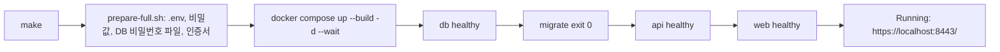
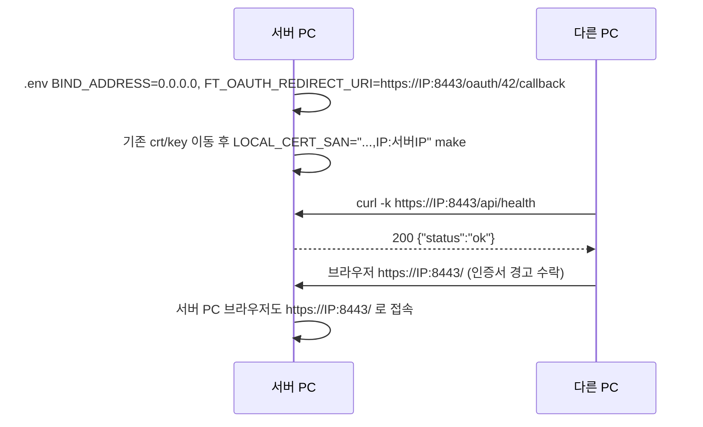
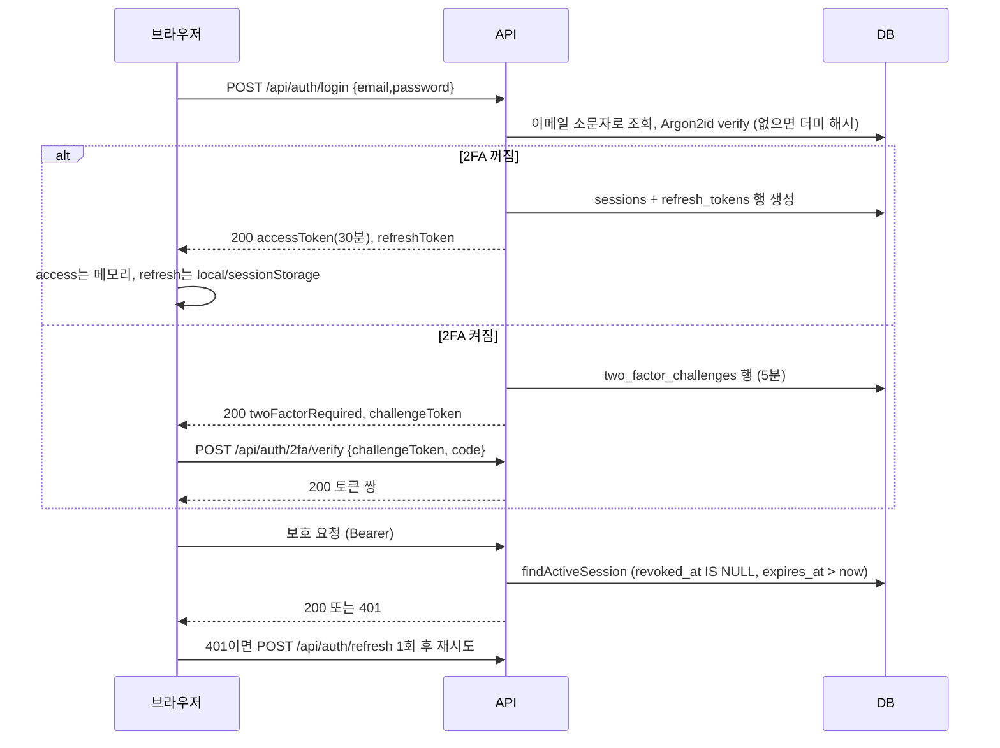
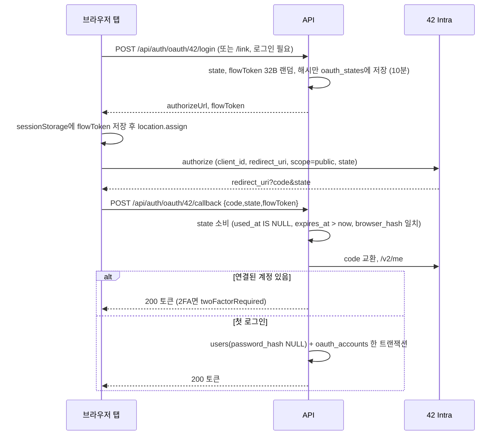
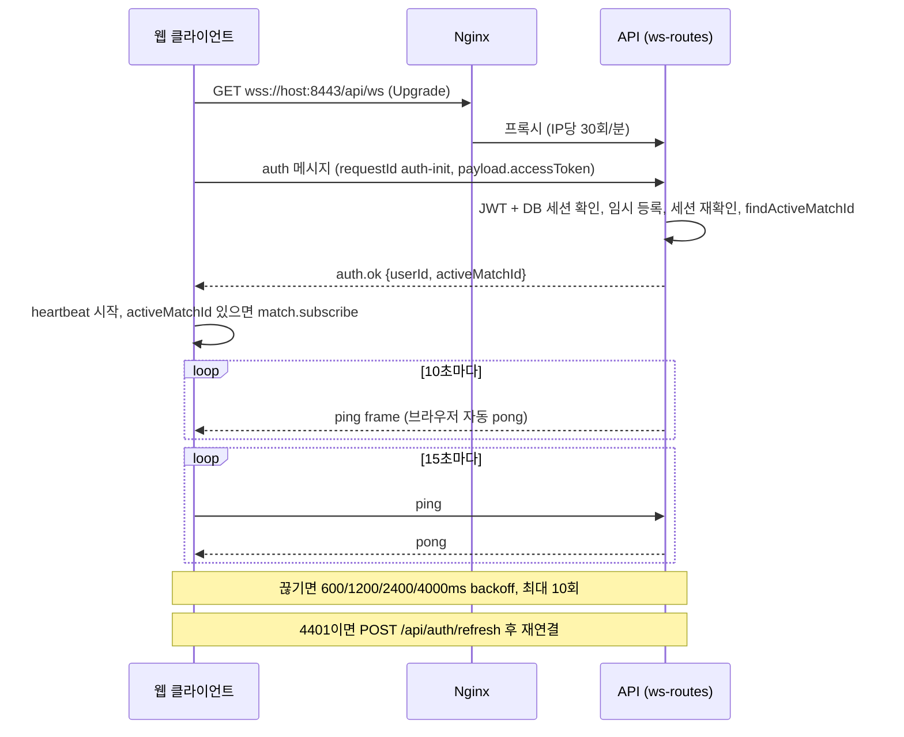

# 평가 시나리오 (ft_transcendence, Cyber Board Café)

평가 중 생길 수 있는 상황을 배포부터 브라우저 흐름, API·WS, 게임 규칙, 장애까지 코드 기준으로 정리한 문서입니다. 평가자 질문에 "그건 생각 못 했다"가 나오지 않도록, 조사 노트에서 확인한 동작을 빠짐없이 옮겼습니다.

## 1. 문서 사용법과 기준 코드

### 1.1 사용법

- 평가 당일 순서: 2장(준비) → 3장(배포) → 4장(평가표 필수 항목) → 5장(모듈) 순서로 시연하고, 질문이 나오면 6~9장의 해당 흐름과 10장(제약·결함), 11장(Q&A)을 찾습니다.
- 각 시나리오는 `상황 | 조작 | 코드 동작 (file:line) | 화면/응답 | 설명 포인트` 형식입니다.
- 라벨
  - **(실행 확인)**: 조사 중 실제로 실행해 결과를 본 항목입니다. HTTP는 Postgres 17 임시 컨테이너 + `buildApp()` + `app.inject()`로 재현했습니다(Nginx는 거치지 않음). 42 OAuth는 `oauth42.fetch` 주입으로 가짜 42 응답을 썼습니다.
  - **코드로 확인 불가**: 라이브러리·Docker·브라우저·OS 동작이라 저장소 코드만으로는 판단할 수 없는 항목입니다.
  - **실행 확인 필요**: 코드상 추정이며 시연 전에 직접 돌려봐야 하는 항목입니다.
  - 라벨이 없는 항목은 코드 읽기로 확인한 동작입니다.

### 1.2 기준 코드와 표기

제출물은 모든 PR이 merge된 뒤의 master입니다. 조사는 아래 사본에서 했고, 인용 경로는 저장소 기준 상대 경로이며 뒤에 코드 기준을 붙입니다.

| 표기 | 사본 | 커밋 | 내용 |
|---|---|---|---|
| [M] | `ft_evalmaster` | master `531f8a1` | 서버 realtime 최신(#61 엔진 등록, #98 presence, #97 세션 폐기 WS). 웹은 placeholder(`apps/web/src/App.tsx:1-3` [M]) |
| [C] | `ft_eval115` | #115 통합 후보 `35c1f96` | 실제 웹 앱, 친구·탈퇴·전적 비공개 서버, migration 0004~0006 |
| [#123] | `ft_make` | `2f4a836` (base `6ed44fd` #107) | `Makefile`, `infra/prepare-full.sh` 추가. 나머지 infra는 [M]과 같음 |
| [#119/#124] | `ft_tw` | `c51bf27` | Tailwind CSS 4.3.3 적용 |
| [#126] | `ft_fv` | `4ee0f90` | 프런트 폼 검증 추가(ft_tw 위 1커밋) |
| [#127] | `ft_priv` | `e140ab9` | 개인정보처리방침·약관 문구 수정 |
| [#120] | `ft_seed` | `12af5a9` | `npm run demo:seed` 시연 데이터 스크립트 |
| E | [M] `packages/game-engine/src/` | | 오목·오델로 엔진 |

- **기준 메모 규칙**: [M]과 [C]의 동작이 다른 곳은 "기준" 줄에 두 쪽을 짧게 적었습니다. 제출 master는 두 쪽이 합쳐진 결과이므로, 시연 전 실제 빌드에서 어느 쪽 동작인지 확인합니다.
- [C]의 realtime 서버 코드는 [M]보다 오래됐습니다(1008 상한 없음, 종료 후 duplicate 처리 차이). 탈퇴·친구·전적 비공개는 [C]에만 있습니다.
- 2026-11-14 master `54fa651`(#147 병합)에는 [C], [#123], [#119/#124], [#126], [#127], [#120]과 #165 친구 1:1 채팅, #166 로비 정리가 모두 들어 있습니다. 로비·대국 진입·오류 표시(6.11절, 7.2~7.3절, 10.1절 일부)와 닉네임 중복 규칙(migration 0007·0008)은 `54fa651` 기준으로 고쳤습니다. 그 밖의 `file:line`은 조사 사본 기준이라 줄 번호가 달라졌을 수 있습니다.

---

## 2. 평가 전 준비 체크리스트

### 2.1 컴퓨터·도구

| 확인 | 방법 | 이유·근거 |
|---|---|---|
| Docker 데몬 켜짐 | `docker info` | 꺼져 있으면 `Cannot connect to the Docker daemon ...`로 `make` 실패. prepare는 docker를 확인하지 않음 |
| Compose v2 plugin | `docker compose version` | Makefile이 `docker compose` 형식 고정(`Makefile:3` [#123]). v1(`docker-compose`)만 있으면 `docker: 'compose' is not a docker command`. 상단 `name:`(`infra/compose.full.yaml:1`), `service_completed_successfully`(:69), `bind.create_host_path`(:98-99), `--wait` 지원 필요. 검증 기록상 Docker 29.6.2 / Compose 5.3.1(`Document/runtime-validation.md:19-20` [#123]) |
| openssl | `openssl version` | 없으면 `OpenSSL is required to generate secrets and the certificate.` 후 exit 1(`infra/prepare-full.sh:10-13` [#123]). macOS 기본 LibreSSL에서 `-addext`(`infra/generate-local-cert.sh:24-26`) 지원 여부는 코드로 확인 불가, 그 컴퓨터에서 미리 `make` 한 번 실행 |
| 포트 8080, 8443 비어 있음 | `lsof -i :8443`, `lsof -i :8080` | 사용 중이면 web 컨테이너 단계에서 `port is already allocated` / `address already in use`(`infra/compose.full.yaml:90-92`) |
| 인터넷(첫 빌드) | | base 이미지 `node:24-bookworm-slim`, `nginx:1.28-alpine`, `postgres:17-alpine` pull + `npm ci`(`infra/Dockerfile:3,6,11`, `compose.full.yaml:15`). digest 고정 안 함(`Document/runtime.md:39`) |
| 디스크 여유(42 goinfre 등) | `df -h` | 부족하면 빌드 실패. 이미지 크기는 코드로 확인 불가 |
| Apple Silicon | | argon2 네이티브 모듈(`package.json:49`)의 arm64 prebuild 여부는 코드로 확인 불가. 평가 컴퓨터에서 미리 빌드 |
| 시계 동기화 | 서버 PC 시간 확인 | TOTP ±30초만 허용(`apps/server/src/core/totp.ts:4,74` [M]). Docker VM 시계가 틀어지면 2FA 실패. 동기화는 코드로 확인 불가 |
| 호스트 Node(시드용) | `node -v` ≥ 22.12.0 | 루트 `package.json` `engines.node ">=22.12.0"`(:29-31 [#120]). 시드 스크립트가 Node 전역 `WebSocket`·`fetch` 사용(`scripts/seed-demo.mjs:57-60` [#120]) |

### 2.2 저장소·빌드 대상

| 확인 | 내용 |
|---|---|
| 최종 master로 배포 | master `54fa651`에는 실제 웹 앱이 들어 있음(#147). [M] `531f8a1`처럼 웹이 제목 한 줄인 이전 커밋으로 배포하지 않음 |
| #123 브랜치 단독 배포 금지 | [#123] base `6ed44fd`에는 `apps/server/src/index.ts`의 `gameEngines` import/전달(`index.ts:5,52-53` [M])이 없음. `rulesByGameType` 기본 `{}`(`apps/server/src/app.ts:107` [M]) → 경기 생성 시 `No rules registered for ${gameType}.` throw(`apps/server/src/services/game-command-service.ts:168-171` [M]) → 매칭 실패. 최신 master와 합친 뒤 배포 |
| 한 컴퓨터에 사본 하나 | project 이름 `-p cyber-board-cafe-full` 고정(`Makefile:3-4`, `compose.full.yaml:1`). 다른 디렉터리에서 `make`하면 같은 컨테이너를 그 디렉터리 빌드로 재생성, volume(`cyber-board-cafe-full_postgres_data`, `..._avatars`) 공유 |
| 저장소 루트에서 실행 | `--project-directory .`와 prepare의 상대 경로. 하위 디렉터리에서는 Makefile이 없어 실패 |
| 타입 오류 없음 | web 빌드가 `tsc --noEmit && vite build`(`package.json:19` [#123]). 타입 오류 하나면 이미지 빌드 실패 |

### 2.3 이전 실행 흔적 정리 (volume)

- 상황: 같은 컴퓨터에서 예전에 띄운 적이 있고 새로 clone한 경우.
- 문제: 새 clone에는 `infra/secrets/postgres-password`가 없어 prepare가 새 비밀번호를 만들지만(`prepare-full.sh:75-80`), 이름이 같은 DB volume은 남아 재사용됩니다(`compose.full.yaml:19-20,118-120`). PostgreSQL은 데이터 디렉터리가 비어 있을 때만 초기 비밀번호를 적용합니다(`Document/runtime.md:68`). 결과는 migrate 인증 실패 → `service "migrate" didn't complete successfully` 류 오류 → api·web 미기동. 정확한 오류 문구는 drizzle-kit/postgres 출력이라 코드로 확인 불가.
- 조치(보존할 데이터가 없을 때):

```sh
docker compose -p cyber-board-cafe-full down -v
# compose 파일 보간까지 맞춘 전체 형식 (deploy 노트 0-4)
docker compose --env-file .env --project-directory . -p cyber-board-cafe-full -f infra/compose.full.yaml down -v
```

- `down -v`는 `postgres_data`·`avatars` volume을 지워 계정·전적·아바타가 모두 사라집니다. `.env`, 비밀번호 파일, 인증서는 호스트 파일이라 남습니다(`Document/runtime.md:165`).
- migration 세트가 다른 브랜치를 오간 volume([C] 0000~0006, [M] 0000~0003, 현재 master 0000~0009)도 같은 방법으로 정리합니다. 이미 적용된 migration이 폴더에 없을 때 drizzle-kit 동작은 코드로 확인 불가이고, 스키마와 코드가 어긋나면 런타임 500이 날 수 있습니다.

### 2.4 `.env`

`make`와 로컬 개발이 루트 `.env` 하나를 함께 씁니다. `.env`가 없으면 `make`가 `.env.example`을 복사하고 비어 있는 비밀값만 채웁니다(`prepare-full.sh:28-33,62-66`). 직접 편집한 값은 그대로 둡니다. 예전 `.env.full`만 있으면 `.env`로 이름을 바꾸고, 두 파일이 모두 있으면 합치라고 안내하고 exit 1입니다(`prepare-full.sh:15-26`).

| 키 | 기본(`.env.example` 줄) | 평가 전 확인 |
|---|---|---|
| `POSTGRES_USER` / `POSTGRES_DB` | 전체 앱은 `cafe` / `cafe_full` 고정(`compose.full.yaml:9-10`) | `.env`의 값(:33,35)은 로컬 개발 DB용이라 전체 앱은 쓰지 않음 |
| `POSTGRES_PASSWORD_FILE` | `./infra/secrets/postgres-password` (:22) | 비우면 prepare가 기본 경로로 채움(`prepare-full.sh:65`) |
| `CERT_DIR` | `./infra/certs` (:23) | 비우면 prepare가 기본 경로로 채움(`prepare-full.sh:66`) |
| `JWT_SECRET` | 빈 값 (:9) | 비면 `make`가 `openssl rand -hex 32`로 생성(`prepare-full.sh:40-62`). 직접 넣은 32자 미만 값은 api가 `Set JWT_SECRET in .env to a random string of 32+ characters.` throw(`apps/server/src/index.ts:13-18` [M]) |
| `TWO_FACTOR_KEY` | 빈 값 (:12) | 비면 `make`가 생성 → make 경로에서는 2FA가 항상 켜짐. 1~31자면 api 기동 실패(`index.ts:19-24` [M]) |
| `FT_OAUTH_CLIENT_ID/SECRET` | 빈 값 (:16-17) | 둘 다 있거나 둘 다 없어야 함. 있으면 `make`가 redirect URI를 `https://<주소>:<HTTPS_PORT>/oauth/42/callback`으로 정해 넘김(`start-full.sh`) |
| `FT_OAUTH_REDIRECT_URI` | 빈 값 (:18) | 로컬 개발 전용. `make`·`make local`은 쓰지 않음 |
| `TRUST_PROXY` | 전체 앱은 `uniquelocal` 고정(`compose.full.yaml:61`) | `.env` 값(:44)은 로컬 개발용 |
| `BIND_ADDRESS` | `127.0.0.1` (:26) | `make`는 `0.0.0.0`, `make local`은 `127.0.0.1`을 실행마다 넘김. docker compose를 직접 쓸 때만 사용 |
| `HTTP_PORT` / `HTTPS_PORT` | 8080 / 8443 (:27-28) | 충돌 시 변경. `PUBLIC_HTTPS_PORT`가 따라감(`compose.full.yaml:92`) |
| `LOCAL_CERT_SAN` | (파일에 없음) | **셸 환경 변수로만** 읽음. `.env`에 써도 무시(`generate-local-cert.sh:10`) |
| `AVATAR_DIR` | `data/avatars` (:46) | 로컬 개발용. Compose가 `/data/avatars`로 고정(`compose.full.yaml:62`) |
| `API_HOST` / `PORT` | `0.0.0.0` / `3001` 고정 | PORT 1~65535 정수, API_HOST 공백 불가(`compose.full.yaml:54-55`, `apps/server/src/listen-options.ts:1-11` [M]) |
| `DATABASE_URL` | 컨테이너에서 생성 | `.env` 값(:38)은 로컬 개발용, 전체 앱은 사용 안 함(`scripts/container-start.mjs:20-24`) |
| `--env-file` 의미 | | Compose 보간 입력일 뿐 컨테이너에 자동 전달되지 않음. 셸 환경 변수가 `.env`보다 우선 |
| CRLF 줄끝 | | Windows 편집기로 저장하면 `value_of`가 `\r` 포함 값을 "비어 있지 않음"으로 봄. Compose 쪽 처리는 코드로 확인 불가 |

### 2.5 인증서

| 확인 | 방법 | 이유 |
|---|---|---|
| 존재·쌍 | `ls infra/certs/` | 하나만 있으면 `Only one of ./infra/certs/server.crt and server.key exists.` exit 1(`prepare-full.sh:95-98`) |
| 만료일 | `openssl x509 -enddate -noout -in infra/certs/server.crt` | 유효기간 **30일**(`generate-local-cert.sh:18-28`). 만료돼도 `make`는 재생성하지 않음(`prepare-full.sh:93-98`) → `ERR_CERT_DATE_INVALID` |
| SAN | `openssl x509 -noout -ext subjectAltName -in infra/certs/server.crt` | 기본은 `DNS:localhost,IP:127.0.0.1,IP:::1`. 두 대 평가면 서버 IP 포함 필요 |

### 2.6 42 OAuth 앱

- 42 intra 앱에는 `make`가 출력한 redirect URI를 등록합니다. 한 대(`make local`): `https://localhost:8443/oauth/42/callback`, 두 대(`make`): `https://<서버IP>:8443/oauth/42/callback`.
- 웹이 받는 callback 경로는 `/oauth/42/callback`, `/auth/oauth/42/callback`(+끝 `/`)입니다(`apps/web/src/legal/legal-routing.ts:84-97` [C]).
- 42가 redirect URI를 어떻게 비교하는지는 42 쪽 동작이라 코드로 확인 불가입니다.
- 설정하지 않으면 42 버튼은 503(화면: "서버 또는 데이터베이스에 일시적으로 연결할 수 없습니다.")입니다. 이 경우 Swagger로 "미설정 시 503"을 설명합니다.

### 2.7 시연 데이터 `npm run demo:seed` (#120)

| 항목 | 내용 (`scripts/seed-demo.mjs` [#120]) |
|---|---|
| 실행 위치 | 호스트, 저장소 루트. 앱이 떠 있어야 함 |
| 명령 | `DEMO_PASSWORD='<8자 이상>' NODE_EXTRA_CA_CERTS=infra/certs/server.crt npm run demo:seed` |
| `DEMO_BASE_URL` | 기본 `https://localhost:8443` (:11). 두 대 평가에서 IP로 돌리면 인증서 SAN에 그 IP가 있어야 함 |
| `DEMO_PASSWORD` | 필수, 8자 이상. 없으면 `Set DEMO_PASSWORD (8+ characters).` throw (:12-14) |
| `NODE_EXTRA_CA_CERTS` | 자체 서명 인증서를 Node가 믿게 함 (주석 :4) |
| 만드는 계정 | `demo-alice`, `demo-bob`, `demo-carol`, `demo-dave`, 이메일 `demo-<name>@demo.example.com` (:32-34). 가입 201 또는 409(이미 있음) 모두 계속, 그 외는 throw (:40-41) |
| 경기 | 실제 `/api/ws`로 15판: 오목 12판(alice-bob 7, alice-carol 3, bob-dave 2) + 오델로 3판(carol-dave 2, alice-bob 1) (:212-226). alice는 오목 10판 → 첫 승 업적과 10경기 진행도 달성. alice-carol 세 번째 판은 carol 기권(`resign`) |
| 오목 진행 | 승자는 7행 3~7열에 5목, 패자는 0행 짝수 열(:113-114). 오델로는 합법 수 중 무작위(:138-145) |
| rate limit | 인증 요청이 429면 `retry-after`만큼 기다린 뒤 재시도(:18-29). 출력 `auth rate limited, waiting 60s` |
| 반복 실행 | **실행할 때마다 같은 경기가 다시 추가됨**(주석 :7-8). 한 번만 실행. 기존 demo 계정이 다른 비밀번호면 로그인 실패로 throw(:43-45) |
| 끝 | 소켓을 닫고 두 게임 리더보드를 출력(:237-254) |
| 주의 | 시드가 인증 요청 8번(가입·로그인 ×4)을 쓰므로, 같은 rate limit 버킷이면 직후 평가자 로그인이 429일 수 있음. 버킷 공유 여부는 Docker 포트 공개 방식에 달려 코드로 확인 불가(3.6절) |

### 2.8 브라우저

- 최신 안정 Chrome. 두 플레이어 시연은 **서로 다른 프로필, 시크릿 창, 또는 다른 브라우저**로 합니다. 한 프로필의 탭들은 같은 저장소를 써서 같은 계정입니다(`apps/web/src/api/auth-client.ts:95,139-216` [C]).
- 모든 클라이언트에서 인증서 경고를 한 번 수락해야 합니다(자체 서명, 신뢰 저장소 없음 `Document/runtime.md:81`).
- localhost와 IP는 다른 origin입니다. localhost에서 로그인한 뒤 IP로 열면 로그아웃 상태입니다(쿠키 미사용, refresh token은 origin별 Web Storage).
- 시연 계정 준비: 비밀번호 계정 2개(A, B), 2FA용 계정 1개, 42 계정(설정 시), 탈퇴용 계정 1개. TOTP 앱(휴대폰) 준비. 2FA 설정 화면에 QR 이미지가 없으므로 Base32 시크릿을 수동 입력합니다(6.3절).

### 2.9 README·저장소

- README 첫 줄 `*This project has been created as part of the 42 curriculum by jyoo, yunhpark, yoshin, sipyeon, dong-hki.*`([M] `README.md:1`).
- [M] README 섹션: Description, Technical stack, Instructions, Environment variables, Structure, Documentation.
- master `54fa651` README 섹션: Description, Features and integration status, Game rules, Technical stack and architecture, Database schema, Instructions, Environment variables, Testing, Team/modules and project management, Structure, Documentation and resources, AI usage, Known limitations.
- 과목 VI장 필수(Team Information, Project Management, Technical Stack, Database Schema, Features List, Modules, Individual Contributions, Resources·AI 사용)가 최종 master README에 모두 있는지 평가 전에 확인합니다.
- `.env`, `.env.*`는 git 제외, 예시 파일만 커밋(`.gitignore:4-5,17`). `.env`는 Docker build context에서도 제외(`.dockerignore:10-13`).

---

## 3. 배포 시나리오

### 3.1 한 대 컴퓨터 `make`



| 순서 | 조작 | 코드 동작 | 화면/출력 | 설명 포인트 |
|---|---|---|---|---|
| 1 | 저장소 루트에서 `make` | `all: up`(`Makefile:8`) → `up: prepare`(:10) → `sh infra/prepare-full.sh`(:16) | | 단일 명령 기동 |
| 2 | (prepare) | `set -eu`(:6), openssl 확인(:10-13), `umask 077`(:15), `.env` 없으면 example 복사(:16-19), `chmod 600 .env`(:20) | `.env` 0600 | 비밀값 파일 권한 |
| 3 | (prepare) | `JWT_SECRET`, `TWO_FACTOR_KEY` 비었으면 64자 hex 생성, `mktemp`→`mv`(:23-47) | `Generated JWT_SECRET in .env.` | 기존 값은 건드리지 않음 |
| 4 | (prepare) | 비밀번호 파일 없으면 디렉터리(0700) + `openssl rand -hex 32`(:61-67), 새 디렉터리면 파일 0444(:68-73) | `infra/secrets/` | DB 비밀번호는 Docker secret 파일 |
| 5 | (prepare) | crt·key 둘 다 없으면 `generate-local-cert.sh`(:80-81): RSA 3072, 30일, CN=localhost, `CA:FALSE`, `serverAuth`(:18-28) | `Created server.crt and server.key in ./infra/certs (valid for 30 days).` | |
| 6 | (compose) | `docker compose --env-file .env --project-directory . -p cyber-board-cafe-full -f infra/compose.full.yaml up --build -d --wait`(:3-4,11) | 빌드 로그 | |
| 7 | (기동 순서) | db `pg_isready`(2s, 30회, start 10s) → migrate(`restart: "no"`) → api(`/api/health/db` node fetch, 5s, 12회, start 15s) → web(`wget --no-check-certificate https://127.0.0.1/api/health/db`, 5s, 12회, start 10s)(`compose.full.yaml:23-28,31-43,67-79,102-111`) | | web healthcheck가 DB까지 봄 |
| 8 | (api 부팅) | listen 전 `app.inject('/api/health/db')`(`apps/server/src/index.ts:55-64` [M]) → 미완료 경기 void(:65-73) | 로그 `Voided N unfinished match(es) on restart.`, `Fastify API listening on http://0.0.0.0:3001` | |
| 9 | 완료 | `HTTPS_PORT` 마지막 값으로 URL 출력(`Makefile:12-13`) | `Running: https://localhost:8443/` | |
| 10 | 브라우저 접속 | | 인증서 경고 → "고급 → 계속" | 자체 서명 |

- 재실행(idempotency): `.env`·비밀값·비밀번호 파일·인증서가 있으면 그대로 둡니다(`prepare-full.sh:29-33,42-44,87-89,93-98`). Compose는 매번 `up --build`라 캐시로 재빌드하고 바뀐 서비스만 재생성합니다. migrate는 미적용 migration만 적용합니다(`Document/runtime.md:135`).
- **평가 도중 `make` 재실행 주의**: api가 재생성되면 진행 중 경기가 모두 void(`server_restart`)됩니다(7.11절).
- `COPY . .` 다음 `npm ci`(`infra/Dockerfile:5-6`)라 파일 하나만 바꿔도 의존성 재설치(시간·네트워크).
- 셸에서 `HTTPS_PORT=9443 make`하면 셸 값이 `.env`보다 우선하지만 Makefile URL 출력은 `.env`만 읽어 출력 URL이 실제 포트와 다를 수 있습니다(`Document/runtime.md:173,188`).

### 3.2 두 대 컴퓨터 (LAN)



| 순서 | 조작 | 코드 근거 | 확인 |
|---|---|---|---|
| 1 | 서버 PC의 LAN IP 확인 | | 이후 `<IP>` |
| 2 | `.env`에 `BIND_ADDRESS=0.0.0.0` (또는 서버 IP) | 기본 `127.0.0.1`이면 다른 PC는 connection refused/timeout(`.env.example:26`, `compose.full.yaml:91-92`) | |
| 3 | `.env`에 `FT_OAUTH_REDIRECT_URI=https://<IP>:8443/oauth/42/callback` (+ 42 앱 redirect URI 같은 값) | redirect URI는 하나(`index.ts:25-39` [M]), authorize URL에 그대로(`apps/server/src/core/oauth-42.ts:57-63,85` [M]) | |
| 4 | 기존 `infra/certs/server.crt`·`server.key`를 다른 곳으로 옮김 | 쌍이 있으면 재생성 안 함(`prepare-full.sh:93`, `generate-local-cert.sh:13-16`) | |
| 5 | `LOCAL_CERT_SAN="DNS:localhost,IP:127.0.0.1,IP:::1,IP:<IP>" make` | SAN은 셸 변수로만 읽음 | `openssl x509 -noout -ext subjectAltName ...` |
| 6 | 실행 중 인증서를 바꿨다면 web 재생성 | web은 시작 시 인증서를 읽음. 설정 변화가 없으면 `make`가 web을 재생성하지 않을 수 있음(Compose 동작, 코드로 확인 불가) → `docker compose --env-file .env --project-directory . -p cyber-board-cafe-full -f infra/compose.full.yaml restart web` | |
| 7 | 다른 PC에서 방화벽·경로 확인 `curl -k https://<IP>:8443/api/health` | 호스트 방화벽, 42 네트워크의 클라이언트 간 차단, Docker iptables는 코드로 확인 불가 | `{"status":"ok"}` |
| 8 | 모든 참가자(서버 PC 포함)가 `https://<IP>:8443/`로 접속 | flowToken·refresh token이 origin별 저장(5.4절) | 인증서 경고 수락 |
| 9 | WSS | WS URL은 `location.host` 기준 `wss://<host>:<port>/api/ws`(`apps/web/src/game/ws-client.ts:156-166` [C]) | 같은 origin이라 mixed content 없음. 페이지 예외 수락 뒤 WSS도 연결(브라우저 예외 범위는 코드로 확인 불가) |

- 인증서 경고: IP가 SAN에 없으면 Chrome은 `ERR_CERT_AUTHORITY_INVALID`와 이름 불일치 경고를 같이 냅니다. SAN에 넣어도 자체 서명이라 경고는 뜨고 "고급 → 계속"이 필요합니다. 대안 mkcert(`Document/runtime.md:83-95`).
- HSTS 헤더가 없어 자체 서명 예외 진행이 막히지 않습니다.
- Nginx healthcheck는 `--no-check-certificate`라 인증서 문제와 무관하게 healthy입니다(`compose.full.yaml:106-107`).
- OAuth: redirect URI가 `https://localhost:8443/...`이면 다른 PC는 42 인증 후 **자기 localhost**로 돌아가 실패합니다. 서버 PC에서도 IP로 시작해 localhost로 돌아오면 sessionStorage에 flowToken이 없어 "OAuth flowToken is missing from this browser session."(`OAUTH_STATE_INVALID`)(`apps/web/src/api/auth-client.ts:841-847` [C]). state 유효 10분(`apps/server/src/services/oauth-service.ts:17`).

### 3.3 배포 실패 상황 전체

| 상황 | 조작 | 코드 동작 (file:line) | 화면/출력 | 대응·설명 |
|---|---|---|---|---|
| 남은 volume + 새 비밀번호 | 새 clone 후 `make` | 2.3절 | migrate 실패, `make` 실패 | `down -v` 후 `make`, 또는 예전 비밀번호 파일 복원 |
| 비밀번호 파일 삭제·변경(volume 유지) | | 새 비밀번호 생성(`prepare-full.sh:75-80`) | 동일 | `POSTGRES_USER`/`POSTGRES_DB` 변경도 기존 DB에 반영 안 됨(`runtime.md:68`) |
| `.env` 삭제 | | 새 `JWT_SECRET`·`TWO_FACTOR_KEY` 생성 | 기존 access token 무효, **기존 2FA 설정 복호화 불가**(`prepare-full.sh:3-5`, `.env.example:11`) | DB 비밀번호는 파일이라 무관 |
| 포트 사용 중 | | web만 포트 공개(`compose.full.yaml:90-92`) | db·migrate·api 정상, web에서 `port is already allocated` | `HTTP_PORT`/`HTTPS_PORT` 변경. 1024 미만은 rootless Docker에서 실패 가능(코드로 확인 불가) |
| openssl 없음 | | `prepare-full.sh:10-13` | `make: *** [prepare] Error 1`, 파일 생성 없음 | 설치 |
| docker 없음 | | prepare 다음 `docker compose` | `docker: No such file or directory`, prepare 파일은 남음 | |
| daemon 꺼짐 | | | `Cannot connect to the Docker daemon ...` | |
| Compose v1만 | | | `docker: 'compose' is not a docker command` | |
| `.env` 일부만 채움 | | 2.4절 표 | | |
| `JWT_SECRET=abc` | | api throw(`index.ts:13-18` [M]) | api exit, web 미기동. | |
| `JWT_SECRET=""`(따옴표만) | | `value_of`가 `""`를 값으로 봄(`prepare-full.sh:36-38,42`) | Compose가 빈 문자열로 해석하면 `${JWT_SECRET:?...}`(`compose.full.yaml:53`) 오류 | dotenv 파싱은 코드로 확인 불가 |
| `TWO_FACTOR_KEY=''` | | Compose가 빈 값으로 넘기면 `container-start.mjs:29`가 삭제 → 2FA 비활성 | 2FA route 503 | |
| OAuth 3개 중 일부 | | `index.ts:25-34` [M] throw | api 실패 | |
| 같은 키 여러 줄 | | `tail -n 1`로 마지막 값, awk는 모든 줄 교체(`prepare-full.sh:37,48-50`) | | Compose도 보통 마지막 값(코드로 확인 불가) |
| `POSTGRES_PASSWORD_FILE` 절대 경로(`/tmp/pw`) | | other-x 있는 디렉터리라 새 파일 0600 + 안내(`:56-60,68-73`) | 컨테이너 `node`가 못 읽으면 `Cannot read the database password file.`(`scripts/container-start.mjs:15-19`) → migrate exit 1 | UID 같으면 읽힐 수 있음(코드로 확인 불가) |
| 경로 `~/...` | | 셸 확장 없음 → 저장소 안에 문자 그대로 `~` 디렉터리(`:61,65`) | | Compose 해석은 코드로 확인 불가 |
| 저장소 안, `infra/secrets` 밖 경로 | | `.dockerignore`는 `infra/secrets`, `*.key` 등만 제외(`.dockerignore:14-20`), `COPY . .`(`infra/Dockerfile:5`) | 비밀번호가 이미지 레이어에 포함, `.gitignore`도 `infra/secrets/`만 제외(:17) | 기본 경로 유지 |
| 비밀번호 파일이 비었거나 여러 줄 | | `apps/server/src/db/container-url.ts:9-15` | `The database password file must contain one non-empty line.` | 끝 LF/CRLF 하나 허용, 공백은 보존 |
| 비밀번호 특수문자 | | `encodeURIComponent`(`container-url.ts:16-23`) | 정상 | `$`·예약문자·공백 실제 연결 성공 기록(`runtime-validation.md`) |
| crt/key 한쪽만 | | `prepare-full.sh:95-98` | `Only one of ...` / `Restore the pair or move both away before running make.` | 둘 다 옮긴 뒤 `make` |
| 인증서 30일 만료 | | 재생성 안 함 | `ERR_CERT_DATE_INVALID` | 둘 다 옮기고 `make` |
| `CERT_DIR` 디렉터리 없음 | | `create_host_path: false`(`compose.full.yaml:93-99`) | Compose 오류 | |
| 타입 오류 | | `tsc --noEmit` | web 이미지 빌드 실패 | |
| migration 실패 | | `container-start.mjs:44-50` 종료 코드 전달 | `make` 실패. `make ps`에는 db만(migrate는 `ps -a`) | `make logs` / `logs migrate`. 실행 중 API는 새 migration 실패에도 안 죽음(`runtime.md:221`) |
| API 부팅 시 DB 불가 | | `index.ts:55-64` [M] | api Exited, 로그 `Database is unavailable. Run npm run db:up and npm run db:migrate first.`(개발용 문구) | restart 정책 없음 |
| migration 미적용 | | `/api/health/db`가 `connection_probe` 조회(`apps/server/src/db/client.ts:45-51`) | 503 | |
| migrate와 db 초기화 경합 | | `pg_isready`가 socket 기반 | 이미지 동작이라 코드로 확인 불가. 빈 DB 첫 기동은 검증 통과 기록 | |
| `listen [::]` IPv6 비활성 | | `default.conf.template:8,15` | nginx 시작 여부 코드로 확인 불가 | |

### 3.4 실행 중 운영 상황

| 상황 | 코드 동작 | 보이는 것 | 설명 포인트 |
|---|---|---|---|
| restart 정책 없음 | db·api·web에 `restart:` 없음 → 기본 no | 컨테이너가 죽거나 Docker/호스트 재시작 후 자동 기동 안 함 | `make` 재실행 |
| Fastify logger 꺼짐 | `buildApp({ trustProxy })`만 전달(`index.ts:47-48` [M]) | `make logs`에 `Voided ...`, `Fastify API listening ...`, 기동 실패 stack 정도. `request.log.error`(`app.ts:115,257,268,271` [M])와 DB pool 끊김 콜백(`app.ts:114-116` [M])은 출력 안 됨 | 500·503 원인은 응답 `error.code`와 `/api/health/db`로 설명 |
| `make down` | `compose down`(`Makefile:19-20`) | 컨테이너·네트워크 삭제, volume 유지(:18 주석) | 다음 `make`에서 데이터 유지, 단 api 재기동으로 미완료 경기 void |
| `make logs` | `logs -f` | Ctrl+C로 종료 | 내용이 적음 |
| `make ps` | `compose ps` | exited migrate는 `-a` 없이 안 보임 | |
| `make re`/`clean`/`fclean` | 정의 없음(`Makefile:6` `.PHONY: all up prepare down logs ps`) | `No rule to make target` | volume 초기화는 직접 `down -v` |
| `.env` 없이 `make down/logs/ps` | 모두 `--env-file .env`(`Makefile:3,20,23,26`) | `:?` 보간에서 실패 가능 | |
| 코드 수정 후 재배포 | `make` = `up --build` | 변경 서비스만 재생성 | 스키마 변경 시 웹·API를 먼저 멈추고 migration 후 기동 권장(`runtime.md:141,221`) |
| DB 직접 확인 | `docker compose ... exec db psql -U "$POSTGRES_USER" -d "$POSTGRES_DB"` | | API(3001)·DB(5432)는 호스트에 노출 안 됨, `data` 네트워크 internal(`compose.full.yaml:122-125`) |
| 해시 시연 | psql `select password_hash from users limit 1;` | `$argon2id$v=19$m=19456,t=2,p=1$...` | |
| 개발용 compose와 공존 | `infra/compose.yaml`은 project `cyber-board-cafe`, DB 127.0.0.1:5432(`compose.yaml:1,10-11`) | 충돌 없음 | 셸 `COMPOSE_PROJECT_NAME`도 `-p`로 무시(`runtime.md:186`) |
| 외부 접근 | `data` 네트워크 internal이라 migrate·db 인터넷 불가, api는 `edge` 네트워크로 42 API 접근(`compose.full.yaml:63-66`) | | |
| non-root | server 이미지 `NODE_ENV=production`, `AVATAR_DIR=/data/avatars`, `/data/avatars` node:node 0750, `USER node`(`infra/Dockerfile:18-25`) | | 서버 코드는 `NODE_ENV`를 읽지 않음 → production 차이 없음 |
| 시작 스크립트 | `scripts/container-start.mjs:6-9` 모드는 `api`/`migrate`만, `:10-13` `POSTGRES_PASSWORD_FILE` 없으면 throw(Compose는 `/run/secrets/postgres_password` 고정 `compose.full.yaml:11`), `:20-24` DATABASE_URL 생성, `:29` 빈 `TWO_FACTOR_KEY` 삭제, `:31` 같은 프로세스에서 서버 import(SIGTERM이 Fastify까지 전달) | | |
| web 이미지 | Nginx 공식 이미지 기본(master root, worker nginx). 템플릿 → `/etc/nginx/templates/default.conf.template`(`infra/Dockerfile:13`), `NGINX_ENVSUBST_FILTER=^PUBLIC_HTTPS_PORT$`로 그 변수만 치환(`compose.full.yaml:89`) | | |
| 아바타 volume 권한 | Dockerfile의 0750 상속(`Dockerfile:21-22`) | 예전 다른 권한 volume이면 업로드 실패 가능(`runtime.md:153-163`) | |
| `init: true` | migrate·api tini 신호 전달(`compose.full.yaml:34,48`), stop_grace_period db 30s, api 30s, web 10s | | |

### 3.5 Nginx 경로와 HTTP/HTTPS

| 요청 | 동작 | 근거 |
|---|---|---|
| `http://localhost:8080/...` | `308 https://$host:${PUBLIC_HTTPS_PORT}$request_uri` - 경로·query·메서드 보존 | `infra/nginx/default.conf.template:6-11`. 검증 기록 308 + Location |
| `http://localhost:8443` | Nginx 기본 400 "The plain HTTP request was sent to HTTPS port" | 별도 처리 없음 |
| `https://localhost:8080` | 브라우저 `ERR_SSL_PROTOCOL_ERROR` | TLS 아님 |
| `/api/...` | API 프록시, URI 그대로, body 3m | template:29-33 |
| `/docs`, `/docs/...` | API 프록시(Swagger UI, `/docs/json`) | template:35-41 |
| 그 외 | 정적 파일, 없으면 `/index.html`(SPA fallback, 200) | template:43-45 |
| `/oauth/42/callback`, `/terms`, `/privacy`, `/match/:id` | index.html | `apps/web/src/legal/legal-routing.ts:85-103` [C] |
| 없는 화면 경로 | 404가 아니라 index.html 200 → SPA 404 화면 | |
| `/api/없는경로` | [M] JSON 404 `{error:{code:"NOT_FOUND",message:"Route not found."}}`(`app.ts:276-278` [M]) / [C] Fastify 기본 `{"message":"Route GET:/api/nope not found","error":"Not Found","statusCode":404}` (실행 확인) | 기준 차이 |
| api 꺼짐 | Nginx 기본 **502 HTML**. upstream은 Docker DNS `127.0.0.11 valid=10s`(template:25-27)라 api 재생성 후 10초 안에 재조회 | 웹은 non-JSON 오류를 `INTERNAL_ERROR`로 처리(`apps/web/src/api/auth-client.ts:458-464` [C]) → "서버 내부 오류가 발생했습니다..." |
| 3 MiB 초과 본문 | Nginx 기본 413 HTML | API는 JSON 1 MiB, 아바타 2 MiB |
| TLS | TLSv1.2/1.3 | template:20 |
| 프록시 헤더 | `proxy_http_version 1.1`, `Host`/`X-Forwarded-Host`=`$http_host`, `X-Forwarded-Proto`=`$scheme`, `X-Forwarded-For`=`$remote_addr`, Upgrade/Connection, read/send timeout 75s | `infra/nginx/api-proxy.conf:2-12`, template:1-4 |
| WS idle | 서버 ping 10초, 20초 무응답 terminate, 클라이언트 heartbeat 15초 → 75초 timeout에 안 걸림 | `apps/server/src/api/ws-routes.ts:281-283,651-661` [M], `ws-client.ts:150-151` [C] |

### 3.6 Rate limit 버킷과 실제 IP

- 키는 `request.ip` = Nginx가 넣은 `$remote_addr`입니다. Nginx가 `X-Forwarded-For`를 덮어써 외부에서 위조해도 같은 IP로 집계됩니다(실행 확인: 신뢰하지 않는 peer에서 XFF를 바꿔도 11번째 429).
- `$remote_addr`가 실제 클라이언트 IP인지는 Docker 포트 공개 방식에 달려 **코드로 확인 불가**입니다.
  - Linux, localhost: docker-proxy를 거치면 bridge gateway(172.x.0.1)로 보일 수 있음 → 같은 컴퓨터 모든 탭·브라우저가 한 버킷.
  - Linux, LAN: iptables DNAT이면 원래 IP 보존 → 컴퓨터별 버킷.
  - Docker Desktop(macOS): VM gateway 주소로 보일 수 있음 → 모든 클라이언트가 한 버킷.
  - 같은 NAT 뒤 두 평가자: 서버에 도달하는 주소가 같으면 같은 버킷.
- 대응: 연속 로그인 시연은 간격을 두고, 429가 나오면 1분 기다립니다. 실제 키는 `docker compose ... exec web`에서 Nginx access log의 `$remote_addr`로 확인합니다.
- 목록은 8.4절.

### 3.7 Swagger `/docs`

- `@fastify/swagger` + `swagger-ui`를 `routePrefix: "/docs"`로 항상 등록, NODE_ENV 조건 없음(`apps/server/src/app.ts:295-305` [M]) → production 컨테이너에서도 노출됩니다.
- `https://<host>:8443/docs/`, `/docs/json`. [C]에서 27 paths(실행 확인). bearer 인증 스키마 등록(`app.ts:298-302` [M]), 같은 origin이라 "Try it out"도 Nginx를 거쳐 API로 갑니다.
- `/api/ws`는 `schema: { hide: true }`라 Swagger에 없습니다(`ws-routes.ts:637` [M]).
- 검증 기록: `/docs`, `/docs/`, `/docs/json`, Swagger CSS·JS 200.

### 3.8 실행 중 장애 시연

| 상황 | 조작 | 코드 동작 | 화면/응답 | 설명 포인트 |
|---|---|---|---|---|
| DB 중지 | `docker compose ... stop db` | pool max 5, 연결 대기 3s, statement_timeout 3s(`db/client.ts:32-38`). 연결 오류(`ECONNREFUSED`/`ENOTFOUND`/`ETIMEDOUT`, SQLSTATE 08xxx, 57014, 57Pxx, pool timeout 문구, "Connection terminated") → 503 `SERVICE_UNAVAILABLE` "Database is unavailable."(`app.ts:59-85,262-270` [M]) | `/api/health` 200, `/api/health/db` 503 (실행 확인). 웹 "서버 또는 데이터베이스에 일시적으로 연결할 수 없습니다." | `EAI_AGAIN`은 목록에 없어 500 가능(Docker DNS 응답 종류는 코드로 확인 불가). api·web unhealthy 표시, 재시작은 안 함 |
| DB 재시작 | `start db` | pool이 새 연결 생성 | 자동 복구(검증 기록) | |
| WS 중 DB 오류 | | 인증·활성 경기 조회 중 오류면 1011 "Service unavailable."(`ws-routes.ts:732-757` [M]) | 클라이언트 재접속 시도 | 이탈 타임아웃 결과 저장 실패 시 최대 10초 간격 재시도(`ws-routes.ts:325-359` [M]) |
| 락 대기 | 다른 트랜잭션이 행 잠금 | 3초 후 57014 → 503 | 503, 3005 ms (실행 확인) | |
| api 재시작 | `restart api` / 재빌드 / `make` 재실행 | SIGTERM → `app.close()`(`index.ts:80-84` [M]) → absence 타이머 정리, pool 종료(`app.ts:218-220`, `ws-routes.ts:295-298` [M]). 기동 시 `playing|paused` 경기 전부 void `server_restart` | 재시작 중 502 HTML → "서버 내부 오류". 클라이언트는 약 30초 재접속 예산 | 7.11절 |
| web(Nginx) 재시작 | `restart web` | 모든 HTTP·WS 끊김 → 구독 0개 사용자는 이탈 처리, 상대에게 `player.disconnected` + paused(`ws-routes.ts:84,255-266` [M]) | 재접속하면 `player.reconnected`, 60초 예산 초과 시 `disconnect_timeout` | 경기 데이터는 DB에 있어 유지 |
| 호스트·Docker 재시작 | | restart 정책 없음 | 컨테이너 안 뜸 | `make` |

---

## 4. 평가표 필수 항목별 시연 시나리오

`Document/evaluation/mandatory-checklist.md`의 13행 순서입니다. 각 항목에 보여 줄 것, 순서, 평가자가 보는 것, 코드 위치, 알려진 빈 곳을 적었습니다.

### 4.1 기본 이메일·비밀번호 가입/로그인 (III.3)

| 단계 | 조작 | 평가자가 보는 것 | 코드 위치 |
|---|---|---|---|
| 1 | `/signup`에서 이메일·비밀번호(8자 이상)·닉네임 입력, 약관 동의, 가입 | 로비 + "{닉네임} 님, 회원가입이 완료되었습니다." | `apps/web/src/App.tsx:1207-1262` [C], 서버 `apps/server/src/api/auth-routes.ts:120-159`, `services/auth-service.ts:147-170` [C] |
| 2 | psql `select email, password_hash from users order by id desc limit 1;` | 이메일 소문자 저장, `$argon2id$v=19$m=19456,t=2,p=1$...` | `core/password.ts:5-15`, 소문자화 `auth-service.ts:155` |
| 3 | 로그아웃 후 같은 계정 로그인 | 로비 | `auth-service.ts:179-193` |
| 4 | 틀린 비밀번호 | "이메일 또는 비밀번호가 맞지 않습니다." | 401 `INVALID_CREDENTIALS` (실행 확인) |
| 5 | 없는 이메일 | 같은 문구 | 더미 해시 검증 `core/password.ts:38-42`. 응답 시간 평균 28.7 ms vs 28.9 ms (실행 확인) |
| 6 | 로그인 없이 `https://.../api/users/me` 또는 Swagger에서 토큰 없이 호출 | 401 `UNAUTHENTICATED` "Authentication required." | `auth-routes.ts:92-107` |
| 7 | DevTools > Application | access token은 저장소에 없고 refresh token만(`cbc.auth.refreshToken`) | `apps/web/src/api/auth-client.ts:139-345` [C] |

- 설명 포인트: salt는 Argon2 해시 문자열 안에 같이 저장됩니다(라이브러리가 랜덤 생성). 가입은 토큰을 주지 않고, 웹이 가입 직후 자동 로그인합니다.
- 알려진 빈 곳: 비밀번호 복잡도 규칙 없음(공백 8개도 201, 실행 확인). 로그인·회원가입 이메일·비밀번호는 클라이언트 검증 없이 서버만 검증합니다(`noValidate`, `App.tsx:1700,2012` [C]).

### 4.2 약관·개인정보처리방침 (III.2)

| 단계 | 조작 | 평가자가 보는 것 | 코드 위치 |
|---|---|---|---|
| 1 | 아무 화면 하단 푸터 "이용약관", "개인정보처리방침" | 모든 화면(대국 화면 포함)에 링크, `© 2026 Cyber Board Cafe. 모든 권리 보유.` | `App.tsx:2715-2747` [C] |
| 2 | 링크 클릭 | `/terms`, `/privacy`. 로그인 없이 열림 | `legal-routing.ts:67-73,99-104` [C] |
| 3 | 내용 | 약관 제1조 목적·범위, 제2조 계정·인증 보안, 제3조 서버 권위 판정·재접속(누적 60초, `disconnect_timeout`, void, `server_restart`), 제4조 전적·통계·리더보드 산정 | `legal-routing.ts:236-280` [C] |
| 4 | 개인정보 | 1. 수집 항목 2. 이용 목적(전적 공개 기본 ON) 3. 안전성 조치(Argon2id, access token 메모리 보관) 4. 보유·파기(아바타 삭제, 탈퇴 조건·처리·보존, "(탈퇴한 사용자)") | `legal-routing.ts:285-337` [C] |
| 5 | 회원가입 화면 "이용약관 전문 보기" | 약관 → "회원가입 화면으로 돌아가기" 후 입력값 유지(비밀번호 포함) | `App.tsx:266-270` [C] |
| 6 | 탭 키보드 | tablist에서 ←/→로 문서 전환 | `legal/LegalDocumentView.tsx:40-46` [C] |
| 7 | 새 탭 열기 | 푸터는 `href` 있는 `<a>`라 가능 | |

- 기준: [C] 제2조 "비밀번호(8~72자)"(`legal-routing.ts:249` [C])와 오류 문구 "8자 이상 128자 이하"(`apps/web/src/api/errors.ts:101` [C])가 다릅니다. [#127]에서 "8~128자"로 수정됐습니다. [#127]은 42 OAuth 항목 분리(42 이메일 저장, 42 login은 닉네임 결정에만, 42 access token 미저장), refresh token "로그인 시점부터 7일", 회전해도 연장 안 됨, 탈퇴 시 친구 관계 삭제, "경기 당시 닉네임 뒤에 (탈퇴한 사용자)"를 추가합니다. [#127]은 오래된 base 위 커밋이라 탈퇴 관련 문구 원문이 [C]와 달라, 최종 문구가 무엇인지는 merge 결과로 확인합니다.
- 알려진 빈 곳: 시행일 "2026-10-13"(`legal-routing.ts:228-231` [C]). 탭은 roving tabindex 없음, 포커스가 새 탭으로 이동하지 않음. "돌아가기"는 `history.back`이 아니라 이전 view로 push라 뒤로 버튼 연타 시 약관 → 이전 → 약관이 오갈 수 있습니다(`App.tsx:354-369` [C]).

### 4.3 동시 사용자·충돌 방지 (III.2 Multi-user)

| 단계 | 조작 | 평가자가 보는 것 | 코드 위치 |
|---|---|---|---|
| 1 | 브라우저 4개(프로필 4개)로 A·B 오목, C·D 오델로 동시 매칭 | 두 경기가 각각 진행 | 게임 종류별 FIFO(`apps/server/src/services/matchmaking.ts:60,75-82,144-147` [M]) |
| 2 | 한 경기의 착수가 다른 경기에 영향 없음 | 구독자별 broadcast | `services/connection-registry.ts:178-187` [M] |
| 3 | 같은 칸을 두 탭에서 거의 동시에 클릭(또는 상대 착수 직후 기권) | 하나만 적용, 다른 쪽 `VERSION_CONFLICT` + 최신 snapshot | 경기 행 `FOR UPDATE`(`services/game-command-service.ts:236-371` [M]), `ws-routes.ts:608-611` [M] |
| 4 | 마지막 착수와 이탈 만료가 겹침 | 결과 하나 | `game-command-service.ts:160-162,383-402` [M] |
| 5 | 같은 계정 두 탭 동시 매칭 | 하나만 대기열, 다른 쪽 `ALREADY_ACTIVE` | `matchmaking.ts:128` [M] |
| 6 | 같은 닉네임 동시 가입 | 하나 201, 하나 409 `NICKNAME_TAKEN` | UNIQUE `users_nickname_unique` |
| 7 | 두 사용자가 동시에 서로 친구 요청 | 201 pending / 200 accepted (실행 확인) | 행 잠금 + `ON CONFLICT DO NOTHING` 재시도 [C] |
| 8 | 동시 refresh | 서버만으로는 둘째가 reuse 판정 → 세션 폐기(실행 확인). 웹은 Web Locks `cbc.auth.refresh`로 탭 간 직렬화 | `auth-repository.ts:124-143` [C], `auth-client.ts:550-556` [C] |

- 설명 포인트: 경기 변경은 한 트랜잭션 + 경기 행 잠금, 응답(`game.ack`)은 commit 후에만, 클라이언트는 낙관적 반영 없이 서버 snapshot만 그립니다(`apps/web/src/game/gomoku-state.ts:500-519` [C]). 연결별 메시지는 Promise chain으로 순서대로 처리합니다(`ws-routes.ts:678-705` [M]).
- 알려진 빈 곳: 대기열·구독·이탈 시계·presence가 메모리에 있어 **단일 API 인스턴스 전제**입니다(`connection-registry.ts:22`, `matchmaking.ts:42` [M]). 성능 측정은 브랜치 `test/perf-measure`의 NFR-PERF-01 기록이 있습니다(이 문서의 조사 범위 밖).

### 4.4 외부에서 백엔드로의 HTTPS (III.3)

| 단계 | 조작 | 평가자가 보는 것 | 코드 위치 |
|---|---|---|---|
| 1 | `http://localhost:8080/login` | 308로 `https://localhost:8443/login` | `infra/nginx/default.conf.template:6-11` |
| 2 | `curl -k -i https://localhost:8443/api/health` | 200 `{"status":"ok"}` | `apps/server/src/app.ts:307-378` [M] |
| 3 | `curl -i http://localhost:3001/api/health` | 연결 실패 (API 포트 미공개) | `compose.full.yaml:90-92,122-125` |
| 4 | 시드·테스트 스크립트 | `DEMO_BASE_URL` 기본 `https://` | `scripts/seed-demo.mjs:11` [#120] |
| 5 | 42 API 호출 | `https://api.intra.42.fr` | `core/oauth-42.ts:57-63` [M] |

- 설명 포인트: TLS는 Nginx에서 종료하고(TLSv1.2/1.3), Nginx→API, API→DB는 Docker 내부 네트워크 평문입니다. 과목은 백엔드 내부 연결의 비암호화를 허용합니다.
- 알려진 빈 곳: 자체 서명 30일 인증서라 경고가 뜹니다. HSTS 없음.

### 4.5 WSS

| 단계 | 조작 | 평가자가 보는 것 | 코드 위치 |
|---|---|---|---|
| 1 | DevTools Network > WS | `wss://<host>:8443/api/ws` | `ws-client.ts:156-166` [C] |
| 2 | 첫 프레임 | `{"type":"auth","requestId":"auth-init","payload":{"accessToken":...}}` | `ws-client.ts:642-650` [C] |
| 3 | URL에 토큰 없음 | `/api/ws`만 | `ws-routes.ts:633-634` [M] |
| 4 | `ws://localhost:8080/api/ws`로 직접 연결 시도 | HTTP 포트(80)는 모든 요청을 308로 HTTPS로 보냄 | `default.conf.template:6-11`. 브라우저 WebSocket이 308을 어떻게 처리하는지는 브라우저 동작이라 실행 확인 필요 |

- 설명 포인트: 토큰을 URL·헤더가 아니라 첫 메시지로 보내 프록시·access log에 남지 않습니다. 폴링은 쓰지 않습니다.
- 알려진 빈 곳: WS upgrade에 Origin 검사가 없습니다(`ws-routes.ts`에 origin 코드 없음). 토큰을 첫 메시지로 받으므로 토큰 없이는 인증되지 않습니다.

### 4.6 최신 안정 Chrome·콘솔 경고/오류 없음 (III.2)

| 단계 | 조작 | 평가자가 보는 것 | 근거 |
|---|---|---|---|
| 1 | `chrome://version` 기록 | 버전 | |
| 2 | 가입 → 로그인 → 로비 → 매칭 → 대국 완주 → 프로필 → 리더보드 → 친구 → 약관 | 콘솔 0건이 목표 | 프로덕션 코드 `console.*` 호출 0건 [C] |
| 3 | 의도적 오류 시연 시 | "Failed to load resource: the server responded with a status of N" | 브라우저 자동 출력(9.1절) |

- 설명 포인트: 앱이 모든 fetch를 try/catch해 "Uncaught (in promise)"는 코드상 없습니다. CSP 헤더가 없어 CSP 위반 메시지 없음, mixed content 없음, service worker 없음, `build.sourcemap` 없음(`apps/web/vite.config.ts:17`) → source map 경고 없음. favicon `<link>` 없음, `/favicon.ico`는 SPA fallback으로 200 `text/html`이라 404 콘솔 오류 없이 아이콘만 안 나옵니다(`apps/web/index.html:1-18` [C]).
- 알려진 빈 곳: [C] `index.html:7-12`이 Google Fonts를 불러와 인터넷이 막힌 환경이면 폰트 요청 실패가 콘솔·Network에 보입니다(대체 폰트로 표시). 30분 경과 후 첫 보호 요청은 401 → refresh → 재시도라 401 한 줄이 남습니다(`auth-client.ts:634-646` [C]). WS 재접속 중 `WebSocket connection to 'wss://...' failed`가 뜰 수 있습니다(브라우저 동작). 통합 웹 기준 콘솔 실측 기록은 조사에서 찾지 못했습니다(실행 확인 필요).

### 4.7 프런트·백·DB와 관계 (III.2-3)

| 계층 | 기술 | 위치 |
|---|---|---|
| 프런트 | React(SPA, 라우터 라이브러리 없이 `history.pushState`) + Vite | `apps/web/src/App.tsx:398-524` [C] |
| 백 | Fastify, JSON Schema 검증, `@fastify/websocket`, `@fastify/rate-limit`, `@fastify/swagger` | `apps/server/src/app.ts` |
| DB | PostgreSQL 17 + Drizzle ORM, migration `apps/server/drizzle/` (master `54fa651` 0000~0009) | `apps/server/src/db/schema/*.ts` |

DB 테이블과 관계([C] `apps/server/src/db/schema/`):

| 테이블 | 파일 | 관계 |
|---|---|---|
| `users` | `users.ts:12` | 중심. `email`·`nickname` UNIQUE, [C]에 `deleted_at`, `records_public` |
| `sessions` | `users.ts:37` | `user_id` → users (cascade) |
| `refresh_tokens` | `users.ts:59` | `session_id` → sessions (cascade), `token_hash` UNIQUE |
| `oauth_accounts` | `external-auth.ts:21` | → users (cascade), provider+providerUserId / user+provider UNIQUE |
| `oauth_states` | `external-auth.ts:55` | → users, → sessions (link 모드) |
| `two_factor_secrets` / `two_factor_recovery_codes` / `two_factor_challenges` | `external-auth.ts:88,101,117` | → users (cascade) |
| `games` | `games.ts:25` | `winner_user_id` → users |
| `game_players` | `games.ts:82` | → games (cascade), → users. `result`, [C] `nickname_snapshot` |
| `moves` | `games.ts:122` | → games (cascade), → users |
| `game_commands` | `games.ts:162` | → games (cascade), → users. 거절된 명령도 기록 |
| `friendships` | `friendships.ts:21` | → users ×3 (cascade). 한 쌍 1행(`user_low_id < user_high_id` UNIQUE) |
| `connection_probe` | `connection-probe.ts:4` | `/api/health/db` 확인용 |

- 시연: 경기 하나를 끝낸 뒤 psql로 `games`, `game_players`를 조회하고 프로필 통계가 같은 값인지 보여 줍니다. 통계는 별도 집계 테이블 없이 조회 시 계산합니다(`apps/server/src/repositories/stats-repository.ts:13-28` [M]).
- 상태값은 text + CHECK 제약(예: `oauth_states.mode`). ER 다이어그램은 README `Database schema`(#118).

### 4.8 컨테이너·단일 명령 실행 (III.2)

- 3.1절 그대로 시연합니다. 문서화한 환경 설정 이후 `make` 한 번으로 db·migrate·api·web이 healthy가 될 때까지 기다리고 URL을 출력합니다.
- 알려진 빈 곳: restart 정책 없음, `make re/clean/fclean` 없음, 첫 빌드는 인터넷 필요, 인증서 30일.

### 4.9 반응형·접근 가능한 UI (III.3)

| 단계 | 조작 | 평가자가 보는 것 | 근거 |
|---|---|---|---|
| 1 | DevTools 기기 모드 360px | 단일 열, 헤더 브랜드 글자 숨김(로고만) | `apps/web/src/styles.css:875-895` [C] |
| 2 | 768px | 로비 게임 카드 2열, 대국·프로필은 단일 열 | `styles.css:822,2188,2283,2434` |
| 3 | 1024px 이상 | 회원가입 2단, 대국 `360px 1fr`, 프로필 `340px 1fr`, 매칭 `7fr 5fr` | `styles.css:311,1462,1931,2603` |
| 4 | 키보드만으로 로그인 → 매칭 → 착수 | Tab 이동, 대국판 방향키·Home/End·Ctrl+Home/End, Enter/Space 착수, Esc 매칭 취소 | `game/GomokuMatchView.tsx:173-206` [C] |
| 5 | 라벨·aria | 필수 `*`(aria-hidden) + sr-only "(필수 입력 항목)", 오류 `role="alert"`, `aria-invalid`/`aria-describedby` | `App.tsx:1704-1710,1725-1731` [C] |

- 알려진 빈 곳은 9.2~9.3절(로그아웃·기권·2FA 해제 모달 focus trap 없음, `prefers-reduced-motion` 없음, 화면 전환 시 포커스 이동 없음, 턴 배너 `aria-live` 없음). WCAG Major 모듈은 선택하지 않았습니다.

### 4.10 스타일링 솔루션 (Plain CSS만으로는 불충분)

평가표 문구 "Ask a team member to show examples of its usage in the code. ... Plain CSS alone is not sufficient." 검증 기록은 `Document/styling-validation.md`(#124).

| 순서 | 보여 줄 코드 [#119/#124] | 설명 |
|---|---|---|
| 1 | `apps/web/package.json`의 `tailwindcss 4.3.3`, `@tailwindcss/vite 4.3.3`, `apps/web/vite.config.ts:4,19` `plugins: [tailwindcss()]` | 빌드에 연결 |
| 2 | `apps/web/src/index.css:7-25` | `@layer theme, base, components, utilities;`, `@import "tailwindcss/theme.css" layer(theme)`, `@import "./styles.css" layer(components)`, `@import "tailwindcss/utilities.css" layer(utilities)`, `@theme inline`으로 디자인 토큰(`--surface`, `--primary` 등)을 `--color-*`, `--font-display`로 노출. Preflight는 의도적으로 제외(주석 :1-6). `main.tsx:3`이 `./index.css` import |
| 3 | `App.tsx:1703` `flex flex-col gap-5`, `:1710` `text-sm/5 font-semibold tracking-[0.01em] text-on-surface`, `profile/ProfileView.tsx:599` `grid grid-cols-1 items-start gap-6 lg:grid-cols-[340px_1fr]`, `friends/FriendsView.tsx:249` `font-display text-[20px]`, `profile/DeleteAccountDialog.tsx:283` | 컴포넌트에서 직접 쓰는 utility class |
| 4 | `styles.css`의 `@apply` 19곳(예: 64 shell, 84 header-inner, 208 login-card, 424 input, 588 btn-primary, 618 btn-secondary, 876 modal-backdrop, 882 modal-dialog) | 여러 화면이 공유하는 버튼·입력·카드. 게임판 좌표·돌처럼 화면 고유 규칙은 CSS 유지 |
| 5 | DevTools에서 로그인 폼, 프로필 레이아웃 선택 후 폭 축소 | class 적용, `lg:` 규칙이 풀려 한 열 |

- 기준: [C]에는 Tailwind가 없습니다(순수 CSS `styles.css` 3399줄, 의존성 react/react-dom만). Tailwind는 [#119/#124]에서 들어오며, diff는 className·서식 위주이고 로직 변경은 확인되지 않았습니다.

### 4.11 프런트/백 입력 검증, `.env` 제외·예시 (III.3)

| 단계 | 조작 | 평가자가 보는 것 | 근거 |
|---|---|---|---|
| 1 | 회원가입 닉네임 `a!` | [#126] 요청 없이 "닉네임은 2~32자의 문자, 숫자, 밑줄(_), 하이픈(-)만 사용할 수 있습니다." / [C] 서버 422 후 같은 문구 | `apps/web/src/api/profile-format.ts:88-101` [#126] |
| 2 | 화면 우회: Swagger "Try it out"이나 curl로 `nickname:"<script>"` | 422 `VALIDATION_ERROR` | `auth-routes.ts:20-24` |
| 3 | 아바타에 GIF 선택 | 클라이언트 "PNG 또는 JPEG 이미지만 업로드할 수 있습니다."(요청 없음) | `profile-format.ts:68-86` [C] |
| 4 | curl로 GIF를 `image/png`로 위장 | 415 "The file is not a PNG or JPEG." | magic bytes 검사 (실행 확인) |
| 5 | `git check-ignore .env` / `git ls-files | grep env` | `.env`는 무시, `.env.example`만 추적 | `.gitignore:4-5` |
| 6 | `.env.example` | 비밀값 비어 있음, `make`가 생성 | 2.4절 |

- 클라이언트 검증 범위는 6.12절 표. [C]는 회원가입에서 약관 동의만 검사, 프로필 닉네임은 동일값·빈값만, 2FA 해제는 길이 6 이상만입니다. [#126]이 닉네임 규칙과 2FA 해제 코드 형식 검사를 추가했습니다. 이메일·비밀번호는 모든 브랜치에서 서버만 검증합니다.

### 4.12 전원 Git 기여·역할 (II, III.2)

- `git shortlog -sne`로 전원 커밋을 보여 줍니다. 역할(PO, PM, Tech Lead, Developers)과 담당 모듈은 `module-matrix.md` 책임자 열(B: MOD-01·04·07·08·10·11, C: MOD-05·09, D: MOD-02·06, E: MOD-03)과 README Team 섹션으로 설명합니다.
- 과목: 평가에서 역할 분배, 작업 조직, 소통, 각자 기여를 설명해야 하고 전원이 프로젝트와 자기 기여를 설명할 수 있어야 합니다.

### 4.13 영어 README·AI 사용 공개·기여 설명 (VI)

- 첫 줄 이탤릭 문구는 2.9절. 필수: Description, Instructions, Resources(AI 사용 포함), Team Information, Project Management, Technical Stack, Database Schema, Features List, Modules(점수 계산), Individual Contributions. README는 영어여야 합니다.
- master `54fa651` README에는 Description, Technical stack and architecture, Instructions, Database schema, Team/modules and project management, Documentation and resources, AI usage, Known limitations 등이 있습니다(2.9절). 최종 master에서 섹션 존재를 확인합니다.

---

## 5. 모듈별 시연 시나리오

선택 18점: Major 7개(MOD-01, 02, 03, 04, 05, 06, 09) + Minor 4개(MOD-07, 08, 10, 11). 최소 14점 + 보너스 후보 4점이며 인정 점수는 평가에서 확정됩니다. 과목: "Only fully functional and properly implemented modules will be counted ... Non-functional or incomplete modules = 0 points."

| ID | 모듈 | 점수 | 담당 |
|---|---|---:|---|
| MOD-01 | 프런트·백 프레임워크 (Major) | 2 | B |
| MOD-02 | 실시간 기능 (Major) | 2 | D |
| MOD-03 | 사용자 교류 (Major) | 2 | E |
| MOD-04 | 표준 사용자 관리 (Major) | 2 | B |
| MOD-05 | 완전한 웹 게임 (Major) | 2 | C |
| MOD-06 | 원격 플레이 (Major) | 2 | D |
| MOD-07 | ORM (Minor) | 1 | B |
| MOD-08 | 통계·전적 (Minor) | 1 | B |
| MOD-09 | 두 번째 게임(오델로)·전적·매칭 (Major) | 2 | C |
| MOD-10 | 원격 인증 OAuth 2.0 42 (Minor) | 1 | B |
| MOD-11 | 2FA (Minor) | 1 | B |

### 5.1 MOD-01 프런트·백 프레임워크

- 과목 조건: 프런트 프레임워크(React 등) + 백 프레임워크(Fastify 등). MOD-01에 프런트·백 Minor를 다시 더하지 않습니다.
- 시연: 가입 화면 → `POST /api/auth/register` → DB `users` 행 확인(T01). 구조 설명은 `apps/web`(React + Vite), `apps/server`(Fastify plugin: rate-limit, websocket, multipart, swagger), `packages/game-engine`, `packages/game-contracts`.
- 근거: 웹 라우팅 `App.tsx:398-524` [C], 서버 `buildApp` `apps/server/src/app.ts`, route 파일 `api/*-routes.ts`.
- 질문 대비: 라우터 라이브러리 없이 `view` state + `history.pushState/replaceState` + `popstate`로 직접 라우팅합니다.

### 5.2 MOD-02 실시간 기능 (WebSocket)

- 과목 조건: 클라이언트 간 실시간 갱신, 연결/해제의 우아한 처리, 효율적 broadcast.
- 시연(T03/T04):
  1. 두 브라우저 매칭 → 둘 다 `queue.matched`로 자동 이동.
  2. 착수 → 상대 화면이 즉시 갱신(`game.updated`).
  3. 한쪽 탭 닫기 → 상대 "경기 일시정지 / 상대방 연결 끊김 - 재접속 대기 중" + 카운트다운. 다시 열면 재개.
  4. 친구 요청·수락 → 상대 친구 화면 자동 재조회(`friends.changed`). 로그아웃 → 친구의 온라인 표시 변경(`presence`).
  5. Network 탭 Offline → 재접속 배너 → Online 복귀 후 snapshot 재동기화.
- 근거: commit 후 snapshot을 한 번 직렬화해 구독자 전체에 전송, 버전이 줄어드는 전송 차단(`connection-registry.ts:178-187` [M]). heartbeat(`ws-routes.ts:647-676` [M]), 클라이언트 backoff(`ws-client.ts:332-352` [C]).
- 기준: presence는 [M] 단독에서는 수신자가 없습니다(`friendIdsOf` 기본 `async () => []`, `app.ts:108-110` [M], `index.ts:47-54` [M]가 넘기지 않음). [C] 서버는 실제 친구 서비스에 연결합니다(`app.ts:192-207` [C]). 최종 master에서 친구 online 시연 전 확인합니다.
- MOD-02는 로비·방·접속 상태, MOD-06은 실제 원격 경기·복구로 나눠 증명합니다.

### 5.3 MOD-04 표준 사용자 관리

| 조건 | 시연 | 근거 |
|---|---|---|
| Profile Update | 내 프로필에서 닉네임 변경 → 헤더 닉네임도 갱신 | `PATCH /api/users/me`, `ProfileView.tsx:397-419` [C] |
| Avatar Upload | PNG/JPEG 2MB, 1024px 이하 업로드 | `PUT /api/users/me/avatar`, `services/avatar-service.ts:83-111` |
| Default Avatar | 삭제 → 닉네임 첫 글자 원형 | `profile/Avatar.tsx:36-45` [C], `avatarUrl:null` |
| Friend Management | 검색 → 요청 → 수락 / 거절 / 삭제 | `api/friend-routes.ts`, `services/friend-service.ts` [C] |
| Friend Online Status | 친구 목록 "온라인"/"오프라인", 상대 로그아웃 시 변경 | `GET /api/friends`의 `online`(`app.ts:191-193` [C]), WS `presence` |
| Profile Page | `/me`, `/users/:id` | `ProfileView.tsx` [C] |

- 기준: 친구 API 6개와 탈퇴는 [M]에 없고(404, 실행 확인) [C]에 있습니다.
- 알려진 빈 곳: 친구 online은 "마지막 목록 조회 시점 기준"이고 polling 없이 WS 이벤트로만 재조회합니다. 리더보드·전적 표 상대 아바타는 항상 이니셜입니다(6.4절).

### 5.4 MOD-05 완전한 웹 게임 (오목)

- 과목 조건: 실시간 대전, 라이브 경기, 명확한 규칙과 승패 조건.
- 시연(T03, T07): 오목 매칭 → 5목 완주 → "Win! / 승리! · 5목 완성" / 상대 "Lose / 패배 · 5목 완성" → 프로필 통계 반영. 기권 확인 모달로 `resign`. 탭 닫고 60초 이상 → `disconnect_timeout`.
- 규칙: 15×15, 흑 선공, 5목 **이상** 승(장목 포함), 금수·무르기 없음, 225칸이 차면 무승부(7.13절).
- 근거: `packages/game-engine/src/gomoku/apply-move.ts:5-35,42-98` (E), 웹 규칙 문구 `game/matchmaking-state.ts:61-126` [C].

### 5.5 MOD-06 원격 플레이

- 과목 조건: 별도 컴퓨터 두 대에서 같은 게임 실시간, 지연·끊김 처리, 재접속 로직.
- 시연(T04): 3.2절로 두 PC 배포 → 각 PC에서 다른 계정 → 매칭 → 한 PC 랜선/Wi-Fi off → 약 10~20초 후 상대에게 일시정지, 남은 시간 약 40초 → 복구 후 재개. 또는 60초 넘겨 `disconnect_timeout` 승패.
- 근거: 7.6~7.10절.
- 알려진 빈 곳: 오프라인 동안 클라이언트 재접속 10회(약 32초) 소진 시 `disconnected`로 멈추고 "지금 재접속"을 눌러야 합니다. 웹에 `online`/`offline` 이벤트 처리가 없습니다.

### 5.6 MOD-07 ORM (Drizzle)

- 시연(T01/T03): `apps/server/src/db/schema/*.ts` 테이블 정의 → `apps/server/drizzle/*.sql` migration → repository의 Drizzle 쿼리(예: `repositories/stats-repository.ts`) → 실제 데이터 쓰기·읽기.
- 명령: `npm run db:generate`, `npm run db:migrate`(`package.json:15-16`, `config/drizzle.config.ts`). 컨테이너에서는 migrate 서비스가 `drizzle-kit migrate` 실행(`scripts/container-start.mjs:33-39`).
- SQL injection 질문: Drizzle 파라미터 바인딩, 검색도 `sql` 템플릿 파라미터(8.1절).

### 5.7 MOD-08 통계·전적

| 조건 | 시연 | 근거 |
|---|---|---|
| Wins/Losses/Win Rate | 프로필 "총 N전 W승 L패 D무", "종합 승률 x.x%", 게임별 카드 | `services/stats-service.ts:16-40` [M], `ProfileView.tsx:1037-1043,74-118` [C] |
| Match History (Date, Result, Opponent) | 경기 기록 표 "상대 플레이어 / 종목 / 결과 / 일시", 필터, 더 보기 | `stats-repository.ts:38-74` [M], `ProfileView.tsx:1084-1195` [C] |
| Achievement: First Win | "첫 승리" 달성 완료 | `firstWin = wins > 0` |
| Progression: 10 Games Played | "참여 진행도 N / 10", "10경기 참여" | `min(played,10)/10` |
| Leaderboard: Number of Wins | `/leaderboard` 탭 오목/오델로, 포디움, 내 순위 | `stats-repository.ts:83-104` [M], `LeaderboardView.tsx` [C] |

- 시연 데이터: `npm run demo:seed`로 alice가 오목 10판(2.7절).
- 업적 한 개로 별도 Gamification 점수는 주장하지 않습니다.

### 5.8 MOD-09 두 번째 게임(오델로)·전적·매칭

| 조건 | 시연 | 근거 |
|---|---|---|
| 두 번째 게임 | 오델로 8×8, 합법 수 힌트, 자동 패스, 돌 개수 승 | E `othello/*`, `OthelloMatchView.tsx` [C] |
| 게임별 전적·통계 | 프로필 오델로 카드, 기록 필터 "오델로", 리더보드 오델로 탭 | `gameType` 파라미터 |
| 매칭 | `gameType`별 대기열. 오목 대기자와 오델로 대기자는 매칭되지 않음 | `matchmaking.ts:60,144-147` [M] |
| 성능·반응성 | 착수 후 즉시 반영 | |

- 엔진 등록: `apps/server/src/engines.ts:15-26` [M], 웹 catalog 둘 다 `playable: true`(`game/matchmaking-state.ts:71,103` [C]).
- 불법 수 피드백 시연: 오델로는 하이라이트 안 된 빈 칸도 클릭 가능 → 서버 `INVALID_ACTION` "해당 칸에는 착수할 수 없습니다. 상대 돌을 1개 이상 끼워 뒤집을 수 있는 합법 위치(0~7)를 선택해 주세요."(`OthelloMatchView.tsx:644,175-179`, `othello-state.ts:517-520` [C]).

### 5.9 MOD-10 원격 인증 OAuth 2.0 (42)

- 조건: 42 Intra OAuth 로그인과 첫 가입, 로그인한 계정에 42 계정 연결.
- 시연: (1) 로그아웃 상태에서 "42 Intra 계정으로 계속하기" → 42 인증 → 로비 "42 Intra 계정으로 로그인되었습니다." (2) 비밀번호 계정 로그인 → 프로필 "42 Intra 계정 연결하기" → 42 인증 → 프로필로 복귀 → 로그아웃 후 42 로그인 시 그 계정으로 들어감 (3) 42 이메일이 기존 비밀번호 계정과 같으면 자동 연결 안 함 → "이미 등록된 이메일입니다."
- 근거: 6.4절. state·flowToken 검증 `repositories/oauth-repository.ts:29-53`.
- 알려진 빈 곳: 연결 성공 notice가 화면에 안 보이고, 프로필이 연결 여부를 표시하지 않습니다(10장 #2, #3). 설정이 없으면 503입니다.

### 5.10 MOD-11 2FA

- 조건: TOTP 설정·활성화·해제, 1회용 복구 코드, 로그인 2단계.
- 시연: 프로필 "2단계 인증(2FA) 설정 시작" → Base32 시크릿을 인증 앱에 수동 입력 → 6자리 코드로 활성화 → 복구 코드 10개 표시 → 로그아웃 → 로그인 시 2FA 화면 → 코드 입력 → 로비. 다시 로그인해 복구 코드로 통과 → 같은 복구 코드 재사용 거절. 해제 모달에서 코드로 해제.
- 근거: 6.3절.
- 알려진 빈 곳: QR 이미지 없음. 2FA 로그인 단계에 형식 검증·`autoComplete="one-time-code"` 없음.

### 5.11 MOD-03 사용자 교류

- 과목 Major "Allow users to interact with other users"의 최소 조건은 기본 채팅(메시지 송수신), 프로필 보기, 친구(추가·삭제·목록)입니다.
- 시연: 두 브라우저에서 친구 요청·수락 → 오른쪽 아래 채팅 패널에서 메시지를 보내면 상대 화면에 바로 표시 → 대국 중에도 패널을 열어 대화 → 새로고침 후 이력 유지 → 친구 목록에서 상대 프로필 열기 → 친구 삭제 후 그 대화는 사라지고 조회는 404.
- 근거: `apps/server/src/api/chat-routes.ts`, `apps/server/src/services/chat-service.ts`, migration `0009_chat_messages`, `apps/web/src/chat/ChatDock.tsx`(#165). 상태 코드는 `contracts.md` 11장, `chat.changed`는 12.9절.
- 프로필·친구는 MOD-04와 공유합니다. MOD-04는 아바타·온라인 상태·프로필 수정, MOD-03은 채팅·프로필 보기·친구 추가/삭제/목록으로 각각 시연합니다.
- 주장하지 않는 것: Advanced chat Minor(차단, 채팅에서 게임 초대, 입력 중 표시·읽음 확인).
- 그 밖에 주장하지 않는 것: 업적 한 개로 Gamification, 아바타만으로 File upload, 게임별 폴더로 Microservices.

---

## 6. 기능별 전체 흐름

이 장의 서버 인용은 별도 표시가 없으면 [C] `apps/server/src/`, 웹 인용은 [C] `apps/web/src/` 기준입니다. 응답 값은 대부분 실행 확인 결과입니다(1.1절 방법).

### 6.0 공통: 오류 형식과 화면 문구

- 오류 본문 `{error:{code,message,details?}}`. 화면은 `message`가 아니라 `code`로 한국어 문구를 고릅니다(`api/errors.ts:64-143`).
- `VALIDATION_ERROR`는 첫 issue path로 문구 선택: email "올바른 이메일 주소를 입력해 주세요." / password "비밀번호는 8자 이상 128자 이하로 입력해 주세요." / nickname 규칙 문구 / 그 외 "입력값을 다시 확인해 주세요.". 매핑에 없는 코드는 서버 `message`(영문일 수 있음), 비면 "요청을 처리하는 중 오류가 발생했습니다.", ApiError가 아닌 Error는 "네트워크 연결을 확인하고 다시 시도해 주세요.".

| 상황 | 서버 (`app.ts`) | 응답 | 화면 |
|---|---|---|---|
| schema 검증 실패 | `:285-298` | 422 `VALIDATION_ERROR`, `details.issues[{path,message}]`. Ajv 메시지·정규식이 그대로(예 `must match pattern "^[\p{L}\p{N}_-]{2,32}$"`). 필수 누락은 `path:""` | 위 문구 |
| 깨진 JSON / json 헤더 + 빈 본문 | `:314-318` | 400 `BAD_REQUEST` "Malformed request body." | "요청 형식이 올바르지 않습니다." |
| `text/plain`, form-urlencoded | `removeContentTypeParser("text/plain")` `:337`, `:309-313` | 415 "Use application/json." | |
| JSON 1 MiB 초과 | `:304-308` | 413 `PAYLOAD_TOO_LARGE` | |
| rate limit | `:299-303` | 429 `RATE_LIMITED` + `x-ratelimit-*`, `retry-after: 60` | "요청이 너무 많습니다. 잠시 후 다시 시도해 주세요." |
| 42 장애 | `:319-324` | 502 `OAUTH_PROVIDER_ERROR` | "현재 42 로그인 서비스를 이용할 수 없습니다." |
| DB 장애·timeout | `:71-93,325-330` | 503 `SERVICE_UNAVAILABLE` | "서버 또는 데이터베이스에 일시적으로 연결할 수 없습니다." |
| 설정 누락(2FA 키, 42 앱) | `:133-136,181-184` | 503 | 같은 문구 |
| 그 밖 | `:331-334` | 500 `INTERNAL_ERROR` "Internal server error." (스택·SQL 없음) | "서버 내부 오류가 발생했습니다. 잠시 후 다시 시도해 주세요." |
| 없는 경로 | | [C] Fastify 기본 404 / [M] `{error:{code:"NOT_FOUND",message:"Route not found."}}` | |
| JSON route에 multipart | | [C] 422 `must be object` / [M] 415(전역 preValidation `app.ts:281-289` [M]) | |

- 기준: 설정 누락 503의 `message`가 [C]는 항상 "Database is unavailable.", [M]은 "Two-factor is not configured." / "42 login is not configured."(`app.ts:127-131,186-190,262-269` [M]). 화면 문구는 code 기준이라 같습니다.

### 6.1 라우팅과 초기 로딩

| URL | 로그인 | 비로그인 | 근거 (`legal/legal-routing.ts`) |
|---|---|---|---|
| `/`, `/index.html` | 로비 | 로그인(URL `/login`으로 replace) | :150-156, `App.tsx:1074-1088,407-431` |
| `/?matchId=N` | 대국 | 로그인 | :151-153 |
| `/login` | 로비 | 로그인 | :105-107 |
| `/signup`, `/register` | 로비 | 회원가입(URL `/signup`) | :108-115,192 |
| `/login/2fa` | 로비 | 로그인(challengeToken은 메모리만 → 직접 진입·새로고침 시 2FA 화면 불가) | :116-118, `App.tsx:239-247` |
| `/matching` | 매칭 화면(대기열 미등록 idle) | 로그인 | `App.tsx:1125-1127` |
| `/match/:id` | 대국(먼저 gomoku view, snapshot 후 gameType) | 로그인 | :132-139, `App.tsx:1128,727-734` |
| `/match/0`, `/match/abc`, `/match/99999999999999999999` | 404 | 404 | :134-138,158 |
| `/me`, `/users/:id` | 프로필(본인 id면 `/me`로 replace) | 로그인 | :122-124,141-148,206-217 |
| `/leaderboard`, `/friends` | 해당 화면 | 로그인 | :125-130 |
| `/terms`, `/privacy`, `#terms`, `#privacy`(hash 우선) | 약관 | 약관(로그인 불필요) | :67-73,99-104 |
| `/oauth/42/callback`, `/auth/oauth/42/callback`, **아무 경로 + `?code=&state=`** | 콜백 처리 | 콜백 처리 | :84-97 |
| `/profile/1`, `/lobby`, `/foo` | 404 | 404 | :158 |

- 404 화면: "요청하신 페이지를 찾을 수 없습니다", "경로(`<pathname>`)가 존재하지 않거나 이동되었습니다.", 버튼 "로비로 이동"/"로그인 화면으로 이동"(`legal/LegalDocumentView.tsx:163-191`). URL은 바뀌지 않음. Nginx는 SPA fallback이라 HTTP는 200.
- `/foo?code=x&state=y`: 콜백으로 처리, flowToken이 없어 네트워크 요청 없이 "42 계정 인증을 완료하지 못했습니다" + "인증 요청이 만료되었거나 유효하지 않습니다. 다시 시도해 주세요."(`api/auth-client.ts:845-851`).

초기 로딩(`App.tsx:1012-1154`):
1. 콜백이면 별도 처리(`:1016-1072`).
2. 저장 refresh token 없음 → terms/privacy/register/notFound만 그대로, 나머지는 login.
3. 있으면 `getMe()`(access token이 메모리에 없어 먼저 `/api/auth/refresh`, `auth-client.ts:601-606`) → URL 종류로 view 결정.
4. 실패: 429·5xx면 토큰 유지 + 로그인 화면 오류 배너(`:1134-1136`), 그 외(401, 네트워크 TypeError 포함)는 토큰 삭제 + 로그인 화면, **안내 없음**(`:1137-1145`).
- 대기 화면 "사이버 보드게임 카페 / 인증 세션을 확인하는 중입니다..."(`:1656-1660`). terms/privacy/notFound/oauthCallback은 그보다 먼저 렌더.
- 네트워크가 완전히 끊긴 상태에서 새로고침하면 transient로 보지 않아 저장 토큰을 지웁니다(`errors.ts:58-62`는 ApiError 429/5xx만 transient) - 실행 확인 필요.
- `sessionStorage["cyber_board_cafe.active_match_id"]`가 있으면 `/`에서 새로고침해도 대국 화면으로 복귀(`App.tsx:133-150,1090,1128`).

비로그인 deep link·뒤로가기:

| 상황 | 동작 | 근거 |
|---|---|---|
| 로그아웃 상태로 `/friends`, `/me`, `/leaderboard`, `/users/3`, `/matching` | 로그인 화면, URL `/login`. 원래 목적지를 기억하지 않아 로그인 후 항상 로비 | `App.tsx:239-247,407-431,1198,1286` |
| 비로그인 `/match/5` | gomokuState 초기값 matchId 5. 복귀 버튼은 같은 matchId의 미종료 snapshot이 있을 때만 보여, 서버 활성 대국이 없으면 버튼 없음 | `App.tsx:143,322-335,2674-2692` |
| 사용자 이동 vs 자동 전환 | 이동은 pushState, 초기 복구·WS 자동 전환은 replaceState | `App.tsx:256-257,314-315,416-427` |
| 로그인 상태에서 back으로 `/login`·`/signup` | lobby + URL `/` replace | `App.tsx:442-524` |
| 비로그인 forward로 보호 경로 | login | |
| `/login/2fa` back | 메모리에 challengeToken 있으면 2FA 화면 | |
| `/match/:id` popstate | `openMatch()` 재호출(구독 전환) | `App.tsx:479-485` |
| `/friends` popstate | 검색어 초기화 | `App.tsx:505-507` |
| popstate로 콜백 경로 | view만 바꾸고 재처리 안 함 → "42 Intra 인증 처리 중..."이 계속 보일 수 있음. 성공 시 콜백 URL은 replace로 지워져 보통 history에 없음 | `App.tsx:470-472,1620-1652` |
| 매칭 중 화면 이동 | `switchView`가 대기열 이탈. popstate 경로는 switchView를 거치지 않아 대기열 정리 없음 | `App.tsx:319-328,449-513` |

헤더·푸터:
- 브랜드 "Cyber Board Cafe" → 로그인 시 lobby, 아니면 login(`App.tsx:1395-1404`). 640px 미만에서는 제목 sr-only.
- 로그인 헤더 pill: `connectionPhase` 기준 "온라인"/"재접속 중"/"연결 끊김"/그 외 "동기화 중"(`session_replaced`도 "동기화 중")(`App.tsx:1418-1427`). 비로그인 "보안 인증 채널"(`:1581-1584`), 콜백 화면도 비로그인 헤더.
- 계정 메뉴(`App.tsx:1428-1578`): `aria-haspopup="menu"`, `aria-expanded`, `role="menu"`/`menuitem`. 내 프로필 / 리더보드 / 친구 관리 / "세션 토큰 갱신 (POST /api/auth/refresh 호출)" / 로그아웃. Esc로 닫고 아바타 버튼 포커스 복귀(`:372-396`). 바깥 클릭으로 안 닫힘, 화살표 이동 없음, 열 때 첫 항목 포커스 없음.
- 로비 환영 문구에 "회원 번호 #id", "(계정: email)"(`App.tsx:2405-2408`) - 본인만 보는 화면.

### 6.2 인증: 가입·로그인·로그인 유지·refresh·로그아웃·멀티 탭



#### 회원가입 `POST /api/auth/register` (`api/auth-routes.ts:120-159`, `services/auth-service.ts:147-170`)

schema: `email` format email ≤254, `password` 8~128, `nickname` `^[\p{L}\p{N}_-]{2,32}$`, 셋 다 필수, additionalProperties false(→ 제거). 인증 없음, 10회/분.

| 상황 | 요청 | 응답 (실행 확인) | 화면 | 설명 포인트 |
|---|---|---|---|---|
| 정상 | `Local1@X.com` / `local1nick` | 201 `{id,email:"local1@x.com",nickname,avatarUrl:null,recordsPublic:true,createdAt}` | 로비 + "{닉네임} 님, 회원가입이 완료되었습니다." | 가입은 토큰 없음, 해시 미노출. 웹이 바로 로그인(remember=true) |
| 자동 로그인 실패 | | | 로그인 화면(이메일 미리 채움) + "회원가입이 완료되었습니다. 가입한 계정으로 로그인해 주세요." | `App.tsx:1248-1254` |
| 이메일 대소문자만 다름 | `local1@x.com` | 409 `EMAIL_TAKEN` | 이메일 필드 "이미 등록된 이메일입니다." | 저장 전 소문자화 |
| 이메일·닉네임 둘 다 중복 | | 409 `EMAIL_TAKEN` | | PG가 먼저 위반한 제약 |
| 이메일 앞뒤 공백 | `" sp@x.com"` | 422 `/email must match format "email"` | "올바른 이메일 주소를 입력해 주세요." | 서버는 trim 안 함. 로그인 화면은 `.trim()`(`App.tsx:1182`) |
| `<script>@x.com` | | 422 | | 이메일로 XSS 저장 불가 |
| 닉네임 대소문자만 다름 | `Local1Nick` | 409 `NICKNAME_TAKEN` (코드) | 닉네임 필드 "이미 사용 중인 닉네임입니다." | UNIQUE가 `lower(normalize(nickname, NFC))`라 대소문자 무시(`db/schema/users.ts:39-41`, `drizzle/0007_case_insensitive_nickname.sql`, `0008_normalized_nickname.sql`) |
| 닉네임 완전 중복 | | 409 `NICKNAME_TAKEN` | 닉네임 필드 "이미 사용 중인 닉네임입니다." | |
| 한글 `한글닉` | | 201 | | `\p{L}` |
| 한글 32자 / 33자 | | 201 / 422 | | 코드포인트 기준, varchar(32)와 일치 |
| 한글 NFD | `"한글".normalize("NFD")` | NFC "한글"이 이미 있으면 409 `NICKNAME_TAKEN` (코드) | | UNIQUE가 NFC 정규화 후 비교(`0008_normalized_nickname.sql`) |
| 이모지/공백/`<script>`/`x'--`/1자/`deleted:1` | | 422 | "닉네임은 2~32자의 문자, 숫자, 밑줄(_), 하이픈(-)만 사용할 수 있습니다." | `:` 차단으로 탈퇴 placeholder `deleted:<id>`와 겹치지 않음 |
| 비밀번호 7/8/128/129 | | 422/201/201/422 | "비밀번호는 8자 이상 128자 이하로 입력해 주세요." | |
| 비밀번호 공백 8개 | | 201 | | 복잡도 규칙 없음 |
| 비밀번호 숫자 `12345678` | | 201 | | coerceTypes |
| `isAdmin:true` | | 201(무시) | | removeAdditional |
| 필수 누락 | nickname 없음 | 422 `path:""` | "입력값을 다시 확인해 주세요." | path에 필드명 없음 |
| 본문 없음 / 배열 / multipart | | 422 `must be object` | | [M]은 multipart 415 |
| 깨진 JSON / 빈 본문 + json | | 400 | "요청 형식이 올바르지 않습니다." | |
| text/plain, form | | 415 | | |
| 1.1 MB | | 413 | | |
| 11번째/분 | | 429 | | |
| DB 다운 | | 검증 통과 후 503. 검증 실패면 DB 없이도 422 | | |
| 약관 미동의 | | 요청 없음 | 배너 "이용약관 및 개인정보처리방침에 동의해 주세요."(체크박스 자체 표시 없음) | `App.tsx:1211-1214` |
| [#126] 닉네임 형식 오류 | | 요청 없음(약관 검사보다 먼저) | 닉네임 필드 오류 + "확인 필요" 배지 | `App.tsx:1212-1217,2161-2163` [#126]. `maxLength=32`로 33자째 입력 불가(UTF-16 code unit) |

- 화면 요소: 이메일 힌트 "로그인 계정용", 비밀번호 `minLength=8`(noValidate라 무효) 도움말 "8자 이상 입력해 주세요", 닉네임 힌트 "2~32자 (문자·숫자·_·-)". 제출 중 "가입 처리 중...". 필드 오류에 `aria-invalid`/`aria-describedby`. 1024px 미만에서 좌측 히어로 패널이 위로 쌓임(`styles.css:311`).

#### 로그인 `POST /api/auth/login` (`auth-routes.ts:161-198`, `auth-service.ts:179-193`)

| 상황 | 응답 (실행 확인) | 화면 | 설명 포인트 |
|---|---|---|---|
| 정상, 2FA 없음 | 200 `{accessToken,tokenType:"Bearer",expiresIn:1800,refreshToken}` | `getMe` → 로비 | 세션 7일(`auth-service.ts:84`) |
| 대문자 이메일 | 200 | | 조회 전 소문자화(`:185`) |
| 틀린 비밀번호 / 없는 이메일 / OAuth 전용 / 탈퇴 계정 | 401 `INVALID_CREDENTIALS` "Email or password is incorrect." | "이메일 또는 비밀번호가 맞지 않습니다." | 모두 `null`(`:188-191`). 탈퇴 계정은 이메일이 `deleted:<id>`라 원래 이메일로 못 찾음 |
| 비밀번호 7자 | 422 | "비밀번호는 8자 이상 128자 이하로 입력해 주세요." | 길이 오류는 계정 존재와 무관 |
| 2FA 계정 | 200 `{twoFactorRequired:true,challengeToken,expiresIn:300}` | `/login/2fa` | 세션은 아직 없음 |
| 알 수 없는 필드 | 200 | | |
| 11번째/분 | 429 | "요청이 너무 많습니다..." | 브루트포스 방어 |
| 503 / 500 / 네트워크 | | "서버 또는 데이터베이스에..." / "서버 내부 오류..." / "네트워크 연결을 확인하고 다시 시도해 주세요." | `errors.ts:90-93,138-140` |

- 화면: 이메일 `type=email` `autoComplete=email`, 비밀번호 `autoComplete=current-password` + 눈 아이콘 `aria-label="비밀번호 표시 전환"`, "로그인 상태 유지"(기본 체크, `App.tsx:263`). 폼 `noValidate`(`:1700`) → 브라우저 말풍선 없이 빈 값도 서버로. 오류 배너 `role="alert"` `id="loginErrorMessage"`, 두 입력 `aria-invalid` + `aria-describedby`, 빨간 테두리, 입력하면 즉시 사라짐(`:1721-1731,1762-1804`). 제출 중 "로그인 중..." + 42 버튼도 disabled(`:1820-1825,1845`). 로그인 API는 `requiresAuth:false`라 refresh 재시도 없음(`auth-client.ts:681-685`).

#### "로그인 상태 유지"가 저장하는 것 (`api/auth-client.ts:139-345`)

| 항목 | 저장 위치 | 키 |
|---|---|---|
| access token (JWT) | **JS 메모리만**(`memoryTokens`) | - |
| refresh token | 체크 ON `localStorage` / OFF `sessionStorage` | `cbc.auth.refreshToken` (:95,314) |
| 로그인 표식(UUID, 비밀 아님) | refresh token과 같은 저장소 | `cbc.auth.sessionId` (:97,313) |
| 구 형식 토큰 | 읽으면 refresh token만 이전 후 삭제 | `cyber_board_cafe.auth.tokens` (:96,158-185) |
| 42 flowToken | `sessionStorage`(탭 단위) | `cyber_board_cafe.oauth42.flow_token` (:98,103-135) |
| 진행 중 matchId | `sessionStorage` | `cyber_board_cafe.active_match_id` (`App.tsx:91,152-165`) |

- 새 로그인 시 두 저장소의 기존 키를 모두 지우고 선택된 쪽에만 기록(`:304-318`). 저장소 쓰기 실패(시크릿 모드 할당량 등)면 메모리만 → 새로고침 시 로그아웃(`:315-319`).
- **체크박스가 안 먹는 경로**: 가입 직후 자동 로그인은 항상 `remember=true`(`App.tsx:1229-1235`), 42 콜백도 항상 `true`(`App.tsx:1030-1033`). 2FA verify는 로그인 화면 체크 state 사용(`App.tsx:1280`), OAuth→2FA는 페이지가 새로 로드돼 기본값 true.
- DevTools 설명: access token은 저장소에 없음. 개인정보처리방침 "액세스 토큰(JWT, 30분 유효)은 브라우저 메모리에만 보관"(`legal-routing.ts:318`)과 일치.

#### 토큰 검증 (`api/auth-routes.ts:92-107`, `auth-service.ts:289-299`, `core/tokens.ts:56-84`)

| 상황 | 응답 (실행 확인) | 설명 포인트 |
|---|---|---|
| Authorization 없음 | 401 `UNAUTHENTICATED` "Authentication required." | 인증이 body 검증보다 먼저(onRequest). 미인증 PATCH 잘못된 본문 → 401 |
| `bearer xxx`(소문자), Bearer 없이 토큰 | 401 | `startsWith("Bearer ")` |
| 위조 서명, 다른 secret, `alg: none`, sub 변조 | 401 | 헤더가 `{"alg":"HS256","typ":"JWT"}`와 바이트 단위로 같아야 함, HMAC 상수시간 비교(`tokens.ts:62-67`) |
| access 만료(30분) | 401 (1초 TTL 앱으로 실행 확인) | `exp <= now`(`tokens.ts:76`), TTL `auth-service.ts:83` |
| JWT 유효 + 세션 폐기(로그아웃, reuse, 탈퇴) | 401 | `findActiveSession`(`repositories/auth-repository.ts:79-97`). 로그아웃이 즉시 적용 |
| 형식 틀린 JWT + DB 다운 | 401 (실행 확인) | DB 조회 전 서명 실패 |
| 유효 JWT + DB 다운 | 503 (코드) | |
| 세션 살아 있는데 사용자 행 없음 | 401 (코드, `user-routes.ts:72`) | |

#### refresh `POST /api/auth/refresh` (`auth-routes.ts:200-235`, `auth-service.ts:244-275`)

| 상황 | 응답 (실행 확인) | 설명 포인트 |
|---|---|---|
| 정상 회전 | 200 새 쌍, refresh 값 변경 | 행 `FOR UPDATE`(`auth-repository.ts:124-143`), 사용 표시 후 발급. 새 refresh 만료는 세션 만료를 넘지 않음 |
| refresh 후 이전 access | 200 (만료 전까지) | access 자체 폐기 목록 없음, 세션 단위 무효화 |
| 이미 쓴 refresh 재사용 | 401 "Refresh token is invalid.", 이후 새 access·refresh도 401 | 탈취 탐지: 세션 전체 폐기(`auth-service.ts:253-257`) + commit 후 그 세션 WS 4401 "Session ended."(`app.ts:143-152`) |
| 같은 refresh로 두 탭 동시 | 200 / 401, **이긴 쪽 새 access도 401** | 서버만으로는 동시 갱신이 로그아웃을 일으킴. 웹 Web Locks로 직렬화(Chrome HTTPS/localhost) |
| 없는 토큰 | 401 | |
| 빈 문자열 / 필드 없음 | 422 | |
| 로그아웃한 세션 | 401 | |
| 세션 만료(7일) | 401 (2초 세션 앱으로 실행 확인) | 슬라이딩 아님. 로그인 후 7일이면 끝 |
| 탈퇴 후 | 401 | refresh_tokens 행 삭제(`account-repository.ts:73-75`), reuse 경로 아님 |

웹 쪽 refresh(`auth-client.ts`):
- 보호 요청 401 → refresh 1회 → 재시도(`:634-646`). 동시 401은 refresh Promise 공유 + Web Locks `cbc.auth.refresh`(`:550-556`).
- 재시도 후에도 401 → 저장 토큰 삭제(`:648-651`). **`authApi`가 `onAuthFailure` 없이 생성**(`:968`)되어 자동으로 로그인 화면으로 가지 않고, 각 화면이 "로그인이 필요하거나 세션이 만료되었습니다. 다시 로그인해 주세요."만 표시, 헤더는 로그인 상태로 보임. 새로고침하면 로그인 화면.
- refresh 자체 429·5xx → 토큰 유지(`:538-545`).
- 계정 메뉴 "세션 토큰 갱신": 성공 notice "세션 토큰이 성공적으로 갱신되었습니다.", 401이면 로그인 화면 + 오류, 429·5xx면 로그인 유지 + 오류(`App.tsx:1480-1503`). notice는 모든 화면, error는 login·register·twoFactor·oauthCallback을 뺀 화면의 `<main>` 위쪽에 렌더합니다(`App.tsx:1827-1847`).

#### 로그아웃 `POST /api/auth/logout` (`auth-routes.ts:237-259`, `app.ts:158-168`)

| 상황 | 응답 (실행 확인) | 설명 포인트 |
|---|---|---|
| 정상 | 204, 이후 같은 access 401, refresh 401 | 현재 세션만 폐기. 다른 기기 세션 유지(실행 확인: 세션 B 200). 그 세션 WS 4401 "Session ended."(`app.ts:162-166`) |
| 같은 토큰으로 다시 | 401 | |
| 토큰 없음 | 401 | |
| 본문 `{}` | 204 | |
| 깨진 JSON 본문 | 400 | 본문을 안 쓰는 route도 파싱 |

- 화면: 계정 메뉴 "로그아웃(현재 기기에서 안전하게 접속 종료)" 또는 로비 "로그아웃" → 모달 `role="dialog" aria-modal="true"`, "정말 로그아웃하시겠습니까?", "로그아웃하면 현재 세션이 종료되며, 다시 로그인해야 게임을 이용할 수 있습니다.", "취소"/"로그아웃"(진행 중 "종료 중...")(`App.tsx:2645-2711`).
- Esc로 닫힘(진행 중 무시), 배경 클릭으로 닫힘(**진행 중에도**, submitting 검사 없음 `:2647-2652`), 닫으면 트리거로 포커스 복귀. **열 때 포커스 이동·Tab trap 없음**.
- 서버 로그아웃 실패해도 로컬 세션 종료 → 로그인 화면에 오류 배너와 "안전하게 로그아웃되었습니다."가 **동시에** 보일 수 있음(`App.tsx:1377-1386`).
- access 만료 상태 로그아웃 → 401 → refresh 후 재시도(`auth-client.ts:634-646,733-751`).
- WS는 `currentUserId` null이 되면 끊고 active match 저장값 삭제(`App.tsx:599-608`).
- 로그아웃은 `leaveSignedOutState`와 달리 profileUserId·playerNicknames·challengeToken을 지우지 않음(`App.tsx:1372-1388` vs `1323-1340`). 화면 영향은 코드로 확인 불가.

#### 멀티 탭

| 상황 | 동작 | 근거 |
|---|---|---|
| 다른 탭 변화 감지 | `storage` 이벤트·BroadcastChannel 없음 → 다음 요청 시점에 감지 | grep 결과 없음 |
| 탭 A 로그아웃 | 서버가 그 세션 WS 4401 → 탭 B WS refresh 시도 → 공유 저장소 토큰 없음 → `disconnected`, 배너 "연결 끊김". 탭 B REST는 `getTokens()` 재확인 후 null → 401 → UNAUTHENTICATED 문구. 자동 로그인 화면 전환 없음 | `auth-client.ts:228-256`, `ws-client.ts:354-374` |
| 탭 A에서 다른 계정 로그인 | `cbc.auth.sessionId` 변경 → 탭 B 요청은 "Login session changed." 401로 폐기, 새 로그인을 덮어쓰지 않음 | `auth-client.ts:576-585,411-423` |
| 로그인 유지 OFF | sessionStorage라 새 탭(복제 아님)은 로그인 화면 | |
| Chrome "탭 복제" + 유지 OFF | sessionStorage 복사 → 두 탭이 같은 일회용 refresh token → 각자 refresh하면 재사용 감지로 세션 폐기 가능. Web Locks는 잠금 후 각 탭 자기 sessionStorage를 다시 읽어 막지 못함 | `auth-client.ts:507-512`, 실행 확인 필요 |
| 같은 계정 두 탭 같은 대국 | 이전 탭 `session.replaced` | 7.9절 |

### 6.3 2FA (`api/two-factor-routes.ts`, `services/two-factor-service.ts`, `core/totp.ts`)

- TOTP: SHA1, 6자리, 30초, 앞뒤 1 step 허용, 마지막 성공 step 이하 재사용 거절(`totp.ts:76-89`).
- secret은 AES-256-GCM 암호화 저장, 키는 `TWO_FACTOR_KEY`에서 HKDF-SHA256 유도, IV 12 bytes(`core/secret-box.ts:17-44`).
- 코드 규칙: verify·disable·탈퇴는 6~16자(`two-factor-routes.ts:19-24`), 6자리 숫자면 TOTP, 아니면 복구 코드(`two-factor-service.ts:57-71`). enable은 `^\d{6}$`만(`:25-29`).
- 복구 코드: 10개, `ABCD-EFGH`, 공백·하이픈 제거 + 대문자화 후 SHA-256 비교(`two-factor-service.ts:17-30`), 1회용(`two-factor-repository.ts:101-118`).
- rate limit: verify·enable·disable 10회/분. `GET /api/auth/2fa`, setup은 제한 없음.

| 상황 | 요청 | 응답 (실행 확인) | 화면 | 설명 포인트 |
|---|---|---|---|---|
| 상태 조회 | `GET /api/auth/2fa` | 200 `{enabled}` | pill "2FA 사용 중"(pulse)/"2FA 미설정". 조회 실패 시 조용히 "2FA 미설정"처럼 보임(`ProfileView.tsx:202-218`) | |
| setup 전 enable | | 409 `TWO_FACTOR_NOT_SET_UP` | "먼저 2단계 인증 설정을 시작해 주세요." | |
| 미사용 disable | | 409 `TWO_FACTOR_NOT_ENABLED` | "2단계 인증이 활성화되어 있지 않습니다." | |
| setup | `POST /2fa/setup` | 200 `{secret, otpauthUrl}` (`otpauth://totp/Cyber%20Board%20Cafe%3A<email>?...`) | **QR 없음**. "1단계: 인증 앱에 시크릿 등록", "수동 입력용 Base32 시크릿" + `<code>`, 링크 "인증 앱 열기 (otpauth URI)"(`ProfileView.tsx:805-892`) | 2FA는 아직 꺼짐. 데스크톱 Chrome의 otpauth 링크는 처리 앱이 없으면 동작 안 함(브라우저/OS 동작) |
| setup 두 번 | | 200, secret 바뀜 | | 미활성 secret 덮어씀(`two-factor-repository.ts:36-51`). 이전 QR 무효 |
| 이전 secret 코드로 enable | | 400 `INVALID_TWO_FACTOR_CODE` | "인증 코드가 일치하지 않습니다. 다시 확인해 주세요." | |
| 틀린 코드 enable | | 400 | 같음 | enable·disable은 400, verify는 401 |
| enable 형식 오류(`abcdef`, 5자리) | | 422 | 브라우저 기본 말풍선이 먼저(폼에 `noValidate` 없음, input `pattern="\d{6}" maxLength=6 required`, `ProfileView.tsx:839-843`) | JS 문구 "인증 앱에 표시된 6자리 숫자를 입력해 주세요."(`:489-491`)는 사실상 도달 불가 |
| enable 정상 | | 200 `{recoveryCodes:[10개]}` | "2단계 인증(TOTP)이 활성화되었습니다. 아래 1회용 복구 코드 10개를 안전한 곳에 보관해 주세요." + "1회용 복구 코드 10개 (최초 1회만 표시)" + "복구 코드를 안전하게 보관했습니다"(`:912-941`) | 원문은 이때만, DB는 해시 |
| 활성 후 enable/setup | | 409 `TWO_FACTOR_ALREADY_ENABLED` | setup 버튼이면 enabled true + "이미 2단계 인증이 활성화되어 있습니다."(`:470-476`) | |
| 활성화 후 기존 세션 | | 200 | | 다른 세션 유지 |
| 로그인 → challenge | | 200 `{twoFactorRequired,challengeToken,expiresIn:300}` | 2FA 화면 | |
| enable에 쓴 코드로 바로 verify(같은 step) | | 401 `INVALID_TWO_FACTOR_CODE` | | replay 방지(`lastUsedStep` `:66-67`) |
| 다음 step 코드(+30초) | | 200 | | 시계 오차 허용 |
| 사용한 challenge 재사용 | | 401 `UNAUTHENTICATED` "Login challenge is invalid or expired. Log in again." | "로그인이 필요하거나 세션이 만료되었습니다..." (화면은 2FA 그대로, "다른 계정으로 로그인"을 눌러야 함) | |
| 4번 틀린 뒤 5번째에 소문자·하이픈 없는 복구 코드 | | 200 | | 정규화 확인 |
| 5번 틀린 뒤 정답 | | 401 `UNAUTHENTICATED` | | 5번째 실패에서 `usedAt`(`auth-service.ts:221-227`) |
| 사용한 복구 코드 재사용 | | 401 `INVALID_TWO_FACTOR_CODE` | | |
| challenge 만료(5분) / 없는 challenge | | 401 `UNAUTHENTICATED` | | |
| code 17자 / 5자 | | 422 | | |
| 로그인~verify 사이 2FA 꺼짐 | | 401 `INVALID_TWO_FACTOR_CODE` (코드) | | `enabledAt` 없으면 false(`:59`) |
| disable 틀린 코드 | | 400 | 모달 안 alert | |
| disable 복구 코드 | | 204, 남은 복구 코드 0, 기존 세션 유지, 다음 로그인은 바로 토큰 | "2단계 인증(2FA)이 비활성화되었습니다." + 트리거 포커스 | secret·복구 코드 삭제(`two-factor-repository.ts:73-78`) |
| **`TWO_FACTOR_KEY` 없음** | | login 200 challenge → verify 503, `GET /2fa` 503, setup 503 | "서버 또는 데이터베이스에..." | login은 repo를 직접 봐서 challenge 발급(`auth-service.ts:125`) → **2FA 사용자는 로그인 불가** |

2FA 로그인 화면(`App.tsx:2246-2305,1264-1292`):
- "2단계 인증 / 인증 앱의 6자리 코드 또는 복구 코드를 입력해 주세요.", placeholder "6자리 숫자 또는 복구 코드", 버튼 "확인"("확인 중..."), 링크 "다른 계정으로 로그인".
- 이 폼만 `noValidate` 없음 + `required` → 빈 값은 Chrome 기본 말풍선(브라우저 언어). 형식 검증·`inputMode`·`autoComplete="one-time-code"`·`maxLength`·자동 포커스 없음. 오류 배너 `role="alert"`, 입력 빨간 테두리, 입력에 `aria-invalid`/`aria-describedby` 없음(로그인 폼과 차이).
- OAuth→2FA 안내 "42 Intra 인증이 확인되었습니다. 2단계 인증 코드를 입력해 주세요."(`App.tsx:1051-1053`)는 2FA 화면이 noticeMessage를 렌더하지 않아 **보이지 않음**.
- 새로고침·직접 진입 시 challengeToken 소실 → 로그인 화면.

2FA 해제 모달(`ProfileView.tsx:1229-1340`): "2단계 인증 해제" → `role=dialog aria-modal`, "2단계 인증(2FA)을 비활성화할까요?", "보안 확인을 위해 현재 인증 앱의 6자리 숫자 또는 남은 복구 코드 (ABCD-EFGH)를 입력해 주세요.", 라벨 "인증 코드 또는 복구 코드", placeholder "6자리 숫자 또는 ABCD-EFGH", `required`(빈 값은 브라우저 말풍선).
- 기준: [C] `trim().length < 6`이면 "현재 6자리 인증 코드 또는 복구 코드(ABCD-EFGH)를 입력해 주세요."(`:515-521`), "12345a"는 서버 400. [#126] `validateTwoFactorCode` `/^(?:\d{6}|[A-Z2-7]{4}[\s-]?[A-Z2-7]{4})$/i`(`profile-format.ts:103-111` [#126])로 "12345a", "1234567", "ABCD-EFG1"(0,1,8,9는 Base32 아님)을 클라이언트에서 차단 → 콘솔 400 없음. 서버 정규화는 구분자 여러 개 허용, 클라이언트는 가운데 1개만이라 "AB CD-EFGH"는 클라이언트 거부(사소한 차이). input에 maxLength/pattern 추가 안 됨.
- 닫기: Esc(window keydown `:221-238`), 배경 클릭, "취소". "해제 중..." 동안 막힘. **초기 포커스·Tab trap 없음**.

### 6.4 42 OAuth (`api/oauth-routes.ts`, `services/oauth-service.ts`, `core/oauth-42.ts`, `repositories/oauth-repository.ts`)



- 42 authorize URL: `https://api.intra.42.fr/oauth/authorize?client_id&redirect_uri&response_type=code&scope=public&state`. callback schema: code 1~512, state 1~128, flowToken 1~128. login·callback 10회/분, link 제한 없음.

| 상황 | 응답 (실행 확인) | 화면 | 설명 포인트 |
|---|---|---|---|
| `FT_OAUTH_*` 없음 | login 503 (callback은 schema 실패면 422 먼저) | 로그인 화면 "서버 또는 데이터베이스에 일시적으로 연결할 수 없습니다." | 일부만 있으면 기동 실패(`index.ts:30-34`) |
| login 시작 | 200 | 42 페이지로 이동 | `handleOAuth42Login`(`App.tsx:1156-1171`), `auth-client.ts:796-808` |
| 사용자가 42에서 거부 | (요청 없음) | "42 인증이 취소되었거나 실패했습니다 ({error_description 또는 error})." | `?error=access_denied`(`App.tsx:1019-1025`, `legal-routing.ts:79-82`) |
| code/state 누락 | | "42 인증 응답 파라미터(code, state)가 누락되었습니다." | |
| flowToken 없음(다른 탭·브라우저에서 콜백, 콜백 새로고침) | (요청 없음) | "인증 요청이 만료되었거나 유효하지 않습니다. 다시 시도해 주세요." | flowToken은 첫 시도 후 finally에서 삭제(`auth-client.ts:882-884`) |
| flowToken 불일치(다른 브라우저) | 401 `OAUTH_STATE_INVALID` | 같은 문구 | login CSRF 방지. **state는 소비되지 않아** 원래 브라우저는 그 뒤에도 200 |
| 같은 state 재사용 | 401 `OAUTH_STATE_INVALID` | | |
| state 만료(10분) | 401 `OAUTH_STATE_INVALID` | | 만료·재사용·위조·다른 브라우저가 같은 코드 |
| 42가 code 거절(400/401) | 401 `OAUTH_FAILED`; 그 state 재시도는 `OAUTH_STATE_INVALID` | "42 계정 인증에 실패했습니다." | state는 교환 전에 소비(`oauth-service.ts:158-166`) |
| 42 연결 실패 / 5xx / JSON 아님 / id·login 누락 | 502 `OAUTH_PROVIDER_ERROR` | "현재 42 로그인 서비스를 이용할 수 없습니다." | |
| 첫 로그인, 이메일 없음 | 422 `OAUTH_EMAIL_MISSING` | "42 계정에서 이메일 정보를 확인할 수 없습니다." | 이미 연결된 42 사용자는 이메일 없어도 로그인 |
| 첫 로그인, 로컬 계정과 같은 이메일(대소문자 달라도) | 409 `EMAIL_TAKEN` "This email already has an account. Log in and link 42 from settings." | "이미 등록된 이메일입니다." | 자동 연결 안 함(FR-AUTH-05) |
| 42 login이 기존 닉네임과 같음 | 200, 닉네임 `local1nick-362c` | | 후보 `base`, `base-xxxx` ×2(`oauth-service.ts:36-44`). 3번 모두 충돌이면 500(확률 매우 낮음) |
| 42 login에 허용 안 되는 문자(`a.b`) | 200, 닉네임 `ab` | | 문자 제거(`:37`), 27자로 자름 |
| 첫 로그인 정상 | 200 토큰 쌍 | 로비 + "42 Intra 계정으로 로그인되었습니다." | users(password_hash NULL) + oauth_accounts 한 트랜잭션. remember 항상 true |
| 두 번째 로그인 | 200 | | |
| 2FA 켠 OAuth 사용자 | 200 `twoFactorRequired` | 2FA 화면 (안내 문구는 안 보임) | `completeLogin` 공유 |
| OAuth 전용 계정에 비밀번호 로그인 | 401 `INVALID_CREDENTIALS` | | |
| 42 이메일 255자 이상 | 500 `INTERNAL_ERROR` | "서버 내부 오류..." | varchar(254) 초과. 내부 정보 노출 없음 |
| link 시작 미인증 | 401 | | |
| link: 다른 사용자에 연결된 42 계정 | 409 `OAUTH_ACCOUNT_LINKED` | "해당 42 계정은 이미 다른 사용자에게 연결되어 있습니다." | `oauth-service.ts:183-187` |
| link: 새 42 계정 | 200 `{linked:true}` | 내 프로필로 이동, **성공 notice 안 보임** | `App.tsx:1042-1044` notice는 ProfileView가 받지 않음(`ProfileView.tsx:44-62`) |
| link: 같은 42 계정 다시 | 200 `{linked:true}` | 같음 | 멱등 |
| link: 이미 다른 42 계정 연결됨 | 409 `OAUTH_ALREADY_LINKED` | 콜백 오류 화면 "이미 42 계정이 연결되어 있습니다." | `oauth_accounts_user_provider_unique` |
| link 시작 세션이 callback 전 로그아웃 | 401 "The session that started linking has ended." | | `oauth-service.ts:176-182` |
| link 후 42 로그인 | 200, 로컬 계정으로 로그인 | | |
| 탈퇴한 OAuth 사용자가 다시 42 로그인 | 200, **새 계정**(새 id) | | 탈퇴 때 oauth_accounts 삭제 |

콜백 화면(`App.tsx:1016-1072,1612-1655`):
- 처리 중: eyebrow "42 INTRA OAUTH 2.0", "42 Intra 인증 처리 중...", "보안 상태 토큰(state·flowToken)을 검증하고 세션을 연결하는 중입니다...". 헤더는 비로그인 표시.
- 오류: "42 계정 인증을 완료하지 못했습니다", 배너 `role="alert"`, 버튼 "로그인 화면으로 돌아가기"(`currentUser`가 있으면 "내 프로필로 돌아가기").
- **연결(link) 흐름에서 콜백 오류**: 콜백 경로는 getMe를 하지 않아 `currentUser` null → 버튼 "로그인 화면으로 돌아가기" → 누르면 로그인 화면이지만 저장 토큰은 남음(`App.tsx:1016-1072,1638-1645`). 새로고침하면 로그인 상태로 복구 - 실행 확인 필요.
- 성공 후 URL은 replace로 `/`, 콜백 URL이 history에 남지 않음(`App.tsx:416-427`).
- 개발 모드 StrictMode에서 effect가 두 번 실행돼도 같은 code/state는 한 번만 전송(`auth-client.ts:853-860,886-898`).

프로필 42 연결 버튼(`ProfileView.tsx:539-559,957-981`):
- "42 Intra 계정 연결하기" → link → `location.assign`, 진행 중 "42 인증 페이지 이동 중...".
- 코드상 link 시작 오류가 `OAUTH_ALREADY_LINKED`면 chip "연결됨" + "42 Intra 계정 연결 완료"(disabled)(`:551-554`). 그러나 서버는 이 코드를 **콜백 단계에서만** 반환(`oauth-service.ts:195-197`, `oauth-routes.ts:46-49,143-147`; link 시작 route에 409 없음) → chip은 도달 불가. 프로필이 연결 여부를 조회하지 않아 이미 연결된 계정도 항상 "연결하기" 버튼으로 보입니다.

### 6.5 프로필·닉네임·아바타

#### 내 정보·타인 프로필 (`api/user-routes.ts`, `services/user-service.ts`, `repositories/user-repository.ts`)

| 상황 | 요청 | 응답 (실행 확인) | 화면 | 설명 포인트 |
|---|---|---|---|---|
| 내 정보 | `GET /api/users/me` | 200 `{id,email,nickname,avatarUrl,recordsPublic,createdAt,hasPassword}` | | 기준: [M]에는 `hasPassword`·`recordsPublic` 없음 |
| PATCH `{}` | | 422(issue 3개) | | anyOf |
| PATCH 알 수 없는 필드(`email`) | | 422 "Invalid profile fields." | | preValidation(`user-routes.ts:83-98`). 이메일 변경 API 없음. 기준: [M]은 조용히 제거 |
| `recordsPublic: "false"` / `null` / `0` | | 422 | | 문자열 boolean 차단 |
| 닉네임 중복 + recordsPublic 같이 | `{nickname:"한글닉", recordsPublic:false}` | 409 `NICKNAME_TAKEN`, recordsPublic 그대로 true | | 한 UPDATE로 원자적(`user-repository.ts:18-29`) |
| 자기 닉네임 그대로 | | 200 | 웹은 요청 전 "현재 닉네임과 동일합니다." | |
| 다른 사용자 닉네임의 대소문자 변형 | | 409 `NICKNAME_TAKEN` (코드) | | UNIQUE 대소문자 무시(`user-service.ts:32-33`) |
| 닉네임 숫자 `12345` | | 200 `"12345"` | | coerce |
| 형식 오류 / 배열 본문 | | 422 | | |
| 미인증 | | 401 | | 인증이 본문 검증보다 먼저 |
| 타인 프로필 | `GET /api/users/:id` | 200 `{id,nickname,avatarUrl}`(이메일 없음) | | 비공개 전적 사용자도 프로필은 보임 |
| id `abc`/`0`/`1.5`/`2^53` | | 422 | | |
| 없는 id / 탈퇴 사용자 | | 404 `NOT_FOUND` "User not found." | "존재하지 않거나 탈퇴한 사용자입니다."(`ProfileView.tsx:280-284`) | 예 `/users/999999` |

프로필 화면(`ProfileView.tsx`):
- 본인이면 currentUser 사용, 타인은 `GET /api/users/{id}` + 게임별 stats 2회 병렬(`:250-273`). eyebrow "카페 라운지 멤버십"/"사용자 공개 프로필", 제목 "내 프로필 및 활동"/"{닉네임} 님의 프로필"(`:573-580`), "← 이전으로"(lobby), "리더보드 보기", "회원 번호 #{id}", "친구 관리"/"친구 검색·요청". 로딩 "프로필을 불러오는 중입니다..."(status). loadError면 본문을 숨기고 alert만.
- 이메일·편집·보안·탈퇴 섹션은 `isMine`일 때만. 이메일은 "이메일 (읽기 전용)" readOnly+disabled(`:702-713`).
- `key={profileUserId ?? currentUser.id}`로 사용자 바뀌면 remount(`App.tsx:2308-2320`). 다른 사용자로 이동 시 notice/error 초기화.

닉네임 변경:
- [C] trim 후 같으면 "현재 닉네임과 동일합니다.", 형식 검증 없음(form `noValidate` `:659`), 버튼은 busy 또는 빈 값이면 disabled(`:682-684`). 서버 409 "이미 사용 중인 닉네임입니다.", 422 닉네임 규칙 문구. 성공 status "닉네임이 변경되었습니다.", 오류는 `#profile-nickname-error`, helper "2~32자 (문자·숫자·_·-)", "저장 중...". 헤더 닉네임도 갱신.
- [#126] trim → 동일 확인 → `validateNickname`, 실패 시 요청 없음. input `minLength={2} maxLength={32} pattern`, form noValidate라 JS 메시지. 공백·`!`·`.`·`@`·1자는 서버까지 안 감(`ProfileView.tsx:405-414,681-683` [#126]).
- busy 중 편집 버튼 대부분 disabled, 전적 필터 탭·"더 보기"는 busy와 무관. 다른 곳에서 닉네임이 바뀌면 입력창 동기화(`ProfileView.tsx:351-353`).
- 경기 기록에는 경기 당시 닉네임(`nickname_snapshot`), 리더보드에는 현재 닉네임이 나옵니다(실행 확인). 기준: [M]은 기록도 현재 닉네임.

#### 아바타 (`api/avatar-routes.ts`, `services/avatar-service.ts`, `core/image.ts`)

PUT `/api/users/me/avatar`: multipart `file` 1개, PNG/JPEG, 2 MiB(2097152 B) 이하, 1~1024 px. 형식은 파일 내용(PNG 시그니처+IHDR, JPEG SOI+SOFn)으로 판단, 이름·Content-Type 무시. 10회/분.

| 상황 | 응답 (실행 확인) | 화면 | 설명 포인트 |
|---|---|---|---|
| JSON 본문 / 본문 없음 | 415 "Use multipart/form-data with a PNG or JPEG file." | "PNG 또는 JPEG 이미지 파일만 업로드할 수 있습니다." | `isMultipart()`(`:66-75`) |
| text/plain | 415 "Use application/json." | 같음 | 문구만 다름 |
| 필드 이름이 `file` 아님 | 422 "Send one file in field 'file'." | "입력값을 다시 확인해 주세요." | |
| GIF / 텍스트를 `.png`·`image/png`로 위장 | 415 "The file is not a PNG or JPEG." | 같은 415 문구 | magic bytes |
| PNG 헤더 + `evil.gif`, `image/gif` | 200, `.png` 저장 | | 이름·MIME 무시 |
| PNG 1025×10, JPEG 2000×2000 | 422 `IMAGE_TOO_BIG` | "이미지는 가로·세로 1024px 이하여야 합니다." | 클라이언트는 해상도 검사 안 함 |
| PNG 0×0 | 422 `IMAGE_TOO_BIG` | | 문구가 어색함 |
| 2 MiB 초과 | 413 `PAYLOAD_TOO_LARGE` | "파일 크기는 2MB 이하여야 합니다." | multipart `fileSize`(`app.ts:339-341`). Nginx 3 MiB 초과는 HTML 413 |
| 정확히 2 MiB | 200 | | |
| 헤더만 맞고 나머지 쓰레기 PNG(33 B) | 200 | 깨진 이미지 | 디코딩 안 함(`image.ts:13-15`). 제공 시 `image/png`+`nosniff`라 실행 안 됨 |
| 파일 2개 | 200(첫 파일) | | `request.file()` |
| 깨진 multipart | 400 "Malformed multipart body." | | |
| 교체 | 200 새 `avatarUrl` `/api/media/avatars/<userId>-<16hex>.png|jpg`, 이전 URL 404, 디렉터리에 새 파일 1개 | "프로필 이미지가 변경되었습니다." | 임시 이름 → rename, 사용자 행 FOR UPDATE, commit 후 이전 파일 삭제(`avatar-service.ts:83-111`). 실패 시 기존 유지 |
| 미인증 | 401 | | |
| DELETE | 204, 이후 파일 GET 404 | **확인 단계 없음**, "프로필 이미지를 삭제하고 기본 이미지로 되돌렸습니다."(`ProfileView.tsx:445-458`) | 기본 아바타는 서버 파일이 아니라 `avatarUrl:null` |
| DELETE 다시 | 204 | | |
| DELETE에 깨진 JSON | **400** | | 기준: [C] schema에 400·413·415 미선언(`avatar-routes.ts:127-131`), [M]은 선언 |
| 파일 GET | 200 `image/png|jpeg`(확장자 기준), `x-content-type-options: nosniff`, `cache-control: public, max-age=31536000, immutable` | `` | 인증 불필요(`:142-172`), 매번 새 파일명 |
| `..%2F..%2Fetc%2Fpasswd`, 패턴 밖 이름 | 404 "File not found." | | `^[1-9]\d*-[0-9a-f]{16}\.(png|jpg)$`(`avatar-service.ts:17,145`) |
| 패턴 맞고 없는 파일 | 404 | | ENOENT 외 읽기 오류는 500 |
| `AVATAR_DIR` 미설정 | 503 (코드) | | 기본 `data/avatars`(`index.ts:51`), Docker `/data/avatars` |

웹(`ProfileView.tsx:620-645`, `api/profile-format.ts:68-86`): "이미지 업로드"가 sr-only file input 클릭, `accept="image/png,image/jpeg"`, `aria-label="프로필 이미지 파일 선택"`, 힌트 "PNG, JPEG 파일 지원 (최대 2MB, 1024px 이하)". 클라이언트 MIME 검사 "PNG 또는 JPEG 이미지만 업로드할 수 있습니다.", 크기 "이미지 크기는 2MB 이하여야 합니다."(서버 문구와 표현 약간 다름). 파일 선택에서 "모든 파일"로 .gif를 고르면 MIME 검사로 차단. 확장자만 .png인 가짜 파일은 브라우저 MIME이 image/png라 통과 → 서버 415(실행 확인 필요). 같은 파일 재선택 위해 `value=""`(`:424`). "처리 중...".
- 기본 이미지(`Avatar.tsx:36-44`): 닉네임 첫 글자 대문자 원형, 없으면 "?", `role=img` `aria-label="{닉} 기본 프로필 이미지"`. 이미지 있으면 `alt="{닉} 프로필 이미지"`.
- 리더보드 행·전적 표 상대 Avatar는 avatarUrl을 안 넘겨 항상 이니셜(`LeaderboardView.tsx:119,156`, `ProfileView.tsx:1143-1146,1154-1157`). 친구 화면만 실제 이미지(`FriendsView.tsx:125-129`). 대국 화면 플레이어 카드는 닉네임만.

### 6.6 전적 공개 설정

| 상황 | 응답 (실행 확인) | 화면 | 설명 포인트 |
|---|---|---|---|
| 토글 | `PATCH /api/users/me {recordsPublic}` | checkbox `role="switch"` "전적 공개", 상태 `aria-live=polite` "저장 중..."/"설정 확인 불가"/"공개"/"비공개". 성공 "전적을 공개로 설정했습니다."/"전적을 비공개로 설정했습니다." | `ProfileView.tsx:377-395,718-757` |
| 응답 값이 요청과 다름 | | "저장 결과를 확인할 수 없습니다. 새로고침 후 다시 확인해 주세요." | `INVALID_RESPONSE`(`profile-api.ts:86-99`) |
| 타인 비공개 stats/matches | 403 `RECORDS_PRIVATE` "This user's records are private." | "전적이 비공개입니다" / "이 사용자는 통계·업적·경기 기록을 비공개로 설정했습니다. 닉네임과 프로필 이미지는 볼 수 있습니다."(`:1017-1030`) | 콘솔에 "Failed to load resource" 403 2~3줄(stats ×2, matches) |
| 본인 비공개 | 200 | | `viewerId === userId` |
| 비공개 사용자 프로필 | 200 | | 프로필은 공개 |
| 비공개 사용자의 리더보드 | 200, 포함(닉네임·승수·승률) | | 설계: contracts.md 11.4 "리더보드는 공개 설정의 영향을 받지 않는다" |
| 늦게 온 성공 응답 | | 무시 | 한 번 거부되면 latch(`recordsDeniedRef` `:254,310`) |

- 안내 문구: "비공개로 설정하면 다른 사용자는 내 프로필의 통계·업적·경기 기록을 볼 수 없습니다. 리더보드와 상대방 자신의 대국 기록에는 계속 표시됩니다."
- 기준: [M]에는 `recordsPublic`·403·`Cache-Control: no-store`가 없어 누구나 타인 stats/matches 조회 가능.

### 6.7 통계·경기 기록·리더보드·업적 (`api/stats-routes.ts`, `services/stats-service.ts`, `repositories/stats-repository.ts`)

| 상황 | 요청 | 응답 (실행 확인) | 설명 포인트 |
|---|---|---|---|
| 본인 통계 | `GET /api/users/:id/stats?gameType=gomoku` | 200 `{userId,gameType,wins,losses,draws,played,winRate,achievements:{firstWin},progress:{current,target:10}}`, `Cache-Control: no-store` | 사용자 행 FOR SHARE 후 집계(`stats-service.ts:18-31`). void는 played·승률 제외, played 0이면 winRate 0 |
| gameType 없음 / `chess` / `GOMOKU` | | 422 | enum, 대소문자 구분 |
| 없는/탈퇴 사용자 | | 404 | `deleted_at IS NULL` |
| 경기 기록 | `GET /api/users/:id/matches` | 200 `{matches:[{matchId,gameType,result,reason,seat,opponent:{id,nickname,deleted},finishedAt}],nextBefore}` | 종료 경기만, `id DESC`, limit+1(`stats-repository.ts:41-79`). void 경기도 기록에 나옴 |
| limit | 1~50, 기본 20. 51·0 → 422 | | |
| before 0 / abc | 422 | | 커서는 경기 id |
| gameType 필터 | 선택 | 200 | |
| 알 수 없는 query | 무시 | 200 | |
| 상대 닉네임 변경 | | 기록은 당시 닉네임, 리더보드는 현재 | |
| 상대 탈퇴 | | 200 `{id:25,nickname:"deluser1",deleted:true}` | 화면 "{당시 닉} (탈퇴한 사용자)", 링크 없음(DEC-09) |
| 리더보드 | `GET /api/leaderboard?gameType&limit` | gameType 필수, limit 1~100 기본 10 | 승수 DESC → 승률 DESC → user id ASC, `row_number()`(공동 순위 없음). 집계 경기 1판 이상, 탈퇴자 제외(`:104-106`) |
| 리더보드 동률(1승씩) | | 승률 0.5가 1위, 같은 1승·0.333은 id 작은 순 | |
| 리더보드 limit 101 / gameType 없음 | | 422 | |
| 미인증 | | 401 | 모든 조회 API가 로그인 필요 |

- 업적·진행도: `firstWin = wins > 0`, 진행도 `min(played,10)/10`, 게임 종류별(`stats-service.ts:4,32-38` [M]). 모두 조회 시점 계산, 별도 집계 테이블 없음.
- 실시간 반영: 통계 변경 WS 이벤트 없음. 프로필·리더보드·매칭 화면 전적은 진입(또는 userId/gameType 변경) 시 REST 재조회(`ProfileView.tsx:241-294`, `LeaderboardView.tsx:36-57`, `MatchmakingView.tsx:59-79`). 경기 후 프로필로 이동하면 바로 반영, 열어 둔 화면이 자동으로 바뀌지는 않습니다.

프로필 화면:
- 종합 "총 {played}전 {w}승 {l}패 {d}무", "종합 승률 {x.x%}"(`:1037-1043`). `sumStats`는 played를 w+l+d로 재계산, 소수 1자리, NaN이면 "0.0%"(`profile-format.ts:45-65`).
- 게임 카드 "오목 (15×15)"/"오델로 (8×8)", "참여 진행도 {current} / {target}", 승률 막대(`role=img` `aria-label="{w}승 {l}패 {d}무"`), "{w}승 {l}패 {d}무 총 {played}국"(`:74-118`).
- 업적 "달성 완료: n / 2": "첫 승리 / 오목 또는 오델로 대국에서 첫 1승 달성"(어느 게임이든 firstWin), "10경기 참여 / 한 종목에서 대국을 10회 이상 완료"(`progress.current >= target`), 각 "달성 완료"/"미달성"(`:1058-1077`).
- 기록 필터 "전체/오목/오델로"(`role=tablist aria-label="종목 필터"`, 방향키·tabpanel 없음), 변경 시 초기화 후 재조회, 이전 응답은 generation으로 폐기(`:296-348`). `limit=10`, `before` cursor, "더 보기"(`:1180-1195`). 로딩 "전적을 불러오는 중입니다...", 빈 "아직 종료된 경기 기록이 없습니다."(필터로 비어도 같은 문구), 오류 시 alert + 헤더만 있는 표. 표 "상대 플레이어 / 종목 / 결과 / 일시", 결과 배지 승리/패배/무승부/무효, 날짜 `YYYY.MM.DD`(로컬), 실패 "-". 탈퇴 상대는 링크 없는 span `data-testid=deleted-opponent`(`account-deletion.ts:28-40`), 그 외는 버튼 → 그 사람 프로필.

리더보드 화면(`profile/LeaderboardView.tsx`):
- `GET /api/leaderboard?gameType&limit=50`, **페이지네이션 없이 상위 50명**(`:12,36-57`). 탭 "오목/오델로"(`aria-label="게임 종류"`), 기본 gomoku.
- "보드 카페 명예의 전당", "플레이어 순위", "승수 순으로 정렬되며, 승수가 같으면 승률 순으로 산정됩니다."
- 내 순위는 50위 안일 때만 "내 현재 순위 N위 · w승 / 총 p국 · 승률 x%".
- 포디움 상위 3 "1위 금빛 메달"/"2위 은빛 메달"/"3위 동빛 메달", 카드 클릭 → 프로필, 768px 이상 3열.
- 표 "순위/플레이어/승수/전체 경기/승률", 내 행 `is-mine` + "내 순위". 로딩 "순위를 불러오는 중입니다...", 빈 "아직 순위에 오른 플레이어가 없습니다.", 오류 시 배너 + 헤더만(`:105`).
- 화면 안에 뒤로가기 버튼 없음(헤더 브랜드·메뉴로 이동). 검색 기능 없음.

### 6.8 친구·온라인 상태 (`api/friend-routes.ts`, `services/friend-service.ts`, `db/schema/friendships.ts`) [C]

한 쌍당 행 1개(`user_low_id < user_high_id` UNIQUE), status `pending|accepted|declined`. 검색·요청·수락·거절·삭제 30회/분, `GET /api/friends` 제한 없음.

| 상황 | 요청 | 응답 (실행 확인) | 화면 | 설명 포인트 |
|---|---|---|---|---|
| 자기 자신에게 | `POST /api/friends/requests {userId:self}` | 422 "Cannot add yourself." | | `friend-routes.ts:204-207` |
| 없는/탈퇴 사용자 | | 404 `USER_NOT_FOUND` | "사용자를 찾을 수 없습니다. 검색 결과를 다시 확인해 주세요." | 양쪽 활성 사용자 FOR SHARE(`friend-service.ts:67-75,110-113`) |
| userId 0 / `"3"` | | 422 / 201(coerce) | | |
| 새 요청 | | 201 `{userId,nickname,avatarUrl,requestId,status:"pending"}` + 양쪽 WS `friends.changed` | "친구 요청을 보냈습니다." | 알림은 commit 후(`app.ts:215-219`) |
| 중복 요청 | | 409 `REQUEST_PENDING` | "이미 친구 요청을 보냈습니다. 목록을 다시 확인해 주세요." | |
| 맞요청 | | **200** `status:"accepted"` | "친구 요청을 수락했습니다." | 201이 아님(`:131-147`) |
| 동시 맞요청 | Promise.all | 201 pending / 200 accepted | | |
| 이미 친구 | | 409 `ALREADY_FRIENDS` | "이미 친구인 사용자입니다. 목록을 다시 확인해 주세요." | |
| 보낸 사람이 수락/거절 | | 403 `FORBIDDEN` | "이 친구 요청을 처리할 권한이 없습니다." | `:214-215` |
| 제3자 수락 / 없는 요청 | | 404 `NOT_FOUND` | "친구 정보를 찾을 수 없습니다. 목록을 다시 불러와 주세요." | 다른 사람 요청 존재 여부 숨김(`:193-201`) |
| requestId `abc` | | 422 | | |
| 이미 처리된 요청 | | 409 `REQUEST_NOT_PENDING` | "친구 관계가 변경되었습니다. 목록을 다시 확인해 주세요." | |
| 받은 사람 거절 | | 204, 양쪽 목록에서 사라짐 | "친구 요청을 거절했습니다." | status declined |
| **거절당한 요청자가 재요청** | | 409 `REQUEST_DECLINED` "You cannot resend a declined friend request." | "이 사용자에게는 친구 요청을 다시 보낼 수 없습니다." | 거절 행 보존 = 차단 정책(`:149-150`) |
| 거절한 사람이 나중에 요청 | | 201 새 requestId | | 거절 행 삭제 후 새 id(`:152-153`). 오래된 탭의 옛 id 수락 → 404 |
| 목록 | `GET /api/friends` | 200 `{friends:[{userId,nickname,avatarUrl,online}],incoming:[{...,requestId,createdAt}],outgoing:[...]}` | | `online`은 같은 API 인스턴스의 WS 인증 연결 수(`app.ts:191-193`). 실행 확인은 WS 없음 → false |
| 삭제 | `DELETE /api/friends/:userId` | 204; 다시 → 404 "Friendship not found." | "친구 관계를 삭제했습니다." | accepted만(`:243-258`) |
| pending 삭제 / 자기 id 삭제 | | 404 | | 요청 취소 API 없음 |
| 검색 | `GET /api/users?nickname=LOC` | 200 최대 20명, 닉네임·id 순, 본인·탈퇴자 제외, 대소문자 무시 | | `left(lower(nickname), n) = lower(prefix)`(`:306-326`). LIKE가 아니라 `%`·`_`는 문자 그대로(`[]`) |
| 검색 공백만 | `%20%20` | 200 `[]` | | trim |
| 검색 빈 값 / 누락 / 33자 | | 422 | | |
| 검색 `' OR 1=1--` | | 200 `[]` | | 파라미터 바인딩 |
| 검색 `deleted` | | 200 `[]` | | placeholder 숨김 |
| 탈퇴한 친구 | | 목록에서 사라짐 | | 탈퇴 트랜잭션에서 관계 삭제(`account-repository.ts:63-68`) + `friends.changed`(`app.ts:264-267`) |

- `CANDIDATE-PROVENANCE.md`의 "원본에 남아 있는 탈퇴·친구 결합 결함" 1~3번은 현재 코드와 맞지 않습니다. 현재 `friend-service.ts`에는 `deleted_at IS NULL`·FOR SHARE가 있고 `anonymizeUser`가 friendships를 지웁니다(실행 확인).

친구 화면(`friends/FriendsView.tsx`, `friends/friends-state`):
- 상단 "← 로비로", "목록 새로고침"(loading/pending이면 disabled), "함께하는 보드 카페", "친구 관리", "플레이어를 찾아 친구 요청을 보내고, 받은 요청을 관리하세요."
- 검색(`:244-305`): 라벨 "닉네임으로 검색", `maxLength=32`, 도움말 "닉네임의 앞부분으로 검색하며 최대 20명을 표시합니다.", 버튼은 빈 값·검색 중 disabled → "검색할 닉네임을 1~32자로 입력해 주세요."는 사실상 도달 불가. "검색 중입니다...", "검색 결과가 없습니다.", 본인 제외, 입력 시 결과 초기화. 타인 프로필 "친구 검색·요청"으로 오면 그 닉네임으로 자동 검색(`App.tsx:332`, `FriendsView.tsx:267`).
- 결과 행(`:135-163`): 친구 chip "친구", 보낸 요청 "요청 보냄", 받은 요청 "요청 수락" 버튼, 그 외 "친구 요청". 요청·수락은 확인 단계 없음. 목록 미확보 시 "친구 목록을 확인한 뒤 요청을 보낼 수 있습니다."
- 친구 목록: "온라인 상태는 마지막 목록 조회 시점 기준입니다. 목록 새로고침으로 다시 확인할 수 있습니다.", 빈 "아직 친구가 없습니다.", 실패 "친구 목록을 아직 확인하지 못했습니다.", "친구 삭제". 받은 요청 "수락"/"거절", 빈 "받은 요청이 없습니다.", 보낸 요청 chip "수락 대기", 빈 "보낸 요청이 없습니다.".
- 온라인 표시(`:169-178`): WS 연결 + 최신 목록이면 "온라인"(`is-online`)/"오프라인"/null "확인 불가", 로딩 "확인 중". WS 끊김 안내 "연결을 확인하는 동안 친구의 온라인 상태를 확인할 수 없습니다." `connected`는 `gomokuState.connectionPhase === "connected"`(`App.tsx:2321-2330`).
- 오래된 목록 "마지막으로 확인한 목록입니다. 다시 불러온 뒤 요청을 처리할 수 있습니다." - pending/loading/stale/`!data`면 모든 버튼 disabled(`:56-57`).
- 실시간: polling 없음. WS `presence`/`friends.changed` → `friendsRefreshVersion++` → REST 재조회, WS 재연결 시에도 재조회(`App.tsx:617-623`, `FriendsView.tsx:278-282`). 조회 실패 자동 재시도 없음(`:98-100`).
- 거절·삭제 확인(`:438-512`): 네이티브 `<dialog>` `showModal()`, "친구 요청을 거절하시겠습니까?"/"친구 관계를 삭제하시겠습니까?" + "{닉} 님", 거절 설명 "거절하면 상대는 다시 친구 요청을 보낼 수 없습니다. 마음이 바뀌면 내가 먼저 요청할 수 있습니다.", 삭제 설명 "친구 목록에서 서로 삭제됩니다. 이후에는 다시 친구 요청을 보낼 수 있습니다.", "취소"(autoFocus)/"거절하기"·"삭제하기"("처리 중..."). Esc → onCancel(pending 중 막힘), Tab trap, 닫히면 트리거 → 없으면 h1(tabIndex -1).
- 기타 오류 문구(`api/friends-api.ts:63-85`): `FRIEND_REQUEST_CONFLICT`·409 "친구 관계가 변경되었습니다. 목록을 다시 확인해 주세요.", `FRIENDS_INVALID_RESPONSE` "친구 정보를 확인할 수 없습니다. 목록을 다시 불러와 주세요.", `FRIENDS_TIMEOUT`(15초, `:99-111`) "응답 시간이 초과되어 처리 결과를 확인하지 못했습니다. 최신 목록을 확인해 주세요.". 목록 오류 배너 "{오류} 위의 목록 새로고침으로 다시 확인해 주세요.", 변경 성공 후 재조회 실패 시 앞에 "변경은 완료됐지만 최신 목록을 불러오지 못했습니다. ". 오래된 요청 처리 시 "친구 요청이 변경되었습니다. 최신 목록을 확인해 주세요."(`:174-176`).

온라인 상태(presence) 서버 동작:
- 온라인 = `auth.ok`를 받은 연결 1개 이상. 인증 확인 중 연결은 안 셈(`services/connection-registry.ts:84-95`, `ws-routes.ts:763-764` [M]).
- 0↔1 변화 때만 `onPresenceChange` → 수락된 친구들의 모든 연결에 `presence {userId, online}`(`services/presence.ts:44-65` [M]).
- 여러 탭: 마지막 연결이 닫혀야 offline(`connection-registry.ts:47-54` [M]). 세션 폐기는 close 핸드셰이크를 기다리지 않고 바로 offline(`:121-128` [M]).
- 친구 관계 변경 시 두 사용자에게 `friends.changed {}`, 조회 중 관계가 바뀌면 최대 5번 재조회(`presence.ts:24-29,71-79` [M]).
- 서버 재시작 시 모두 offline에서 시작(contracts.md 12.8).
- 기준: [M] 단독은 `friendIdsOf` 기본값 빈 배열이라 presence가 아무에게도 안 갑니다. [C]는 친구 서비스에 연결.

### 6.9 회원 탈퇴 `DELETE /api/users/me` [C] (`api/user-routes.ts:134-207`, `services/account-service.ts:51-106`, `repositories/account-repository.ts:62-105`)

요청 본문 선택 `{password?: 1~128자, code?: 1~32자}`, 없으면 `{}`(`:139-141`). 10회/분. 검사 순서(`account-service.ts:67-92`): 활성 사용자 잠금 → **진행 중 경기** → 비밀번호 있으면 비밀번호 → 없고 2FA면 코드 → 둘 다 없으면 세션 생성 10분 이내.

| 상황 | 응답 (실행 확인) | 화면 (`profile/account-deletion.ts:124-205`) | 설명 포인트 |
|---|---|---|---|
| 비밀번호 계정, 본문 없음 | 400 `INVALID_CREDENTIALS` "Password is incorrect." | "비밀번호가 올바르지 않습니다. 다시 확인해 주세요." | 400이지 401 아님 |
| 틀린 비밀번호 | 400 `INVALID_CREDENTIALS` | 같음(입력 비움) | |
| 비밀번호 계정이 code만(2FA 켠 비밀번호 계정 포함) | 400 `INVALID_CREDENTIALS` | 42 방법이었다면 "이 계정은 비밀번호로 본인 확인이 필요합니다. '비밀번호' 방법을 선택해 입력해 주세요." | 비밀번호가 있으면 2FA 코드 안 씀 |
| 빈 본문 + json 헤더 | 400 `BAD_REQUEST` | "요청 형식이 올바르지 않습니다. 입력값을 확인해 주세요." | |
| password 129자 | 422 | "입력값을 다시 확인해 주세요. (비밀번호 128자, 코드 32자 이하)" | |
| 진행 중·대기 중·일시정지 경기(비밀번호 맞음) | 409 `ACTIVE_MATCH` "Finish the current match first." | "진행 중이거나 대기 중인 경기가 있어 탈퇴할 수 없습니다. 경기를 마친 뒤 다시 시도해 주세요." | `waiting/playing/paused`(`account-repository.ts:34-47`). 코드 확인 전 검사라 복구 코드·TOTP step 소모 안 함. 비밀번호가 틀려도 경기가 있으면 409 먼저(코드). 메모리 대기열은 이 검사에 안 걸림 |
| 성공(알 수 없는 필드 포함) | 204 | 로그인 화면 "회원 탈퇴가 완료되었습니다. 계정 정보는 삭제되었고 모든 기기에서 로그아웃되었습니다."(`App.tsx:1343-1349`) | 같은 트랜잭션: 친구 관계, refresh token 삭제, 모든 세션 revoke, oauth_accounts·oauth_states·2FA secret·복구 코드·challenge 삭제, users 행 `email=nickname=deleted:<id>`, password_hash·avatar_url NULL, deleted_at. commit 후 친구에게 `friends.changed`, 모든 세션 WS 4401, 아바타 파일 삭제(`account-service.ts:99-103`, `app.ts:250-269`) |
| 탈퇴 후 같은 access / 다른 세션 | 401 | "로그인 세션이 끝났거나 이미 탈퇴 처리된 계정입니다. 다시 로그인해 주세요."(`App.tsx:1351-1358`) | |
| 탈퇴 후 refresh / 로그인 | 401 / 401 `INVALID_CREDENTIALS` | | |
| 탈퇴 사용자 프로필·통계·친구 요청 | 404 / 404 / 404 `USER_NOT_FOUND` | | |
| 상대의 경기 기록 | 당시 닉네임 + `deleted:true` | "(탈퇴한 사용자)" | 기록 보존(DEC-09) |
| 같은 이메일·닉네임 재가입 | 201 새 id | | placeholder로 UNIQUE 해제 |
| 탈퇴 두 번(옛 토큰) | 401 | | |
| OAuth 전용, 2FA 없음, 로그인 11분 경과 | 403 `RECENT_LOGIN_REQUIRED` | "보안을 위해 최근 10분 안에 로그인한 42 계정만 탈퇴할 수 있습니다. 다시 로그인한 뒤 바로 탈퇴해 주세요." + "다시 로그인하기" → 로그인 화면 "다시 로그인한 뒤 10분 안에 내 프로필에서 회원 탈퇴를 진행해 주세요." | `RECENT_LOGIN_SECONDS` 600(`account-service.ts:10`) |
| 위 상태에서 refresh 후 | 403 | | 기준은 세션 `created_at`, refresh로 갱신 안 됨 |
| OAuth 전용, 방금 로그인, 본문 없음 | 204 | | |
| OAuth+2FA, 코드 없음/틀림/password만 | 400 `INVALID_TWO_FACTOR_CODE` | "2단계 인증 코드 또는 복구 코드가 올바르지 않습니다. 다시 확인해 주세요." / 비밀번호 방법이었다면 "이 계정은 비밀번호가 없습니다. '42 계정' 방법을 선택해 2단계 인증 코드를 입력해 주세요." | |
| OAuth+2FA, 복구 코드(또는 TOTP) | 204 | | |
| OAuth+2FA, 2FA 키 없음 | 503 (코드 `account-service.ts:81`) | 5xx 문구 | |
| 11번째 잘못된 시도/분 | 429 | "요청이 너무 많습니다. 잠시 후 다시 시도해 주세요. 이전 시도는 실패해 계정은 그대로입니다." | |
| 5xx | | "서버 오류로 탈퇴를 처리하지 못했습니다. 잠시 후 다시 시도해 주세요. 계속 실패하면 다시 로그인해 처리 여부를 확인해 주세요." | |
| 네트워크 오류 | | "서버 응답을 받지 못해 탈퇴가 처리되었는지 알 수 없습니다. 네트워크 연결을 확인한 뒤 다시 시도해 주세요. 계속 실패하면 새로고침하거나 다시 로그인해 처리 여부를 확인해 주세요." | |
| 기타 | | "탈퇴를 처리하지 못했습니다. 잠시 후 다시 시도해 주세요." | |

탈퇴 대화상자(`profile/DeleteAccountDialog.tsx`):
- 트리거 "회원 탈퇴"(busy면 disabled, `ProfileView.tsx:986-1012`), 섹션 안내 "계정과 로그인 정보를 삭제합니다. 되돌릴 수 없으며, 경기 결과는 상대방 전적에 "(탈퇴한 사용자)"로 남습니다."
- `role="alertdialog"` `aria-modal` `tabIndex=-1`(`:239-250`). "정말 회원 탈퇴할까요?", "{닉} 계정을 탈퇴하면 되돌릴 수 없습니다.", 목록 4개(`:264-279`): 삭제·로그아웃 / 경기 결과·당시 닉네임 보존 / 같은 이메일·닉네임 재가입 가능하나 전적 미승계 / 진행 중·대기 중 경기 있으면 불가. 확인 문구 타이핑 단계 없음.
- 본인 확인(`:56-62,287-400`): `hasPassword === true`면 비밀번호(`type=password`, `maxLength=128`). `false`면 42 방법. `undefined`면 fieldset "본인 확인 방법" 라디오 "비밀번호로 확인"/"비밀번호 없는 42 계정". 42 + 2FA: "2단계 인증 코드 또는 복구 코드"(`maxLength=32`), helper "인증 앱의 6자리 코드 또는 사용하지 않은 복구 코드를 입력해 주세요.". 2FA 여부 모름: " (2FA를 쓰는 경우만)", "2FA를 쓰지 않으면 비워 두세요. 이 경우 최근 10분 안에 로그인한 계정만 탈퇴할 수 있습니다.". 42 + 2FA 꺼짐: "최근 10분 안에 로그인한 42 계정만 탈퇴할 수 있습니다."
- 클라이언트 검증(`account-deletion.ts:60-89`): 비밀번호 빈 값 "비밀번호를 입력해 주세요.", 128자 초과 "비밀번호는 128자 이하입니다.", 코드 필요인데 빈 값 "2단계 인증 코드 또는 복구 코드를 입력해 주세요.", 32자 초과 "코드는 32자 이하입니다.". 오류 필드로 포커스. 비밀번호는 trim 안 함, 코드는 trim(`:49-57`).
- 키보드: 열리면 첫 입력(없으면 "취소") 포커스(`:90-92`). Esc(포커스가 안에 있을 때), busy 중 무시. **Tab trap 있음**(선택 안 된 라디오 제외, `:127-169`). 실패 후 종류별 포커스(`:95-110`). 닫히면 트리거로 복귀. 배경 클릭 닫힘(busy 중 막힘). "취소"/"회원 탈퇴"("탈퇴 처리 중...").
- 시연: 매칭 대기 중 다른 탭에서 탈퇴 시도하면 409를 보여 줄 수 있다고 웹 노트에 적혀 있으나, 대기열은 메모리라 DB 경기 검사에 안 걸립니다(9-3 realtime 노트). 409는 **경기 진행 중**에 시연합니다.
- 기준: [M]에는 탈퇴 endpoint가 없어 404 `NOT_FOUND` "Route not found."(실행 확인).

### 6.10 법적 고지 화면

- 화면(`legal/LegalDocumentView.tsx:26-151`): eyebrow "정책 및 법적 고지 · NFR-PRIV-01", 제목 "서비스 이용약관"/"개인정보처리방침", "시행일: 2026-10-13 · 실제 서버 수집·보관·파기 정책 기준", 탭 "이용약관 (/terms)" / "개인정보처리방침 (/privacy)", 상하 두 개의 돌아가기 버튼. `aria-selected`, `aria-controls`, `role=tabpanel aria-labelledby`.
- 진입: 푸터 링크, 회원가입 "전문 보기", URL 직접, hash.
- 돌아가기 라벨: 이전이 register면 "회원가입 화면으로 돌아가기", login이면 "로그인 화면으로 돌아가기", 그 외 로그인 상태 "이전 화면으로 돌아가기". URL로 직접 진입하면 이전 view가 없어 로그인 시 lobby, 비로그인 시 login. 약관↔개인정보 전환해도 previousViewBeforeLegal 유지(`App.tsx:342-351`).
- 대국 중 열람: 약관 화면 유지, WS snapshot은 상태에만 반영, "이전 화면으로 돌아가기"로 대국 복귀(`App.tsx:354-369,1596-1604,726-734`). 턴 제한·대국 시계가 없어(7.13절) 약관을 보는 동안 시간패는 없습니다.

### 6.11 로비

- 게임 카드 두 개 모두 `playable: true`라 "준비 중" 분기(`App.tsx:994-1000,2830-2839`)는 도달 불가. 카드마다 "오목 빠른 매칭 시작"/"오델로 빠른 매칭 시작" 버튼이 그 게임 대기열에 바로 들어갑니다(별도 게임 선택 단계 없음, #166). 카드 제목 "오목 (15 × 15 자유룰)"/"오델로 (8 × 8 표준 보드)", 배지 "실시간 대국 가능", "보드 크기" + 규칙 앞 3개(`App.tsx:2775-2841`, `matchmaking-state.ts:57-128`).
- 대국 번호 입력 폼·"대국실 입장" 버튼은 없습니다(#166에서 제거). 진행 중인 대국은 로비 맨 위 복귀 버튼이나 참가자가 `/match/<id>`를 직접 여는 방법으로 돌아갑니다.
- 로비 오류 배너: matchmaking 오류 "[CODE] message" + "닫기". matchmaking 오류가 없을 때만 대국 오류(`gomokuState.gameError ?? othelloState.gameError`)를 "[CODE] message"로 표시(`App.tsx:330,2643-2672`).
- 복귀 버튼: 로비 맨 위 "진행 중인 오목 대국(#N) 복귀"/"진행 중인 오델로 대국(#N) 복귀". 조건은 그 게임 state의 snapshot이 같은 matchId이고 미종료일 때(snapshot null이면 안 보임)(`App.tsx:331-335,2674-2692`).

### 6.12 클라이언트 폼 검증 요약

| 입력 | 클라이언트 검증 | 메시지 | 서버만 검증 | 근거 |
|---|---|---|---|---|
| 로그인 이메일/비밀번호 | 없음(noValidate, trim만) | 서버 매핑 | 형식·인증 | `App.tsx:1700,1182` |
| 회원가입 이메일 | 없음 | 서버 422 → "올바른 이메일 주소를 입력해 주세요." | O | `App.tsx:2012` |
| 회원가입 비밀번호 | 없음(`minLength=8` 무효) | 서버 → "비밀번호는 8자 이상 128자 이하로 입력해 주세요." | O | `App.tsx:2073` |
| 회원가입 닉네임 | [C] 없음 / [#126] 정규식 | 닉네임 규칙 문구 | 중복 | `profile-format.ts:88-101` [#126] |
| 약관 동의 | 체크 필수 | "이용약관 및 개인정보처리방침에 동의해 주세요." | | `App.tsx:1211-1214` |
| 2FA 로그인 코드 | `required`만 | Chrome 말풍선 | 형식·일치 | `App.tsx:2257-2273` |
| 2FA 활성화 코드 | `pattern="\d{6}" maxLength=6 required` | Chrome 말풍선 | 일치 | `ProfileView.tsx:839-843,879` |
| 2FA 해제 코드 | [C] 길이 6 이상 / [#126] 정규식 | "현재 6자리 인증 코드 또는 복구 코드(ABCD-EFGH)를 입력해 주세요." | 일치 | |
| 프로필 닉네임 | [C] 동일값·빈값 / [#126] 정규식 | | 중복 | |
| 아바타 | MIME png/jpeg, 2 MiB | 6.5절 | 해상도·magic bytes | `profile-format.ts:68-86` |
| 탈퇴 | 빈 값·길이 | 6.9절 | 비밀번호·코드 일치 | `account-deletion.ts:60-89` |
| 친구 검색 | 빈 값이면 버튼 disabled, `maxLength=32` | | 형식 | `FriendsView.tsx:244-305` |

---

## 7. 실시간·게임 시나리오

이 장의 서버 인용은 [M] `apps/server/src/`, 엔진은 E(`packages/game-engine/src/` [M]), 웹은 [C] `apps/web/src/` 기준입니다. [C] 서버와 다른 곳은 "기준"에 적었습니다.

### 7.0 핵심 수치

| 항목 | 값 | 근거 |
|---|---|---|
| auth 대기 | 5000ms | `api/ws-routes.ts:281` |
| 서버 ping frame | 10000ms | `ws-routes.ts:282,660` |
| 서버 무응답 절단 | 마지막 pong/메시지 후 20000ms, `terminate()` | `ws-routes.ts:283,650-661` |
| 누적 이탈 예산 | 사용자별·경기별 60000ms | `services/absence-tracker.ts:51` |
| 처리 대기 메시지 상한 | 32, 넘으면 1008 ([M]만) | `ws-routes.ts:56,694-697` |
| 메시지 크기 | 16 KiB, 넘으면 1009(ws `maxPayload`) | `app.ts:294` |
| upgrade rate limit | IP당 1분 30회, 넘으면 HTTP 429 | `ws-routes.ts:63-71` |
| requestId | 1~64자 | `ws-routes.ts:85,112-119` |
| access token TTL | 30분(refresh 세션 7일) | `services/auth-service.ts:93-94` |
| 클라이언트 app ping | 15000ms마다, 10000ms 안에 아무 메시지 없으면 4000으로 닫고 재접속 | `game/ws-client.ts:150-151,275-308` |
| 클라이언트 재접속 | 600/1200/2400/4000ms(이후 4000 고정), 최대 10회(합 약 32.2초) 후 `disconnected` | `ws-client.ts:148-149,332-352` |
| Nginx | `proxy_read_timeout 75s`, Upgrade 전달 | `infra/nginx/api-proxy.conf:9-11` |

### 7.1 연결과 인증



| 상황 | 조작 | 코드 동작 | 화면 | 설명 포인트 |
|---|---|---|---|---|
| 정상 연결 | 로그인 후 앱 진입 | `onopen`에서 auth 전송(`ws-client.ts:642-650`) → `authenticate` → `connections.add` → 세션 재확인(로그아웃 경합 방지) → `findActiveMatchId` → `connections.authenticate`(이때부터 online) → `auth.ok`(`ws-routes.ts:716-771`) | phase `connecting`→`authenticating`→`connected`. 헤더 "온라인" | 토큰이 URL·헤더에 없어 로그에 안 남음(`:633-634`). 인증은 연결 시점에만, 연결 중 access 만료는 유지(`:232-235`) |
| 활성 경기 있음 | | `auth.ok.activeMatchId` → 자동 `match.subscribe`(`ws-client.ts:397-413`). App 목표: activeMatchId ?? URL `/match/:id`·`?matchId=` ?? 기존 구독(`App.tsx:644-673,110-128`) | 로비에 있어도 대국 화면으로 복귀. terms/privacy/oauthCallback/notFound/othello가 아니면 gomoku view, 오델로는 snapshot 후 othello(그 사이 오목판이 잠깐 보일 수 있음) | |
| 무효·만료 토큰 | 위조/만료 accessToken | close 4401 `Invalid or expired token.`(`ws-routes.ts:741-746`), 폐기 세션도 동일 | 클라이언트 refresh 후 재연결(`ws-client.ts:354-374,668-671`). refresh도 실패하면 `disconnected`, **`onAuthFailed` 미연결**로 로그인 화면 이동 없음, "연결 끊김 - 실시간 서버와의 연결이 끊어졌습니다"(`GomokuMatchView.tsx:238-241`) | contracts.md 12.3 "갱신 실패 시 로그인 화면"과 다름. 토큰 없음이면 `onAuthFailed("인증 토큰이 없습니다.")` + disconnected(`ws-client.ts:610-615`) |
| auth 시간 초과 | devtools `new WebSocket("wss://.../api/ws")`만 | 5초 후 4401 `Authentication timed out.`(`:642-646`) | | 인증 전 소켓 최대 5초 |
| auth 전 다른 메시지 | 첫 메시지가 auth 아님 / accessToken 비문자열 | 4401 `Authenticate first.`(`:716-720`) | | |
| auth 후 auth.ok 전 두 번째 메시지 | | 큐에 넣지 않고 4401 `Authenticate first.`(`:685-690`) | | |
| 잘못된 JSON / envelope / binary | `"hello"`, `{"type":1}`, payload 없음/배열, requestId 65자, binary | `parseEnvelope` null → 4400 `Malformed message.`(`:102-121,710-714`) | 웹은 4401 외 모든 close에 재접속(`ws-client.ts:659-674`) | contracts.md 12.3 "4400·1008·1009는 재시도 안 함"과 다름. 정상 UI로는 보낼 수 없음 |
| 알 수 없는 type | `{type:"foo",payload:{}}` | 연결 유지, `error {code:"UNSUPPORTED_MESSAGE", message:"Unsupported message type: foo"}`(type 64자로 자름)(`:794-800`) | "요청 메시지 형식이 올바르지 않습니다." | |
| 16 KiB 초과 | | ws 라이브러리가 1009(`app.ts:294`, `ws-routes.ts:38-39`) | 재접속 | plugin 설정 |
| 처리 대기 32 초과 | 응답 기다리지 않고 100개 전송 | Promise chain, `pendingCount >= 32`면 1008 `Too many pending messages.`(`:680-705`), 닫힌 뒤 남은 메시지 버림(`:709`) | 재접속 | 기준: [M]만. [C] 서버에는 상한과 709행 검사 없음. `ping`처럼 빨리 끝나는 메시지로는 32를 넘기기 어려움, 재현 조건은 타이밍 의존이라 코드로 확인 불가 |
| 인증 중 DB 장애 | | `authenticate`/`findActiveMatchId` 예외 → 1011 `Service unavailable.`(`:733-739,751-758`) | 재접속 | |
| 처리 중 서버 예외 | | 연결 유지, `error {code:"INTERNAL_ERROR"}`(`:802-809`) | "서버 오류가 발생했습니다. 잠시 후 다시 시도해 주세요." | |
| 31번째 upgrade/분 | 새로고침 30회 이상 | HTTP 429 `RATE_LIMITED`(`:63-71,271-272`) | 브라우저에는 1006으로 보여 재접속 루프 | 일반 평가에서는 거의 안 걸림. IP는 `TRUST_PROXY`(`index.ts:43-46`) |
| upgrade 없는 `GET /api/ws` | 브라우저 주소창 | 404 빈 본문 (실행 확인, contracts.md 12.3) | | plugin 동작(`@fastify/websocket` index.js:170-192). Swagger에 없음(`schema.hide`) |
| heartbeat | | 서버 10초 ping, pong이나 아무 메시지로 `deadline.refresh()`, 20초에 `terminate()`(클라이언트 1006), 이탈 시작은 `lastSeen`으로 소급(`:647-676`). 클라이언트 15초 `ping` → 서버 `pong`(requestId 유지 `:776-778`), 10초 무응답이면 4000 `heartbeat timeout`(`ws-client.ts:280-305`), 어떤 메시지든 받으면 해제(`:389`) | | 브라우저가 ping frame에 자동 pong이라 백그라운드 탭도 서버 쪽 유지 |

close code와 웹 반응:

| code | 서버가 닫는 경우 | 웹 클라이언트 |
|---|---|---|
| 4401 | auth 시간 초과, auth 전 메시지, 토큰 무효·만료, 로그아웃·refresh 재사용·([C]) 탈퇴로 세션 폐기 `Session ended.` | refresh 후 재연결, 실패 시 `disconnected` |
| 4400 | 형식 오류, binary | 재접속 스케줄 |
| 1008 | 대기 32 초과 | 재접속 스케줄 |
| 1009 | 16 KiB 초과 | 재접속 스케줄 |
| 1011 | 인증·활성 경기 조회 중 장애 | 재접속 스케줄 |
| 1006 | heartbeat terminate, 네트워크 단절, 서버 종료 | 재접속 스케줄 |
| 1000 | 클라이언트가 닫음(로그아웃 `disconnect()`, 재연결 전 이전 소켓) | 수동 종료면 재접속 안 함 |
| 4000 | 클라이언트 heartbeat timeout | 재접속 스케줄 |

- `session.replaced`는 close가 아니라 메시지입니다. 받으면 재접속·heartbeat를 멈추고 phase `session_replaced`, 소켓은 열린 채 갱신은 계속 받습니다(`ws-client.ts:580-591`).
- `error`(연결 수준·형식) vs `game.error`(명령 거절, 요청 연결에만)(`ws-routes.ts:132-140,572-578`). 기본값: `game.error` code 없으면 `UNKNOWN_ERROR`, message 없으면 "게임 명령 처리 중 오류가 발생했습니다.", 일반 error message 없으면 "요청 처리 중 오류가 발생했습니다."(`ws-client.ts:503,507,539`).

### 7.2 매칭

| 상황 | 조작 | 코드 동작 | 화면 | 설명 포인트 |
|---|---|---|---|---|
| 매칭 시작 | "오목 빠른 매칭 시작"/"오델로 빠른 매칭 시작" | `handleStartMatchmaking`(`App.tsx:990-1012`) → phase `joining` → `queue.join {gameType}`(`ws-client.ts:723-726`) → 서버 gameType `gomoku|othello` + 엔진 등록 확인(`ws-routes.ts:147-153,428-432`), `matchmaking.join` → DB 미완료 경기 확인 → push → `queue.joined`(`services/matchmaking.ts:123-149`, `ws-routes.ts:433-436`) | URL `/matching`, "오목 일반 매칭 대기실", eyebrow "실시간 대전 매칭 · gomoku-freestyle-v1", joining "매칭 대기열에 등록하는 중입니다..." / queued "대전 상대를 찾는 중입니다...", chip "대기열 진입 중"/"상대 탐색 중", 레이더 "탐색 중", "경과 시간: MM:SS" 1초 갱신, 링 45초 주기, "동일 게임 1:1 선착순 매칭", "흑·백 무작위 배정 · 즉시 대국 시작", 오른쪽 규칙 dl + "내 오목 전적 기록"(실패 시 조용히 0), WS pill "매칭 서버 연결됨"/"연결 동기화 중"(`MatchmakingView.tsx:47-115,167-169,280-292`) | 엔진 등록 `engines.ts:15-26`. 잘못된 gameType은 `error INVALID_MESSAGE "Invalid gameType."` |
| WS 미연결 상태 시작 | | 오류 + `reconnectNow()`(`App.tsx:1001-1008`) | 로비 alert "실시간 게임 서버에 연결하는 중입니다. 잠시 후 다시 시도해 주세요." | |
| busy 중 재클릭 | | 차단(`matchmaking-state.ts:198`) | | `queue.matched`가 `queue.joined`보다 먼저 와도 matched 유지(`:224-226`) |
| 짝짓기 | 두 번째 사람 join | 게임 종류별 FIFO, waiting 2명이면 동기적으로 `matching` → `createMatch`(`matchmaking.ts:75-82`), 흑백 `Math.random() < 0.5`(`:85`), 경기는 바로 `playing`·흑 차례(`game-command-service.ts:197-223`), 이탈 시계 시작(`matchmaking.ts:92`, `ws-routes.ts:318`), 두 사용자 **모든 인증 연결**에 `queue.matched {matchId, gameType}`(`matchmaking.ts:93-99`) | 클라이언트 `subscribedMatchId` 설정 후 즉시 subscribe(`ws-client.ts:456-468`), sessionStorage 저장, 게임 화면 이동, URL `/match/:id`(`App.tsx:688-735`). snapshot 전 "대국 정보 동기화 중" / "서버로부터 확정된 대국 스냅샷을 불러오고 있습니다." | 수동 조작 없음 |
| 같은 사용자 중복 join | 대기 중 다시 / 두 탭 동시 | `entries`나 `joining`에 있으면 `ALREADY_ACTIVE`(`matchmaking.ts:128`) | "[ALREADY_ACTIVE] 이미 참가 중인 대국이 있거나 매칭 대기열에 등록되어 있습니다.", 매칭 화면이면 로비로. 대국 오류(gameError)는 지워 로비 배너는 matchmaking 오류 하나(`App.tsx:934-946,2643-2672`) | 자기 자신과 매칭 불가 |
| 경기 중 join | devtools | `findActiveMatchId`가 `waiting|playing|paused` → `ALREADY_ACTIVE`(`matchmaking.ts:133-139`, `repositories/game-repository.ts:69-82`) | 위와 같음 | UI는 auth.ok 때 경기로 보내므로 보통 devtools로만 |
| 매칭 취소 | "매칭 취소 및 로비로 이동" 또는 **Esc** | phase `leaving` → `queue.leave` → 대기 중이면 빼고 `queue.left`, 아니어도 `left`(`matchmaking.ts:158-165`, `ws-routes.ts:449-464`) | leaving 중 "매칭 취소 처리 중...", "매칭 취소를 처리하는 중입니다...", chip "취소 요청 중", 레이더 "취소 중" → 로비 "매칭 대기열 등록이 취소되었습니다."(`App.tsx:683-687,839-848`). 안내 "단축키: Esc 키로 매칭을 취소할 수 있습니다" | 미연결이면 즉시 idle + 로비 + notice |
| leave가 join DB 확인과 겹침 | | `cancelled` 기록 → join이 `cancelled` → join 연결에도 `queue.left`(`matchmaking.ts:136-138,159`, `ws-routes.ts:436-438`) | | |
| 경기 생성 중 leave | | entry `matching` → `error ALREADY_MATCHED "A match is being created for you."`(`matchmaking.ts:162`, `ws-routes.ts:454-461`) | phase 다시 `queued`, 매칭 화면 유지, "[ALREADY_MATCHED] 이미 매칭이 성사되어 대기열을 취소할 수 없습니다." → 곧 `queue.matched`(`matchmaking-state.ts:310-317`, `App.tsx:762-767`) | |
| 경기 생성 실패 | | 두 사람 모두 대기열에서 빼고 `error INTERNAL_ERROR "Matchmaking failed. Join the queue again."`(`matchmaking.ts:100-110`) | | [#123] 단독 배포(엔진 미등록)에서 이 경로 |
| 여러 탭 같은 사용자 | | `queue.joined`는 신청 연결에만(`ws-routes.ts:435`). `queue.matched`는 모든 탭 → 각 탭 자동 subscribe → 마지막에 구독한 탭이 입력 권한, 나머지 `session.replaced`(`connection-registry.ts:140-148`, `ws-routes.ts:499-503`) | | 어느 탭이 이길지는 도착 순서(코드로 확정 불가). 대기 항목은 신청 소켓에 묶여 신청 탭만 닫아도 대기열에서 빠짐(`matchmaking.ts:171-177`, `ws-routes.ts:667`) |
| 다른 gameType | | gameType별 Map이라 매칭 안 됨(`matchmaking.ts:60,144-147`) | | |
| 홀수 인원 | | 세 번째는 네 번째까지 대기, 대기열 timeout 없음 | | |
| 대기 중 연결 끊김 | | close 시 `removeSocket` → waiting 제거, `matching`이면 유지(`matchmaking.ts:171-177`, `ws-routes.ts:663-667`) | phase `reconnecting|disconnected|session_replaced`면 매칭 해제 + "[WS_DISCONNECTED] 실시간 서버와 연결이 끊어져 매칭 대기가 해제되었습니다. 재연결 후 다시 매칭을 신청해 주세요." + 로비(`matchmaking-state.ts:335-367`, `App.tsx:634-643`) | 재접속 후 자동 재신청 없음. 생성 중 끊기면 경기는 생성되고 이탈 시계가 매칭 시각부터 흐름 → auth.ok.activeMatchId로 복귀 |
| 매칭 중 다른 화면 이동 | 프로필·리더보드·브랜드 로고 | 자동 `leaveQueue` + idle(`App.tsx:320-328,1398`) | | popstate는 정리 없음 |
| 서버 재시작 | | 대기열 메모리라 사라짐(`matchmaking.ts:42-44`) | | |

### 7.3 경기 구독

| 상황 | 코드 동작 | 화면 | 설명 포인트 |
|---|---|---|---|
| 참가자 `match.subscribe` | matchId 검증(1 이상 safe int, 아니면 `INVALID_MESSAGE`) → `getMatch` → 참가자 확인 → 구독 등록 + controller를 이 연결로 → 이전 controller에 `session.replaced {matchId}` → snapshot 읽기 → `match.snapshot`(requestId 포함) → 미종료면 이탈 시계 연결 수 +1(`ws-routes.ts:469-535`) | 보드 표시 | 구독 등록 후 snapshot을 읽어 그 사이 갱신을 놓치지 않음. 클라이언트는 `game.updated`는 버전이 더 높을 때만, `match.snapshot`은 같거나 높을 때 반영(`gomoku-state.ts:290-305`) |
| 비참가자(관전 시도) | URL `/match/<남의 id>` → `error NOT_PARTICIPANT "Only players of this match can subscribe." {matchId}`(`:487-496`) | 웹은 구독 id와 sessionStorage 저장값을 지우고 두 게임 state를 초기화한 뒤 로비로 이동(URL replace), 상단 오류 배너 "이 대국의 참가자가 아니므로 착수할 수 없습니다."(구독 거부인데 "착수" 문구)(`App.tsx:908-932`) | **관전 기능 없음** |
| 없는 경기 | `error NOT_FOUND "Match not found."`(`:481-486,517-523`) | 비참가자와 같은 처리: 로비 + 상단 오류 배너 "요청한 대국을 찾을 수 없습니다.", 복귀 버튼 없음(snapshot 없음)(`App.tsx:908-932,331-335`) | sessionStorage 저장값도 지워 새로고침해도 오류 화면이 반복되지 않음 |
| `/match/abc`, `/match/0` | 웹 라우팅에서 404 화면 | | |
| 끝난 경기 구독(참가자) | 허용, finished snapshot, 이탈 시계에 안 셈(`:526-534`) | 결과 오버레이 | |
| 다른 진행 중 경기가 있는데 다른 경기 구독 | 참가자 확인만 → 허용(`:487`) | | |
| `match.unsubscribe` | 구독·권한 해제, 이탈 시계 -1, 아무도 안 보면 gameType 캐시 삭제, `match.unsubscribed`. 구독 안 한 경기도 성공(`:537-551`) | 결과 후 "나가기"(finished일 때만 unsubscribe), "다시 하기"(unsubscribe 후 매칭)(`App.tsx:938-956,989-1010`) | 진행 중 "나가기"는 unsubscribe 없이 로비로만 → 연결 유지돼 이탈 아님. 경기 중 unsubscribe를 직접 보내면 마지막 연결이면 이탈 시작 |
| 수동 입장 `openMatch` | 다른 대국 구독 중이면 unsubscribe → sessionStorage 저장 → state 생성 → view(othello snapshot id 일치 시만 othello) → subscribe, 전송 실패 시 `reconnectNow`(`App.tsx:1030-1068`). 로비 대국 번호 입력은 없어졌고(#166) popstate에서만 호출. 첫 로드의 `/match/:id`는 `parseInitialMatchId`로 WS 구독 대상에 넣음(`App.tsx:143,756`) | | |
| popstate `/match/:id` | `openMatch`(`App.tsx:625-630`) | | |

snapshot 내용: `{matchId, gameType, rulesVersion, stateVersion, status, players:{black,white}, board, currentPlayerId, result}`(`game-command-service.ts:473-505`). board는 저장된 착수 기록을 엔진으로 재생(`:501`, E `gomoku/rules.ts:36-38`, `othello/rules.ts:51-53`). result는 진행 중 `null`, 종료 시 `{outcome:"win", winnerId, reason}` 또는 `{outcome:"draw"|"void", winnerId:null, reason}`. rulesVersion `gomoku-freestyle-v1`, `othello-standard-v1`(E `gomoku/rules.ts:10`, `othello/rules.ts:10`).

stateVersion: 생성 시 0(`db/schema/games.ts:33` `default(0)`), 적용된 명령마다 +1(`game-command-service.ts:297,354`), 시스템 종료 +1(`:413`), 재시작 void +1(`game-repository.ts:220`). 일시정지·재개는 올리지 않음(`:427`). 서버는 경기별 마지막 broadcast 버전보다 높지 않은 `game.updated`를 보내지 않음(`connection-registry.ts:178-187`).

### 7.4 게임 명령 `game.command`

- payload `{matchId, gameType, commandId(UUID), expectedVersion(0..2^31-1), action:{type:"place",row,col}|{type:"resign"}}`(`ws-routes.ts:185-209`). 형식 오류 `error INVALID_MESSAGE`(`:561-570`). 행동 사용자는 payload가 아니라 인증 연결에서 정함(`:183`).
- 사전 검사: 구독 안 했으면 `game.error NOT_SUBSCRIBED`(`:579-582`, 클라이언트 자동 재구독 `ws-client.ts:526-529`), 입력 권한 없으면 `SESSION_REPLACED`(`:583-586`), gameType이 경기와 다르면 `error INVALID_MESSAGE "gameType does not match the match."`(`:587-596`).
- 서버 처리 순서(한 트랜잭션, 경기 행 `FOR UPDATE`): 잠금 → NOT_FOUND → NOT_PARTICIPANT → 중복 commandId → GAME_FINISHED → GAME_NOT_ACTIVE → VERSION_CONFLICT → (resign이면 바로 종료) / (place면 NOT_YOUR_TURN → 엔진 규칙 → 착수 저장·버전 증가·종료 처리) → 명령 기록 → commit(`game-command-service.ts:236-371`). 거절도 `game_commands`에 기록(`:281-288`).
- commit 후에만 요청자에게 `game.ack {matchId, commandId, stateVersion, duplicate}`, 그 다음 snapshot을 읽어 구독자 전체에 `game.updated`(`ws-routes.ts:598-631`).
- 웹: 클릭마다 새 UUID, expectedVersion은 현재 snapshot 버전(`App.tsx:905-933`, `gomoku-state.ts:219-280`). `handleCellClick`은 `canPlaceStone`이 아니거나 돌이 있으면 무시(`GomokuMatchView.tsx:168-172`). **낙관적 반영 없음**, pending 동안 칸·기권 disabled, `game.ack` 또는 `game.updated`로 해제(`gomoku-state.ts:490,500-540`). "전송 중" 표시 없이 보드가 잠깐 disabled.

| code | 재현 방법 | 서버 근거 | 웹 문구 (`gomoku-state.ts:390-428`) |
|---|---|---|---|
| NOT_YOUR_TURN | 상대 차례 place. 웹은 클릭을 막아 devtools 필요 | `game-command-service.ts:312` | "상대방의 차례입니다. 내 차례가 될 때까지 기다려 주세요." |
| INVALID_ACTION | 오목 범위 밖/돌 있는 칸(웹이 막음 → devtools). **오델로 하이라이트 안 된 빈 칸 클릭으로 UI 재현 가능** | E `gomoku/apply-move.ts:51-87`, `othello/apply-move.ts:142-188` | 오목 "해당 위치에는 착수할 수 없습니다. 비어 있는 교차점(0~14)을 선택해 주세요." / 오델로 "해당 칸에는 착수할 수 없습니다. 상대 돌을 1개 이상 끼워 뒤집을 수 있는 합법 위치(0~7)를 선택해 주세요."(`othello-state.ts:517-520`) |
| VERSION_CONFLICT | 오래된 expectedVersion. UI에서는 상대 착수 직후 거의 동시에 기권 | `:292-294` | "대국 상태 버전이 일치하지 않습니다. 서버의 최신 스냅샷으로 동기화합니다." + 서버가 최신 `match.snapshot` 추가 전송(`ws-routes.ts:608-611`) |
| GAME_NOT_ACTIVE | paused 중 place/resign. 웹은 버튼 비활성 → devtools | `:291` | "현재 대국이 진행 중이 아닙니다 (일시정지 또는 대기 중)." |
| GAME_FINISHED | 끝난 경기에 새 commandId | `:290` | "이미 종료된 대국입니다." |
| COMMAND_ID_CONFLICT | 상대가 쓴 commandId 재사용(devtools) | `:251-260` | "동일한 명령 ID로 다른 요청이 감지되었습니다. 다시 시도해 주세요." |
| NOT_FOUND / NOT_PARTICIPANT (game.error) | WS로는 사실상 도달 불가(NOT_SUBSCRIBED가 먼저, 구독은 참가자만) | `ws-routes.ts:579,487` | "요청한 대국을 찾을 수 없습니다." / "이 대국의 참가자가 아니므로 착수할 수 없습니다." |
| NOT_SUBSCRIBED | 구독 안 한 matchId로 명령 | `:579-582` | "대국 구독이 필요합니다. 대국 정보를 다시 구독합니다." + 자동 재구독 |
| SESSION_REPLACED | 다른 탭이 권한을 가져간 뒤 명령(웹은 버튼 비활성) | `:583-586` | "다른 기기 또는 브라우저 탭에서 접속하여 현재 화면의 제어권이 이동되었습니다." |
| INVALID_MESSAGE / UNSUPPORTED_MESSAGE | 형식 오류 | | "요청 메시지 형식이 올바르지 않습니다." |
| INTERNAL_ERROR | | | "서버 오류가 발생했습니다. 잠시 후 다시 시도해 주세요." |
| 그 외 | | | 서버 message, 없으면 "게임 요청 처리 중 오류가 발생했습니다." |

- 배너: `role="alert"`에 영문 코드 + 문구 + "닫기"(`aria-label="오류 알림 닫기"`)(`GomokuMatchView.tsx:337-359`). 다음 `game.updated`나 새 명령 시 사라짐(`gomoku-state.ts:479-483,514`). 서버 영문 message(예 "It is not your turn.")는 화면에 안 나옴. 일반 `error`는 매칭 중이거나 `ALREADY_ACTIVE`/`ALREADY_MATCHED`면 matchmaking state에만, 그 밖에는 gomoku·othello state에 들어감. 구독 오류 `NOT_FOUND`/`NOT_PARTICIPANT`는 로비로 보내고 상단 배너로 표시(`App.tsx:908-950`).
- 엔진이 공개 목록 밖 코드를 내면 기록 없이 롤백(서버 버그 처리)(`game-command-service.ts:327-334`). 저장된 rulesVersion과 등록 버전이 다르면 예외 롤백(`:316-320`). `GAME_NOT_ACTIVE`의 `waiting`은 실제로 안 생김(경기는 처음부터 `playing`).

중복 commandId:
- 같은 사용자·경기·commandId면 처음 결과를 `duplicate: true`로 반환. 적용됐던 명령이면 `game.ack(duplicate:true, stateVersion=최초 적용 버전)` + 최신 snapshot 재broadcast 시도(이미 보낸 버전 이하면 건너뜀). 거절됐던 명령이면 같은 거절 코드 `duplicate:true`(`game-command-service.ts:251-272`, `ws-routes.ts:625-630`).
- 중복 판정이 상태·버전 검사보다 먼저라 종료 후 마지막 명령을 다시 보내도 duplicate ack. payload가 달라도 처음 결과(contracts.md 9.1). 다른 사용자의 commandId면 `COMMAND_ID_CONFLICT`.
- 기준: [M]은 종료 후에도 구독자가 있으면 gameType 캐시를 유지해 duplicate ack 가능(`ws-routes.ts:300-310`). [C] 서버는 종료 시 캐시를 지워 재전송이 `INVALID_MESSAGE`.
- 웹은 재전송 로직이 없고(클릭마다 새 UUID), 연결이 끊기면 pending 명령을 지웁니다(`gomoku-state.ts:609-622`).

broadcast와 유실 복구: commit 후 snapshot을 한 번 직렬화해 전체 전송, 버전 감소 전송 차단(`connection-registry.ts:178-187`). 복구 경로 (a) 재접속 후 `match.snapshot` (b) 같은 commandId 재전송 (c) `VERSION_CONFLICT` 뒤 최신 snapshot. 종료 broadcast 뒤 `absences.finish` + `forgetMatch`(`ws-routes.ts:412-421`).

기권:
- 내 차례가 아니어도 가능(차례 검사 없음), 단 `playing`이고 expectedVersion이 맞아야 함(`game-command-service.ts:299-310`). 결과 상대 승, reason `resign`.
- 웹: "기권하기"(참가자·playing·연결됨·pending 없음일 때만 활성 `gomoku-state.ts:734-736`) → 모달 `role="dialog" aria-modal="true"` "정말 기권하시겠습니까?", 오목 "기권 명령(resign)을 전송하면 서버가 즉시 상대방의 승리로 대국을 종료합니다.", 오델로 "기권하면 즉시 패배(resign)로 기록되며 상대방의 승리로 대국이 종료됩니다.", "취소"/"기권 확정"(`GomokuMatchView.tsx:499-509,780-833`). Esc·"취소"로 닫고 기권 버튼에 포커스 복귀(`:80-95,815-818`). 열 때 포커스 이동·trap 없음. 배경 클릭 시 오목은 포커스 복원 안 함(`:784`), 오델로는 복원(`OthelloMatchView.tsx:817-820`).

### 7.5 대국 화면

오목(`GomokuMatchView.tsx:534-679`):
- 15×15 `<button>` 225개, 행마다 `role="group"` `aria-label="{row}행 교차점"`(`:605-607`), 좌표 0~14(aria-hidden), SVG 격자, 화점 5개(`gomoku-state.ts:37-43`). 칸 aria-label "{row}, {col} 흑돌 (최근 착수)"/"백돌"/"빈 칸"(`:620-642`). 마지막 수 `is-last-move` + 마커(`detectPlacedMove :311-385`). 승패 계산 없음. legal-move 힌트 없음.
- pill "상대 착수: (r, c)"/"내 착수: (r, c)"/"첫 착수를 기다리고 있습니다". 카드 "흑돌 (선공) · 착수 N회", "백돌 (후공) · 착수 N회", 이름 닉네임 + " (나)" 또는 "Player #id"(닉네임은 `GET /api/users/:id`, `App.tsx:538-593`), 상대 없음 "대기 중".

오델로(`OthelloMatchView.tsx:597-713`):
- `role="grid"` `aria-label="8×8 오델로 격자"`, 행 `role="row"`, 셀 button에 `role="gridcell"` 없음. 합법 수 8방향 계산은 표시용(`othello-state.ts:182-244`), 판정은 서버. 내 차례일 때만 `is-legal-move` + 뒤집히는 개수(`:683-690`). aria-label "{r}, {c} 착수 가능 (상대 돌 N개 뒤집기)"/"흑돌 (뒤집힘)"/"(최근 착수)"/"빈 칸", 뒤집힌 돌 `is-flipped`. snapshot 전 중앙 4칸 초기 배치(`:121`).
- "실시간 돌 개수 현황", "빈 칸 N / 64", 흑 N : 백 N, 카드 "흑돌 (선공) · 현재 N개", pill "상대 착수: (r, c) · 뒤집기 N개" / 초기 "중앙 4칸 초기 배치 완료 · 흑돌 선공".
- 자동 패스 배너(status, polite): chip "자동 패스" + "백돌에게 합법 착수 위치가 없어 자동 패스되었습니다. 흑돌 차례가 계속됩니다."(`othello-state.ts:358-365,709-716`). 합법 수 0개면 `canPlaceDisc` false(`:702-704`).

턴 표시(`data-testid="turn-indicator"`, `gomoku-state.ts:649-768`, `othello-state.ts:616-756`):
- 내 차례 "내 차례" + "나의 착수 차례입니다 (흑돌). 원하는 교차점을 선택해 돌을 놓으세요."(오델로 "나의 착수 차례입니다 (흑돌, 합법 위치 N곳). 상대 돌을 끼울 수 있는 표시된 칸에 착수하세요.") / "상대 차례" + "상대방(백돌)이 수를 고민하고 있습니다." / "경기 일시정지" + "상대방 연결이 끊어져 재접속을 기다리는 중입니다. 유예 시간 동안 착수가 잠깁니다." / "대국 종료" + "서버가 확정한 최종 대국 결과를 확인하세요." / 관전자 "흑돌 차례"/"백돌 차례" / 기본 "대국 대기 중". 카드 chip "[현재 차례 · 내 차례]"/"[상대 차례]"/"[대기]"/"[재접속 대기 중]"/"[종료]".
- 턴 배너에 `aria-live` 없음 → 스크린리더가 턴 변경을 읽지 않음.

결과 화면(`gomoku-state.ts:815-897`, `othello-state.ts:792-870`):
- snapshot `status==="finished" && result`일 때만. 오버레이 `role="dialog"` `aria-modal="false"`, 포커스 이동 없음.
- 승 `WIN` "Win!" "승리! · {사유}" / 패 `LOSE` "Lose" "패배 · {사유}" / 무 `DRAW` "Draw" "무승부 · {사유}" / 무효 `VOID` "경기 취소" / 관전자 `FINISHED` "경기 종료". 오델로는 " (흑 N : 백 N)" 추가(void 제외, `othello-state.ts:821`).
- 오목 사유: five_in_row "5목 완성", resign "기권", disconnect_timeout "연결 끊김 시간 초과", draw "무승부 (판이 가득 참)", server_restart "무효 (서버 재시작)". 오델로: disc_count "돌 개수 우세 승리", draw "무승부 (돌 수 동률)", 나머지 동일.
- 버튼 "다시 하기", "나가기", "마지막 판 다시 보기"(오버레이 최소화). 최소화 바 "{headline} ({reasonTitle})" + "결과 창 열기"/"다시 하기"/"나가기". 사이드바는 기권 대신 "다시 하기"+"나가기"(`GomokuMatchView.tsx:681-778`).
- 사유별 `criteria` 데이터(`gomoku-state.ts:877-882`)는 만들지만 렌더하지 않음. 클라이언트는 승패를 판정하지 않음(`:808-814`).

대국 후 이동: "나가기"(`App.tsx:938-946,989-1000`) 끝난 대국이면 sessionStorage 삭제 + unsubscribe 후 로비. **진행 중 "나가기"**는 unsubscribe 없이 로비로만, 대국은 계속되고 로비에 복귀 버튼. 상대는 계속 기다리고 내 차례면 경기가 멈춘 채 남음(턴 제한 없음). "다시 하기"는 unsubscribe 후 같은 게임 매칭(`App.tsx:948-956,1002-1010`).

키보드(`GomokuMatchView.tsx:174-205`, `OthelloMatchView.tsx:181-212`): 셀이 `<button>`이라 Tab 진입. disabled 셀은 포커스 불가 → 상대 차례·돌 있는 칸은 이동 불가, 방향키로 다음 칸이 disabled면 이동 안 함. ←→↑↓, Home/End(행 처음/끝), Ctrl+Home/End(판 처음/끝), Enter/Space 착수. roving tabIndex 없음 → 오목은 Tab으로 칸을 하나씩 지나감. Esc: 매칭 취소(window 전역), 기권 모달 닫기.

### 7.6 한 참가자 이탈 → 일시정지 → 복귀

| 단계 | 서버 | 상대 화면 | 본인 화면 |
|---|---|---|---|
| 이탈 | 그 사용자의 경기 구독 연결이 0개 → `since` 기록, 남은 예산 타이머, 상대에게만 `player.disconnected {matchId, userId, remainingMs}`, `setPaused(true)` → DB `playing→paused` 조건부 → 구독자 전체 `match.snapshot(status:"paused")`(`absence-tracker.ts:145-158`, `ws-routes.ts:365-390`, `game-command-service.ts:429-435`) | 배지 "경기 일시정지", "상대방 연결 끊김 - 재접속 대기 중"(코드 원문은 em dash 문자), "상대방의 네트워크 연결이 불안정하여 대국이 일시정지되었습니다. 누적 유예 시간(60초) 내 복귀하지 않으면 시간패 처리됩니다.", "남은 유예 시간 MM:SS", "(N초 / 누적 60초)", 진행 바, 250ms 카운트다운, chip "[재접속 대기 중]". 착수·기권 비활성(`GomokuMatchView.tsx:105-123,287-334`) | "연결 끊김 · 재접속 중... (재시도 N회)" + "지금 재접속"(`:222-258`). 자기 remainingMs는 안 옴(`notify`가 본인 제외 `ws-routes.ts:286-287`) |
| 복귀 | 다시 구독 → 연결 0→1, 사용 시간 누적, 상대에게 `player.reconnected {remainingMs}`, 모든 seen 사용자가 접속돼 있으면 `paused→playing` + snapshot(`absence-tracker.ts:120-137`) | 배너 사라짐(`gomoku-state.ts:593-607`) | 최신 snapshot으로 복구 |

- 이탈 단위는 연결이 아니라 **사용자**. 다른 탭이 같은 경기를 구독 중이면 이탈 아님. 한 번도 접속 안 한 사용자는 일시정지 사유 아님(`absence-tracker.ts:84-88`).
- pause/resume은 경기별로 직렬화해 resume이 pause를 앞지르지 않음(`ws-routes.ts:361-390`). 일시정지 전환은 `from` 상태 조건부라 늦은 이탈 처리가 끝난 경기를 다시 열지 않음(`game-repository.ts:179-191`).
- 웹: `player.disconnected`에 remainingMs가 없으면 60000(`ws-client.ts:546-561`). snapshot `status==="paused"`만으로도 배너가 뜨고 이때 카운트다운은 60000에서 멈춰 "01:00"(`GomokuMatchView.tsx:97-99`). `DISCONNECT_GRACE_TOTAL_MS`(`gomoku-state.ts:46`).
- 상대 화면 상태 표시(`role=status`, `aria-live=polite`), 본인 연결 배너 disconnected는 `role=alert`, 그 외 `status`.

### 7.7 누적 60초 예산과 `disconnect_timeout`

- 사용자별·경기별, 복귀해도 다시 채워지지 않고 짧은 이탈이 합산됩니다(`absence-tracker.ts:54-55,125,150-151`). heartbeat로 끊긴 경우 시작은 마지막 응답 시각(`ws-routes.ts:669-673`).
- 만료: 경기 `expired=true`, 모든 타이머 정지, 그 순간 연결 0인 사용자 전원을 `absentUserIds`로 `finishByTimeout`(`absence-tracker.ts:61-76`). `finishBySystem`: 부재자 1명이면 상대 승 `disconnect_timeout`, 2명이면 `void` `disconnect_timeout`(`game-command-service.ts:383-417`). 중간 착수로 버전이 바뀌면 skip 후 즉시 재시도, 오류면 500ms부터 2배씩 최대 10초 간격 재시도(`ws-routes.ts:321-359`). 저장 후 `game.updated(finished)`.
- 화면: 남은 사람 "Win! / 승리! · 연결 끊김 시간 초과", 돌아온 사람 "Lose / 패배 · 연결 끊김 시간 초과"(`gomoku-state.ts:784-787,815-880`).
- 만료 뒤 돌아와도 종료는 취소되지 않음. 만료 후 연결 변화는 세지 않음.

### 7.8 둘 다 이탈

- 각자 자기 남은 예산으로 타이머, 먼저 0이 되는 사람 기준으로 만료, 그 순간 둘 다 부재면 void(`absence-tracker.ts:69-72`).
- 재개 조건: 모든 seen 사용자가 다시 연결(`:86`).
- 화면: "경기 취소 · 연결 끊김 시간 초과"(`gomoku-state.ts:860-864`).
- 한 명만 먼저 돌아오면 그 사람은 일시정지 화면. 상대 remainingMs 배너는 자기 접속 전에 보낸 `player.disconnected`를 못 받았으면 안 보일 수 있음(배너는 받은 이벤트 기준). status는 snapshot의 `paused`.

### 7.9 매칭 후 접속 안 함 / 새로고침 / 탭 닫기 / 다른 탭

| 상황 | 동작 | 화면 | 근거 |
|---|---|---|---|
| 매칭 후 접속 안 함 | `track(at=매칭 시각)`, 매칭 직후부터 시계. 60초 안에 구독 안 하면 기권과 같이 처리 | | `absence-tracker.ts:97-117` |
| F5 새로고침 | 소켓 정상 close → 즉시 이탈 → 상대에 짧게 일시정지 → 새 페이지가 refresh로 토큰 복원 → WS auth → `auth.ok.activeMatchId`로 자동 구독 → 재개. 사용 예산은 새로고침 소요 시간만큼(대략 1~2초, 환경 의존) | 잠깐 "연결 및 인증 확인 중..." + "대국 정보 동기화 중" → 보드 복원. 오델로면 snapshot 전까지 빈 오목판이 잠깐 | sessionStorage `cyber_board_cafe.active_match_id`로 로비 깜빡임 방지(`App.tsx:91,131-163,1090`). 우선순위 서버 activeMatchId → URL → subscribed(`App.tsx:645-647`), WS 생성 시 `setSubscribedMatchId(initialMatchId)`(`:787-789`) |
| 탭 닫고 다시 열기 / 재로그인 | `auth.ok.activeMatchId`로 같은 경기 복귀(`ws-routes.ts:750-770`), 60초 안이면 재개 | | sessionStorage는 탭을 닫으면 사라지지만 서버 activeMatchId로 복귀 |
| 다른 기기 로그인 | 다른 세션이지만 같은 사용자라 구독하면 입력 권한을 가져감 → 원래 기기 `session.replaced` | | |
| 같은 브라우저 새 탭(입력 권한 이전) | 새 탭 auth.ok 후 자동 구독 → controller 이동 → 이전 탭 `session.replaced {matchId}`. 이전 탭 구독 유지로 갱신은 계속(`connection-registry.ts:140-148`, `ws-routes.ts:499-503`) | 이전 탭 alert "[세션 전환됨] 다른 기기 또는 브라우저 탭에서 대국 제어권을 가져갔습니다" / "현재 탭에서는 착수 및 기권 조작이 비활성화되었습니다." + "이 탭으로 다시 연결"(`GomokuMatchView.tsx:260-285`), 오류 배너 SESSION_REPLACED 문구, 헤더 "동기화 중". 매칭 중이었다면 로비 + `[SESSION_REPLACED]` | 연결이 2개라 한 탭을 닫아도 일시정지 안 됨 |
| "이 탭으로 다시 연결" | `reconnectNow` → ws-client `sessionReplaced=false`(`ws-client.ts:706`) → 새 소켓·auth·구독 → 서버는 권한을 이 탭으로, 다른 탭에 replaced | **버그**: 화면 state `GomokuClientState.sessionReplaced`/`OthelloClientState.sessionReplaced`가 true로 남음(되돌리는 곳은 `createInitial*` `gomoku-state.ts:446`, `othello-state.ts:415`뿐) → 배너가 안 사라지고 착수·기권 계속 비활성(`isOnline` `gomoku-state.ts:712`, `othello-state.ts:682`). 다른 대국을 열거나 새로고침해야 풀림 | 실행 확인 필요 |
| 권한 가진 탭을 닫음 | 남은 탭은 구독은 있지만 controller가 아님(controller 항목 삭제 `connection-registry.ts:56-64`) → 명령이 `SESSION_REPLACED` | 그 탭에서 "이 탭으로 다시 연결"을 눌러야 함(위 버그로 화면은 계속 잠길 수 있음) | |

### 7.10 두 대 중 한 대 네트워크 끊김

| 시점 | 서버 | 끊긴 PC | 상대 PC |
|---|---|---|---|
| 0초 | close frame 없음 → 감지 전 | | 경기 `playing`, 상대 착수 가능(끊긴 쪽 차례면 기다림) |
| 10~25초 | | 앱 ping 무응답 → 4000 close, 재접속 시도. 오프라인이면 실패 반복 | |
| 약 10~20초 | 마지막 pong 후 20초 `terminate` → 이탈 시작은 마지막 응답 시각 | | `player.disconnected`, 남은 시간 약 40초 |
| 약 32초(10회) | | `disconnected`로 멈춤. 다시 연결된 뒤에는 "지금 재접속"을 눌러야 함. 소진 후 `reconnectNow`는 `reconnectAttempt`를 0으로 안 되돌려 1회만 시도(`ws-client.ts:332-352,704-709`; 0으로 되돌리는 곳은 `connect()`·`auth.ok` `:683-684,403`) | |
| 복구 | 재연결 → auth(access 30분 안이면 그대로, 아니면 4401 → refresh) → 자동 구독 → 최신 snapshot | | `player.reconnected`, 재개 |

- 웹에 `online`/`offline` 이벤트 처리 없음(`App.tsx`, `game/` 검색 결과 없음).
- 시연 팁: DevTools Network Offline 전환 → 재접속 배너 → Online 복귀 시 자동 복구. 10회 소진 전에 복귀해야 자동입니다.
- 재접속·끊김 동안 pendingCommand 제거(`gomoku-state.ts:618`), 착수·기권 잠김(`isOnline :712`).

### 7.11 서버 재시작

- 시작 시 listen 전에 `playing|paused` 경기를 모두 `finished`, `outcome='void'`, `resultReason='server_restart'`, 참가자 `result='void'`, stateVersion +1(`index.ts:65-73`, `game-repository.ts:211-233`, `game-command-service.ts:151-153`). 로그 `Voided N unfinished match(es) on restart.`
- 시계·대기열·구독은 메모리라 사라짐(`absence-tracker.ts:31-34`).
- 클라이언트: 소켓 종료(4401 아님) → 재접속 → 서버가 약 30초(600+1200+2400+4000×7) 안에 healthy면 auth.ok(`activeMatchId: null`) → 기존 `subscribedMatchId`로 구독 → finished snapshot → "경기 취소 · 무효 (서버 재시작)"(`gomoku-state.ts:793-797`). 넘기면 `disconnected`. 서버 종료 시 plugin이 보내는 close code는 코드로 확인 불가.
- JWT secret·DB 세션이 그대로면 재로그인 불필요. void는 통계·리더보드에서 제외.

### 7.12 세션 폐기와 경기 (4401 "Session ended.")

| 경로 | 서버 | 같은 브라우저 다른 탭 | 경기 영향 |
|---|---|---|---|
| 다른 탭에서 로그아웃 | 세션 폐기 후 그 세션 모든 WS 4401(`app.ts:162-171`) | 4401 → refresh 실패 → `disconnected`, "연결 끊김". storage 이벤트 처리 없어 자동 로그아웃 화면 없음. 로그아웃한 탭은 `currentUserId=null`로 `disconnect()`(`App.tsx:599-608`) | 사용자 연결 0 → 이탈 → 상대 일시정지 → 60초 안에 다시 로그인하면 activeMatchId로 재개, 아니면 `disconnect_timeout` 패 |
| refresh 재사용 | 세션 전체 폐기, commit 후 `onSessionRevoked` 한 번 → WS 4401(`auth-service.ts:253-284`, `app.ts:147-155`) | 같음 | 같음 |
| 탈퇴 [C] | 경기 중이면 409로 거절. 성공 시 모든 세션 폐기 → WS 4401, 친구에게 `friends.changed`(`app.ts:249-268` [C]) | | 경기 중 탈퇴 불가. 대기열은 소켓 close로 빠짐 |
| 다른 기기(다른 세션) | 영향 없음 | | |
| 연결 중 access 만료 | 연결 유지(`ws-routes.ts:234-235`), 재연결 때만 4401 → refresh | | |
| 2FA 활성·비활성, 닉네임 변경 | WS를 닫지 않음 | | |

- 같은 브라우저 탭 간 세션 공유는 "로그인 유지"에 따른 저장소 종류에 달려 있고(`auth-client.ts:139-184`), 세부 조합은 코드로 확정하지 않았습니다.

### 7.13 오목 규칙 (`gomoku-freestyle-v1`)

| 규칙 | 값 | 근거 (E) |
|---|---|---|
| 판 | 15×15, 좌표 0..14, `(0,0)` 좌상단 | `gomoku/initial-state.ts:4`, `Document/GAME_RULES.md:12` |
| 선공 | 흑 | `initial-state.ts:11`, `game-command-service.ts:207` |
| 승리 | 놓은 돌 기준 가로·세로·두 대각선 연속 5개 **이상** → 장목(6목+)도 승리 | `gomoku/apply-move.ts:5-35` (`count >= 5`) |
| 금수·무르기 | 없음 | `GAME_RULES.md:5-11` |
| 무승부 | 승리 없이 225칸이 다 차면 `draw`(마지막 칸에서 5목이면 승리 우선) | `apply-move.ts:93-98` |
| 잘못된 착수 | 정수 아님·범위 밖·돌 있음 → `INVALID_ACTION`. 종료 후 → `GAME_FINISHED` | `apply-move.ts:42-87` |
| 시간 | 턴 제한·대국 시계 없음. 시간 규칙은 누적 이탈 60초뿐 | 다른 timer 없음 |

### 7.14 오델로 규칙 (`othello-standard-v1`)

| 규칙 | 값 | 근거 (E) |
|---|---|---|
| 판 | 8×8, 초기 (3,3)백 (3,4)흑 (4,3)흑 (4,4)백 | `othello/initial-state.ts:13-29` |
| 선공 | 흑 | 같음 |
| 합법 수 | 빈 칸이고 8방향 중 하나 이상에서 상대 돌을 끼움, 아니면 `INVALID_ACTION` | `othello/apply-move.ts:23-64,167-188` |
| 뒤집기 | 끼운 방향의 상대 돌 전부 | `apply-move.ts:191-195` |
| 자동 패스 | 착수 후 상대에게 합법 수가 없고 자신은 있으면 차례 유지. 패스는 착수 기록으로 저장하지 않고 재생 시 저장된 `stone` 색 사용 | `apply-move.ts:213-224`, `othello/rules.ts:12-41` |
| 종료 | 둘 다 합법 수 없음(판이 차거나 한쪽 전멸 등) → 돌 수 비교, 많은 쪽 `disc_count` 승, 같으면 `draw` | `apply-move.ts:85-103,226-234` |

### 7.15 결과 reason과 저장

| reason | outcome | 발생 | 근거 |
|---|---|---|---|
| `five_in_row` | win | 오목 5목 이상 | E `gomoku/apply-move.ts:95` |
| `disc_count` | win | 오델로 돌 수 우세 | E `othello/apply-move.ts:96-101` |
| `draw` | draw | 오목 판 가득, 오델로 동수 | E `gomoku/apply-move.ts:97`, `othello/apply-move.ts:102` |
| `resign` | win(상대) | 기권 | `game-command-service.ts:299-310` |
| `disconnect_timeout` | win(남은 사람) 또는 void(둘 다 부재) | 이탈 60초 소진 | `game-command-service.ts:404-412` |
| `server_restart` | void | 서버 시작 시 미완료 경기 | `game-repository.ts:211-233` |

- 계약 타입 `packages/game-contracts/src/shared/two-player-result.ts:5-20`. 문서 차이: `GAME_RULES.md` 2장은 `WIN/RESIGN/DISCONNECT_FORFEIT/DRAW/INVALIDATED` 이름을 씁니다.
- 저장: 종료를 만든 명령과 같은 트랜잭션에서 `games`(status finished, outcome, result_reason, winner_user_id, finished_at, current_turn null)와 `game_players.result`(win/loss/draw/void)(`game-command-service.ts:111-140`). 시스템 종료(이탈 만료)도 같은 함수(`:414`). 재시작 void는 별도 일괄 UPDATE.
- 집계: 승·패·무, void 제외, played = 승+패+무, winRate = 승/played(`stats-service.ts:16-40`, `stats-repository.ts:13-28`). 리더보드 승수 desc → 승률 desc → userId asc, 1판 이상(`stats-repository.ts:83-104`). 문서 차이: `GAME_RULES.md` 4장은 동률을 "nickname → userId"로 적었습니다.

---

## 8. 보안·입력 검증 시나리오

서버 인용은 별도 표시가 없으면 [C] `apps/server/src/` 기준, 결과는 실행 확인입니다.

### 8.1 주입·XSS

| 시도 | 조작 | 결과 | 설명 포인트 |
|---|---|---|---|
| 닉네임 `<script>`, `x'--`, 공백, 이모지 | 가입·PATCH | 422 | 정규식 `^[\p{L}\p{N}_-]{2,32}$`가 `<>'"`·공백 차단 |
| 이메일 `<script>@x.com` | 가입 | 422 | Ajv format |
| 검색 `' OR 1=1--` | `GET /api/users?nickname=` | 200 `[]` | Drizzle 파라미터 바인딩, 검색도 `sql` 템플릿 파라미터. LIKE 미사용이라 `%`·`_`도 문자 그대로(`friend-service.ts:306-326`) |
| 아바타에 HTML/스크립트 | 텍스트를 `.png`로 | 415 | magic bytes. 제공 시 `image/png` + `nosniff` |
| 경로 조작 | `/api/media/avatars/..%2F..%2Fetc%2Fpasswd` | 404 | 파일명 정규식(`avatar-service.ts:17,145`) |
| 출력 | | | React가 출력 escape |
| 탈퇴 placeholder 충돌 | 닉네임 `deleted:1` | 422 | `:` 차단 |

### 8.2 우회 요청 (화면 밖)

| 시도 | 결과 (실행 확인) | 설명 포인트 |
|---|---|---|
| 알 수 없는 필드 `isAdmin:true`(가입), `remember`(로그인), `x=1`(검색), `foo:1`(탈퇴) | 201 / 200 / 200 / 204, 필드는 **조용히 제거** | Fastify Ajv 기본 `removeAdditional: true`(`node_modules/@fastify/ajv-compiler/lib/default-ajv-options.js:8`). 예외 `PATCH /api/users/me`는 preValidation으로 422(`user-routes.ts:83-98`). 권한 필드가 없어 상승 불가 |
| 타입 강제 변환 | password `12345678`(숫자) 가입·로그인 성공, 닉네임 `12345` 200, 친구 `userId:"3"` 201, 2FA code 숫자 → 문자열 | Ajv `coerceTypes: 'array'`. `recordsPublic`만 preValidation으로 boolean 강제(`user-routes.ts:91`) |
| 이메일 변경 시도 | PATCH `{email}` → 422 "Invalid profile fields." | 이메일 변경 API 없음 |
| 다른 사람으로 착수 | | 행동 사용자는 인증 연결에서 정함(`ws-routes.ts:183` [M]) |
| 비참가자 구독 | `NOT_PARTICIPANT` | |
| 남의 친구 요청 수락 | 404 | 존재 여부 숨김 |
| 타인 비공개 전적 | 403 | |
| 본문 우선 검사 | 미인증 + 잘못된 본문 → 401 | onRequest 인증이 body 검증보다 먼저 |

### 8.3 닉네임 중복의 경계

| 상황 | 결과 (실행 확인) | 설명 |
|---|---|---|
| 대소문자만 다름 `Local1Nick` vs `local1nick` | 409 `NICKNAME_TAKEN` (코드) | UNIQUE가 `lower(normalize(nickname, NFC))`(`db/schema/users.ts:39-41`, migration 0007·0008) |
| NFD 한글 | 409 `NICKNAME_TAKEN` (코드) | NFC 정규화 후 비교(migration 0008) |
| PATCH로 다른 사람 닉네임 대소문자 변형 | 409 (코드) | 가입과 같은 UNIQUE |
| 이메일 대소문자 | 409 | 소문자화 후 저장(`auth-service.ts:155`) |

### 8.4 인증·토큰·rate limit

- 비밀번호: Argon2id `memoryCost 19456`(19 MiB), `timeCost 2`, `parallelism 1`(`core/password.ts:5-10`), 해시만 저장, 응답에 없음. 없는 계정도 더미 검증(`:38-42`)으로 응답 시간이 같음(28.7 ms vs 28.9 ms, 실행 확인).
- access token: HS256 JWT 30분, claim `sub`, `sid`, `iat`, `exp`. 헤더가 정확히 `{"alg":"HS256","typ":"JWT"}`일 때만, `timingSafeEqual`(`core/tokens.ts:12-14,28-45,56-84`). 요청마다 세션 폐기 여부 DB 확인 → 로그아웃 즉시 적용. `JWT_SECRET` 32자 미만이면 서버 기동 안 함.
- refresh token: 랜덤 32 bytes, DB에는 SHA-256 해시만(`core/tokens.ts:92-99`), 회전, 재사용 시 세션 전체 폐기 + 그 세션 WS 종료. 동시 경합은 `SELECT ... FOR UPDATE`. 세션 7일 고정(슬라이딩 아님).
- 2FA: TOTP ±30초, step 재사용 금지, challenge 5분·5회, 복구 코드 10개 1회용, secret AES-256-GCM.
- OAuth: state·flowToken 32 bytes 해시 저장, 10분 1회용, flowToken으로 브라우저 묶음(login CSRF 방지), 같은 이메일 자동 연결 안 함.
- 오류 노출: 500은 고정 문구, 스택·SQL·제약 이름 없음. 다만 422는 Ajv 메시지와 정규식을 그대로 보여 줌.

Rate limit (IP 기준, route별 별도 카운터 - 실행 확인: login이 막힌 IP에서도 register 201):

| 한도 | route | 근거 |
|---|---|---|
| 1분 10회 | `POST /api/auth/register`, `/login`, `/refresh`, `/2fa/verify`, `/2fa/enable`, `/2fa/disable`, `/oauth/42/login`, `/oauth/42/callback`, `DELETE /api/users/me` | `authRateLimit` `auth-routes.ts:84`, `user-routes.ts:142` [C]. [M] `auth-routes.ts:76,115,156,195`, `oauth-routes.ts:68,108`, `two-factor-routes.ts:51,165,222` |
| 1분 10회 | `PUT /api/users/me/avatar` | `avatar-routes.ts:17` [C] (`:18,39` [M]) |
| 1분 30회 | `GET /api/users`(검색), `POST /api/friends/requests`, accept, decline, `DELETE /api/friends/:userId` | `friend-routes.ts:83` [C] |
| 1분 30회 | WS upgrade `GET /api/ws` | `ws-routes.ts:54-62` [C] / `:63-71` [M] |
| 없음 | `GET/PATCH /api/users/me`, `GET /api/users/:id`, stats/matches/leaderboard, `GET /api/friends`, `GET /api/auth/2fa`, `POST /2fa/setup`, `POST /oauth/42/link`, logout, 아바타 DELETE/GET, health, docs | 실행 확인: `GET /api/users/me` 40회 연속 200 |

- 전역은 off(`app.ts:290` [M]). 429는 `x-ratelimit-limit/remaining/reset`, `retry-after: 60`. route별 버킷 분리는 실행 확인됐습니다.

### 8.5 비밀값·전송 보안

| 항목 | 내용 | 근거 |
|---|---|---|
| `.env` git 제외 | `.env`, `.env.*` 무시, 예시만 커밋 | `.gitignore:3-5,15` |
| Docker build context | `.env`, `infra/secrets`, `*.key` 제외 | `.dockerignore:10-20` |
| DB 비밀번호 | Docker secret 파일, Compose 변수 치환을 거치지 않음 | `compose.full.yaml:114-116` |
| 비밀값 생성 | `make`가 없는 값만 `openssl rand -hex 32` | `prepare-full.sh` |
| 권한 | `.env` 0600, `infra/secrets/` 0700, 비밀번호 파일 0444(새 디렉터리), 인증서 0600 | 3.1절 |
| 위험 경로 | 비밀번호 파일을 저장소 안 `infra/secrets` 밖에 두면 이미지 레이어·커밋 위험 | 3.3절 |
| HTTPS | Nginx TLSv1.2/1.3, HTTP 308, API·DB 포트 미공개 | 3.5절 |
| HSTS·CSP | 없음 | Nginx `add_header` 없음 |
| WS Origin | 검사 없음, 토큰을 첫 메시지로 요구 | `ws-routes.ts` [M] |
| `X-Forwarded-For` 위조 | Nginx가 `$remote_addr`로 덮어씀 → rate limit 우회 불가(실행 확인) | `api-proxy.conf:7-8` |
| `TRUST_PROXY` | 기본 `loopback`, Docker `uniquelocal`. 잘못된 문자열일 때 proxy-addr 동작은 코드로 확인 불가 | `index.ts:46`, `compose.full.yaml:58` |
| 키 교체 | `TWO_FACTOR_KEY` 교체 시 기존 2FA 복호화 불가, `JWT_SECRET` 교체 시 기존 access 무효 | `.env.example:11` |

---

## 9. 콘솔·반응형·접근성 시나리오

웹 인용은 [C] `apps/web/src/` 기준.

### 9.1 콘솔에 "Failed to load resource"가 생기는 조작

프로덕션 코드에 `console.log/warn/error`는 0건입니다(`grep -rn 'console\.' src | grep -v .test.` 결과 없음). 콘솔에 남는 것은 서버 4xx·5xx에 대해 Chrome이 자동으로 찍는 "Failed to load resource: the server responded with a status of N"입니다(앱 코드가 아닌 브라우저 동작). 시연 중 아래 조작은 정상 오류 응답이지만 콘솔에 줄이 남습니다.

| 화면 | 조작 | 상태 |
|---|---|---|
| 로그인 | 틀린 비밀번호 / 빈·잘못된 이메일 / 연속 실패 | 401 / 422 / 429 |
| 회원가입 | 형식 오류 / 이메일·닉네임 중복 / 연속 | 422 / 409 / 429 |
| 2FA 로그인 | 틀린 코드 / 만료 challenge | 401 / 401 |
| 2FA 활성화·해제 | 틀린 코드 | 400 ([#126]은 해제 형식 오류면 요청 자체를 안 보냄) |
| 42 콜백 | state·code·이메일·연결 오류 | 401 / 409 / 422 / 502 |
| 프로필 | 닉네임 중복 / 형식([C]) | 409 / 422 |
| 아바타 | 크기 / 형식 / 해상도 | 413 / 415 / 422 |
| 타인 프로필 | 비공개 전적 | 403 2~3줄(stats ×2, matches) |
| `/users/:id` | 없는·탈퇴 사용자 | 404 |
| 대국 화면 | 참가자 닉네임 조회 `/api/users/:id`가 탈퇴 사용자 | 404(조용히 무시하지만 브라우저 로그는 남음, `App.tsx:569-584`) |
| 탈퇴 | 비밀번호·코드 틀림 / 최근 로그인 필요 / 진행 중 경기 | 400 / 403 / 409 |
| 친구 | 중복·거절 요청 / 없는 요청 | 409 / 404 |
| 30분 경과 후 첫 보호 요청 | 401 → refresh → 재시도 | 401 한 줄(`auth-client.ts:634-646`) |
| 오프라인 환경 | Google Fonts(`index.html:7-12`) | 폰트 요청 실패 |
| WS 재접속·4401 | | `WebSocket connection to 'wss://...' failed` 류(정확한 문구는 Chrome 동작, 코드로 확인 불가) |
| api 재시작 중 | Nginx 502 | 502 |

- 새로고침은 access token이 메모리에 없어 refresh를 먼저 부르므로 정상 상황에서는 401이 안 남습니다.
- 콘솔 0건을 보여 줄 때는 위 조작을 피하고 정상 흐름만 시연합니다.
- React: StrictMode(`main.tsx:6`)는 개발 모드에서만 effect 이중 실행. 목록마다 key 있음(`App.tsx:2501,2535` 등).

### 9.2 반응형 (`styles.css`)

| 폭 | 변화 | 줄 |
|---|---|---|
| < 640px (`max-width:639px`) | 헤더 축소, 브랜드 글자 sr-only(로고만) | 875-905 |
| ≥ 640px | main padding, 카드 padding, footer 가로 배치, 매칭 메타 2열 | |
| ≥ 768px | 로비 게임 카드 2열, 프로필 게임 카드 2열, 업적 2열, 리더보드 포디움 3열 | 822, 2188, 2283, 2434 |
| ≥ 1024px | 헤더 padding, 회원가입 2단(`5fr 7fr`), 환영 배너 가로, 대국 `360px 1fr`, 프로필 `340px 1fr`, 매칭 `7fr 5fr` | 109, 311, 788, 1462, 1931, 2603 |

- 360px: 단일 열. 1440px: 사이드바 + 보드 2단. viewport meta 있음, `<html lang="ko">`.
- [#119/#124]에서는 프로필 레이아웃이 `lg:grid-cols-[340px_1fr]` utility(`ProfileView.tsx:599`)로 표현됩니다.

### 9.3 키보드·포커스·aria

| 요소 | 있는 것 | 없는 것 | 근거 |
|---|---|---|---|
| 로그인 폼 | `aria-invalid`, `aria-describedby`, `role="alert"`, 필수 sr-only | | `App.tsx:1704-1731` |
| 2FA 로그인 폼 | `role="alert"` | `aria-invalid`/`aria-describedby`, 자동 포커스, `autoComplete="one-time-code"` | `App.tsx:2257-2273` |
| 계정 메뉴 | `aria-haspopup`, `aria-expanded`, `role=menu`, Esc + 포커스 복귀 | 바깥 클릭 닫기, 화살표 이동, 첫 항목 포커스 | `App.tsx:372-396,1428-1578` |
| 로그아웃 모달 | `role=dialog aria-modal`, Esc, 닫을 때 포커스 복귀 | 초기 포커스, Tab trap | `App.tsx:2645-2711` |
| 기권 모달 | `role=dialog aria-modal`, Esc, 포커스 복귀(오목은 배경 클릭 시 복원 안 함) | 초기 포커스, trap | `GomokuMatchView.tsx:780-833` |
| 2FA 해제 모달 | `role=dialog aria-modal`, Esc | 초기 포커스, trap | `ProfileView.tsx:1229-1340` |
| 탈퇴 대화상자 | `role=alertdialog`, 첫 입력 포커스, **Tab trap**, Esc, 실패 후 포커스, 트리거 복귀 | | `DeleteAccountDialog.tsx:90-169,239-250` |
| 친구 거절·삭제 | 네이티브 `<dialog>` `showModal()`, "취소" autoFocus, **Tab trap**, Esc | | `FriendsView.tsx:438-512` |
| 약관 탭 | ←/→ 전환, `aria-selected`, `aria-controls`, tabpanel | roving tabindex, 포커스 이동 | `LegalDocumentView.tsx:40-46` |
| 전적 필터·리더보드 탭 | `role=tab aria-selected` | 방향키, tabpanel | `ProfileView.tsx:1084-1105` |
| 대국판 | 셀 `<button>`, 방향키·Home/End·Ctrl+Home/End, 셀 aria-label, 배너 alert/status | roving tabindex, 턴 배너 `aria-live`, 결과 오버레이 포커스, disabled 칸 포커스 | 7.5절 |
| 매칭 화면 | 레이더 `role=status aria-live=polite`, `section aria-label="실시간 매칭 상태"`, `aside aria-label="대국 규칙 및 내 전적"` | 경과 타이머가 live region 안이라 **1초마다 읽힐 수 있음** | `MatchmakingView.tsx:216-220` |
| 전적 공개 토글 | `role="switch"`, `aria-live` 상태 | | `ProfileView.tsx:718-757` |
| 화면 전환 | | 포커스 이동, 스크롤 맨 위, `document.title` 변경 | grep 결과 없음 |
| 모션 | | `prefers-reduced-motion`([C], [#119/#124] 모두 없음). 애니메이션: pulse dot 무한(`styles.css:174-180,2665`), spinner(1188-1195), 타이머 바 transition(1319), 원형 카운트다운(2694) | |
| focus 스타일 | `.cbc-input:focus`(523), 비밀번호 토글 `:focus-visible`(557), 전적 공개 토글(2136), 탈퇴 대화상자(3396). 일반 버튼은 브라우저 기본 outline | | |
| `.sr-only` | `styles.css:62` | | |

---

## 10. 코드로 확인된 제약·결함 목록

평가 중 질문받을 수 있는 결함·제약·문서와 코드의 차이를 한 표로 모았습니다. "확인 방법"의 실행은 조사에서 실제로 돌린 것, 코드는 읽기로 확인한 것입니다.

수정 진행: 42·43·46·87은 #133, 69·73·74는 #134에서 고쳤습니다(#132). 아래 표는 조사 시점 그대로입니다.

### 10.1 웹 화면 흐름

| # | 항목 | 영향 | 질문받으면 할 설명 | 근거 | 확인 방법 |
|---|---|---|---|---|---|
| 1 | 세션 만료 후 자동 로그인 화면 전환 없음 (`onAuthFailure`, `onAuthFailed` 미연결) | 화면은 로그인 상태로 남고 오류 문구만. 대국 화면은 "연결 끊김" 배너 | refresh 실패 시 저장 토큰은 지우고 각 화면이 UNAUTHENTICATED 문구를 보여 줍니다. 새로고침하면 로그인 화면으로 갑니다. 자동 이동 콜백은 연결되어 있지 않습니다 | `api/auth-client.ts:968`, `App.tsx:611-786`(onAuthFailed 없음), `game/ws-client.ts:98,371,613` [C]. contracts.md 12.3과 차이 | 코드 |
| 2 | 42 연결 성공 notice 안 보임 | 연결 후 프로필로 가지만 성공 문구 없음 | App이 notice를 설정하지만 ProfileView가 받지 않습니다. 성공 여부는 로그아웃 후 42 로그인으로 확인합니다 | `App.tsx:1042-1044`, `ProfileView.tsx:44-62` [C] | 코드 |
| 3 | 프로필이 42 연결 상태를 표시하지 않음, "연결됨" chip 도달 불가 | 이미 연결돼도 "연결하기" 버튼 | 서버는 `OAUTH_ALREADY_LINKED`를 콜백에서만 반환합니다 | `ProfileView.tsx:551-554,957-978`, 서버 `oauth-service.ts:195-197`, `oauth-routes.ts:46-49,143-147` [C] | 코드 |
| 4 | OAuth→2FA 안내 문구 안 보임 | 2FA 화면만 뜸 | 2FA 화면이 noticeMessage를 렌더하지 않습니다 | `App.tsx:1051-1053,2246-2305` [C] | 코드 |
| 5 | (master에서 해결) "세션 토큰 갱신" 결과가 lobby·login 외에서 안 보임 | 해당 없음 | notice는 모든 화면, error는 login·register·twoFactor·oauthCallback을 뺀 화면의 `<main>` 위쪽에 렌더합니다 | `App.tsx:1480-1503,1827-1847` | 코드 |
| 6 | 42 연결 콜백 실패 시 "로그인 화면으로 돌아가기"만, 누르면 토큰이 남은 채 로그인 화면 | 로그아웃처럼 보이지만 새로고침하면 복구 | 콜백 경로가 getMe를 하지 않아 currentUser가 비어 있습니다 | `App.tsx:1016-1072,1638-1645` [C] | 코드(새로고침 복구는 실행 확인 필요) |
| 7 | `session.replaced` 후 "이 탭으로 다시 연결"을 눌러도 계속 잠김 | 권한은 서버에서 돌아오지만 화면은 착수·기권 비활성 | 화면 state의 `sessionReplaced`를 되돌리는 곳이 초기 생성뿐입니다. 새로고침하면 풀립니다 | `gomoku-state.ts:446,712`, `othello-state.ts:415,682`, `ws-client.ts:706` [C] | 코드(실행 확인 필요) |
| 8 | (master에서 해결) 없는·남의 matchId 오류 뒤 sessionStorage에 남음 | 해당 없음 | `NOT_FOUND`/`NOT_PARTICIPANT`면 구독 id·저장값을 지우고 로비로 보냅니다 | `App.tsx:908-932` | 코드 |
| 9 | 비로그인 deep link 목적지 미기억 | 로그인 후 항상 로비 | return URL 미구현 | `App.tsx:1198,1286` [C] | 코드 |
| 10 | (master에서 해결) 비로그인 `/match/5` 진입 후 로그인 → 로비에 "#5 복귀" 버튼 가능 | 해당 없음 | 초기 state에 URL matchId가 들어가도 복귀 버튼은 같은 matchId의 미종료 snapshot이 있을 때만 보입니다 | `App.tsx:322-335,2674-2692` | 코드 |
| 11 | 네트워크 끊긴 상태 새로고침 시 저장 토큰 삭제 | 로그아웃됨 | fetch TypeError를 transient로 보지 않습니다 | `errors.ts:58-62`, `App.tsx:1137-1145` [C] | 실행 확인 필요 |
| 12 | 로그아웃 모달이 진행 중에도 배경 클릭으로 닫힘, 실패 시 오류·성공 배너 동시 | 혼란 | 로그아웃 실패여도 로컬 세션은 종료합니다 | `App.tsx:1377-1386,2647-2652` [C] | 코드 |
| 13 | 로그아웃이 profileUserId·playerNicknames·challengeToken을 안 지움 | 화면 영향은 코드로 확인 불가 | | `App.tsx:1372-1388` vs `1323-1340` [C] | 코드 |
| 14 | (master에서 해결) ALREADY_ACTIVE 시 로비 배너 두 개, 오델로 gameError는 로비에 안 보임 | 해당 없음 | 매칭 오류면 gameError를 지우고, 로비 대국 오류는 `gomokuState.gameError ?? othelloState.gameError`를 matchmaking 오류가 없을 때만 보여 줍니다 | `App.tsx:330,934-946,2643-2672` | 코드 |
| 15 | NOT_PARTICIPANT 문구가 "착수할 수 없습니다" | 구독 거부인데 착수 문구 | 관전 기능 없음 | `gomoku-state.ts:405-406` [C] | 코드 |
| 16 | popstate는 대기열을 정리하지 않음, 콜백 경로로 back 시 "처리 중..." 고정 | 뒤로가기 후 대기열에 남을 수 있음 | switchView만 leaveQueue | `App.tsx:449-513,470-472` [C] | 코드 |
| 17 | 약관 "돌아가기"가 push라 back 연타 시 왕복 | | `history.back`이 아닙니다 | `App.tsx:354-369` [C] | 코드 |
| 18 | 대국 새로고침 시 오델로면 오목판이 잠깐 | 깜빡임 | snapshot 전 기본 view가 gomoku | `App.tsx:662-670,727-734,1128` [C] | 코드상 추정 |
| 19 | 헤더 pill이 `session_replaced`를 "동기화 중"으로 표시 | | | `App.tsx:1418-1427` [C] | 코드 |
| 20 | 진행 중 "나가기"는 구독 유지, 경기 정지 | 상대가 기다림(턴 제한 없음) | 이탈로 세지 않도록 연결을 유지합니다. 복귀는 로비 복귀 버튼·참가자의 `/match/<id>`·auth.ok | `App.tsx:1101-1109` | 코드 |
| 21 | 리더보드 상위 50명만, 페이지 없음, 내 순위는 50위 안일 때만 | | API는 limit 최대 100 | `LeaderboardView.tsx:12,36-57` [C] | 코드 |
| 22 | 리더보드·전적 표 상대 아바타는 항상 이니셜, 대국 카드는 닉네임만 | | avatarUrl을 넘기지 않습니다. 친구 화면은 실제 이미지 | `LeaderboardView.tsx:119,156`, `ProfileView.tsx:1143-1157` [C] | 코드 |
| 23 | 아바타 삭제 확인 단계 없음 | | | `ProfileView.tsx:628-635` [C] | 코드 |
| 24 | 2FA 설정에 QR 없음 | 수동 입력 필요 | Base32와 otpauth 링크 제공 | `ProfileView.tsx:805-892` [C] | 코드 |
| 25 | 2FA 활성화 JS 문구·친구 검색 문구 도달 불가 | 브라우저 말풍선이 대신 | `noValidate` 없음 / 버튼 disabled | `ProfileView.tsx:489-491,839-843`, `FriendsView.tsx:244-305` [C] | 코드 |
| 26 | 2FA 상태 조회 실패 시 "2FA 미설정"처럼 보임 | | 조용히 undefined | `ProfileView.tsx:202-218` [C] | 코드 |
| 27 | 매칭 화면 전적 조회 실패 시 조용히 0 | | | `MatchmakingView.tsx:59-79` [C] | 코드 |
| 28 | 매핑 없는 서버 코드는 영문 message 노출 | | | `errors.ts:64-143` [C] | 코드 |
| 29 | 친구 online은 마지막 조회 시점 기준, polling·자동 재시도 없음 | | WS presence/friends.changed로 재조회 | `FriendsView.tsx:98-100,278-282` [C] | 코드 |
| 30 | `reconnectNow`가 재시도 횟수를 리셋하지 않음 | 10회 소진 후 "지금 재접속"은 1회만 | | `ws-client.ts:704-709` [C] | 코드 |
| 31 | `online`/`offline` 이벤트 처리 없음 | 네트워크 복구를 바로 감지하지 않음 | backoff 재시도로 복구 | `App.tsx`, `game/` 검색 결과 없음 | 코드 |
| 32 | 4400·1008·1009도 재시도 | contracts.md 12.3 "재시도 안 함"과 다름 | 정상 UI로는 발생하지 않습니다 | `ws-client.ts:659-674` [C] | 코드 |
| 33 | 결과 `criteria` 데이터를 만들고 렌더하지 않음 | | | `gomoku-state.ts:877-882` [C] | 코드 |
| 34 | 접근성 편차: 로그아웃·기권·2FA 해제 모달 trap·초기 포커스 없음, 메뉴 화살표·바깥 클릭 없음, 화면 전환 포커스 없음, 턴 배너 `aria-live` 없음, 매칭 타이머 1초마다 읽힘, `prefers-reduced-motion` 없음, 탭 UI 방향키 없음 | WCAG 질문 | WCAG Major는 선택하지 않았고, 탈퇴·친구 대화상자는 trap이 있습니다 | 9.3절 | 코드 |
| 35 | 클라이언트 검증 범위 [C] | 회원가입은 약관만, 프로필 닉네임은 동일·빈값, 2FA 해제는 길이 | [#126]에서 닉네임·2FA 해제 형식 추가. 이메일·비밀번호는 서버만 | 6.12절 | 코드 |
| 36 | [#126] 2FA 해제 클라이언트가 구분자 1개만 허용 | "AB CD-EFGH" 거부(서버는 허용) | 사소한 차이 | `profile-format.ts:103-111` [#126], `two-factor-service.ts:17-19` | 코드 |
| 37 | 약관 제2조 "8~72자" vs 오류 "8~128자" [C] | 내용 불일치 | [#127]에서 "8~128자"로 수정 | `legal-routing.ts:249`, `errors.ts:101` [C] | 코드 |
| 38 | [#127]이 오래된 base 위 커밋 | 탈퇴 bullet 원문이 [C]와 달라 최종 문구는 merge 결과로 결정 | | ft_priv diff | 코드로 확인 불가 |
| 39 | 웹 노트의 "매칭 대기 중 다른 탭 탈퇴로 409 시연"은 서버 코드와 맞지 않음 | 대기열은 메모리라 DB 검사에 안 걸림, `waiting` 경기는 생성되지 않음 | 409는 경기 진행 중에 시연합니다 | `account-repository.ts:34-47` [C], realtime 9-3 | 코드 |

### 10.2 서버·API

| # | 항목 | 영향 | 질문받으면 할 설명 | 근거 | 확인 방법 |
|---|---|---|---|---|---|
| 40 | 42 OAuth 미설정 503이 DB 오류 문구로 표시 | "서버 또는 데이터베이스에 일시적으로..."가 설정 누락인데 DB 장애처럼 보임 | 화면은 code로 문구를 고르고 `SERVICE_UNAVAILABLE`가 같습니다. [M]은 서버 message를 구분하지만 화면은 같습니다 | `errors.ts:91-92,124-127` [C], `app.ts:177-192` [M], `app.ts:181-184` [C] | 실행 |
| 41 | `TWO_FACTOR_KEY` 없으면 2FA 사용자 로그인 불가 | login은 challenge 200, verify 503 | login이 repo를 직접 봐 challenge를 발급합니다. make는 키를 항상 생성합니다 | `auth-service.ts:125,220-221`, `app.ts:133-136` [C] | 실행 |
| 42 | 42 이메일 255자 이상이면 500 | | varchar(254) 초과, 내부 정보 노출 없음 | `users.email` varchar(254) | 실행(probe2) |
| 43 | OAuth 닉네임 후보 3개 모두 충돌하면 500 | 확률 매우 낮음 | | `oauth-service.ts:36-44` | 코드 |
| 44 | 알 수 없는 필드 조용히 제거 | 422가 아님 | Ajv 기본 removeAdditional. 권한 필드가 없어 상승 불가. PATCH me만 422 | 8.2절 | 실행 |
| 45 | 숫자→문자열 강제 변환 | | Ajv coerceTypes | 8.2절 | 실행 |
| 46 | (master에서 해결) 대소문자·NFD 닉네임 중복 | 해당 없음 | UNIQUE가 `lower(normalize(nickname, NFC))`(migration 0007·0008) | 8.3절 | 코드 |
| 47 | 동시 refresh는 서버 단독으로 세션 폐기 | 탭 두 개가 같은 토큰으로 동시에 갱신하면 로그아웃 | 웹 Web Locks로 직렬화. 탭 복제 + 유지 OFF는 막지 못할 수 있음 | `auth-repository.ts:124-143`, `auth-client.ts:507-512,550-556` [C] | 실행(서버) / 실행 확인 필요(탭 복제) |
| 48 | PNG 헤더만 검사, 0×0이 `IMAGE_TOO_BIG` | 깨진 이미지 업로드 가능 | 제공 시 `nosniff`라 실행되지 않습니다 | `core/image.ts:13-15`, `avatar-service.ts:74-81` | 실행 |
| 49 | 422가 Ajv 메시지·정규식 노출 | | 500은 고정 문구 | `app.ts:285-298` [C] | 실행 |
| 50 | [C] 없는 경로 404가 표준 오류 형식이 아님 | `{"message":"Route GET:/api/nope not found",...}` | [M]은 `NOT_FOUND` 표준 형식 | `app.ts:276-278` [M] | 실행 |
| 51 | [C] JSON route에 multipart는 422 | [M]은 415 | | `app.ts:281-289` [M] | 실행 |
| 52 | [C] 설정 누락 503 message 항상 "Database is unavailable." | | 화면 영향 없음 | 6.0절 | 실행 |
| 53 | [C] 아바타 DELETE에 400·413·415 미선언 | 깨진 JSON → 실제 400이 Swagger에 없음 | [M]은 선언 | `avatar-routes.ts:127-131` [C] | 실행 |
| 54 | [C] WS 대기 메시지 상한(1008) 없음, 종료 후 duplicate 재전송이 `INVALID_MESSAGE` | | [M]에 있음 | `ws-routes.ts:56,300-310,694-697,709` [M] | 코드(diff) |
| 55 | [M] presence 수신자 없음 | master 단독이면 친구 online 이벤트가 안 감 | `friendIdsOf` 기본값 빈 배열. [C] 친구 서비스와 합쳐져야 동작 | `app.ts:108-110`, `index.ts:47-54` [M] | 코드 |
| 56 | [M]에 탈퇴·친구 API 없음, recordsPublic 없음 | 404 | [C]에 있음 | | 실행 |
| 57 | 단일 인스턴스 전제 | 수평 확장 시 대기열·presence 분리 | 메모리 구조 | `connection-registry.ts:22`, `matchmaking.ts:42` [M] | 코드 |
| 58 | 관전 기능 없음 | 비참가자 구독 `NOT_PARTICIPANT` | 선택하지 않은 모듈 | `ws-routes.ts:487-496` [M] | 코드 |
| 59 | 턴 제한·대국 시계 없음 | 내 차례에 안 두면 무한 대기 | 시간 규칙은 이탈 60초뿐 | realtime 5-12 | 코드 |
| 60 | WS Origin 검사 없음 | | 토큰을 첫 메시지로 요구 | `ws-routes.ts` [M] | 코드 |
| 61 | `EAI_AGAIN`은 503 목록에 없음 | DB DNS 실패가 500일 수 있음 | Docker DNS 응답 종류는 코드로 확인 불가 | `app.ts:59-85` [M] | 코드 |
| 62 | 2FA 활성·비활성·닉네임 변경이 WS를 닫지 않음 | | 세션 폐기만 닫습니다 | http 11장 | 코드 |
| 63 | 리더보드가 비공개 사용자 포함 | | 설계 의도(contracts.md 11.4) | `stats-repository.ts:88-109` [C] | 실행 |
| 64 | 친구 요청 취소 API 없음, 거절당한 요청자는 재요청 불가 | | 거절 행 보존 = 차단 정책. 거절한 쪽은 요청 가능 | `friend-service.ts:149-153` [C] | 실행 |
| 65 | 비밀번호 복잡도 규칙 없음 | 공백 8개 가능 | 길이 8~128만 | `auth-routes.ts` | 실행 |

### 10.3 배포

| # | 항목 | 영향 | 질문받으면 할 설명 | 근거 | 확인 방법 |
|---|---|---|---|---|---|
| 66 | (master에서 해결) [M] 웹 placeholder | 해당 없음 | master `54fa651`에 웹 앱이 들어 있음(#147) | `apps/web/src/App.tsx` | 코드 |
| 67 | [#123] base에 엔진 등록 없음 | 매칭 실패 | 최신 master와 합친 뒤 배포 | `index.ts:5,52-53` [M], `app.ts:107`, `game-command-service.ts:168-171` [M] | 코드 |
| 68 | 같은 project 이름 공유 | 다른 사본이 컨테이너·volume 공유 | 한 컴퓨터 한 사본 | `Makefile:3-4`, `compose.full.yaml:1` | 코드 |
| 69 | 남은 volume + 새 비밀번호 | migrate 실패 | `down -v` | 2.3절 | 코드(오류 문구는 코드로 확인 불가) |
| 70 | 인증서 30일, 자동 재생성 없음 | 만료 시 `ERR_CERT_DATE_INVALID` | 둘 다 옮기고 `make` | `generate-local-cert.sh:18-28`, `prepare-full.sh:93-98` | 코드 |
| 71 | 인증서 한쪽만 있으면 make 실패 | | | `prepare-full.sh:95-98` | 코드 |
| 72 | `LOCAL_CERT_SAN`은 셸 변수만 | `.env`에 써도 무시 | | `generate-local-cert.sh:10` | 코드 |
| 73 | restart 정책 없음 | 죽으면 안 뜸 | `make` 재실행 | `compose.full.yaml` | 코드 |
| 74 | Fastify logger 꺼짐 | 500·503 원인이 로그에 없음 | 응답 code와 health로 설명 | `index.ts:47-48` [M] | 코드 |
| 75 | 기동 실패 메시지가 개발용 | "Run npm run db:up ..." | 전체 앱에는 해당 없음 | `index.ts:11,15-17,62` [M] | 코드 |
| 76 | `POSTGRES_PASSWORD_FILE`/`CERT_DIR` 빈 값이면 prepare 성공, Compose 실패 | | | `prepare-full.sh:62-63,91-94`, `compose.full.yaml:95,116` | 코드 |
| 77 | 저장소 안 `infra/secrets` 밖 비밀번호 파일은 이미지 레이어 포함·커밋 위험 | | 기본 경로 유지 | `.dockerignore:14-20`, `Dockerfile:5`, `.gitignore:17` | 코드 |
| 78 | Swagger가 production에서도 노출 | | 평가용 문서. 인증이 필요한 route는 토큰 없이는 401 | `app.ts:295-305` [M] | 실행(200) |
| 79 | Google Fonts 외부 요청 | 오프라인이면 콘솔 실패, 대체 폰트 | | `index.html:7-12` [C] | 코드 |
| 80 | rate limit 버킷이 Docker 포트 공개 방식에 따라 공유될 수 있음 | 여러 평가자·시드 직후 429 | 1분 대기 | 3.6절 | 코드로 확인 불가 |
| 81 | `make re/clean/fclean` 없음 | | volume 초기화는 `down -v` | `Makefile:6` | 코드 |
| 82 | 셸 `HTTPS_PORT`와 출력 URL 불일치 가능 | | | `Makefile:12-13` | 코드 |
| 83 | `COPY . .` 후 `npm ci`라 캐시 무효 | 재빌드가 느림 | | `Dockerfile:5-6` | 코드 |
| 84 | 첫 빌드 인터넷 필요, digest 미고정 | | | `runtime.md:39` | 코드 |
| 85 | 평가 중 `make` 재실행 시 진행 중 경기 void | | 서버 시작 시 미완료 경기 무효 처리 | `index.ts:65-73` [M] | 코드 |
| 86 | LibreSSL `-addext` 지원, arm64 argon2 prebuild | | 평가 컴퓨터에서 미리 실행 | | 코드로 확인 불가 |

### 10.4 문서와 코드 차이

| # | 문서 | 코드 | 근거 |
|---|---|---|---|
| 87 | `Document/contracts.md` 11.3에 `DELETE /api/users/me` 없음 | 코드·Swagger에 있음(204, 400 `INVALID_CREDENTIALS`·`INVALID_TWO_FACTOR_CODE`, 403, 409, 429 ...). 프로젝트 CLAUDE.md "모든 endpoint 상태 코드를 contracts.md에 기록" 위반 | http 12장 |
| 88 | 11.3에 친구 6개 endpoint 없음, 11.5는 오류 상태 코드 없이 "서버 PR 통합 대기" | 코드에 있음 | 같음 |
| 89 | `DELETE /api/users/me/avatar` [C] Swagger·contracts가 401·500·503만 | 깨진 JSON → 400 | 같음 |
| 90 | 11.1 공통 오류 형식 | [C] 404는 Fastify 기본 | 같음 |
| 91 | 11.4 본인 DTO에 `hasPassword` 없음 | `GET /api/users/me`가 반환 | 같음 |
| 92 | 12.2 `auth.ok` payload `{userId}`([C] 문서) | `{userId, activeMatchId}`. [M] 문서는 갱신됨 | 같음 |
| 93 | 11.2 "본문을 받는 POST·PATCH는 400·413·415" | DELETE도 본문을 보내면 파싱(탈퇴·아바타 DELETE 400, 실행 확인) | 같음 |
| 94 | contracts.md 12.3 "갱신 실패 시 로그인 화면으로" | 웹 미연결 | 10.1 #1 |
| 95 | contracts.md 12.3 "4400·1008·1009 재시도 안 함" | 웹은 재시도 | 10.1 #32 |
| 96 | `GAME_RULES.md` 4장 리더보드 동률 "nickname → userId" | 승률 → userId | `stats-repository.ts:83-104` [M] |
| 97 | `GAME_RULES.md` 2장 종료 유형 `WIN/RESIGN/DISCONNECT_FORFEIT/DRAW/INVALIDATED` | 실제 reason `five_in_row`, `disc_count`, `draw`, `resign`, `disconnect_timeout`, `server_restart` | 7.15절 |
| 98 | `CANDIDATE-PROVENANCE.md` 친구·탈퇴 결함 1~3번 | 현재 코드에는 필터·관계 삭제가 있음(실행 확인) | http 9장 |
| 99 | README·`runtime.md`의 "실제 WSS 검증 대기" | `Document/runtime-wss-validation.md`가 별도로 존재(내용 미확인) | deploy 10장 |
| 100 | contracts.md 버전 차이 | [M] 문서에는 404 행과 WS 12.4~12.8(구독·명령·매칭·재접속·presence) 상세가 있고, [C] 문서는 11.4·11.5가 추가됐지만 WS는 #41 기준 오래된 내용. `GET /api/health` Swagger 설명은 [M]에만 | http 13장 |
| 101 | contracts.md 11.5 "두 서버 PR은 미병합" | #98(presence)과 친구 서버(`api/friend-routes.ts`)는 모두 master `54fa651`에 있음 | web 7.2 |

---

## 11. 예상 질문과 답

### 11.1 배포·인프라

1. **Q. 어떻게 실행하나요? 명령 하나로 되나요?**
   A. 저장소 루트에서 `make` 한 번입니다. prepare가 `.env`, `JWT_SECRET`, `TWO_FACTOR_KEY`, DB 비밀번호 파일, 자체 서명 인증서 중 없는 것만 만들고(`infra/prepare-full.sh`), `docker compose ... up --build -d --wait`로 db → migrate → api → web이 healthy가 될 때까지 기다린 뒤 URL을 출력합니다(`Makefile:10-16`).

2. **Q. 컨테이너는 몇 개고 어떤 순서인가요?**
   A. db(postgres 17), migrate(drizzle-kit, 1회), api(Fastify), web(Nginx). db healthy → migrate 성공 종료 → api healthy(`/api/health/db`) → web healthy 순서입니다(`compose.full.yaml:23-28,31-43,67-79,102-111`).

3. **Q. 다른 컴퓨터에서 접속하려면?**
   A. `BIND_ADDRESS=0.0.0.0`, 인증서 SAN에 서버 IP(`LOCAL_CERT_SAN` 셸 변수로 재생성), `FT_OAUTH_REDIRECT_URI`를 `https://<IP>:8443/oauth/42/callback`으로, 모두 IP origin으로 접속합니다(3.2절). 방화벽은 `curl -k https://<IP>:8443/api/health`로 확인합니다.

4. **Q. 왜 인증서 경고가 뜨나요?**
   A. `make`가 만드는 자체 서명 인증서라 브라우저 신뢰 저장소에 없습니다(`generate-local-cert.sh`, RSA 3072, 30일, `Document/runtime.md:81`). "고급 → 계속"으로 진행하고, mkcert 대안은 `Document/runtime.md:83-95`에 있습니다. 경고가 있어도 연결은 TLS(1.2/1.3)로 암호화됩니다.

5. **Q. HTTP로 접속하면?**
   A. 8080은 308로 HTTPS로 보냅니다(경로·query·메서드 보존, `default.conf.template:6-11`). API(3001)·DB(5432)는 호스트에 공개하지 않습니다.

6. **Q. 서버를 재시작하면 진행 중이던 게임은?**
   A. 시작할 때 `playing|paused` 경기를 모두 `void`, reason `server_restart`로 끝냅니다(`apps/server/src/index.ts:65-73`, `repositories/game-repository.ts:211-233` [M]). 이탈 시계·대기열이 메모리라 공정하게 이어갈 수 없기 때문이고, void는 통계에서 제외됩니다. 클라이언트는 약 30초 안에 자동 재접속해 "경기 취소 · 무효 (서버 재시작)"을 봅니다.

7. **Q. DB가 죽으면?**
   A. 연결 오류·timeout은 503 `SERVICE_UNAVAILABLE`로 바꿉니다(`app.ts:59-85` [M]). `/api/health`는 200, `/api/health/db`는 503입니다(실행 확인). DB가 돌아오면 pool이 새 연결로 자동 복구합니다.

8. **Q. 로그는 어디서 보나요?**
   A. `make logs`. Fastify logger를 켜지 않아(`index.ts:47-48` [M]) 기동 메시지와 기동 실패 stack 정도만 나옵니다. 오류 원인은 응답의 `error.code`와 `/api/health/db`로 설명합니다.

9. **Q. 비밀값은 어디에 두나요? git에 올라가나요?**
   A. `.env`(0600)과 `infra/secrets/postgres-password`이고 둘 다 git·Docker build context에서 제외됩니다(`.gitignore:4-5,17`, `.dockerignore:10-20`). 커밋되는 것은 `.env.example`뿐이며 비밀값은 비어 있고 `make`가 생성합니다. DB 비밀번호는 Docker secret 파일로 전달합니다.

10. **Q. 처음부터 깨끗하게 다시 띄우려면?**
    A. `docker compose -p cyber-board-cafe-full down -v`(또는 2.3절 전체 형식)로 volume을 지우고 `make`합니다. Makefile에는 `re`/`clean`/`fclean`이 없습니다(`Makefile:6`).

### 11.2 인증·보안

11. **Q. 비밀번호는 어떻게 저장하나요? salt는?**
    A. Argon2id(19 MiB, t=2, p=1)이고 salt는 해시 문자열 안에 같이 저장됩니다(`core/password.ts:5-15`). psql로 `$argon2id$v=19$m=19456,t=2,p=1$...`를 보여 줄 수 있습니다.

12. **Q. 없는 이메일로 로그인하면 응답 시간으로 계정 존재를 알 수 있나요?**
    A. 없는 계정도 더미 해시로 검증해 시간이 같습니다(`core/password.ts:38-42`). 실측 평균 28.7 ms vs 28.9 ms입니다. 오류 코드도 둘 다 `INVALID_CREDENTIALS`입니다.

13. **Q. 토큰은 어디에 저장하나요? XSS로 털리면?**
    A. access token(30분)은 JS 메모리에만, refresh token은 "로그인 상태 유지"에 따라 localStorage 또는 sessionStorage입니다(`api/auth-client.ts:139-345` [C]). 쿠키는 쓰지 않습니다. 입력 정규식과 React escape로 XSS 입력을 막고, refresh token은 1회용 회전이라 재사용되면 세션 전체를 폐기합니다.

14. **Q. 로그아웃하면 access token이 남아 있어도 쓸 수 있나요?**
    A. 아닙니다. 매 요청에서 세션의 `revoked_at`을 DB로 확인해 바로 401입니다(`repositories/auth-repository.ts:79-97`). 같은 세션의 WebSocket도 4401 "Session ended."로 닫습니다(`app.ts:158-168`).

15. **Q. `alg: none` JWT는?**
    A. 헤더가 바이트 단위로 `{"alg":"HS256","typ":"JWT"}`와 같아야 하고 서명은 `timingSafeEqual`로 비교합니다(`core/tokens.ts:56-84`). 실측 401입니다.

16. **Q. refresh token을 훔쳐서 쓰면?**
    A. 정상 사용자와 공격자 중 늦게 쓰는 쪽에서 이미 사용된 토큰으로 판정되어 세션 전체를 폐기하고 그 세션 WS를 닫습니다(`auth-service.ts:253-257`, `app.ts:143-152`). 두 탭의 정상 동시 갱신은 웹이 Web Locks로 직렬화합니다.

17. **Q. 브루트포스는?**
    A. 가입·로그인·refresh·2FA·OAuth·탈퇴는 IP당 1분 10회, 초과 시 429와 `retry-after: 60`입니다(8.4절). 2FA challenge는 5번 틀리면 폐기됩니다.

18. **Q. SQL injection은?**
    A. Drizzle ORM 파라미터 바인딩이고, 닉네임 검색도 `sql` 템플릿 파라미터로 `left(lower(nickname), n) = lower(prefix)`를 써 LIKE 와일드카드도 문자 그대로입니다(`friend-service.ts:306-326` [C]). `' OR 1=1--` 검색은 200 `[]`입니다(실행 확인).

19. **Q. 화면 검증을 우회해 API로 이상한 값을 보내면?**
    A. 서버 JSON Schema가 422로 거절합니다. 알 수 없는 필드는 Ajv 기본값으로 조용히 제거되고(예: `isAdmin:true`는 무시하고 201), 권한 필드 자체가 없어 영향이 없습니다. 이메일 변경 시도처럼 프로필 PATCH의 알 수 없는 필드는 422입니다(`user-routes.ts:83-98` [C]).

20. **Q. 프런트에서도 검증하나요?**
    A. 약관 동의, 닉네임 규칙([#126]), 2FA 해제 코드 형식([#126]), 아바타 MIME·크기, 탈퇴 입력 길이를 클라이언트에서 검사합니다. 이메일 형식·비밀번호 길이는 서버만 검증하고, 서버 422의 path로 해당 필드 아래 문구를 보여 줍니다(6.12절).

21. **Q. 닉네임 `Alice`와 `alice`가 둘 다 있을 수 있나요?**
    A. 아니요. 닉네임 UNIQUE가 `lower(normalize(nickname, NFC))`라 대소문자·NFC 정규화 차이를 무시하고 409 `NICKNAME_TAKEN`입니다(`db/schema/users.ts:39-41`, migration 0007·0008). 이메일은 소문자로 저장해 대소문자 무시입니다.

22. **Q. 비밀번호 규칙이 약하지 않나요?**
    A. 길이 8~128자만 검사합니다(`auth-routes.ts` schema). 복잡도 규칙은 없어 공백 8개도 가입됩니다(실행 확인).

### 11.3 2FA·OAuth

23. **Q. 2FA는 표준 TOTP인가요?**
    A. HMAC-SHA1, 6자리, 30초, 앞뒤 1 step 허용입니다(`core/totp.ts:4-5,76-89`). Google Authenticator 같은 앱에 Base32 시크릿을 입력하면 됩니다. 화면에 QR 이미지는 없고 Base32와 otpauth 링크를 줍니다.

24. **Q. 같은 6자리 코드를 두 번 쓰면?**
    A. 마지막 성공 step 이하를 거절해 401입니다(`lastUsedStep`). 활성화에 쓴 코드로 바로 로그인 verify도 거절됩니다(실행 확인).

25. **Q. 휴대폰을 잃어버리면?**
    A. 활성화 때 1회만 보여 주는 복구 코드 10개(`ABCD-EFGH`)로 로그인·해제할 수 있습니다. DB에는 SHA-256 해시만 있고 한 번 쓰면 소진됩니다(`two-factor-repository.ts:101-118`). 입력은 공백·하이픈 제거 + 대문자화 후 비교합니다.

26. **Q. TOTP secret은 평문 저장인가요?**
    A. AES-256-GCM으로 암호화하고 키는 `TWO_FACTOR_KEY`에서 HKDF-SHA256으로 유도합니다(`core/secret-box.ts:17-44`). 키를 바꾸면 기존 설정은 복호화할 수 없습니다.

27. **Q. 42 OAuth에서 CSRF는 어떻게 막나요?**
    A. `state`와 브라우저 sessionStorage의 `flowToken` 둘 다 32 bytes 랜덤, 해시로 저장, 10분, 1회용이고, callback에서 state·만료·사용 여부·브라우저 해시를 한 UPDATE로 확인합니다(`repositories/oauth-repository.ts:29-53`). 다른 브라우저로 콜백을 열면 401 `OAUTH_STATE_INVALID`입니다.

28. **Q. 42 이메일이 기존 비밀번호 계정 이메일과 같으면 자동으로 합치나요?**
    A. 합치지 않고 409 `EMAIL_TAKEN`입니다. 이메일만으로 합치면 계정 탈취가 가능해서, 로그인한 상태에서 프로필의 "42 Intra 계정 연결하기"로만 연결합니다(`oauth-service.ts:100-116,173-213`).

29. **Q. 42 로그인한 사용자도 2FA를 거치나요?**
    A. 네. 비밀번호 로그인과 같은 `completeLogin`을 거쳐 2FA가 켜져 있으면 challenge를 줍니다(실행 확인).

30. **Q. 42 앱 설정이 없으면?**
    A. 42 route가 503입니다. 화면 문구는 "서버 또는 데이터베이스에 일시적으로 연결할 수 없습니다."로 DB 오류와 같은 문구라는 점은 알려진 제약입니다(10장 #40). 세 변수 중 일부만 넣으면 서버가 시작하지 않습니다(`index.ts:25-34` [M]).

### 11.4 사용자·친구·통계

31. **Q. 아바타 업로드는 어떻게 검증하나요?**
    A. 클라이언트에서 MIME·2MB를 먼저 보고, 서버는 파일 이름·Content-Type을 무시하고 내용 앞부분(PNG 시그니처+IHDR, JPEG SOI+SOFn)으로 형식을 판단, 2 MiB·1~1024 px를 검사합니다(`core/image.ts`, `avatar-service.ts`). 제공 시 `nosniff`, 파일명 정규식으로 경로 조작을 막습니다. 다만 헤더만 보고 디코딩은 하지 않습니다.

32. **Q. 아바타가 없으면?**
    A. 서버 파일이 아니라 `avatarUrl:null`이고, 웹이 닉네임 첫 글자 원형을 그립니다(`profile/Avatar.tsx:36-45` [C]).

33. **Q. 친구 온라인 상태는 어떻게 아나요?**
    A. WebSocket에서 `auth.ok`를 받은 연결이 1개 이상이면 온라인이고, 0↔1이 바뀔 때만 수락된 친구에게 `presence`를 보냅니다(`services/presence.ts:44-65` [M]). 친구 화면은 이 이벤트를 받으면 목록을 다시 조회합니다. 여러 탭이면 마지막 탭이 닫혀야 오프라인입니다.

34. **Q. 친구 요청을 거절당하면 다시 보낼 수 있나요?**
    A. 거절당한 쪽은 409 `REQUEST_DECLINED`로 막힙니다. 거절 행을 보존하는 차단 정책이고, 거절한 쪽은 나중에 먼저 요청할 수 있습니다(`friend-service.ts:149-153` [C]).

35. **Q. 승률·통계는 어떻게 계산하나요? 따로 저장하나요?**
    A. 저장된 `game_players.result`를 조회할 때 집계합니다. 별도 카운터 테이블이 없어 경기 기록과 항상 일치합니다. void는 제외, played = 승+패+무, winRate = 승/played(`stats-service.ts:16-40`, `stats-repository.ts:13-28` [M]).

36. **Q. 리더보드 순위 기준은?**
    A. 승수 내림차순 → 승률 내림차순 → user id 오름차순, `row_number()`라 공동 순위 없음, 1판 이상만, 탈퇴자 제외입니다(`stats-repository.ts:83-109`). `GAME_RULES.md`의 "nickname → userId"는 문서가 틀린 것입니다.

37. **Q. 전적을 비공개로 하면 리더보드에서도 빠지나요?**
    A. 빠지지 않습니다. 비공개는 다른 사용자가 내 통계·업적·경기 기록을 못 보게 하는 것(403 `RECORDS_PRIVATE`)이고, 리더보드와 상대의 경기 기록에는 계속 나온다는 설계이며 화면 안내 문구에도 적혀 있습니다(contracts.md 11.4).

38. **Q. 탈퇴하면 상대방 전적은 어떻게 되나요?**
    A. users 행을 지우지 않고 익명화(`deleted:<id>`)해 경기 기록 참조를 유지합니다. 상대 기록에는 경기 당시 닉네임 + "(탈퇴한 사용자)"가 링크 없이 나오고, 같은 이메일·닉네임으로 재가입하면 새 계정입니다(`account-repository.ts:62-105` [C]).

39. **Q. 경기 중에 탈퇴할 수 있나요?**
    A. 409 `ACTIVE_MATCH`로 막습니다. 비밀번호·코드 확인보다 먼저 검사해 복구 코드나 TOTP step을 소모하지 않습니다(`account-service.ts:67-73` [C]).

40. **Q. 비밀번호가 없는 42 계정은 탈퇴 본인 확인을 어떻게 하나요?**
    A. 2FA가 켜져 있으면 TOTP 또는 복구 코드, 꺼져 있으면 세션 생성 후 10분 이내만 허용합니다. 기준이 세션 `created_at`이라 refresh로 연장되지 않습니다(403 `RECENT_LOGIN_REQUIRED`, `account-service.ts:10`).

### 11.5 실시간·게임

41. **Q. 실시간 통신은 무엇을 쓰나요? 폴링인가요?**
    A. `@fastify/websocket` 기반 WSS 하나(`/api/ws`)이고 폴링은 없습니다. 토큰은 URL이 아니라 연결 후 첫 `auth` 메시지로 보내고, 5초 안에 인증하지 않으면 4401로 닫습니다(`ws-routes.ts:281,633-646` [M]).

42. **Q. 서버 권위(server-authoritative)인가요? 클라이언트가 조작하면?**
    A. 모든 착수는 서버가 경기 행을 잠그고 엔진으로 검증한 뒤 commit하고, commit 후에만 ack·broadcast합니다(`game-command-service.ts:236-371`). 클라이언트는 낙관적 반영 없이 서버 snapshot만 그리고 승패도 판정하지 않습니다. 행동 사용자는 payload가 아니라 인증된 연결에서 정합니다.

43. **Q. 두 사람이 동시에 같은 칸에 두거나 착수와 기권이 겹치면?**
    A. 경기 행 `FOR UPDATE`로 직렬화되고 `expectedVersion`이 맞는 하나만 적용됩니다. 다른 쪽은 `VERSION_CONFLICT`와 최신 snapshot을 받습니다(`ws-routes.ts:608-611` [M]).

44. **Q. 같은 명령이 네트워크 문제로 두 번 가면?**
    A. 같은 사용자·경기·commandId면 처음 결과를 `duplicate: true`로 돌려주고 다시 적용하지 않습니다(`game-command-service.ts:251-272`). 다른 사용자의 commandId면 `COMMAND_ID_CONFLICT`입니다.

45. **Q. 연결이 끊기면 게임은?**
    A. 그 사용자의 구독 연결이 0개가 되면 경기를 일시정지하고 상대에게 남은 시간을 보냅니다. 사용자별·경기별 누적 60초 안에 돌아오면 재개, 소진하면 상대 승 `disconnect_timeout`, 둘 다 없으면 void입니다(`services/absence-tracker.ts` [M]). 누적이라 끊겼다 붙기를 반복해도 다시 채워지지 않습니다.

46. **Q. 랜선을 뽑으면 얼마나 걸려 감지하나요?**
    A. 서버가 10초마다 ping하고 마지막 응답 후 20초에 끊으므로 약 10~20초 뒤 상대에게 일시정지가 뜨고, 이탈은 마지막 응답 시각부터 세어 남은 시간이 약 40초로 보입니다(`ws-routes.ts:647-676` [M]). 클라이언트는 15초 앱 ping으로 자기 쪽 끊김을 감지하고 600ms~4초 backoff로 10회 재접속합니다.

47. **Q. 새로고침하면 경기가 날아가나요?**
    A. 아닙니다. 새 페이지가 refresh token으로 로그인 상태를 복원하고 WS `auth.ok`의 `activeMatchId`로 자동 구독해 서버 snapshot으로 보드를 복원합니다. 예산은 새로고침에 걸린 1~2초 정도만 씁니다.

48. **Q. 같은 계정으로 탭 두 개를 열면?**
    A. 나중에 구독한 탭이 입력 권한을 가져가고 이전 탭은 `session.replaced`로 착수·기권이 잠기며 갱신은 계속 받습니다(`connection-registry.ts:140-148` [M]). 연결이 두 개라 한 탭을 닫아도 일시정지되지 않습니다. 이전 탭의 "이 탭으로 다시 연결" 후에도 화면이 잠긴 채 남는 문제는 알려진 결함입니다(10장 #7).

49. **Q. 매칭은 어떻게 하나요? 자기 자신과 매칭되나요?**
    A. 게임 종류별 FIFO 대기열이고 2명이 모이면 바로 경기를 만들며 흑백은 무작위입니다(`matchmaking.ts:75-85` [M]). 사용자당 대기 항목은 하나라 같은 계정 두 탭은 `ALREADY_ACTIVE`이고 자기 자신과는 매칭되지 않습니다. 오목 대기자와 오델로 대기자는 서로 매칭되지 않습니다.

50. **Q. 관전할 수 있나요?**
    A. 없습니다. 참가자만 구독할 수 있고 다른 사람은 `NOT_PARTICIPANT`입니다(`ws-routes.ts:487-496` [M]). 관전 모듈은 선택하지 않았습니다.

51. **Q. 오목 규칙은? 6목은?**
    A. 15×15 자유룰, 흑 선공, 5개 **이상** 연속이면 승리라 6목도 승리, 금수·무르기 없음, 225칸이 다 차면 무승부입니다(`packages/game-engine/src/gomoku/apply-move.ts:5-35,93-98`).

52. **Q. 오델로에서 둘 곳이 없으면?**
    A. 착수 후 상대에게 합법 수가 없고 내가 있으면 자동 패스로 차례가 유지되고 배너로 알려 줍니다. 둘 다 없으면 돌 수 비교로 `disc_count` 승 또는 `draw`입니다(`othello/apply-move.ts:85-103,213-234`).

53. **Q. 턴 시간 제한이 있나요?**
    A. 없습니다. 시간 규칙은 누적 이탈 60초뿐입니다.

54. **Q. 경기 결과는 언제 DB에 저장되나요?**
    A. 종료를 만든 명령과 같은 트랜잭션에서 `games`와 `game_players.result`를 씁니다(`game-command-service.ts:111-140`). 거절된 명령도 `game_commands`에 기록합니다. 경기가 끝나고 프로필로 가면 바로 반영됩니다.

55. **Q. 서버를 여러 대로 늘릴 수 있나요?**
    A. 현재는 대기열·구독·이탈 시계·presence가 메모리에 있어 단일 API 인스턴스 전제입니다(`connection-registry.ts:22`, `matchmaking.ts:42` [M]).

### 11.6 프런트·평가표 일반

56. **Q. 프레임워크는? 라우터는?**
    A. 프런트 React + Vite, 백 Fastify입니다. 라우터 라이브러리 없이 `history.pushState/replaceState`와 `popstate`로 직접 라우팅합니다(`App.tsx:398-524` [C]).

57. **Q. Tailwind를 실제로 쓰나요? Plain CSS 아닌가요?**
    A. Tailwind CSS 4.3.3 + `@tailwindcss/vite`를 빌드에 연결하고(`vite.config.ts`), `index.css`의 `@theme inline`으로 디자인 토큰을 Tailwind 색으로 노출, 컴포넌트에서 utility class(`flex flex-col gap-5`, `lg:grid-cols-[340px_1fr]` 등)를 직접 쓰고 공유 컴포넌트는 `@apply`로 만듭니다(4.10절, [#119/#124]). 게임판 좌표 같은 화면 고유 규칙만 CSS로 둡니다.

58. **Q. 콘솔에 오류가 없나요?**
    A. 앱 코드의 console 호출은 0건이고 모든 요청 실패를 화면 메시지로 처리합니다. 다만 서버가 4xx를 돌려주는 조작(틀린 비밀번호 등)은 Chrome이 "Failed to load resource"를 자동으로 찍습니다(9.1절).

59. **Q. 약관·개인정보처리방침은 실제 내용인가요?**
    A. 실제 서버 동작 기준입니다. 수집 항목, access token 메모리 보관, Argon2id, 재접속 60초·void 정책, 아바타 삭제, 탈퇴 시 익명화와 "(탈퇴한 사용자)" 표시 등을 적었고 모든 화면 푸터에서 열 수 있습니다(`legal-routing.ts:236-337` [C]).

60. **Q. 세션이 만료되면 어떻게 되나요?**
    A. access token이 만료되면 웹이 refresh로 자동 갱신하고 같은 요청을 다시 보냅니다. 로그인 후 7일이 지나면 refresh도 실패해 각 화면에 "로그인이 필요하거나 세션이 만료되었습니다."가 뜨고, 새로고침하면 로그인 화면입니다. 자동으로 로그인 화면으로 옮겨 주지 않는 것은 알려진 제약입니다(10장 #1).

61. **Q. 반응형·키보드 접근성은?**
    A. 640/768/1024px 브레이크포인트로 단일 열에서 2단까지 바뀌고(9.2절), 대국판은 방향키·Home/End로 이동하고 Enter/Space로 둡니다. 탈퇴·친구 대화상자는 focus trap이 있지만 로그아웃·기권·2FA 해제 모달에는 없고 `prefers-reduced-motion`도 없습니다. WCAG Major는 주장하지 않습니다.

62. **Q. MOD-03(User Interaction)의 채팅은 어떻게 동작하나요?**
    A. 수락된 친구끼리만 1:1 메시지를 조회·전송합니다. 메시지는 PostgreSQL에 저장하고, 저장 뒤 인증된 WebSocket으로 `chat.changed`를 보내 상대 화면이 이력을 다시 읽습니다. 친구 관계를 지우거나 탈퇴하면 그 대화도 삭제됩니다(5.11절).

63. **Q. 시연 데이터는 어디서 왔나요? DB에 직접 넣었나요?**
    A. `npm run demo:seed`(#120)가 실제 API로 가입·로그인하고 실제 `/api/ws`로 15판을 둬서 만든 데이터입니다. 통계·기록·업적·리더보드가 저장된 경기 결과에서 나옵니다(`scripts/seed-demo.mjs`).

64. **Q. Swagger에 모든 상태 코드가 있나요?**
    A. 각 route의 `schema.response`에 상태 코드별로 선언해 `/docs`에 나옵니다(27 paths, 실행 확인). [C] 기준 아바타 DELETE의 400처럼 빠진 것과 contracts.md에 탈퇴·친구 endpoint가 빠진 것은 10.4절에 정리했습니다.
