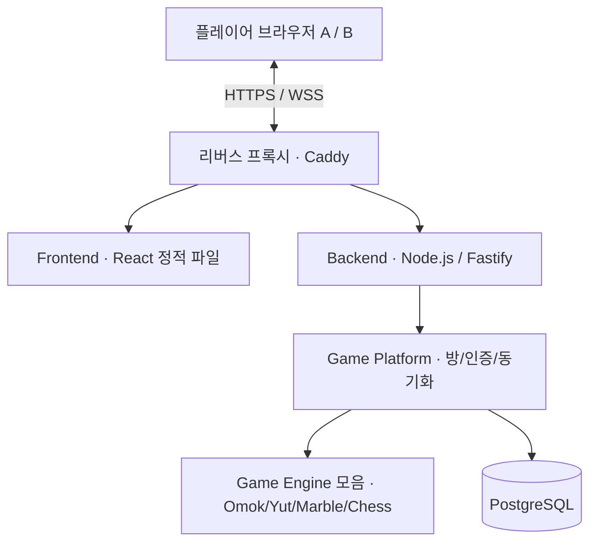

# ft_transcendence — 멀티게임 플랫폼 아키텍처 설계서

> **상태:** 설계 초안 v0.1 · 2026-09-20  
> **목표:** 로컬 오목에서 시작해 온라인 오목, 윷놀이, 부루마블, 체스까지 확장 가능한 사이버 보드게임 카페  
> **마감 목표:** 2026-10-31  
> **기준 문서:** `en.subject.pdf` — ft_transcendence v21.1  
> **문서 성격:** 프로젝트 팀의 **설계 제안**. 과제의 필수 요구사항과 우리의 기술적 선택을 명시적으로 구분한다.

## 0. 핵심 결정 요약

**온라인에서는 백엔드가 게임 상태의 최종 권한자(authoritative server)다.** 프론트엔드는 사용자 입력과 화면 표시를 맡는다. 게임별 규칙은 플랫폼과 독립된 **Game Engine**에서 처리한다. 같은 엔진을 로컬 모드의 브라우저와 온라인 모드의 서버에서 재사용할 수 있다.

| 구분 | 주요 책임 | 하지 말아야 할 일 |
|---|---|---|
| Frontend (React) | 보드·말 렌더링, 버튼과 애니메이션, 입력 수집, 서버 상태 표시 | 자신의 판단을 온라인 대국의 최종 결과로 확정하기 |
| Game Platform (Fastify) | 인증, 방·매칭, 참가자 권한, 요청 순서, 연결·재접속, 기록 | 오목/윷놀이/체스의 고유 규칙을 플랫폼 코드에 하드코딩하기 |
| Game Engine (순수 TypeScript) | 행동 검증, 게임 상태 전이, 턴·단계 결정, 종료·승리 판정 | DOM, React, DB, WebSocket을 직접 호출하기 |
| Database (PostgreSQL) | 계정, 방·대국 메타데이터, 수순·행동 기록, 전적, 필요한 상태 스냅샷 | 게임 규칙이나 UI 처리하기 |

**중요:** 턴 전환은 완전히 공통 플랫폼의 몫이 아니다. 오목의 1수 1턴, 윷놀이의 추가 던지기, 부루마블의 주사위→구매·지불 단계 등은 **각 게임 엔진의 규칙**이다. 플랫폼은 엔진이 알려준 현재 행동 권한을 적용한다.

## 1. 두 단계의 목표와 범위

### 단계 A — 로컬 오목 MVP

- 하나의 브라우저에서 두 사람이 교대로 플레이한다.
- 15×15 판, 흑 선공, 빈 칸 검사, 4방향 5목 판정, 종료·재시작을 구현한다.
- 최초 규칙은 **단순 자유형**(5개 이상 연속 승리)으로 명시한다. 렌주 금수 등은 별도 후속 범위다.
- 착수 처리 순서는 입력 검증 → 새 보드에 착수 → 승리 판정 → 무승부 판정 → 진행 중이면 차례 전환이다. 마지막 빈자리에 놓아 5목이 완성되면 무승부가 아닌 승리로 처리한다.
- 범위 밖·정수가 아닌 좌표, 이미 놓인 교차점, 게임 종료 후 착수는 거절한다. 거절 시 보드·현재 차례·마지막 수·결과를 포함한 기존 상태를 모두 유지한다. 성공 시에도 입력 상태를 직접 변경하지 않고 새 상태를 반환한다.
- 승리는 마지막 착수 지점에서 가로·세로·양쪽 대각선의 양방향 연속 돌을 합산해 판정한다. 5개 이상이면 승리하며, 승리가 없고 225개 교차점이 모두 찼을 때만 무승부다.
- **브라우저에서 게임 엔진을 실행**하고 React state에 상태를 보관한다. 서버·DB·WebSocket은 아직 불필요하다.
- 목적은 게임 규칙과 UI를 독립적으로 테스트하고 아키텍처를 검증하는 것이다. **이것만으로 ft_transcendence 제출 요건을 충족하지 않는다.**

### 단계 B — 온라인 멀티게임 플랫폼

- 프론트엔드, 백엔드, DB, 안전한 인증, 다중 사용자 지원을 구현한다.
- 게임방 생성·입장, 실시간 대국, 서버 측 행동 검증, 재접속, 전적을 제공한다.
- 오목 이외의 게임을 **동일한 방·인증·통신 기반**에 연결한다.
- 배포용 컨테이너와 HTTPS, 개인정보처리방침/이용약관, 영문 README를 준비한다.

## 2. 시스템 컨텍스트와 실행 흐름



> 그림은 **논리적 책임**을 보여준다. 실제 배포에서는 프론트 정적 파일과 API를 같은 도메인에서 제공할 수 있고, 게임 엔진은 별도 서버가 아닌 백엔드 프로세스에 로드된 코드 패키지다.

### 로컬 모드

```text
사용자 클릭 → React 이벤트 → Game Engine → 새 GameState → React 렌더링
```

### 온라인 모드

```text
사용자 클릭 → WebSocket 요청 → 서버의 참가자·순서 검증
 → 서버 Game Engine의 행동 검증·상태 전이 → 저장/버전 증가
 → 해당 게임방에 결과 브로드캐스트 → 각 React 화면 갱신
```

온라인 클라이언트는 엔진을 이용해 **미리 가능한 행동을 표시**할 수 있지만, 확정은 서버가 한다. UI 예측과 서버 확정을 혼동하지 않는다.

## 3. 계층별 상세 설계

### 3.1 Frontend

- 공통 화면: 로그인/회원가입, 로비, 게임 목록, 게임방, 프로필, 전적, 정책 페이지.
- 게임별 화면: 오목의 바둑판, 윷놀이의 말과 윷 애니메이션, 부루마블의 보드와 자산 UI, 체스의 기물과 수 표시.
- 네트워크: REST API로 인증·조회; WebSocket으로 실시간 게임 요청과 이벤트 수신.
- 화면 데이터: 서버가 보낸 `PlayerView`와 `stateVersion`을 기준으로 표시한다.
- 서버 응답 전의 임시 애니메이션은 허용하되 거절되면 서버 상태로 복원한다.

### 3.2 Game Platform

- `Auth`: 신원 확인, 세션/토큰, 사용자 접근 제어.
- `Lobby/Matchmaking`: 대국 생성, 참가·초대·매칭, 공개/비공개 방.
- `Room Manager`: 방과 참가자, 연결 정보, 현재 대국 식별.
- `Game Coordinator`: 요청 권한·순서·중복 확인, 엔진 실행, 상태 버전 관리.
- `Realtime Gateway`: 방별 이벤트 전달, 연결 해제·복구 처리.
- `Persistence`: 수순/행동 기록과 결과 저장, 복구용 상태 스냅샷.

초기 버전은 **단일 백엔드 프로세스**로 구현한다. 다중 프로세스 확장은 현재 범위가 아니며, 나중에 도입하면 분산 동시성 제어 및 공유 상태 저장이 필요하다.

### 3.3 Game Engine

각 게임의 규칙을 외부 입출력과 분리한 TypeScript 모듈로 작성한다. 엔진은 `state + action + 검증된 컨텍스트`를 받아 새로운 상태와 이벤트 또는 오류를 돌려준다.

- 오목: 좌표·중복 착수, 흑백 턴, 5목, 무승부.
- 윷놀이: 윷 던지기 결과, 말 이동·업기·잡기·추가 턴, 종료.
- 부루마블: 주사위, 이동, 토지 구매, 통행료, 자금, 파산, 턴 단계.
- 체스: 기물별 합법 수, 체크/체크메이트/스테일메이트, 특수 수.

난수·현재 시간처럼 비결정적인 값은 **서버가 생성해 엔진에 입력**한다. 엔진의 상태 전이는 가능한 한 결정적으로 유지한다. 체스 규칙은 범위가 크므로 안정적인 라이브러리 활용 여부를 팀에서 별도 결정한다.

### 3.4 Database

최소한 `users`, `games`, `rooms`, `room_players`, `matches`, `match_events`가 필요하다. `match_events`는 서버가 수락한 행동과 순번을 보관하며, `matches`는 게임 종류·상태·결과·스냅샷을 보관할 수 있다. 게임별 세부 상태는 스키마가 굳기 전에는 버전이 명시된 JSON/JSONB로 다룰 수 있다.

DB에 전체 상태를 매 수 저장할지, 일정 주기로 스냅샷을 저장하고 이벤트를 재생할지는 **일관성·복구 요구사항**에 따라 결정한다. 현재 권장안은 **수락된 행동을 영속화하고 복구 가능한 스냅샷을 주기적으로 저장**하는 것이다.

## 4. 공통 게임 계약 — 초안

**로컬 MVP 적용 범위:** 단계 A에서는 오목 전용 타입과 초기 상태 생성·착수 처리 함수만 구현한다. 상태에는 보드, 현재 차례, 마지막 수, 진행·승리·무승부 결과를 보관한다. React와 규칙 엔진의 분리는 유지하되, 범용 GameEngine 인터페이스, 이벤트 추상화, 난수·시간 컨텍스트, 플레이어별 화면 변환은 온라인·다중 게임 단계에서 필요할 때 도입한다. 아래 인터페이스는 후속 확장을 위한 참고 설계다.

```typescript
type GameId = "omok" | "yut" | "blue-marble" | "chess";

type EngineResult<State, Event> =
  | { ok: true; nextState: State; events: Event[] }
  | { ok: false; reason: string };

interface GameEngine<State, Action, Event, View> {
  readonly id: GameId;
  createInitialState(playerIds: string[], seed?: string): State;
  applyAction(
    state: State,
    actorId: string,
    action: Action,
    context: { randomValues?: number[]; now?: number }
  ): EngineResult<State, Event>;
  getPlayerView(state: State, viewerId: string): View;
  getResult(state: State): null | { finished: true; winnerIds: string[]; reason: string };
}
```

이 인터페이스는 **의사 설계**이며 바로 복사해 쓰는 완성된 API가 아니다. 게임별로 `Action`, `State`, `Event`를 구체화한다. 인증·참가자 권한·패킷 검증은 엔진 호출 **전**에 플랫폼에서 실행한다. 숨김 정보가 있는 게임에서는 `getPlayerView`가 공개 가능한 정보만 제공한다.

**턴 관리 원칙:** 엔진 상태에는 `currentPlayerIds` 또는 게임별 `phase`가 포함될 수 있다. 플랫폼은 해당 값을 참조해 행동 가능한 사용자를 제한하지만, 다음 턴의 규칙은 엔진이 결정한다.

## 5. 실시간 통신 계약 — 예시

```jsonc
// Client → Server: 착수 요청
{
  "type": "game.action",
  "roomId": "room_123",
  "requestId": "request_456",
  "expectedVersion": 12,
  "action": { "type": "PLACE_STONE", "x": 7, "y": 7 }
}
```

```jsonc
// Server → Room: 서버가 확정한 상태
{
  "type": "game.updated",
  "roomId": "room_123",
  "stateVersion": 13,
  "actionId": "action_789",
  "view": { "currentTurn": "WHITE", "lastMove": { "x": 7, "y": 7 } }
}
```

응답의 `view`는 **설명을 위한 축약 예시**다. 실제로는 화면 복구에 충분한 상태를 제공하거나, 이벤트와 스냅샷을 함께 제공해야 한다. 접속 시 전체 스냅샷을 수신하고, 이후 버전이 연속된 이벤트를 반영한다.

**동시 요청 처리:** 같은 방의 변경은 직렬화한다. 수락된 행동마다 `stateVersion`을 올리고 중복 `requestId`를 멱등하게 처리한다. 잘못된 차례, 과거 버전, 중복 착수는 오류 응답으로 돌려준다. 재접속 시 인증 후 현재 스냅샷을 다시 전달한다.

## 6. 게임별 공통/고유 책임

| 게임 | 주요 요청 | 엔진이 결정하는 것 | 서버가 공통 처리하는 것 |
|---|---|---|---|
| 오목 | `PLACE_STONE` | 합법 좌표, 턴, 5목, 종료 | 사용자/방 검증, 상태 버전, 전송·저장 |
| 윷놀이 | `THROW_YUT`, `MOVE_PIECE` | 도개걸윷모 결과 적용, 이동·잡기·추가 턴 | 신뢰할 난수 입력, 행동 순서, 전송·저장 |
| 부루마블 | `ROLL_DICE`, `BUY_PROPERTY`, `END_TURN` | 이동, 구매 가능, 통행료, 파산, 단계 | 신뢰할 난수 입력, 권한, 전송·저장 |
| 체스 | `MOVE_PIECE`, `PROMOTE` | 합법 수, 체크, 특수 수, 무승부·종료 | 플레이어 식별, 시계(필요 시), 전송·저장 |

**게임별 UI도 각각 만든다.** 공통 컴포넌트는 방 정보, 플레이어 카드, 채팅, 결과 모달 등이다. 모든 게임을 하나의 거대한 `Board` 컴포넌트로 추상화하지 않는다.

## 7. 기술 스택 제안

| 계층 | 권장 기술 | 선택 이유 / 도입 시점 |
|---|---|---|
| 언어 | TypeScript | UI·엔진·서버 간 타입 공유. 첫 단계부터 |
| 프론트엔드 | React + Vite | 상태 기반 렌더링, 빠른 개발. 첫 단계부터 |
| 스타일 | Tailwind CSS 또는 CSS Modules | 팀 선호에 따라 1개 선택. 첫 단계부터 |
| 엔진 테스트 | Vitest | 규칙과 경계 조건 검증. 첫 단계부터 |
| 백엔드 | Node.js + Fastify | REST 및 WebSocket, 엔진 재사용. 온라인 단계 |
| 실시간 통신 | WebSocket | 방 단위 실시간 업데이트. 온라인 단계 |
| DB | PostgreSQL | 관계와 트랜잭션, JSONB. 온라인 단계 |
| DB 접근 | Prisma (선택) | 타입 안전한 ORM. 팀의 학습 비용 검토 |
| 배포 | Docker Compose + Caddy | 단일 명령 실행, HTTPS 종단. 통합 단계 |

일단 **모놀리식 백엔드**로 시작하고, 마이크로서비스·Redis·메시지 큐는 실제로 필요해지기 전까지 도입하지 않는다. 위 스택은 **우리 팀에 대한 제안**이며 subject가 강제하는 특정 제품 목록이 아니다.

## 8. 권장 디렉터리 구조

```text
ft_transcendence/
├── apps/
│   ├── web/
│   │   └── src/
│   │       ├── pages/             # 로비 / 방 / 프로필 / 정책
│   │       ├── components/        # 공통 컴포넌트
│   │       ├── games/             # omok/ yut/ marble/ chess/ UI
│   │       ├── hooks/
│   │       └── api/
│   └── server/
│       └── src/
│           ├── auth/
│           ├── rooms/
│           ├── game-coordinator/
│           ├── realtime/
│           └── persistence/
├── packages/
│   ├── game-core/               # 공통 계약과 타입
│   └── games/
│       ├── omok/
│       ├── yut/
│       ├── blue-marble/
│       └── chess/
├── compose.yaml
├── .env.example
└── README.md
```

초기에는 `web`과 `games/omok`만 만들어도 충분하다. 분리된 패키지 빌드가 부담되면 단일 저장소 내부 모듈로 시작해도 되고, 필요한 경계만 유지하면 된다.

## 9. 단계별 실행 계획 및 완료 기준

1. **로컬 오목:** 최소 환경 구성 → 순수 TypeScript 엔진 → React UI 연결 → 엔진 테스트·빌드 및 정상 1판·재시작 확인. 서버 불필요.
2. **온라인 오목:** 두 브라우저 간 동일 상태, 잘못된 착수 거절, 동시 요청 순서, 재접속 복원.
3. **공통 플랫폼 추출:** 오목에만 의존한 분기 제거, 공통 행동 계약, 방·기록 재사용.
4. **두 번째 게임:** 별도 UI·엔진, 같은 게임방·네트워크·전적 기반에서 실행.
5. **필수 요구사항 통합:** 가입/로그인, DB, HTTPS, Docker 단일 명령, 정책 페이지, 영문 README, 다중 사용자·콘솔 검사.

**로컬 오목 완료 검증:** 가로·세로·양쪽 대각선의 5목과 6개 이상 연속, 가장자리 승리, 마지막 빈자리의 승리 우선 판정, 승리 없는 만판의 무승부, 잘못된 착수 시 전체 상태 유지, 성공 시 입력 상태 불변, 종료 후 착수 차단, 재시작 시 빈 판·흑 선공 복원을 확인한다.

**온라인·확장 단계 테스트 시나리오:** 범위 밖 좌표, 이미 놓인 칸, 상대 차례 요청, 게임 종료 후 행동, 동시에 온 두 요청, 중복 요청, 새로고침·재접속, 서버 재시작 후 복원(지원 범위에 따라), 게임별 특수 규칙.

## 10. subject v21.1과의 대응

다음은 **과제 문서에 명시된 요구사항**이다. 위 설계의 기술 선택과 구분한다.

| 항목 | 문서 위치(인쇄 페이지) | 요구사항 요약 |
|---|---|---|
| Mandatory — General | p.8 | 웹 앱 + frontend/backend/DB, 팀 Git 기여, 컨테이너 단일 명령, Chrome 호환, 콘솔 오류·경고 없음, 실제 정책 페이지, 다중 사용자 |
| Mandatory — Technical | p.9 | 반응형·접근성, CSS 솔루션, `.env`/`.env.example`, 명확한 DB 관계, 이메일·비밀번호 인증, 프론트/백 입력 검증, 외부→백엔드 HTTPS |
| Module points | p.10–11 | Major 2점 / Minor 1점, 총 14점; 모듈 선행조건·완성도 확인 |
| Web modules | p.12 | 양쪽 프레임워크, WebSocket 실시간, ORM 등 선택 모듈 |
| Gaming modules | p.16–18 | 웹 기반 게임, 원격 플레이, 추가 게임+전적+매칭, 관전자 등 선택 모듈 및 세부 기준 |
| README | p.27–29 | 영문 README, 팀 역할·기여, 기술 스택·DB 스키마·모듈·AI 사용 등 |

**주의:** 로컬 오목이나 두 번째 게임의 화면만 만든 것으로 온라인 게임·추가 게임 모듈 점수를 확보했다고 판단하지 않는다. 실제 구현이 각 모듈의 **전체 세부 조건**을 충족하는지 별도 체크한다. 점수 구성과 선택 모듈은 팀 합의 후 확정한다.

## 11. 결정이 필요한 항목(ADR 후보)

- 오목 규칙: 자유형과 렌주룰 중 최종 지원 범위는?
- 윷놀이 및 부루마블: 구체적인 판·변형 규칙과 디자인 자산 사용 범위는?
- 인증: 세션 쿠키와 토큰 중 어떤 방식을 사용할 것인가?
- 게임 상태 복구: 매 행동 DB 기록 vs 주기적 스냅샷을 어디까지 구현할 것인가?
- 두 번째 게임과 과제 모듈 조합: 팀의 일정 안에서 무엇을 우선할 것인가?
- 체스: 완전 자체 구현 vs 검증된 룰 라이브러리 활용?

---

**설계 원칙 한 문장:** 게임마다 바뀌는 것은 **Game Engine과 게임별 UI**, 계속 재사용하는 것은 **인증·방·네트워크·기록의 Game Platform**이다. 온라인 대국의 최종 상태는 항상 **서버에서 확정**한다.
