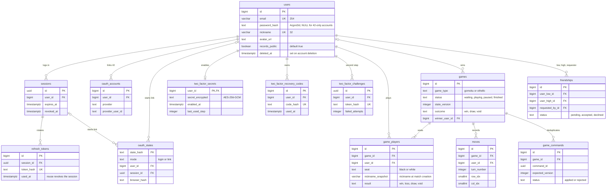

*This project has been created as part of the 42 curriculum by jyoo, yunhpark, yoshin, sipyeon, dong-hki.*

# Cyber Board Café

## Description

A Korean-language, two-player board game platform for freestyle Gomoku (Omok, 15 × 15) and standard Othello (8 × 8). Accounts, matchmaking, real-time transport and persistence are separated from each game's rules and board UI.

This submission README draft was updated on **2026-11-12 (KST)**. Feature-branch implementation, runtime integration and evaluation readiness are tracked separately in the [SDS](Document/SDS.md) and [test plan](Document/TEST_PLAN.md).

## Features and integration status

| Area | Implemented scope | Remaining work |
|---|---|---|
| Accounts | Registration, email/password login, rotating refresh tokens and session revocation | Full browser acceptance coverage |
| OAuth and 2FA | 42 login/link API and UI; TOTP setup, verification, recovery codes and disable flow | Real 42 provider verification; UI PR #72 is open |
| Profiles | Public profiles, nickname changes, PNG/JPEG avatar upload/delete and default avatars | UI #57 and browser E2E #77 are implemented on open PRs; integration and acceptance remain |
| Records | Per-game statistics, history, first-win achievement, ten-game progress and leaderboard | Full real-game acceptance data and independent reproduction |
| Matchmaking | Game selection, queue join/cancel/matched flow and waiting UI | UI PR #63 is open; requires D's real-time server |
| Gomoku | Rules engine, board UI and WS client | Two-session reconnect/result/history E2E is on the separate #27 integration branch |
| Othello | Engine merged in #58; UI in #73; server registration and two-session browser E2E in #77 | #73 and #77 are open; final integrated acceptance remains |
| Legal pages | `/terms`, `/privacy`, links and modal Escape handling in #71 (`011b5a8`), including #99/#100 and selected #77 history/mobile fixes | #71 remains open against the web stack; policy needs final comparison with a release containing #89/#85 |
| Friends and invitations | Friend UI #90, REST #95 and presence/relationship notification transport #98 are implemented on open PRs | Wire the REST service to the authenticated connection registry and UI events; invitations remain planned |
| Privacy and deletion | Privacy API/DB/UI/E2E in open #79; deletion API/DB in open #89 | Integrate migrations in order (#96); deletion UI #85 and social/WS cleanup remain |
| Deployment | Full application containers, HTTPS and persistent DB/avatar volumes from merged #10 | Pinned historical WSS evidence is separate from current-master and two-PC acceptance |

Issues #23, #64, #65 and #66 correspond to PRs #63, #71, #72 and #73. The web implementation reference is `feat/web-othello` at `3d06126`. This documentation branch incorporates `master` at `6965b9c`: server APIs, both game engines, authenticated `/api/ws`, full application containers and a placeholder web page. It does not include those frontend feature PRs. The current startup does **not** register game engines, match subscriptions, game commands, matchmaking or reconnection; those remain in the open #42/#43/#49/#50 stack. Use a checkout containing the web feature branch for signup/profile screens and the real-time integration for matches. The feature table describes the referenced branches, not features all available in this checkout.

## Game rules

- **Gomoku:** black starts on an empty 15 × 15 board. Players alternate placing one stone. Five or more consecutive stones horizontally, vertically or diagonally win. No forbidden moves or undo. A full board without a winner is a draw.
- **Othello:** black starts from the standard four central discs. A move must enclose and flip at least one opposing disc in any of eight directions. A player without a legal move passes automatically. When neither player can move, the larger disc count wins; equal counts draw.
- Coordinates are zero-based `(row, col)`: Gomoku `0..14`, Othello `0..7`, with `(0, 0)` at the top left. The current board UI and API use the same convention.
- Statistics are per game. Void matches are excluded; draws count as completed matches. Win rate is `wins / completed matches`. Leaderboards order by **wins descending, win rate descending, user ID ascending** (DEC-08), with distinct sequential ranks.
- The real-time design pauses play during disconnection and gives each player a cumulative 60-second absence budget per match (DEC-03). Returning does not reset it. Verification requires the integrated runtime.

The [SDS](Document/SDS.md) and [test plan](Document/TEST_PLAN.md) contain current conventions. [GAME_RULES.md](Document/GAME_RULES.md) still needs C's pending #36 update for Othello and DEC-03/08; its older tie-break and one-based display wording are not the current contract.

## Technical stack and architecture

- Node.js `>=22.12.0` (package engine requirement), TypeScript, npm workspaces; recent implementation reports use Node.js `26.13.0`.
- Frontend: React, Vite, History API routing and Tailwind CSS v4, wired in `apps/web/vite.config.ts` and `apps/web/src/index.css`. Components use utility classes directly (e.g. `flex flex-col gap-5` on the login form, PR #119); shared buttons, inputs and cards use `@apply` in `apps/web/src/styles.css` (PR #124), which also keeps screen-specific rules such as the boards and the design tokens. Where to show this during evaluation: [mandatory checklist](Document/evaluation/mandatory-checklist.md#스타일링-솔루션-시연-116).
- Backend: Fastify, JSON Schema validation and Swagger UI.
- Database: PostgreSQL 17, Drizzle ORM, Drizzle Kit migrations and `pg`.
- Security: Argon2id passwords, signed access tokens, rotating opaque refresh tokens and encrypted TOTP secrets.
- Tests: Vitest unit/database integration tests and Playwright browser tests.

The browser calls `/api/*` through Vite's development/preview proxy. Fastify routes call services and repositories backed by PostgreSQL. `@cafe/game-contracts` holds shared messages/types; `@cafe/game-engine` implements rules independently of transport. The integrated runtime adds authenticated WebSocket matchmaking, subscriptions and commands. It validates and persists commands before publishing authoritative state; `commandId` and `stateVersion` support deduplication and stale-state detection.

Committed migrations `0000`–`0003` include `users`, `sessions`, `refresh_tokens`, OAuth/2FA tables, `games`, `game_players`, `moves`, `game_commands` and the connection probe. Statistics are queried from stored results. `friendships`, privacy and account-deletion migrations exist in open #95, #79 and #89. Each currently starts at `0004`; regenerate the later unmerged migration against the agreed integration order (#96), without rewriting shared/applied migrations. Relationships and constraints are documented in the [SDS](Document/SDS.md).

## Database schema

PostgreSQL 17 with Drizzle ORM. Table definitions live in `apps/server/src/db/schema/` and SQL migrations in `apps/server/drizzle/`. The diagram shows the schema after the open #89 (account deletion), #95 (friends) and #79 (records privacy) migrations are applied in the order planned in #96 (`0004`, `0005`, `0006`).



| Table | Purpose | Key constraints |
|---|---|---|
| `users` | Account and public profile | `email` and `nickname` unique |
| `sessions` | Server session; the access token carries its `id` (`sid`) | Revoked on logout or refresh token reuse |
| `refresh_tokens` | Rotating refresh tokens, hash only | `token_hash` unique |
| `oauth_accounts` | 42 account linked to a user | One user per provider account, one link per provider per user |
| `oauth_states` | One-time OAuth `state`, bound to the browser | CHECK: `link` mode needs `user_id` and `session_id`, `login` mode has neither |
| `two_factor_secrets` | TOTP secret per user | `last_used_step` blocks reuse of the same code |
| `two_factor_recovery_codes` | Recovery codes, hash only | Used once (`used_at`) |
| `two_factor_challenges` | Pending second login step, hash only | Discarded after the failed-attempt limit |
| `games` | Server-confirmed state of one match | CHECK on type, status, turn and outcome; finished matches must have outcome, reason and time; only a win has a winner |
| `game_players` | Two seats per match and their results | Unique `(game_id, user_id)` and `(game_id, seat)` |
| `moves` | Confirmed moves; the board is rebuilt from them | Unique `(game_id, turn_number)` and `(game_id, row_idx, col_idx)`; coordinates `0..14` |
| `game_commands` | One row per processed command | Unique `(game_id, command_id)`, so a resent command is not applied twice |
| `friendships` | One row per user pair | Unique `(user_low_id, user_high_id)` with `user_low_id < user_high_id`; CHECK on status and timestamps |
| `connection_probe` | Infrastructure check only | No account or game data |

- Enumerated values use `text` + CHECK instead of PostgreSQL enums, so adding a value only needs a simple migration.
- Statistics, history and the leaderboard are queried from `games` and `game_players`; no separate statistics table is stored.
- Secrets are never stored in plain text: passwords as Argon2id hashes, refresh tokens, recovery codes, 2FA challenges and OAuth states as hashes, TOTP secrets encrypted with AES-256-GCM.
- Account deletion (#89) keeps the `users` row so match history keeps its references. It replaces `email` and `nickname` with `deleted:<id>`, clears the password hash and avatar, revokes sessions and deletes refresh tokens, OAuth and 2FA rows (friendship rows too, in #113). Past matches show `game_players.nickname_snapshot`.

## Instructions

Choose local development below or the [full application HTTPS workflow](Document/runtime.md). Deployment was merged in #10; its recorded checks and remaining limitations are separate from new validation of this documentation change.

### Local development

Run commands from the repository root. Install Node.js/npm and start Docker Desktop or a compatible Docker engine. Copy `.env.example` to `.env` **only if `.env` does not already exist**:

```sh
cp .env.example .env
```

In PowerShell use `Copy-Item .env.example .env`; use `npm.cmd`/`npx.cmd` if PowerShell blocks the `.ps1` launchers. Preserve existing credentials.

Set PostgreSQL credentials and the matching `DATABASE_URL`. Replace `JWT_SECRET` with a random value of at least 32 characters. Set a separate random `TWO_FACTOR_KEY` of at least 32 characters to enable 2FA. For example, generate each value separately using `openssl rand -base64 48`.

```sh
npm ci
npm run db:up
npm run db:migrate
npm run db:check
npm run dev
```

| Service | Local URL |
|---|---|
| Web | http://127.0.0.1:5173 |
| API | http://127.0.0.1:3001 |
| Swagger UI | http://127.0.0.1:3001/docs |
| Liveness | http://127.0.0.1:3001/api/health |
| Database readiness | http://127.0.0.1:3001/api/health/db |

The API checks the database before listening and marks unfinished matches void on startup. Development servers default to `127.0.0.1`; `API_HOST` overrides the API address. Vite proxies `/api` HTTP and WS traffic; Swagger UI is available on the API port. Restart `npm run dev` after server changes.

`infra/compose.yaml` starts **only PostgreSQL**, bound to `127.0.0.1:5432` by default. A named volume preserves data; `npm run db:stop` stops the database without deleting it. Initialization credentials apply to a new volume; editing `.env` does not change existing database credentials. Full application containers use the separate `infra/compose.full.yaml` workflow below; the database-only development workflow does not enable HTTPS.

In a checkout containing `feat/web-othello` (`3d06126`), sign up through the web page, then sign in and open your profile or leaderboard. This documentation checkout has only the placeholder page; its APIs can be explored through Swagger UI. To prepare test accounts through the real API, set a private `QA_PASSWORD` and run `npm run qa:accounts` while the API is running. It creates `qa-p1`–`qa-p4` and `qa-outsider` with `@qa.example.com` addresses; it does not reset existing passwords.

```sh
npm run build       # Type-check and build apps/web/dist
npm run dev:server  # API only
npm run preview     # Production web build; run the API separately
```

### Full application containers

Prepare `.env.full` from `.env.full.example`, the password file, and certificates as described in [the full execution guide](Document/runtime.md). Then:

Set a private `JWT_SECRET` of at least 32 characters in `.env.full`. Compose passes
authentication settings explicitly and mounts a separate `avatars` volume at
`/data/avatars`, writable by the API's `node` user. The current checkout includes the
authentication and avatar routes; frontend screens remain on open feature PRs. An empty `TWO_FACTOR_KEY` disables the optional 2FA key.

```sh
docker compose --env-file .env.full --project-directory . \
  -p cyber-board-cafe-full -f infra/compose.full.yaml up --build -d --wait
```

Default HTTPS URLs are `https://localhost:8443/`, `/api/health`, `/api/health/db`, `/docs/`, and `/docs/json`. HTTP port 8080 redirects to HTTPS port 8443. Only Nginx publishes host ports. Full-app API and DB communicate internally; this workflow does not require host Node/npm.

The full app has a separate project/DB volume from local development. The [runtime validation record](Document/runtime-validation.md) reports startup, explicit-CA HTTPS, migration failure, DB recovery and persistence checks; this documentation update did not rerun them. The [WSS record](Document/runtime-wss-validation.md) uses a pinned historical integration source and reports an approximately 30-second heartbeat detection against a 20-second target. It does not prove current-master gameplay, Windows browser trust, two-PC play or independent reproduction.

## Environment variables

The API, Vite configuration, migration configuration and DB check load the root `.env`. Existing shell environment values take precedence. Keep secrets outside Git.

| Variable | Purpose |
|---|---|
| `API_HOST` | API listen address, default `127.0.0.1`; full-app Compose sets `0.0.0.0` |
| `PORT` | API port, integer `1..65535`, default `3001`; Vite uses the same proxy target |
| `POSTGRES_USER`, `POSTGRES_PASSWORD`, `POSTGRES_DB` | Local database initialization |
| `POSTGRES_PORT` | Host database port, default `5432` |
| `DATABASE_URL` | API/migration PostgreSQL URL; percent-encode special characters in credentials |
| `JWT_SECRET` | Required signing secret, at least 32 characters |
| `TWO_FACTOR_KEY` | Separate encryption key, at least 32 characters; absent means 2FA returns 503; changing it invalidates encrypted setups |
| `FT_OAUTH_CLIENT_ID`, `FT_OAUTH_CLIENT_SECRET`, `FT_OAUTH_REDIRECT_URI` | Set all three or leave all empty; redirect URI must match the 42 app and web `/oauth/42/callback` |
| `TRUST_PROXY` | Trusted proxies for rate-limit client IP; local default `loopback` |
| `AVATAR_DIR` | Avatar directory, default `data/avatars`; relative paths start at repository root |
| `TEST_DATABASE_URL` | Disposable integration-test database; actual database name must end in `_test` |
| `QA_PASSWORD`, `QA_API_URL` | Test-account password (8+ characters) and optional API URL for `qa:accounts` |
| `E2E_PORT` | Local Playwright web-server port, default `5173` |

After schema changes, run `npm run db:generate -- --name=<change>`, review the SQL and run `npm run db:migrate`. Do not rewrite shared/applied migrations.

## Testing

```sh
npm test
npm run test:watch
npx playwright install chromium
npm run test:e2e
```

`npm test` runs the engine and server tests in this checkout. The referenced web feature branch also includes web unit tests and adds them to the Vitest configuration. DB tests skip when `TEST_DATABASE_URL` is absent: green results with skips do not demonstrate database integration. When configured, the helper checks the **connected** database name ends in `_test`, applies migrations and truncates domain tables between tests. Create this disposable database separately (for example, `CREATE DATABASE cafe_test;` through a PostgreSQL administrator connection). Never use the development/shared database. Keeping the example URL configured without creating the test database causes failures.

`npm run test:e2e` starts the API and Vite unless an existing server is reused. Prepare the development DB using `db:up` and `db:migrate`. This checkout's `tests/app.spec.ts` checks the home page only.

The actual two-session Gomoku scenario is `tests/gomoku.spec.ts` on `codex/gomoku-integration` at `b24ea10` (#27). That branch supports `E2E_BASE_URL` for a deployed target; this checkout's configuration does not. Use a checkout containing that integration to run it. Othello, legal-page and profile browser E2E are implemented in open #77 (`05eaede`); privacy coverage is in #79 (`8b93fb5`). Those tests require their integrated checkout and are not present here. #90 friend UI tests replace API/WS responses and therefore do not demonstrate real friend CRUD or presence integration. The published #55 (`b431f05`) authentication suite also verifies refresh-only storage and multi-tab restoration against the real API/DB. The #71 (`011b5a8`) legal/history suite replaces HTTP/WS responses, including its different-match Back/Forward regression, so it does not prove actual game-server integration. These files are on their feature branches. Record commands, commit, environment, skips and results using the [test plan](Document/TEST_PLAN.md).

## Team, modules and project management

| Member | Responsibility and implementation areas |
|---|---|
| jyoo (A) | Product scope, frontend screens, documentation and evaluation collection |
| yunhpark (B) | Technical lead; authentication, database, command persistence/concurrency, statistics and integration support |
| yoshin (C) | Game rules and Gomoku/Othello engines |
| sipyeon (D) | WebSocket transport, matchmaking, subscriptions and reconnection |
| dong-hki (E) | Development/deployment environment and social contracts/implementation |

Commits and PRs record individual contributions. The [roadmap](Document/roadmap.md) preserves the original role/schedule plan; the SDS records implementation references. Work uses issues, feature branches and reviewed PRs under [CONTRIBUTING.md](CONTRIBUTING.md).

### Individual Contributions

Each entry below is based on the member's own write-up in [#125](https://github.com/EscapeFromGyeongsan/ft_transcendence/issues/125). B's entry is still tracked there. The referenced feature and integration PRs remain separate from the code in this documentation checkout.

#### jyoo (A) — Frontend developer, UI/UX and documentation

- **Account and profile screens:** implemented the React clients for registration, login, session restoration, profile/avatar editing, statistics and leaderboards ([#55](https://github.com/EscapeFromGyeongsan/ft_transcendence/pull/55), [#57](https://github.com/EscapeFromGyeongsan/ft_transcendence/pull/57)). Integrated B's authentication APIs; the server authentication implementation belongs to B.
- **Game and matchmaking UI:** implemented the Gomoku and Othello boards, legal-move and turn displays, matching controls, reconnect/result screens, and client state handling for server snapshots ([#56](https://github.com/EscapeFromGyeongsan/ft_transcendence/pull/56), [#63](https://github.com/EscapeFromGyeongsan/ft_transcendence/pull/63), [#73](https://github.com/EscapeFromGyeongsan/ft_transcendence/pull/73)). The client displays server decisions; C owns the rules engines and D owns the real-time runtime.
- **Additional user flows:** implemented legal pages and browser-history routing, OAuth/2FA screens, records-privacy controls and friends UI ([#71](https://github.com/EscapeFromGyeongsan/ft_transcendence/pull/71), [#72](https://github.com/EscapeFromGyeongsan/ft_transcendence/pull/72), [#79](https://github.com/EscapeFromGyeongsan/ft_transcendence/pull/79), [#90](https://github.com/EscapeFromGyeongsan/ft_transcendence/pull/90)). Friend invitations remain a separate, unimplemented task (#83).
- **Integration and verification:** added browser E2E coverage ([#77](https://github.com/EscapeFromGyeongsan/ft_transcendence/pull/77)), prepared the Tailwind integration candidate ([#143](https://github.com/EscapeFromGyeongsan/ft_transcendence/pull/143)), and integrated B's form/auth fixes with A's evaluation-flow and accessibility fixes ([#144](https://github.com/EscapeFromGyeongsan/ft_transcendence/pull/144)). Maintained the frontend SDS/README review and validation records ([#59](https://github.com/EscapeFromGyeongsan/ft_transcendence/pull/59)).

Implementation challenges and how they were addressed:

1. **Adding Tailwind without disrupting existing boards.** The UI already depended on custom board geometry and CSS rules. The #116 candidate introduces Tailwind v4 without its reset stylesheet, moves shared controls to `@apply`/utilities, and preserves board-specific CSS. The #143 record separates desktop/tablet/mobile screen checks from unresolved full-acceptance and container checks.
2. **Recovering control after another tab takes over a match.** Reconnection alone could leave the old tab locked, while ordinary updates from the controlling tab must keep that lock. #144 releases it only after an authenticated connection resubscribes and receives `match.snapshot`. Regression tests were shown to fail before the fix, and the recovery was exercised with two tabs and two users against the actual API/DB for both games.
3. **Keeping navigation consistent with matchmaking and authentication.** Back/Forward, legal-page navigation and late queue events could leave stale matching state; OAuth failures and busy dialogs also needed explicit recovery. #144 coordinates queue cancellation with navigation, ignores canceled queue responses, restores a valid session after callback failure, and adds dialog/menu keyboard and focus handling. Its validation record distinguishes mocked browser scenarios from actual HTTPS/WSS gameplay.

Suggested evaluation walkthrough: trace a board click from the React board through the command's `stateVersion` to the server snapshot, then demonstrate two-tab takeover and recovery. The source and executed checks are documented in [the #136 validation record](https://github.com/EscapeFromGyeongsan/ft_transcendence/blob/c4ef0e4968b06cbe3f7d60db8e75b65f48bdf34f/Document/evaluation-136-validation.md); this is supporting evidence, and each member must still explain their own implementation during evaluation.

#### yoshin (C, gdtknight) - Game engine developer

- **Role:** Developer (game engine and rules).
- **Othello 8×8 game engine** (`packages/game-engine/src/othello`, [#58](https://github.com/EscapeFromGyeongsan/ft_transcendence/issues/58)), the module C will explain during evaluation: implemented 8-directional sandwich flipping with multi-direction flips (`findFlippableDiscs`), automatic pass when there is no legal move (`hasLegalMoves`), and wipeout and disc-count/draw results (`disc_count` / `draw`). Wrote 30 unit tests, including input deep-freeze immutability and early wipeout edge cases.
- **Gomoku board snapshot restore and registration interface** (`gomoku.board(moves)`, [#45](https://github.com/EscapeFromGyeongsan/ft_transcendence/issues/45)): on top of the existing Gomoku rules, restored the 15×15 board from the DB move history (`restoreState`) and implemented the `{ version, rules, board }` registration contract (`IF-04`).
- **Game rules document and contract sync** (`Document/GAME_RULES.md`, [#70](https://github.com/EscapeFromGyeongsan/ft_transcendence/issues/70)): detailed Othello rules, the engine rejection codes (`INVALID_ACTION`, `GAME_FINISHED`), the DEC-03 60-second cumulative absence budget per match, and the resume condition when both players return.
- **Cross-area integration and E2E review:** reviewed and approved [#33](https://github.com/EscapeFromGyeongsan/ft_transcendence/issues/33) (server contract integration), [#61](https://github.com/EscapeFromGyeongsan/ft_transcendence/issues/61) (engine registration in the running server and two-browser real-time E2E), [#63](https://github.com/EscapeFromGyeongsan/ft_transcendence/issues/63) (web matchmaking queue) and [#94](https://github.com/EscapeFromGyeongsan/ft_transcendence/issues/94) (TSDoc).

Challenges and how they were addressed:

1. **Replaying Othello history correctly after automatic passes.** Unlike Gomoku, Othello lets one player move twice in a row when the opponent has no legal move, so deriving the turn from `index % 2` during replay corrupts the board after a pass. `restoreState` advances by each persisted move's `move.stone` color and checks `move.stone === state.currentPlayerColor` at every move, so the board is restored deterministically however many passes occurred.
2. **Five in a row versus draw on Gomoku's 225th move.** A five completed by the move that fills the board risked being recorded as a draw because no empty cells remain. Move handling checks five in a row (`hasFive`) first and only then counts empty cells to end the game as `draw`.
3. **Keeping the pure engine separate from server and network errors (`IF-01` / `IF-04`).** Disconnects, turn violations, version conflicts and concurrency locks could leak into what should be pure engine functions. Engine results are limited to the two rule codes `INVALID_ACTION` and `GAME_FINISHED`; pause (`paused`), resignation (`resign`), `VERSION_CONFLICT` and the 60-second cumulative absence forfeit are handled by the server (`GameCommandService`).

#### sipyeon (D, sypyeon) - Real-time developer

- **Role:** Developer (real-time communication). Owns the `/api/ws` WebSocket server and the matchmaking, game delivery and reconnection built on it. Evidence owner for the Real-time features (major, 2) and Remote players (major, 2) modules.
- **Disconnect detection and reconnection** ([#50](https://github.com/EscapeFromGyeongsan/ft_transcendence/issues/50)), the feature D will explain during evaluation: the server finds unresponsive connections with ping, closes them, notifies the opponent and pauses the match. A player who returns within the match's 60-second cumulative budget continues from the latest snapshot; after that, the opponent wins if one player is gone, and the match is invalidated if both are.
- WebSocket connection with first-message authentication, and closing connections on logout or session revocation ([#41](https://github.com/EscapeFromGyeongsan/ft_transcendence/issues/41)).
- Match subscribe/unsubscribe with per-match message isolation; among several tabs of one account, the last tab controls the match ([#42](https://github.com/EscapeFromGyeongsan/ft_transcendence/issues/42)).
- Game command handling: broadcast after the DB commit, version ordering, and handling of a resent `commandId` ([#43](https://github.com/EscapeFromGyeongsan/ft_transcendence/issues/43)).
- Per-game automatic matchmaking queue and match creation ([#49](https://github.com/EscapeFromGyeongsan/ft_transcendence/issues/49)).
- Gomoku and Othello engine registration in the running server ([#61](https://github.com/EscapeFromGyeongsan/ft_transcendence/issues/61)) and friend online status (presence, [#98](https://github.com/EscapeFromGyeongsan/ft_transcendence/issues/98)).

Challenges and how they were addressed:

1. **A logout committed during token verification left a connection open that should have been closed.** The connection is now registered on the session first and the session is checked once more, so the connection closes whenever the logout happens ([#41](https://github.com/EscapeFromGyeongsan/ft_transcendence/issues/41)).
2. **Commands arriving after a match ended got the wrong error (`INVALID_MESSAGE`).** B wrote a reproduction test in review. The cause was that ending a match also cleared its game type; it is now kept until every subscriber leaves, and the test was added ([#43](https://github.com/EscapeFromGyeongsan/ft_transcendence/issues/43)).
3. **A queue request waiting on a DB lookup in one tab still entered the queue after another tab canceled it, even though the cancel had been acknowledged.** A cancel now marks the pending request, which then stays out of the queue, and both tabs are told it was canceled ([#49](https://github.com/EscapeFromGyeongsan/ft_transcendence/issues/49)).

#### uersnmae (E) - PM and social developer

- **Role:** PM and social developer. Owned the runtime environment and HTTPS deployment, and carried out the friends API and remote-play integration checks.
- **Full-stack Docker Compose deployment** ([#10](https://github.com/EscapeFromGyeongsan/ft_transcendence/issues/10), [#40](https://github.com/EscapeFromGyeongsan/ft_transcendence/issues/40)), the feature E will explain during evaluation: configured the web, API and PostgreSQL Docker Compose deployment and the Nginx HTTPS/WSS connection, including the DB ready → Drizzle migration → API/web start order and the avatar storage volume.
- Friend relationship schema and the search, list, request, accept, decline and remove REST API, with concurrent requests verified on a real PostgreSQL ([#95](https://github.com/EscapeFromGyeongsan/ft_transcendence/issues/95)).
- In a verification environment combining the deployment, server and web PRs, checked Gomoku auto-matching, disconnect and return, and both players' records after a match, and wrote the E2E tests and reproduction steps ([#67](https://github.com/EscapeFromGyeongsan/ft_transcendence/issues/67), [#28](https://github.com/EscapeFromGyeongsan/ft_transcendence/issues/28)).

Challenges and how they were addressed:

1. **The deployment settings and the game server's startup code conflicted in `index.ts`.** Kept both the container's `API_HOST`/`PORT` settings and the game engine registration, then verified HTTPS play and reconnection in Chrome on a Windows PC and a MacBook ([#67](https://github.com/EscapeFromGyeongsan/ft_transcendence/issues/67), [#28](https://github.com/EscapeFromGyeongsan/ft_transcendence/issues/28)).
2. **Avatars had to survive replacing the API container, and the API runs as a non-root user that needs write access.** Mounted a Docker named volume at `/data/avatars`, set the directory ownership in the image, and confirmed the same avatar file could be read before and after recreating the container ([#40](https://github.com/EscapeFromGyeongsan/ft_transcendence/issues/40), [#67](https://github.com/EscapeFromGyeongsan/ft_transcendence/issues/67)).
3. **Two users sending each other a friend request at the same time had to end up with one relationship.** Added a uniqueness constraint on the user pair; when the insert conflicts, the transaction re-reads the relationship and accepts the opposite request. Verified concurrent requests and lock waits on a real PostgreSQL ([#95](https://github.com/EscapeFromGyeongsan/ft_transcendence/issues/95)).

### Modules (16 points)

Major modules are worth 2 points and minor modules 1 point. Details and evidence owners are in the [module matrix](Document/evaluation/module-matrix.md).

| Module (subject) | Type | Points | How it is implemented | Owner |
|---|---|---:|---|---|
| Use a framework for both the frontend and backend | Major | 2 | React 19 + Vite web app, Fastify 5 API | yunhpark (B) |
| Real-time features using WebSockets | Major | 2 | `/api/ws`: matchmaking, server-confirmed `game.updated` broadcasts, reconnection, friend `presence` | sipyeon (D) |
| Standard user management and authentication | Major | 2 | Profile update, avatar upload with default avatar, friends with online status, profile page | yunhpark (B) |
| Complete web-based game | Major | 2 | 15×15 Gomoku with server-side rules and win/loss conditions | yoshin (C) |
| Remote players | Major | 2 | Two browsers on separate computers; pause on disconnect, 60-second cumulative reconnection window, snapshot restore | sipyeon (D) |
| Add another game with user history and matchmaking | Major | 2 | 8×8 Othello engine and screen, matchmaking queue per game type, per-game history, statistics and leaderboard | yoshin (C) |
| Use an ORM for the database | Minor | 1 | Drizzle ORM schema and SQL migrations on PostgreSQL | yunhpark (B) |
| Game statistics and match history | Minor | 1 | Wins, losses, win rate, match history (date, opponent, result), first-win achievement, 10-game progression, leaderboard | yunhpark (B) |
| Remote authentication with OAuth 2.0 | Minor | 1 | 42 Intra OAuth login, first sign-up and account linking | yunhpark (B) |
| Complete 2FA system | Minor | 1 | TOTP setup, enable and disable, single-use recovery codes, second login step | yunhpark (B) |
| **Total** | 6 Major + 4 Minor | **16** | 14 required points + 2 bonus candidate points | |

The User Interaction major is not claimed: its basic chat requirement is not implemented. Profiles and friends are covered by Standard user management.

## Structure

The web layout below describes `feat/web-othello`; this documentation checkout currently has only `App.tsx` and `main.tsx` under `apps/web/src`.

```text
apps/server/src/
  api/              HTTP routes and schemas
  services/         Auth, users, avatars, games and statistics
  repositories/     Database queries
  db/schema/        Drizzle tables
  core/             Tokens, passwords, TOTP, OAuth and image checks
  test-support/     Disposable DB setup
apps/server/drizzle/ SQL migrations and metadata
apps/web/src/
  App.tsx           Routing, session bootstrap and shared shell
  api/              HTTP clients and formatting
  game/             Matchmaking, WS client and game views/state
  profile/          Profiles, avatars and leaderboard
  legal/            Terms, privacy and route helpers
  styles.css        Shared design tokens and responsive styles
packages/
  game-contracts/   Shared game and transport types
  game-engine/      Gomoku and Othello rules
config/             Drizzle, Vitest and Playwright configuration
infra/              Local DB and full-app Compose, Dockerfile and HTTPS proxy
tests/              Playwright browser scenarios
scripts/            Development, DB checks and QA accounts
Document/           Design, contracts and evaluation plans
```

## Documentation and resources

- [Full application execution](Document/runtime.md), [runtime validation](Document/runtime-validation.md) and [pinned WSS validation](Document/runtime-wss-validation.md).
- [SDS](Document/SDS.md): architecture, data model, contracts and requirement traceability.
- [Test plan](Document/TEST_PLAN.md): T00–T10 scenarios, coordinates, ranking and automation scope.
- [Contracts](Document/contracts.md), [game engine documentation](packages/game-engine/README.md) and [shared contract types](packages/game-contracts/src/).
- [Roadmap](Document/roadmap.md), [module matrix](Document/evaluation/module-matrix.md), [mandatory checklist](Document/evaluation/mandatory-checklist.md).
- [Documentation specification](Document/cyber_boardgame_documentation_spec.md), [contribution rules](CONTRIBUTING.md), [TSDoc conventions](Document/code-conventions.md).
- Dependencies and versions: [package.json](package.json), [package-lock.json](package-lock.json). Package license notices accompany dependencies: React/Fastify/Vite/Vitest/pg use MIT; Drizzle ORM and Playwright use Apache-2.0. No root project license currently exists; dependency licenses do not license this project's code. Asset/font attribution review remains required before submission.

## AI usage

Codex has assisted with implementation, tests, code review and documentation. This README/SDS/test-plan update used Codex to compare local source, branch commits and GitHub metadata, reconcile document changes and draft English text. Humans review generated changes and reproduce behavior. Real credentials, completed acceptance tests and awarded module scores are not inferred from AI output. Per-change verification belongs in each PR's `Test Result`.

## Known limitations

- Frontend and game-runtime PRs remain open; full-app deployment #10 is already merged.
- This checkout has a placeholder page and WS authentication only. Referenced game cards do not establish running-server game support.
- Friends, presence, privacy and deletion have open implementation PRs. Their migrations, service wiring and UI acceptance remain separate; invitations are still planned. The IF-02 memory-only access-token correction is published in #55 (`b431f05`) and propagated through #56/#57/#63/#71. The #72/#73 and other feature branches still need that update before final integration.
- Current integrated HTTPS/WSS gameplay, performance targets and real two-PC play still require fresh evidence.
- Existing #77/#79 E2E must be integrated and rerun; final policy review, asset attribution and independent README reproduction remain required before submission.
